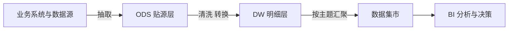
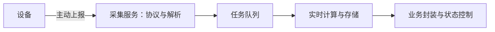

# 数据采集技术全景：从 ETL 到设备主动上报

同样叫「数据采集」，在不同场合指的东西并不一样：BI 项目里说的是 ETL，数据团队嘴里说的是日志抓取，物联网语境里说的是设备上报。冷链监控平台属于最后一种，但另外两种的思路值得对照着看：它们决定了平台为什么不做定时抽数，为什么把通信封装成独立服务，为什么报文要自定义协议。开篇这一课把全景铺开，后面再进 Netty。

## 先给结论

- ETL 是把业务系统数据经抽取、清洗、转换后加载到数据仓库的过程，BI 项目至少三分之一的时间花在它上面，设计好坏直接关系项目成败。
- 大数据采集有三条主流路线：系统日志用 Flume、ELK 这类方案，网络数据靠 Apache Nutch、Scrapy 等爬虫工具，数据库采集对接 MySQL、Oracle 等关系型数据库。
- 传统 ETL 是采集方主动「拉」，物联网采集是设备主动「推」，这一个方向之差决定了架构形态完全不同。
- 冷链监控平台把采集与底层通信封装成独立系统 cold-netty：收设备报文、解析、扔进 Kafka 队列，实时计算框架监听队列消费，既解耦又削峰。
- 设备与平台之间必须约定报文协议，平台的 SHT 报文用竖线分隔字段，一条报文携带设备编号与温湿度读数。

## ETL：把零乱的数据变成决策依据

ETL 指通过程序或工具，将业务系统的数据经过抽取、清洗、转换之后，加载到数据仓库的过程；目的地也可能是另一个关系型数据库或其他存储。它的核心诉求是把企业里分散、零乱、标准不统一的数据整合到一起，为经营决策提供分析依据。作为 BI 项目的重要环节，ETL 通常要吃掉整个项目至少三分之一的时间，它的设计好坏直接关系到项目成败。

整体流程分三步：数据抽取、清洗与转换、加载存储到目的地。落到工具选型，常见的是三条路：开源工具如 Kettle、DataX；企业级商用产品如 IBM 的 DataStage，功能全但偏重；以及按业务逻辑自研的 Java 程序，定制性强、开发复杂度不高，缺点是换一个场景就得再写一遍，通用性差。



图里同时画出了数仓分层的影子。ODS 是贴源层，原始数据抽进来原样落地，与源数据一模一样；DW 层做关联与指标计算，沉淀明细；再往上按主题汇聚成数据集市，用户相关的归用户集市，风险相关的归风险集市。

**增量抽取是第一道坎。** 每次都全量抽数，数据量随时间膨胀，成本很快就不可接受。增量抽取靠标识判断哪些是新数据，最常用的办法是利用业务系统的时间戳字段：上次抽到几点，这次就只抽晚于它的记录。这就要求设计业务系统时预留增量时间戳字段，属于建表阶段就要想清楚的潜在需求。

**清洗处理三类脏数据。** 不完整的数据只能由业务系统补全；错误的数据同样靠业务系统修复，无论是写修复语句还是改流程；重复的数据以业务系统去重为主，抽取过程中剔除为辅。重复数据不能全指望抽取侧兜底，源头是重复的，说明业务系统里很多数据本身就不准确，这类问题在抽取环节修不完。

**转换规则要统一设计。** 转换阶段要提前从业务层面定义好规则，包括不一致数据的转换、数据粒度的转换，以及商务规则转换，把「原来的数据长什么样、要变成什么样」约定清楚，编码映射、可配置转换都按这套规则落地。

## 大数据时代的三条采集路线

规模上来之后，ETL 工具不再是唯一选项。**系统日志采集**面对几百上千台机器产生的大量日志，常用 Flume 或 ELK 一类开源方案做统一收集；**网络数据采集**面向公开网站的内容，靠 Apache Nutch、Scrapy 等爬虫工具抓取，抓回来再入库或进大数据平台；**数据库采集**对接 MySQL、Oracle 等关系型数据库，前面提到的各类 ETL 工具大多以此为强项。三条路线解决的是不同源头的问题，但都强调一点：采集是独立环节，与计算、存储分开。

## 物联网采集：从拉到推

5G 与物联网的蓬勃发展让联网设备的数量空前增长，数据量随之高涨。这个场景与前面所有采集方式有一个方向上的根本差异：ETL 与大数据采集是采集方主动从对方拿数据，物联网采集是设备主动把数据提交给后台网关或采集服务，服务端收完做归类、存储与转发。

架构设计上，实时监控与数据采集这类通信系统通常把数据采集与底层逻辑单元的通信功能封装成独立系统，统一负责数据的收发、通信流程的控制与底层协议的整合。拆开看它的职责分层：对外是外部系统接口，约定通信协议与通信方式；往下是通信实现类与通信协议类，管连接与字节流；收到数据后解析入任务队列；采集调度控制类协调任务，采集业务类与业务状态机类封装具体业务对象、控制数据的状态转换。



这张图就是物联网采集系统的通用骨架，冷链监控平台的数据采集服务按它落地。

## 落到冷链监控平台

平台的选型与上面完全对应：设备通过 TCP 连接把 SHT 报文发给采集服务 cold-netty，报文样例为：

```text
SHT|HE00120931|29|76|1|null|null|20190802125717|SH5lb1.2.1R
```

协议头 SHT 之外，竖线依次分隔设备编号、温度、湿度、状态、经度、纬度、采集时间与固件版本。设备侧的模拟任务由 Quartz 驱动，每台设备按自己的节奏发。服务器端的处理核心在 ServerHandler：

```java
public class ServerHandler extends ChannelInboundHandlerAdapter {

    public final static String MSG_TOPIC = "device_msg_topic";

    @Override
    public void channelRead(ChannelHandlerContext ctx, Object msg) {
        ByteBuf in = (ByteBuf) msg;
        try {
            //接收报文，ByteBuf 转字符串
            byte[] req = new byte[in.readableBytes()];
            in.readBytes(req);
            String body = new String(req, "UTF-8");

            //解析报文，封装成消息实体
            MessageEntity message = this.parseMessage(body);
            String jsonString = JSON.toJSONString(message);

            //发送至 Kafka 队列
            KafkaSender sender = (KafkaSender) SpringContextUtils.getBean("kafkaSender");
            sender.send(MSG_TOPIC, jsonString);

            //向硬件回送应答
            String responseText = "SHT|true|";
            ByteBuf buf = ctx.alloc().buffer();
            buf.writeBytes(responseText.getBytes());
            ctx.writeAndFlush(buf);
        } catch (Exception e) {
            logger.error(e.getMessage());
        } finally {
            //ByteBuf 用完主动释放，否则容易内存泄漏
            ReferenceCountUtil.release(msg);
        }
    }
}
```

收到报文先转字符串，按竖线拆字段封装成 MessageEntity，序列化为 JSON 发到 Kafka 的 `device_msg_topic`，再回送一条 `SHT|true|` 应答告诉设备已收到。Kafka 队列之后是实时计算框架 Flink 监听消费。设备侧与计算侧互不等待，这就是开头说的解耦；设备高峰期上报量陡增时，队列把洪峰挡在计算之前，这就是削峰。协议与业务也解开了：换一种设备、换一种报文，改的只是解析那几行，下游毫无感知。

## 常见误区

- **把物联网采集当 ETL 做。** 错例是写个定时任务轮询设备「拉」数据。正解是设备主动推，服务端常驻监听连接、即时解析转发，模型从定时批处理换成事件驱动。
- **报文不约定边界。** 错例是服务端把收到的字节流直接当一条完整报文解析。正解是协议必须规定边界，结束符、固定长度或长度头任选其一，否则 TCP 粘包拆包会把字段搅乱。
- **采集完直接写数据库。** 错例是解析完立刻 insert。正解是先入消息队列，数据库写入由下游按自己的节奏消费，高频小报文直插数据库迟早把连接池打满。
- **解析不做防御。** 错例是拿到字符串直接按固定下标取值转换数字。正解是先校验字段数量与格式，脏报文记日志丢弃，不能让一条坏数据把处理线程带崩。

## 面试可能被问到的问题

1. 面试官追问：「ETL 为什么会占 BI 项目三分之一的时间？」
   答：企业数据源分散、标准不一，抽取、清洗、转换的每一条规则都要与业务方反复确认，口径定错分析就全错。它是决定数据质量与项目成败的环节，工作量与风险都集中在这里。
2. 面试官追问：「增量抽取怎么做？」
   答：全量抽取随时间不可持续，增量抽取靠标识识别新数据，最常用时间戳字段：按上次抽取位点只取更新的记录。这要求业务系统建表时预留增量时间戳，也可以借助数据库日志等机制实现。
3. 面试官追问：「物联网数据采集与传统采集在架构上最大的差别是什么？」
   答：方向相反。传统采集是服务端主动拉，物联网是设备主动推，服务端要常驻监听、维护大量连接、按自定义协议解析报文，因此把采集与底层通信封装成独立系统，职责分层对接协议、任务队列与业务封装。
4. 面试官追问：「设备报文到达后平台做了什么？」
   答：Netty 把 ByteBuf 转成字符串，按竖线解析出设备编号与温湿度字段，封装成消息实体并序列化为 JSON，发送到 Kafka 的报文主题并回送应答；Flink 从队列消费做实时计算，设备侧与计算侧通过队列解耦、削峰。
5. 面试官追问：「为什么采集服务要独立部署？」
   答：协议解析与连接管理集中一处，报文变化只改采集服务；它按设备连接数独立扩容，故障也被隔离在通信层；业务服务通过队列取数据，完全不接触设备细节，整个数据链路职责清晰。

## 配套资料

- 代码：`materials/code/06/day3 数据采集服务/`，cold-netty 采集服务工程的 NettyServer、ServerHandler、MessageEntity、KafkaSender，模拟设备侧的 cold-jobs 工程，均为真实随包文件。
- 说明：引用路径截至 day 目录层级；包名与 groupId 已统一改写为 `com.study.coldchain`；`materials/docs/06/` 无讲义目录。
