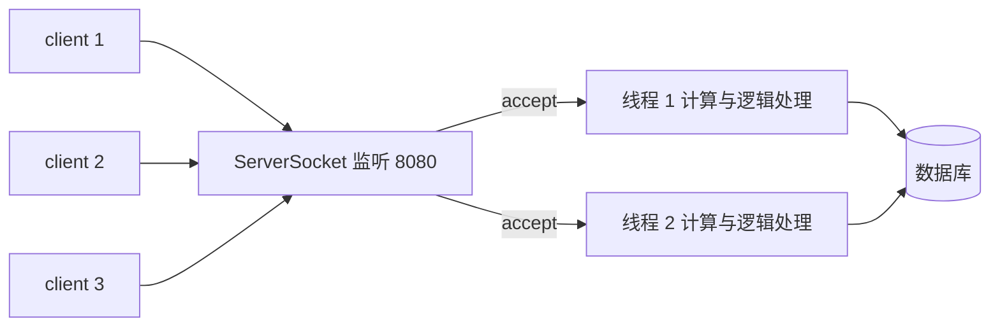
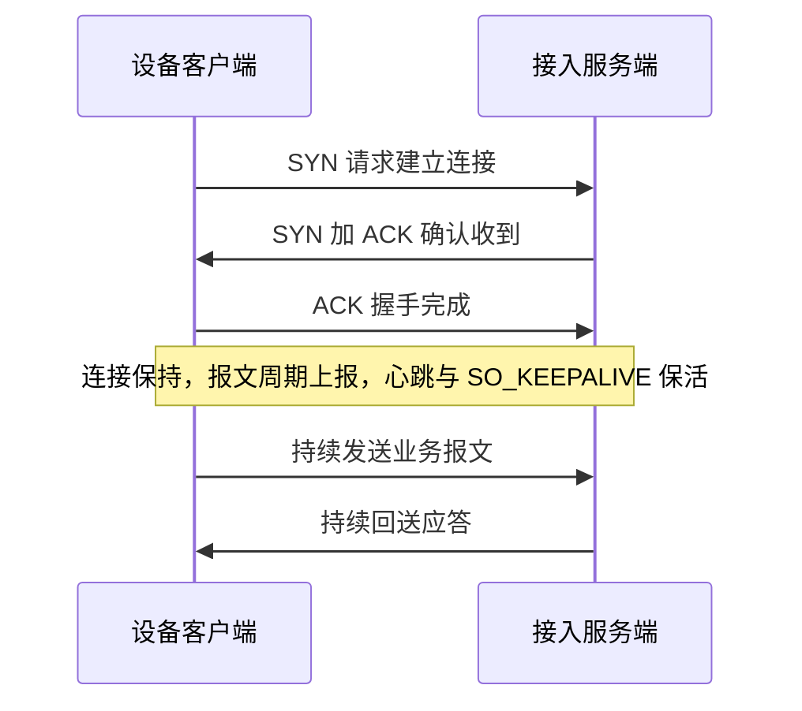

# 网络编程的底座：从 Socket 到 BIO

冷链监控平台的接入服务还没写一行代码，先要回答一个更底层的问题：设备与服务器隔着网络，数据到底是怎么进、怎么出的？这个问题不澄清，选型时就会人云亦云：有人说 BIO 简单够用，有人说 NIO 才是正道，还有人直接甩出 Netty。要判断这些说法，得先把 IO 的基本盘看清楚。

这堂课从 IO 方向的相对性讲起，走过传统 HTTP 服务器的接客流程与 TCP 连接的建立，最后停在 JDK 1.4 前后的分水岭：阻塞式 IO 的实现与它的天花板。看清 Netty 要接手的是个什么局面，后面它的每个设计才显得有的放矢。

## 先给结论

- IO 是 Input/Output 的缩写，方向取决于参照物：浏览器发出请求是 Output，收到网页是 Input，服务器视角正好相反。
- 服务端接入分两个阶段：读取数据与处理数据，两段吞吐都要跟上，客户端并发能力才提得起来。
- TCP 连接靠三次握手建立，设备接入走的是长连接，建一次连持续上报报文。
- JDK 1.4 之前的 BIO 是一连接一线程，连接一多线程就爆，线程池只能缓解，治不了根。
- JDK 1.4 的 NIO 引入选择器做中转，但原生 API 繁琐，还留着 Selector 空轮询打满 CPU 的老毛病。

## 一、IO 的方向是相对的

IO 在计算机里指 Input/Output，输入与输出。程序和运行时数据都驻留在内存中，CPU 执行程序时，凡是与内存之外交换数据的地方，磁盘、网络、外设，都要经过 IO 接口。

方向不是绝对的，取决于参照物。浏览器访问一个网站，它先把「我要首页 HTML」的请求发出去，对浏览器这是 Output；网站服务器把网页传回来，对浏览器这是 Input。同一份数据，服务器那边收进来叫 Input、发出去叫 Output，视角一换，方向跟着换。

也有只走单方向的情况。把磁盘文件读进内存，是 Input 操作；把内存数据写到磁盘文件，是 Output 操作，一来一回都齐的场景同样常见。讨论 IO 问题时，先确认自己站在哪一侧，后面分析服务端收发才不会绕晕。

## 二、传统服务器的接客流程：两个阶段

以传统 HTTP 服务器为例看服务端要做什么。服务器先创建一个 ServerSocket，把端口打开，比如 8080，然后调用 accept 方法等待请求，此时 8080 端口就能接收数据了。数据来自一个又一个客户端，浏览器就是最典型的 client。accept 到连接后，服务器新开一个线程，线程里做计算与逻辑处理，需要数据时去数据库取，结果最终返回给前台。画成图，这条接客路线是这样的：



关键路径是 client 到 ServerSocket、ServerSocket 经 accept 分流到线程、线程再到数据库。图上还要标一句注释：两个阶段，1 是读取数据，2 是处理。要提升客户端侧看到的并发能力，功夫全压在这两个阶段上：第一阶段决定 8080 端口能同时收下多少请求，第二阶段决定收下来的请求多快能算完。接收得快、处理得慢，请求照样在服务端积压。

## 三、连接怎么建、协议怎么约

accept 能拿到连接，前提是连接已经建好。客户端与服务端建立 TCP 连接要走三次握手：客户端发 SYN 发起请求，服务端回 SYN 加 ACK 表示收到并同意，客户端再回 ACK 确认，连接就此成立。服务端 Socket 的 bind、listen、accept 三步分别对应绑定端口、进入监听、受理连接，accept 每返回一个 Socket 就是一条独立连接。整条时间线如下：



设备接入用的正是这种建连方式，但与网页浏览不同：不是发完一次请求就断开，而是建一次连、长时间保持、报文周期性上报，这就是 TCP 长连接，保活靠心跳与 `SO_KEEPALIVE` 这类选项。

连接通了只是管道通了，管道里流什么还得双方约好，这就是协议。协议有协议的内容：报文要有 header 头部、要传输的数据，还有传输方法，GET、POST、PATCH、DELETE 各有语义。落到代码上，客户端把请求组装成 request 对象发过来，服务器解析后处理，再把结果组装成 response 返回。对服务端来说，这里的 IO 操作具体就是三件事：把收进来的字节解析成请求对象，做业务处理，把响应组装成字节发回去；至于线程用什么模式开、开多少，是下一层要解决的问题。

## 四、BIO：一连接一线程的代价

JDK 1.4 之前，JDK 提供的网络编程方式叫 BIO，Blocking IO，阻塞式 IO。它的处理方式朴素：一个请求进来，后台就创建一个线程专职伺候，读数据、算业务、写响应全在这一个线程里完成。随包示例工程里有一个最小实现，服务端与客户端各一个类：

```java
package com.study.coldchain.demo.io;

import java.io.InputStream;
import java.net.ServerSocket;
import java.net.Socket;

public class IOServer {
    public static void main(String[] args) throws Exception {
        // 服务端打开 10086 端口，等待客户端连接
        ServerSocket serverSocket = new ServerSocket(10086);

        while (true) {
            // accept 每返回一个 Socket，就是一条新连接
            final Socket socket = serverSocket.accept();

            // 一连接一线程：每条连接单独养一个后台线程
            new Thread() {
                @Override
                public void run() {
                    try {
                        byte[] data = new byte[1024];
                        InputStream inputStream = socket.getInputStream();
                        int len;
                        // read 是阻塞调用：没有数据时，这个线程就卡在这里
                        while ((len = inputStream.read(data)) != -1) {
                            System.out.println("线程名称:" + Thread.currentThread().getName()
                                    + " 内容:" + new String(data, 0, len));
                        }
                    } catch (Exception e) {
                        e.printStackTrace();
                    }
                }
            }.start();
        }
    }
}
```

客户端侧更直观，直接并发 100 条连接持续发数据：

```java
package com.study.coldchain.demo.io;

import java.net.Socket;

public class IOClient {
    public static void main(String[] args) {
        // 一口气发起 100 个连接
        for (int i = 0; i < 100; i++) {
            new IOClientThread().start();
        }
    }

    static class IOClientThread extends Thread {
        @Override
        public void run() {
            try {
                Socket socket = new Socket("localhost", 10086);
                while (true) {
                    socket.getOutputStream().write("IO test".getBytes());
                    socket.getOutputStream().flush();
                    Thread.sleep(1000);
                }
            } catch (Exception e) {
                e.printStackTrace();
            }
        }
    }
}
```

客户端 100 个连接、每秒才发一小条数据，服务端就得养 100 个线程，而且这 100 个线程绝大多数时间卡在 `inputStream.read()` 上干等。把数字放大：面向公众的网站客户端可能成千上万甚至几十万，服务端线程不可能涨到那么多。假设线程只有 1000 个而客户端有 10000 个，一对一处理之外，剩下 9000 个连接只能排队，阻塞就是这么来的。BIO 时代也出现过线程池的改良，让线程能复用，但没解决根本问题：连接不关，线程就不能真正回收。

## 五、NIO 的中转站与它的坑

JDK 1.4 之后出现了 New IO，NIO。它在应用与线程之间加了一个选择器 Selector，结构类似医院里的护士工作台：连接先在 Selector 上注册，线程空闲时由 Selector 指派下一个有数据的通道，不再一根筋地等某一条连接。数据不就绪，线程不死等，转头去服务别的通道，服务端从一连接一线程里被解放出来。

这一步方向是对的，但 JDK 原生 NIO 门槛不低：Selector、Channel、Buffer 一整套 API 没有封装，注册、轮询、读写、开线程全要自己拼装，开发量与出错率都不小。还有一个著名的坑：早期 JDK 的 Selector 在特定条件下会陷入空轮询，select 本该阻塞等待事件，却立即返回且没有任何事件，循环空转，CPU 直接飙到 100%。官方声称 JDK 1.6 已修复该问题，实际 1.7 上仍会出现，只是概率降低，没有根治。

要把 NIO 用好又不踩这些坑，就需要一个把轮询、线程、缓冲都封装到位的框架。Netty 正是冲着这个缺口来的。

## 常见误区

- **把 IO 的方向当绝对概念。** 错例是认定「读就是 Input、写就是 Output」。正解是方向取决于参照物，同一段数据从服务端看是 Input，从客户端看是 Output，讨论前先站对位置。
- **以为线程池能救活 BIO。** 错例是给一连接一线程套上线程池就当高并发方案。正解是长连接不释放、线程不回收，线程池迟早被占满，真正的出路是让少量线程同时盯着大量连接，也就是多路复用。
- **把连接和协议混为一谈。** 错例是认为三次握手完成就能直接传业务数据。正解是连接只是管道，报文格式、字段顺序、方法语义要靠双方约定的协议确定，设备接入里那条 SHT 开头、竖线分段的私有报文就是这样约定的。
- **认为空轮询问题已成历史。** 错例是只看官方修复声明。正解是后续 JDK 版本仍有低概率出现，自研 NIO 服务端要做空轮询检测兜底，选型则优先考虑已经处理过该问题的成熟框架。

## 面试可能被问到的问题

1. 面试官追问：「为什么说 Input 和 Output 是相对的？举个例子。」
   答：方向取决于参照物。浏览器把请求发给服务器，对浏览器是 Output，对服务器是 Input；网页传回时正好相反。磁盘读写同理，读进内存是 Input，写出磁盘是 Output，也有只有单向的场景。
2. 面试官追问：「传统服务器处理请求分哪两个阶段？提高并发要从哪里下手？」
   答：分读取数据与处理数据两个阶段。接收阶段决定端口能同时收下多少请求，处理阶段决定收下后多快算完，任何一段跟不上都会在服务端积压，所以两段吞吐要同时规划。
3. 面试官追问：「BIO 的问题是什么？加线程池能解决吗？」
   答：BIO 一连接一线程，并发大时线程数量随之膨胀，资源占用失控；连接建立后线程阻塞在 read 上，没数据也占着线程。线程池只能复用处理短期连接的线程，长连接场景下连接不释放、线程不回收，解决不了根本问题。
4. 面试官追问：「JDK 1.4 的 NIO 解决了什么，又留下了什么？」
   答：它用 Selector 把连接的就绪状态与线程执行解耦，一个线程可以管理多个通道，摆脱一连接一线程。留下两件事：Selector、Channel、Buffer 的原生 API 繁琐、没有封装，开发量大；以及 Selector 空轮询导致 CPU 100% 的问题，官方声明 1.6 修复，实际后续版本仍有低概率出现。
5. 面试官追问：「设备接入为什么用 TCP 长连接？」
   答：设备数量多、上报频繁，短连接每次报文都重走三次握手，开销大且对网络抖动敏感；长连接建一次连持续上报，配心跳与 SO_KEEPALIVE 保活，服务端还能主动下发指令，代价是要自己管理连接生命周期，这正是接入框架要解决的问题。

## 配套资料

- 代码：`materials/code/06/day3 数据采集服务/`，随包示例工程含 BIO 版服务端 `IOServer` 与客户端 `IOClient`（accept 后一连接一线程，客户端并发 100 连接持续发送），同一示例工程还有 NIO 与 Netty 版本的对照实现，设备接入的工程化落地在 `cold-netty` 工程。
- 说明：引用路径截至 `materials/code/06/` 的 day 目录层级，示例工程内包名统一改写为 `com.study.coldchain`；服务端示例按随包代码整理，读取长度一处修正为可运行写法；三次握手、bind/listen/accept 与长连接保活为按主流网络编程知识补写的衔接内容。
