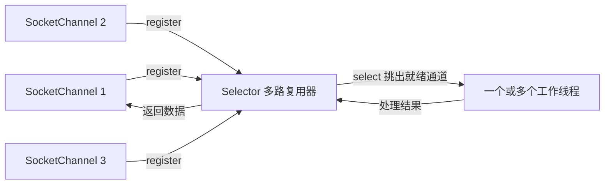

# 从阻塞到多路复用：IO 模型如何决定收发数据的效率

接入服务上线初期一切正常，设备涨到几千台后，线程数跟着连接数线性上涨，内存与 CPU 双双告警。这几乎是 IO 模型没选对的标准症状。设备连接是长连接，建连之后大部分时间没有数据流动，把线程绑死在一条连接上，浪费是必然的。这堂课把阻塞模型与多路复用模型放到一起对比，顺带说清 NIO 三大件在代码里的样子，以及 Netty 为什么独宠多路复用。

## 先给结论

- Netty 的高性能来自两方面：IO 模型决定如何收发数据，线程处理模型决定如何处理数据。
- BIO 三宗罪：每个请求独占线程、并发大时线程暴涨、连接建立后没数据也阻塞在 read 上。
- 多路复用用 Selector 做中转：通道注册、统一监听、按事件响应，少量线程服务海量连接。
- NIO 的数据形态从流变成 Channel 与 Buffer，读位置可以任意跳，不再受流式顺序约束。
- Netty 的 IO 线程 NioEventLoop 内部聚合了 Selector，这是它一个线程能管成百上千连接的根。

## 一、两个车轮：收发与处理分开看

Netty 作为事件驱动型网络编程框架，高性能并非来自单点优化。它把服务端工作拆成两个阶段，接收数据与处理数据，两个阶段各配一套设计：IO 模型回答数据如何收发，通道怎么注册、事件怎么感知、读写怎么不空等；线程处理模型回答数据如何处理，线程开几个、怎么分工、重活给谁。这两个车轮要分别拆解，先拆第一个。

## 二、阻塞模型：一千个病人配一千个医生

阻塞模型就是早期 BIO 的做法。每个客户端 socket 通过输入流读写数据，每个 socket 连接在后台创建一个线程，由这条线程完成数据读取、业务处理、数据写出的完整闭环。它的问题有三条：

- 每个请求都需要一个独立线程完成读、处理、写的全部操作，线程与请求一一绑定。
- 并发数较大时，需要创建大量线程来处理连接，系统资源占用急剧上升。
- 连接建立后，如果当前线程暂时没有数据可读，线程就阻塞在 read 操作上，线程资源被白白占用。

医院是个好类比。医院有十个医生，一天来一千个病人。阻塞模型的做法是一千个病人配一千个医生，医院当场崩盘。现实中医生不可能无限增加，服务端线程也一样，CPU 核数、内存、线程调度的开销都是天花板。所以 BIO 只是早期可用的模型，后来被复用模型取代。

## 三、多路复用：护士工作台登场

复用模型换了一种组织方式。每个客户端 socket 建立自己的 SocketChannel 通道，所有通道在 Selector 上注册；Selector 统一监听，选择响应哪个通道；后台创建一个或多个线程，线程处理完的数据经 Selector 返回给对应通道。Socket 与 Thread 之间多了一层中转机构，结构如下：



关键路径：通道注册进 Selector，Selector 把就绪事件交给线程，处理结果再经 Selector 回到通道。回到医院，这层中转就是护士工作台：病人把病历交到工作台，医生只处理叫到号的病人，看完把结果送回工作台，工作台再叫下一个病人。请求端与医生被隔离，中间环节被缓冲，后台服务的负载不再随连接数直线飙升，效率反而上去了。十个医生服务一千个病人，靠的不是医生多，而是调度。

## 四、Netty 从多路复用里拿到了什么

**第一，事件循环聚合了多路复用器。** Netty 的 IO 线程叫 NioEventLoop，它内部聚合了 Selector，因此能同时并发处理成百上千个客户端连接。线程从某个客户端 socket 通道读写数据时，如果没有数据可用，该线程就去执行其他任务，把非阻塞 IO 的空闲时间用在别的通道上。读写都是非阻塞的，IO 线程的运行效率被充分拉满，避免了频繁阻塞导致的线程挂起。一个 IO 线程并发处理 N 个客户端的连接与读写，从根本上取代了一连接一线程，架构的性能、弹性伸缩能力与可靠性同步抬升。

**第二，数据形态从流变成块。** 传统 IO 面向字节流或字符流，以流式方式顺序读取，读指针不能随意改变位置。NIO 引入 Channel 与 Buffer：数据从 Channel 读进 Buffer，或从 Buffer 写进 Channel。Buffer 的操作不受流式顺序约束，可以按位置任意读取。用蓄水池类比：水管往池子里放水，水泵从池子里抽水，两边节奏不必一致；若是直连水管，一边慢另一边就得干等。池子把上下游解耦，并发能力随之提高。

**第三，三大件在代码里各就各位。** 随包示例工程的 NIO 服务端把 Selector、Channel、Buffer 全用上了，可以对着跑：

```java
package com.study.coldchain.demo.nio;

// 以下省略 import：java.nio 与 java.net 相关类

public class NioServer {
    public static void main(String[] args) throws IOException {
        // 三大件之一：Selector，统一监听事件的选择器
        Selector selector = Selector.open();
        // 三大件之二：Channel，服务端通道绑定 10010 端口
        ServerSocketChannel ssc = ServerSocketChannel.open();
        ssc.socket().bind(new InetSocketAddress(10010));
        // 非阻塞模式：accept、read 不再死等
        ssc.configureBlocking(false);
        // 注册连接事件
        ssc.register(selector, SelectionKey.OP_ACCEPT);

        while (true) {
            int keys = selector.select(1000); // 最多等 1 秒，返回就绪事件数
            if (keys > 0) {
                for (SelectionKey key : selector.selectedKeys()) {
                    if (key.isAcceptable()) {
                        ServerSocketChannel channel = (ServerSocketChannel) key.channel();
                        SocketChannel socketChannel = channel.accept();
                        if (socketChannel == null) {
                            continue;
                        }
                        socketChannel.configureBlocking(false);
                        // 新连接注册读事件
                        socketChannel.register(selector, SelectionKey.OP_READ);
                    } else if (key.isReadable()) {
                        // 三大件之三：Buffer，数据落地的容器
                        ByteBuffer byteBuffer = ByteBuffer.allocate(1024);
                        SocketChannel socketChannel = (SocketChannel) key.channel();
                        socketChannel.read(byteBuffer);
                        String msg = new String(byteBuffer.array()).trim();
                        System.out.println("收到客户端信息：" + msg);
                        // 回写：wrap 直接包一个 Buffer 写回通道
                        ByteBuffer out = ByteBuffer.wrap(msg.getBytes());
                        socketChannel.write(out);
                    }
                }
                // 注意这里要移除键，否则同一事件会被重复处理
                selector.selectedKeys().clear();
            }
        }
    }
}
```

客户端一侧同样简洁，连接、非阻塞、注册事件三步走完：

```java
SocketChannel socketChannel = SocketChannel.open();
socketChannel.connect(new InetSocketAddress("127.0.0.1", 10010));
socketChannel.configureBlocking(false);
socketChannel.register(selector, SelectionKey.OP_CONNECT);
```

Channel 是数据的进出通道，Buffer 是数据容器，Selector 决定哪些通道的哪些事件被处理，三者协作就是一个最小可运行的多路复用服务端。

## 五、底层机制一句话，以及 Reactor 的名字

select、poll、epoll 这三个词常在面试里出现，一句话级别说清：它们都是操作系统提供的多路复用调用，select 与 poll 每次调用要把连接集合在用户态与内核态之间来回传递并线性扫描，连接多时开销大；epoll 在内核维护事件表，就绪事件回调通知，开销不随连接数线性增长，是 Linux 服务端的主流选择，JDK 的 Selector 在 Linux 上正由 epoll 支撑。

这种统一监听、按事件分发的模式有一个正式名字：Reactor 模式，也叫反应堆模式。多路复用是它的地基，事件分发是它的骨架，至于 Reactor 与处理线程怎么组合，单线程、多线程、主从多线程三种形态各有取舍，那是线程处理模型要回答的问题。

再往后 JDK 还提供过异步 IO 即 AIO：读写发起后由操作系统完成并回调通知，模型更简洁，但 Linux 上的实现成熟度与性能优势并不突出，服务端主流仍是多路复用这一路，Netty 的主力方向也在此。

## 常见误区

- **忘记移除已处理的 SelectionKey。** 错例是遍历完 `selectedKeys()` 不做清理，下一次 select 时同一事件被再次处理，数据错乱。正解是随包示例专门注释了「注意这里要移除键」，处理完调用 `selector.selectedKeys().clear()`。
- **把非阻塞理解成立刻有数据。** 错例是以为 `configureBlocking(false)` 之后 read 必然马上返回数据。正解是返回的语义变成「有多少读多少、未就绪立即返回」，数据何时就绪由操作系统决定，程序靠事件感知，而不是靠等待。
- **以为一个线程包揽所有业务。** 错例是把耗时的数据库操作、下游调用直接写进 IO 事件处理里。正解是 IO 线程只做收发与快速解析，重活移交业务线程池，这个边界正是线程处理模型要规划的内容。
- **把三大件的职责记混。** 正解一句话：Channel 管连接与双向传输，Buffer 管数据容器与读写位置，Selector 管在哪些 Channel 上发生了哪些事件。

## 面试可能被问到的问题

1. 面试官追问：「Netty 的高性能来自哪两个方面？」
   答：IO 模型与线程处理模型。前者决定数据如何收发，采用多路复用，NioEventLoop 聚合 Selector，一个 IO 线程可服务大量连接；后者决定数据如何处理，采用主从 Reactor 多线程分工，收发与处理各管一段。
2. 面试官追问：「BIO 有哪些问题？」
   答：每个请求独占线程完成读写与业务处理；并发大时线程数量与资源占用失控；连接建立后没有数据线程就阻塞在 read 上白白占用资源。设备长连接场景下连接常驻，线程池也救不回来。
3. 面试官追问：「多路复用模型的流程是什么？」
   答：每个客户端连接对应一个 SocketChannel，通道在 Selector 上注册，Selector 统一监听就绪事件，后台一个或多个线程只处理被选中的通道，处理结果经 Selector 返回对应通道。Socket 与线程之间多出中转层，负载不再随连接数线性增长。
4. 面试官追问：「select、poll、epoll 的区别用一句话概括？」
   答：都是多路复用系统调用。select 与 poll 每次携带连接集合并线性扫描，连接多时开销大；epoll 在内核维护事件表、就绪事件回调通知，海量连接下开销稳定，是 Linux 服务端主流。
5. 面试官追问：「NIO 三大件是什么？怎么协作？」
   答：Channel 负责连接与双向数据传输，Buffer 是数据读写容器、支持按位置访问，Selector 监听注册其上的 Channel 并挑出就绪事件。数据在 Channel 与 Buffer 之间搬运，事件由 Selector 分发给线程处理。
6. 面试官追问：「传统 IO 与 NIO 在数据形态上的差别？」
   答：传统 IO 面向字节流或字符流，顺序读取、指针不可回跳；NIO 以 Buffer 为容器，可按位置随机读写，配合 Channel 双向传输，缓存解耦了读写两端的节奏。

## 配套资料

- 代码：`materials/code/06/day3 数据采集服务/`，随包示例工程含 NIO 版 `NioServer` 与 `NioClient`，Selector、Channel、Buffer 三大件在服务端示例中完整可运行，客户端与服务端可对照调试。
- 说明：引用路径截至 `materials/code/06/` 的 day 目录层级，示例包名统一改写为 `com.study.coldchain`，服务端示例省略了退出清理与部分 import；select/poll/epoll 与 AIO 的对比为按主流知识补写的一句话级衔接，医院与蓄水池类比沿用本课讲法。
