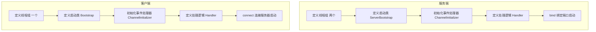

# Netty 程序开发五步：服务端与客户端只差四个配置

Netty 程序的写法看起来自由，骨架其实是固定的：服务端五个步骤，客户端五个步骤，步骤名字几乎一样，差别浓缩在一张对比表里。先把骨架和差异表记牢，后面读任何 Netty 代码，包括冷链监控平台采集服务的启动类，都能按图索骥；紧接着的示例课，就是把这张骨架填满的过程。

## 先给结论

- 服务端五步：定义线程组、定义启动类、初始化事件处理器、定义事件处理器的处理逻辑、绑定端口启动服务。
- 客户端五步：定义线程组、定义启动类、初始化事件处理器、定义事件处理器的处理逻辑、连接服务器启动客户端。
- 相同点：两边都用 EventLoopGroup 与 NioEventLoopGroup，都有 group、channel、handler（ChannelInitializer 方法）这一套配置。
- 四个不同点：EventLoopGroup 个数（客户端 1 个、服务端 2 个）、通道工厂类 NioSocketChannel 对 NioServerSocketChannel、启动类 Bootstrap 对 ServerBootstrap、收尾方法 connect 对 bind。
- 五步里真正要花心思写的只有第四步的处理逻辑，前两步与第五步基本是模板代码。

## 一、服务端五步

**第一步，定义线程组。** 也就是核心类一课提到的 NioEventLoopGroup，相当于线程池。服务端要两个：一个接收请求，一个处理具体工作。

**第二步，定义启动类。** 服务端用 ServerBootstrap，把线程组和后面所有配置都挂到它身上。

**第三步，初始化事件处理器。** 通过 ChannelInitializer 在通道初始化时把处理器装进 pipeline，这一步决定了「谁来处理数据」。

**第四步，定义事件处理器的处理逻辑。** 写 Handler 实现类，复写 channelRead 这类回调方法，这是业务真正的落脚点，也是开发量最大的一块。

**第五步，绑定端口启动服务。** 调 bind 绑定监听端口，服务端就启动起来了。

## 二、客户端五步

客户端流程与服务端几乎逐字相同：定义线程组，一个 NioEventLoopGroup 就够；定义启动类，换成 Bootstrap；初始化事件处理器，同样用 ChannelInitializer；定义处理逻辑，同样是写 Handler 实现；第五步从绑定端口换成连接服务器，也就是 connect 服务端的 IP 与端口，客户端随之启动。

两份步骤单摆在一起看，差异只出现在两头：中间三步是同一套动作，首尾两步各自换装。

## 三、一张对比表记牢差异

| 区别点 | 客户端 | 服务端 |
| --- | --- | --- |
| EventLoopGroup 个数 | 1 | 2 |
| 工厂类 | NioSocketChannel | NioServerSocketChannel |
| 启动类 | Bootstrap | ServerBootstrap |
| 绑定方法 | connect | bind |

为什么服务端要两个线程组而客户端只要一个？服务端一进一出要分工：一组线程守着端口收连接（accept），另一组线程处理收下连接的读写。客户端没有守端口这回事，它只发起连接、收发数据，一个线程组全包。启动类与工厂类的差异同源：服务端要的是监听通道 NioServerSocketChannel，客户端要的是连接通道 NioSocketChannel。

这两条流水线长这样：



关键路径：两条流水线步骤一一对应，只在首尾分叉，线程组一个对两个，bind 对 connect，中间三步完全同构。

## 四、代码骨架预览

按这五步搭出来的服务端骨架（真实示例工程代码，业务细节留到服务端示例一课展开）：

```java
// 步骤一：定义线程组，服务端两个
EventLoopGroup boss = new NioEventLoopGroup();
EventLoopGroup worker = new NioEventLoopGroup();
// 步骤二：定义启动类
ServerBootstrap bootstrap = new ServerBootstrap();
// 步骤三、四：初始化事件处理器并定义处理逻辑
bootstrap.group(boss, worker)
        .channel(NioServerSocketChannel.class)
        .childHandler(new ChannelInitializer<SocketChannel>() {
            @Override
            protected void initChannel(SocketChannel ch) throws Exception {
                ch.pipeline().addLast(new ServerHandler());
            }
        });
// 步骤五：绑定端口启动服务
ChannelFuture f = bootstrap.bind(port).sync();
f.channel().closeFuture().sync();
```

客户端骨架，五个步骤如何逐一换装一目了然：

```java
// 步骤一：客户端只要一个线程组
EventLoopGroup worker = new NioEventLoopGroup();
// 步骤二：启动类换成 Bootstrap
Bootstrap bootstrap = new Bootstrap();
// 步骤三、四：初始化事件处理器并定义处理逻辑
bootstrap.group(worker)
        .channel(NioSocketChannel.class)
        .option(ChannelOption.SO_KEEPALIVE, true)
        .handler(new ChannelInitializer<SocketChannel>() {
            @Override
            protected void initChannel(SocketChannel ch) throws Exception {
                ch.pipeline().addLast(new ClientHandler());
            }
        });
// 步骤五：connect 连接服务器
ChannelFuture f = bootstrap.connect(ip, port).sync();
```

两边对照着读，骨架的差异全部落在对比表的四行上：线程组个数、通道工厂类、启动类名、bind 与 connect。记住表，骨架就背下来了。

## 常见误区

- **给客户端配两个线程组。** 错例是把服务端模板原样复制，boss、worker 照写。正解是客户端一个 NioEventLoopGroup 足够，它不监听端口，没有接收与处理的分工。
- **bind 与 connect 用反。** 错例是客户端调 bind、服务端调 connect。正解是 bind 是服务端占住端口等连接上门，connect 是客户端主动去连服务端的 IP 加端口。
- **handler 配到错误的层级。** 错例是服务端把业务处理器加在 handler(...) 上而不是 childHandler(...) 上。正解是服务端用 childHandler 把处理器配到 accept 出来的每条新连接；客户端没有子通道概念，直接用 handler。
- **只背五步、忘掉收尾。** 错例是 bind 完方法直接返回，finally 里没人管线程组。正解是 try 里 bind 加 closeFuture 等待，finally 里对线程组调 shutdownGracefully，退出路径也要闭环。

## 面试可能被问到的问题

1. 面试官追问：「Netty 服务端开发分哪几步？」
   答：五步：定义线程组（NioEventLoopGroup）；定义启动类（ServerBootstrap）；初始化事件处理器（ChannelInitializer 里往 pipeline 注册 Handler）；定义事件处理器的处理逻辑；绑定端口启动服务，bind 加 sync 等待完成，finally 里优雅关闭线程组。
2. 面试官追问：「客户端和服务端开发的异同在哪里？」
   答：相同点是都用 EventLoopGroup 与 NioEventLoopGroup，都有 group、channel、handler 这套配置方法。不同点有四：EventLoopGroup 个数客户端 1 个、服务端 2 个；通道工厂类 NioSocketChannel 对 NioServerSocketChannel；启动类 Bootstrap 对 ServerBootstrap；收尾方法 connect 对 bind。
3. 面试官追问：「为什么客户端只要一个 EventLoopGroup？」
   答：服务端的两个线程组对应主从 Reactor 的分工，一组 accept 新连接、一组做 IO 读写；客户端只发起连接并收发数据，没有监听环节，一个线程组就覆盖全部工作，第二个纯属浪费。
4. 面试官追问：「ChannelInitializer 在开发步骤里处于什么位置？」
   答：它承载第三步初始化事件处理器。连接建立、通道初始化时 initChannel 被回调，把处理器装进该连接的 pipeline；第四步的处理逻辑则写在被注册的 Handler 实现类里，两者是注册与实现的关系。
5. 面试官追问：「bind 和 connect 的区别是什么？」
   答：bind 是服务端把 ServerBootstrap 绑定到本地监听端口，之后被动等待客户端连接；connect 是客户端主动向服务端 IP 与端口发起连接。一个面向监听通道 NioServerSocketChannel，一个面向连接通道 NioSocketChannel。
6. 面试官追问：「五步里哪一步是业务开发的重点？」
   答：第四步定义事件处理器的处理逻辑。线程组、启动类、绑定连接都是模板化的装配动作，真正决定系统行为的是 Handler 里的 channelRead 等回调，报文解析、业务分发、异常处理都落在这一步。

## 配套资料

- 代码：`materials/code/06/day3 数据采集服务/`，示例工程 nettydemo 的 `Server`、`Client` 与采集工程 `cold-netty` 的 `NettyServer` 均按这五步组织，真实可查。
- 说明：引用路径截至 `materials/code/06/` 的 day 目录层级，包名统一改写为 `com.study.coldchain`；五步清单与四行对比表按本课讲义整理，骨架代码为真实工程摘录并省略异常声明等次要语句。
