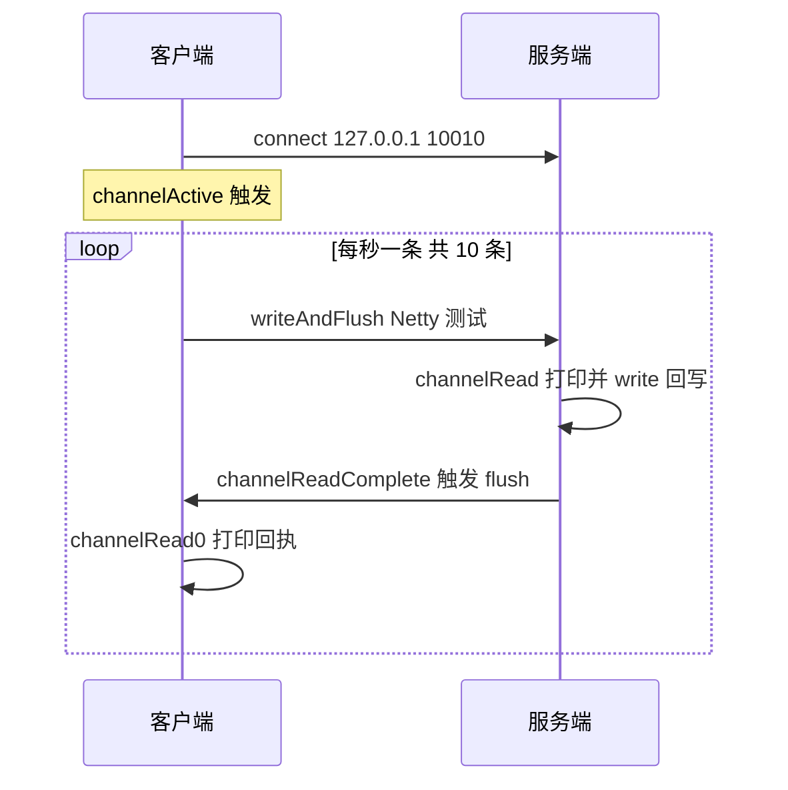

# Netty 客户端实战：channelActive 里发消息，与服务端联调跑通

服务端已经能监听 10010 端口了，缺一个往里发数据的客户端。客户端写法与服务端五步同构，差异只有四个配置；真正有嚼头的是联调环节，示例工程第一次跑就撞出一个经典报错：客户端一发消息，服务端的 channelRead 就抛异常，根因只是保留了一行 super 调用。这一节把客户端代码逐行讲完，再把联调踩的坑拆开。

## 先给结论

- 客户端五个步骤与服务端同构，差异在四处：一个 NioEventLoopGroup、启动类 Bootstrap、通道 NioSocketChannel、收尾 connect。
- 发送数据的时机是 channelActive 回调，连接一建立就触发，示例在里头每隔 1 秒发一条，连发 10 条。
- 客户端处理器继承 SimpleChannelInboundHandler<ByteBuf>，泛型声明消息类型，回调结束自动释放，不用手动管引用计数。
- 联调第一坑：处理器回调里不要调 super.channelRead，父类默认实现会把消息继续向链尾传播并释放，回头再读就抛引用计数异常。
- writeAndFlush 是发消息的常用组合，写出并立即刷新；服务端回写在 channelReadComplete 里统一 flush。

## 一、Client 启动类：connect 方法里的五步

```java
package com.study.coldchain.netty.demo.netty;

import io.netty.bootstrap.Bootstrap;
import io.netty.channel.ChannelFuture;
import io.netty.channel.ChannelInitializer;
import io.netty.channel.ChannelOption;
import io.netty.channel.EventLoopGroup;
import io.netty.channel.nio.NioEventLoopGroup;
import io.netty.channel.socket.SocketChannel;
import io.netty.channel.socket.nio.NioSocketChannel;

public class Client {
    public static void main(String[] args) throws Exception {
        new Client().connect("127.0.0.1", 10010);
    }

    public void connect(String ip, int port) throws Exception {
        //定义线程池，客户端只要一个
        EventLoopGroup worker = new NioEventLoopGroup();
        try {
            //定义启动类
            Bootstrap bootstrap = new Bootstrap();

            //设置启动类的属性
            bootstrap.group(worker)
                    .channel(NioSocketChannel.class)
                    .option(ChannelOption.SO_KEEPALIVE, true)
                    .handler(new ChannelInitializer<SocketChannel>() {

                        @Override
                        protected void initChannel(SocketChannel socketChannel) throws Exception {
                            socketChannel.pipeline().addLast(new ClientHandler());
                        }
                    });

            //启动客户端，连接服务器
            ChannelFuture f = bootstrap.connect(ip, port).sync();
            f.channel().closeFuture();
        } finally {
        }
    }
}
```

**参数与入口。** 客户端要的是服务端的地址，ip 与 port 交给 connect 方法的参数。main 里 `new Client().connect("127.0.0.1", 10010)`，连的是本机刚启动的服务端。

**一个线程组。** 客户端不监听端口，只发起连接、收发数据，一个 NioEventLoopGroup 就够，习惯命名为 worker。这就是对比表第一行的由来。

**启动类的坑。** IDE 自动补全 Bootstrap 时很容易引到别的包里同名的类，import 一错，group、channel 这些方法全点不出来。认准 io.netty.bootstrap.Bootstrap；同理通道类型是 NioSocketChannel，与服务端的 NioServerSocketChannel 只差两个词，一个表示发起连接的通道，一个表示监听通道。另外 `option(ChannelOption.SO_KEEPALIVE, true)` 保持长连接，客户端这头也配上。

**收尾方法。** `connect(ip, port).sync()` 连接服务器，sync 等到连接真正建立。随包示例的 finally 是空的，closeFuture 也没接 sync，这是为了把注意力集中在收发链路上；正式代码建议补成 `closeFuture().sync()`，并在 finally 里加 `worker.shutdownGracefully()`，与服务端同款收尾。

## 二、ClientHandler：发消息与收回执

```java
package com.study.coldchain.netty.demo.netty;

import io.netty.buffer.ByteBuf;
import io.netty.buffer.Unpooled;
import io.netty.channel.ChannelHandlerContext;
import io.netty.channel.SimpleChannelInboundHandler;
import io.netty.util.CharsetUtil;

public class ClientHandler extends SimpleChannelInboundHandler<ByteBuf> {
    @Override
    public void channelActive(ChannelHandlerContext ctx) throws Exception {
        for (int i = 0; i < 10; i++) {
            try {
                Thread.sleep(1000);
            } catch (Exception e) {
                e.printStackTrace();
            }
            ctx.writeAndFlush(Unpooled.copiedBuffer("Netty 测试", CharsetUtil.UTF_8));
        }
    }

    @Override
    protected void channelRead0(ChannelHandlerContext ctx, ByteBuf msg) throws Exception {
        System.out.print("客户端：" + msg.toString(CharsetUtil.UTF_8));
    }

    @Override
    public void exceptionCaught(ChannelHandlerContext ctx, Throwable cause) throws Exception {
        cause.printStackTrace();
        ctx.close();
    }
}
```

**channelActive。** 连接建立成功、可以开始通信的瞬间触发一次，是客户端发首条消息的标准位置。示例在这里循环 10 次，每次睡 1 秒再发一条「Netty 测试」：`Unpooled.copiedBuffer` 把字符串按 UTF-8 拷进 ByteBuf，`ctx.writeAndFlush` 写出并立即刷新。发送放在 channelActive 而不是 main 里，是因为连接没就绪就写数据不可靠，就绪这件事由 Netty 用回调告诉你。

**channelRead0。** 服务端有数据回来时触发。父类是 SimpleChannelInboundHandler<ByteBuf>，泛型直接声明消息类型，Netty 会按类型自动分发，回调结束后自动释放这块 ByteBuf，业务代码只管读内容。这正是它与服务端用的 ChannelInboundHandlerAdapter 的主要差别：后者不自动释放，msg 的去向要自己掌控，服务端要把数据回写出去，所以选它。

**exceptionCaught。** 打印异常堆栈并关闭连接，客户端掉线、服务端拒绝时能第一时间看到原因。

## 三、联调：先服务端后客户端，以及那个必踩的坑

启动顺序：先运行 Server 的 main，端口监听起来；再运行 Client 的 main。预期现象是客户端每秒发一条，服务端每秒打印一条「服务端接收：Netty 测试」，同时把数据回写，客户端打印出服务端回的内容。

第一次运行却报错了，错误落在服务端的 ServerHandler.channelRead 上。原因是最初的代码在方法开头保留了一行 `super.channelRead(ctx, msg);`。ChannelInboundHandlerAdapter 的默认实现不是空操作，它会把消息继续向 pipeline 后面传播，消息走到链尾就被释放掉了；等代码回到自己这里再读 buf，引用计数已经归零，抛出引用计数异常，效果就是数据被「提前消费」了一遍、自己反而读不到。修法是把这一行注释掉：处理器自己拿到的 msg 自己处理，不再手动上交。

修完重启，链路跑通：服务端连打 10 条接收日志，客户端的 channelRead0 也收到服务端回写的 10 条回执，收发各十次。

这张时序图把联调全程串起来。



关键路径：消息由 channelActive 起头，服务端收到即回写，回写在读取完成时统一刷出，客户端用 channelRead0 接收；一次连接、十条消息、收发各十次，链路闭合。

## 四、两版处理器为什么要不一样

客户端与服务器端的处理器长得不一样，不是随意为之。客户端只读不写，用 SimpleChannelInboundHandler 最省心：泛型声明 ByteBuf，自动释放，代码最少。服务端要把收到的数据原样回写，msg 在 read 里还要再交给 write 用一次，用 ChannelInboundHandlerAdapter 才能自己掌控它的释放时机。选型口诀按场景记：只读用 Simple，要回写用 Adapter。

## 常见误区

- **复写回调时顺手保留 super。** 错例是 channelRead 开头写 super.channelRead(ctx, msg)，联调时服务端一收数据就抛引用计数异常。正解是删掉这行，父类默认实现会把消息向链尾传播并释放，随后再读必然出错。
- **import 错 Bootstrap。** 错例是自动补全引入了非 Netty 包的同名 Bootstrap，group、channel 等方法全部报红。正解是认准 io.netty.bootstrap.Bootstrap，方法报红先查 import。
- **在 SimpleChannelInboundHandler 里回写原 msg。** 错例是 channelRead0 里 ctx.write(msg)，回调结束 msg 已被自动释放，运行时报引用计数异常。正解是复制一份再发，或者换成 ChannelInboundHandlerAdapter 自己管理释放。
- **以为客户端也要 bind。** 错例是照服务端写 bind(port)。正解是客户端收尾用 connect 连服务端 IP 与端口，bind 是服务端占住端口的动作。

## 面试可能被问到的问题

1. 面试官追问：「channelActive 和 channelRead 有什么区别？」
   答：channelActive 在连接建立成功、通道就绪时触发一次，适合做首包发送、上线登记；channelRead 每次读到数据都触发。示例客户端在 channelActive 里发消息，正是利用连接一就绪就发送的特性。
2. 面试官追问：「SimpleChannelInboundHandler 与 ChannelInboundHandlerAdapter 怎么选？」
   答：SimpleChannelInboundHandler 通过泛型声明消息类型，回调结束后自动释放 msg，适合只读场景，比如客户端收回执；需要把原消息回写或继续往下传的场景用 ChannelInboundHandlerAdapter，自己掌控 msg 的释放时机，示例服务端回写就用的它。
3. 面试官追问：「writeAndFlush 与 write 的区别？」
   答：write 把数据放进发送缓冲区，flush 才触发真正写出；writeAndFlush 两步合一立即出网。客户端示例在 channelActive 里用 writeAndFlush 保证每条消息立刻发出；服务端则 write 攒着、读取完成时统一 flush，减少系统调用。
4. 面试官追问：「客户端为什么只要一个 EventLoopGroup？」
   答：服务端需要一组线程 accept 新连接、另一组处理已有连接的读写，对应主从 Reactor；客户端只发起连接并收发数据，没有监听环节，一个 NioEventLoopGroup 全部覆盖，第二个纯属浪费。
5. 面试官追问：「connect 之后为什么要 sync？」
   答：connect 返回 ChannelFuture，连接是异步完成的，sync 阻塞到连接建立为止，保证后续基于这条连接的操作不会在未就绪时执行；不 sync 拿到的是还没连上的 future，行为不可预期。
6. 面试官追问：「客户端发消息为什么要用 Unpooled.copiedBuffer？」
   答：ByteBuf 是接口，创建要走 Netty 的工具类。copiedBuffer 会把字符串按指定字符集拷贝成 ByteBuf，交给 writeAndFlush 发出；这样字节容器的分配、池化与引用计数都归 Netty 管理，不绕开框架的内存机制。

## 配套资料

- 代码：`materials/code/06/day3 数据采集服务/`，示例工程 nettydemo 的 `Client`、`ClientHandler` 为真实随包代码，正文逐行摘录；`Server`、`ServerHandler` 用于联调对照。
- 说明：引用路径截至 `materials/code/06/` 的 day 目录层级，包名统一改写为 `com.study.coldchain`；super 调用导致引用计数异常的因果解释在课程讲解基础上按 Netty 引用计数机制补全，finally 补优雅关闭为按本课写法的建议。
