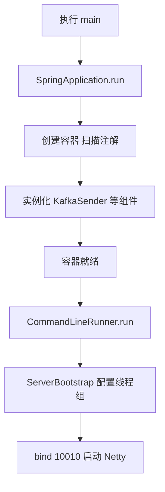

# 把 Netty 采集工程从 Maven 工程改造成 Spring Boot 服务

前面的采集服务跑在一个普通 Java 工程的 main 方法里，报文能收能解析，但它是「孤儿进程」：注册不进 Eureka，用不上 KafkaTemplate，组件注入更是无从谈起。改造的目标不是重写 Netty 代码，而是让它在 Spring Boot 的启动流程里被拉起，顺带接入注册中心与 Kafka 客户端。改造动作只有四步，但每一步都埋着容易踩的坑。

## 先给结论

- 改造四步：pom 认 parent 补依赖；加 `application.yml` 与多环境文件；主类加 `@SpringBootApplication` 与 `@EnableDiscoveryClient`；Netty 启动代码整体搬进 CommandLineRunner 的 run 方法。
- 主类不能保留有参构造函数，Netty 监听的端口直接写在 bind 处，不走构造参数。
- yml 的注释符号是 `#`，从 Java 文件拷代码时把双斜杠带进来会直接解析报错。
- 一个进程两个端口并存：8186 归 Spring Boot 内嵌容器，10010 归 Netty 的 bind，任何一个被占用都会启动失败。
- CommandLineRunner 在容器完全就绪后执行，Netty 在这里启动，此时发送组件等 bean 已经注入完毕。

## 为什么要改造

原工程是普通 Maven 工程，Netty 服务靠 main 方法手动拉起。接下来要把报文转发进 Kafka，要注册到 Eureka 做服务发现，这些能力全部建立在 Spring 容器之上。改造前后 Netty 的通信代码一行不变，变化的只是拉起时机与周边生态，这一点决定了改造是低风险的。

改造完成后，进程内部的启动顺序是这样的：



关键路径在最后两步：Netty 的 bind 被安排在容器就绪之后，Handler 运行时要用的组件此时已经存在，不会出现「报文来了组件还没好」的竞态。

## 第一步：pom 认 parent 补依赖

普通工程通常只有 `netty-all` 一个依赖。改成 Spring Boot 工程先在 pom 里认下 parent，再补上要用到的坐标（来自 cold-netty 工程的真实 pom，节选）：

```xml
<parent>
    <groupId>org.springframework.boot</groupId>
    <artifactId>spring-boot-starter-parent</artifactId>
    <version>2.1.8.RELEASE</version>
</parent>

<properties>
    <java.version>1.8</java.version>
    <spring-cloud.version>Greenwich.SR3</spring-cloud.version>
    <fastjson.version>1.2.47</fastjson.version>
</properties>

<dependencies>
    <dependency>
        <groupId>org.springframework.cloud</groupId>
        <artifactId>spring-cloud-starter-netflix-eureka-client</artifactId>
    </dependency>
    <dependency>
        <groupId>org.springframework.kafka</groupId>
        <artifactId>spring-kafka</artifactId>
    </dependency>
    <dependency>
        <groupId>io.netty</groupId>
        <artifactId>netty-all</artifactId>
        <version>4.1.10.Final</version>
    </dependency>
    <dependency>
        <groupId>com.alibaba</groupId>
        <artifactId>fastjson</artifactId>
        <version>${fastjson.version}</version>
    </dependency>
</dependencies>

<dependencyManagement>
    <dependencies>
        <dependency>
            <groupId>org.springframework.cloud</groupId>
            <artifactId>spring-cloud-dependencies</artifactId>
            <version>${spring-cloud.version}</version>
            <type>pom</type>
            <scope>import</scope>
        </dependency>
    </dependencies>
</dependencyManagement>
```

parent 认下来之后，Spring Boot 官方 starter 的版本号统一由它管理。Spring Cloud 各组件版本跨度大、互相有兼容要求，所以单独引入 `spring-cloud-dependencies` 做版本仲裁，eureka client 这种 starter 不用再写 version。Lombok 与 fastjson 的依赖保持原样，版本号从 properties 引用。

## 第二步：配置文件与多环境

resources 目录下新建 `application.yml`，它是 Spring Boot 启动时读取的属性文件：

```yaml
server:
  port: 8186

spring:
  application:
    name: cold-netty
  profiles:
    active: dev
```

`server.port` 是 Spring Boot 内嵌容器的端口，`spring.application.name` 是服务在注册中心的唯一标识，`profiles.active` 指定生效的环境文件。环境文件按 `application-环境名.yml` 命名：开发环境是 `application-dev.yml`，测试环境是 `application-test.yml`，生产环境是 `application-prod.yml`。要切换环境，只改 active 后面这一个词，不用进各个文件来回改属性，这是 profile 机制的全部意义。

环境文件里放注册中心与 Kafka 的连接信息（真实配置，域名做了占位处理）：

```yaml
eureka:
  client:
    service-url:
      defaultZone: http://eureka.example.com:8001/eureka

spring:
  kafka:
    bootstrap-servers: 172.17.0.143:9092
    listener:
      concurrency: 5
    producer:
      retries: 3
      batch-size: 10000
      buffer-memory: 33554432
      key-serializer: org.apache.kafka.common.serialization.StringSerializer
      value-serializer: org.apache.kafka.common.serialization.StringSerializer
```

一个高频报错来自注释符号：yml 的注释是 `#`，从 Java 代码里拷说明时把双斜杠带了进来，启动时 YAML 解析直接失败。改造成本最低的一步，往往翻车率最高。

## 第三步：改造启动类

原来的 Server 类带一个 `Server(int port)` 构造函数，main 里手动 new。改造后主类挂两个注解：`@SpringBootApplication` 声明这是 Spring Boot 应用入口，开启组件扫描与自动配置；`@EnableDiscoveryClient` 把服务注册到 Eureka。

注解背后是容器要反射实例化这个类，有参构造函数必须删掉。Netty 监听的 10010 是设备接入端口，与 Spring 容器无关，直接写在 bind 调用处，不依赖构造传参。

main 换成标准写法，Netty 启动代码整体搬进 CommandLineRunner 的 run（来自 cold-netty 工程的真实启动类）：

```java
@SpringBootApplication
@EnableDiscoveryClient
public class NettyServer implements CommandLineRunner {

    public static void main(String[] args) {
        SpringApplication.run(NettyServer.class, args);
    }

    @Override
    public void run(String... args) throws Exception {
        // 1. Netty 辅助启动类
        ServerBootstrap bootstrap = new ServerBootstrap();
        // 2. 两个线程组：boss 接连接，worker 干活
        EventLoopGroup boss = new NioEventLoopGroup();
        EventLoopGroup worker = new NioEventLoopGroup();

        // 3. 设置属性与处理器
        bootstrap.group(boss, worker);
        bootstrap.option(ChannelOption.SO_BACKLOG, 128);
        bootstrap.childOption(ChannelOption.SO_KEEPALIVE, true);
        bootstrap.channel(NioServerSocketChannel.class);
        bootstrap.childHandler(new ChannelInitializer<SocketChannel>() {
            @Override
            protected void initChannel(SocketChannel socketChannel) throws Exception {
                socketChannel.pipeline().addLast(new ServerHandler());
            }
        });

        try {
            // 4. 绑定 Netty 服务端口
            ChannelFuture f = bootstrap.bind(10010).sync();
            f.channel().closeFuture().sync();
        } finally {
            boss.shutdownGracefully();
            worker.shutdownGracefully();
        }
    }
}
```

CommandLineRunner 是 Spring Boot 留的启动钩子：容器就绪后，会依次执行所有实现它的 bean 的 run 方法。原来的 Netty 初始化代码从普通 run 方法原样搬进来即可，线程组、引导器、childHandler 的配置一行不改。`closeFuture().sync()` 会阻塞当前线程，让 Netty 的事件循环一直挂在进程里，服务常驻。

## 第四步：端口冲突与启动验证

第一次启动大概率撞上 bind 异常，日志里是 `Failed to bind ... port already in use` 一类的信息。最常见的原因是上一个版本的 Netty 程序还开着，10010 被旧进程占着；也可能是另一份演示代码没停。处理办法是找到占用进程结束它，或者换一个端口重试，改完再启动。

启动成功的标志是两类日志同时出现。一类是 Spring Boot 自己的启动完成行，另一类是 Eureka 注册记录，服务带着应用名、地址与端口注册上去：

```text
DiscoveryClient_COLD-NETTY/192.168.145.138:8186 - registration status: 204
NettyServer: Started NettyServer in 5.773 seconds (JVM running for 5.773)
```

通信验证用改造前的模拟客户端即可：连 10010 发一条报文，服务端照常打印报文内容与解析结果，说明 Netty 部分的行为没有因改造发生任何变化。排查问题时记得先分清端口：8186 是管理面，健康检查、管理端点走这里；10010 是数据面，设备报文走这里。客户端连错端口，日志再正常也收不到数据。

## 为什么先写 Java 工程再改造

按标准流程创建 Spring Boot 工程时，第一步就该写 `@SpringBootApplication` 和 main。这套课程反着走：先把 Netty 的通信核心在纯 Java 工程里跑通，再套 Spring Boot 的壳。好处是两件事被拆开了，Netty 的线程组、引导器、Handler 是通信核心，与 Spring 没有任何关系；Spring Boot 提供的是容器、注册中心与生态整合，两者边界清楚。排查问题时能迅速定位故障在哪一层，不会把 bind 失败当成容器问题来查。

## 常见误区

- **主类保留有参构造函数。** 错例是改造时把 `Server(int port)` 留着，容器实例化主类直接失败。正解是删掉构造参数，端口写死在 bind 处或挪进配置文件。
- **yml 里用双斜杠注释。** 错例是从 Java 文件拷代码带上 `//`，启动时 YAML 解析报错。正解是 yml 注释只用 `#`，拷贝后逐行检查。
- **只看容器端口就判定服务可用。** 错例是 8186 启动日志正常，Netty 的 bind 却因端口占用失败，客户端一直连不上。正解是确认 10010 的 bind 完成，并用客户端实测收发一次。
- **bind 失败反复重试。** 错例是不查原因直接重启，端口占用不会自己消失。正解是用 netstat 一类工具找到占用 10010 的进程，停掉旧服务再启动。

## 面试可能被问到的问题

1. 面试官追问：「Netty 服务为什么不用 main 启动，而要挂到 Spring Boot 里？」
   答：挂在 CommandLineRunner 里，Netty 启动前容器已就绪，Handler 里能取到发送组件等 bean；服务还能用上配置管理、注册发现与健康检查，进程的运维口径与项目里其他服务统一。
2. 面试官追问：「CommandLineRunner 和 @PostConstruct 有什么区别？」
   答：@PostConstruct 在 bean 自身初始化阶段执行，此时整个容器可能还没装配完；CommandLineRunner 在容器完全启动后执行，适合拉起依赖其他 bean 的长驻服务，Netty bind 放在这里更稳。
3. 面试官追问：「一个进程里 8186 和 10010 两个端口各管什么？」
   答：8186 是 Spring Boot 内嵌容器的管理端口，10010 是 Netty 绑定的设备接入端口，两者互不干扰；改造后的采集服务天然双端口并存，管理流量与设备流量分离。
4. 面试官追问：「改造过程中 Netty 的代码改动有多大？」
   答：核心代码原样搬进 run 方法，线程组、ServerBootstrap、childHandler 与端口绑定一行不改，变的只有触发时机，从手动 main 启动改为容器就绪后自动执行，风险因此可控。
5. 面试官追问：「多环境配置怎么组织比较好？」
   答：公共属性放主 `application.yml`，用 profiles.active 指向环境文件；环境差异分别放 application-dev、application-test、application-prod，切换环境只改一个词，避免手工改属性造成环境漂移。

## 配套资料

- 代码：`materials/code/06/day3 数据采集服务/`，cold-netty 工程的 NettyServer 启动类、pom.xml、`application.yml` 与 `application-dev.yml`，均为真实随包文件。
- 说明：引用路径截至 day 目录层级，内层目录不再展开；包名与 groupId 已统一改写为 `com.study.coldchain`，注册中心域名以 example.com 占位；`materials/docs/06/` 无讲义目录。
