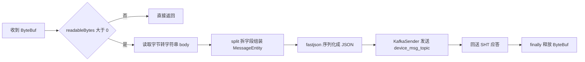
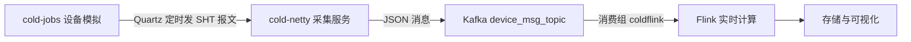

# 从字节流到 Kafka 消息：ServerHandler 的五步收口

> 🔒 安全提示：文中示例的口令/密钥均为课程教学环境演示口径，生产环境的安全要求见《安全与合规须知》。

上一课把 KafkaSender 与 SpringContextUtils 两个工具类备齐，往 Kafka 发消息的能力已经有了，但它还悬在半空：真正决定「一条报文怎么变成一条消息」的地方是 ServerHandler。这个类在 day3 早期只有一副骨架，channelRead 里把收到的数据原样打印再写回去，设备报文进来什么也不会发生。把它改造成完整的报文处理器，是 day3 收官前的最后一块拼图：接收、解析、序列化、转发、应答五步要在一次回调里全部做完，任何一步漏了异常处理或漏了释放资源，服务跑上一晚就会出问题。

## 先给结论

- channelRead 是唯一入口，五步推进：判空读取、parseMessage 拆字段组装 MessageEntity、fastjson 序列化、经 KafkaSender 发送到 `device_msg_topic`、回送 `SHT|true|` 应答。
- 报文要用 `split("\\|")` 拆分，竖线在正则里是元字符，不转义就拆错；数字字段用 `Integer.valueOf` 转换，内容非法直接抛 `NumberFormatException`。
- 采集时间不取报文里的值，以服务器接收时间兜底；经纬度在演示环境是 `null` 字符串也不影响解析。
- ByteBuf 的释放在 finally 里用 `ReferenceCountUtil.release(msg)` 完成，连接级异常由 `exceptionCaught` 统一关闭。
- 联调撞上两个真实报错：字段转数字失败、`application-dev.yml` 缺 Kafka 配置；补齐配置重启后，队列里取到 JSON 消息，day3 全链路就此收官。

## 五步流程长什么样

改造从把处理步骤写进注释开始，channelRead 里按这五行推进：

```java
//1. 接收数据
//2. 转化数据
//3. 解析数据
//4. 发送到 kafka 队列
//5. 向硬件返回应答字符串
```

转化与解析实际是一件事的两面：把 `SHT|...` 字符串变成 MessageEntity 对象，再把对象变成 JSON 字符串。整条路径画出来是这样：



这张图的关键路径在中间三步：字符串进、JSON 出，中途的对象只存在于方法栈里，不落库也不落盘，这正是采集服务「过路财神」的定位，存储与计算都不归它管。

## 第一步：把 ByteBuf 读成报文字符串

Netty 递给 channelRead 的 msg 是 ByteBuf，先做防御性判断再读：

```java
ByteBuf in = (ByteBuf) msg;
//接收报文，无可读字节直接返回
if (in.readableBytes() <= 0) {
    return;
}
byte[] req = new byte[in.readableBytes()];
in.readBytes(req);
String body = new String(req, "UTF-8");
logger.info("报文内容:{}", body);
```

`readableBytes` 表示还剩多少字节可读，小于等于 0 说明这次回调没有有效数据，直接返回避免空转。读出字节数组后按 UTF-8 转成字符串，一条 SHT 报文就完整摆在 body 里了。

## 第二三步：拆字段组装 MessageEntity

parseMessage 负责把竖线分割的字符串变成对象（来自 cold-netty 工程的真实代码）：

```java
/**
 * 解析报文，数据报文示例：
 * SHT|HE00120931|29|76|1|null|null|20190802125717|SH5lb1.2.1R
 */
private MessageEntity parseMessage(String body){
    String[] arrBody = body.split("\\|");
    logger.info("报文字段数量:{}", arrBody.length);

    MessageEntity msg = new MessageEntity();
    msg.setMetercode(arrBody[1]);              //设备编码
    msg.setTem(Integer.valueOf(arrBody[2]));   //温度
    msg.setHum(Integer.valueOf(arrBody[3]));   //湿度
    msg.setState(Integer.valueOf(arrBody[4])); //状态
    msg.setLon(arrBody[5]);                    //经度
    msg.setLat(arrBody[6]);                    //纬度

    //时间不取报文里的值，以服务器接收时间兜底
    java.text.DateFormat format_date = new java.text.SimpleDateFormat("yyyyMMddHHmmss");
    String sysdate = format_date.format(new Date());
    msg.setCurtime(sysdate);
    return msg;
}
```

三个细节值得停留。**第一，split 的参数是 `\\|`。** 竖线在正则表达式里是「或」的元字符，直接写 `split("|")` 会把字符串拆成一个个单字符，必须转义。**第二，数字字段严格转换。** 温度、湿度、状态用 `Integer.valueOf` 转 int，报文里任何一个字段不是合法数字，这里就抛 `NumberFormatException`，联调时真撞上过，后面细讲。**第三，时间字段有讲究。** 报文里虽然带了采集时间，工程代码没有采用，而是用服务器当前时间兜底：演示环境设备侧的时间与经纬度可能是 `null` 字符串，服务端时间统一可信，后续按时间窗口做统计也只认这一种时钟。

MessageEntity 是公共组件里的消息实体，与报文直接相关的就这七个字段：

```java
@Data
public class MessageEntity implements Serializable {
    private String metercode;   //设备编码
    private int tem;            //温度
    private int hum;            //湿度
    private int state;          //状态：1 在用，0 停用，2 异常
    private String lon;         //经度
    private String lat;         //纬度
    private String curtime;     //当前时间
    //maxtem/mintem/maxhum/minhum 为温湿度阈值，temalert/humalert 为预警标记
    //meterid/metername/hostid/houseid/companyid 等关联字段留待实时计算补齐
}
```

实体里预留了阈值与预警标记字段，此刻它们还是默认值；设备档案与阈值放在 Redis 里，由后续 Flink 程序消费时补齐。采集服务只把设备上报的原始七要素装进实体，职责边界就划在这里。

## 第四五步：转发队列与回送应答

解析出 JSON 之后，用工具类取出 KafkaSender 发送，然后按协议约定回送应答：

```java
//解析报文，封装成消息实体并序列化
MessageEntity message = this.parseMessage(body);
String jsonString = JSON.toJSONString(message);
logger.info("报文解析结果:{}", jsonString);

//发送至 kafka 队列
KafkaSender sender = (KafkaSender) SpringContextUtils.getBean("kafkaSender");
sender.send(MSG_TOPIC, jsonString);

//向硬件回送响应，格式由协议双方约定
String responseText = "SHT|true|\0";
ByteBuf buf = ctx.alloc().buffer();
if (responseText.length() > 0) {
    buf.writeBytes(responseText.getBytes());
    ctx.writeAndFlush(buf);
    if (null != buf) {
        buf.resetWriterIndex();
    }
}
```

主题常量 `MSG_TOPIC` 即 `device_msg_topic`，与后续消费侧监听的主题一致。应答 `SHT|true|` 末尾带一个 `\0` 结束符，设备收到 true 才确认这次上报被接收。`ctx.alloc().buffer()` 从当前上下文分配缓冲区，写入应答字节后 `writeAndFlush` 刷出去；`resetWriterIndex` 把写指针归位，配合 finally 里的释放动作，一条报文处理完内存不留尾巴。

## 异常与资源：两层兜底各管一段

```java
@Override
public void channelRead(ChannelHandlerContext ctx, Object msg) {
    ByteBuf in = (ByteBuf) msg;
    try {
        //……上述五步业务逻辑
    } catch (Exception e) {
        e.printStackTrace();
        logger.error(e.getMessage());
    } finally {
        //使用完 ByteBuf 之后主动释放，否则资源一直占用内存，容易造成内存泄漏
        ReferenceCountUtil.release(msg);
    }
    if (null != in) {
        in.resetWriterIndex();
    }
}

@Override
public void exceptionCaught(ChannelHandlerContext ctx, Throwable cause) {
    //关闭发生异常的连接
    ctx.close();
}
```

channelRead 里的 try catch 把单条报文的解析或发送异常拦下来，连接不断，设备可以继续上报下一条；exceptionCaught 管连接级异常，比如对端突然断开，直接 `ctx.close()` 释放通道。`ReferenceCountUtil.release` 放在 finally，正常与异常路径都执行，Netty 的堆外内存靠引用计数回收，漏一次就漏一块内存，持续漏下去就是 OOM。

## 半包与粘包：课程之外的一步

课程工程为了聚焦业务流程，pipeline 里没有放解码器，channelRead 读到的可能是一次完整报文，也可能只有半个。TCP 是流式协议，没有消息边界：一条 SHT 报文可能被拆成两次到达（半包），也可能几条粘连在一起（粘包）。生产上的主流做法是在业务 Handler 前加解码器，先把字节流切完整：

```java
//补充示例：按主流写法补全，课程工程未包含此段
//以换行符为界切分字节流，再把字符串递给业务处理器
ByteBuf delimiter = Unpooled.copiedBuffer("\n", CharsetUtil.UTF_8);
ch.pipeline().addLast(new DelimiterBasedFrameDecoder(4096, delimiter));
ch.pipeline().addLast(new StringDecoder(CharsetUtil.UTF_8));
ch.pipeline().addLast(new ServerHandler());
```

Netty 自带固定长度、分隔符、长度域三类解码器，报文两端约定好边界即可。加了这一层，channelRead 里的 msg 直接就是 String，判空与读字节那几行也随之简化。

## 联调验证：撞上的两个真报错

服务器端与模拟端先后启动（Kafka 等依赖跑在课程环境的虚拟机上，账号 root、密码 123456），第一次联调就报了错。

**第一枪打在解析上。** 日志抛 `NumberFormatException`，定位到字符串转 int 的那几行：模拟端构造的报文里某个字段内容不是合法数字，`Integer.valueOf` 一接手就炸。把报文内容修正后重启双端，「报文解析结果」打出了期望的 JSON，接收与解析两步通过。

**第二枪打在发送上。** 往 Kafka 发的时候抛异常，检查配置发现改造 Spring Boot 工程时，`application-dev.yml` 里只加了注册中心地址，Kafka 的配置压根没搬进来。把 `spring.kafka` 这一段补进 `application-dev.yml`：

```yaml
spring:
  kafka:
    bootstrap-servers: 172.17.0.143:9092
    producer:
      retries: 3
      batch-size: 10000
      buffer-memory: 33554432
      key-serializer: org.apache.kafka.common.serialization.StringSerializer
      value-serializer: org.apache.kafka.common.serialization.StringSerializer
    consumer:
      group-id: coldflink
```

bootstrap-servers 指向队列服务器，producer 段配重试与批量参数，consumer 段的 group-id 写成 `coldflink`，这个消费组名是给后续 Flink 程序预留的。配置补齐重启，再次联调一次通过：模拟端定时发报文，服务端日志依次打出报文内容与 JSON，Kafka 队列消费端取到了数据。

## day3 收官



到这里 day3 的采集服务完整落地：模拟端按 Quartz 的节奏构造随机报文发往 10010 端口；NettyServer 以 Spring Boot 服务的身份拉起并注册进注册中心；ServerHandler 收报文、拆字段、组装实体、序列化 JSON，经 KafkaSender 送进队列并回送应答，失败有日志可查，ByteBuf 有 finally 兜底，异常连接有 exceptionCaught 关闭。设备侧与消费侧通过队列彻底解耦，采集服务的全部职责到此完成。下一棒是 day4 的 Flink：先补实时计算的基础概念，再让程序从队列里把数据接走。

## 常见误区

- **用 `split("|")` 直接拆报文。** 错例是照抄字面竖线，结果每个字符都被拆开，下标取值全部错位。正解是 `split("\\|")` 转义，拆完先打印字段数量确认。
- **只在正常路径处理 ByteBuf。** 错例是解析发送都成功才走到释放代码，一旦中途抛异常，ByteBuf 就没人管。正解是 release 放进 finally，无论成败都执行。
- **应答格式随手写。** 错例是回个「ok」了事，真实设备按协议判断应答内容，收不到 `SHT|true|` 会按失败处理。正解是应答内容与结束符严格按双方约定输出。
- **认为一次 channelRead 就是一条完整报文。** 错例是不设防地把读到的字节直接解析，遇到半包或粘包就解析出脏数据。正解是接入解码器切包，或至少按报文格式校验后再解析。

## 面试可能被问到的问题

1. 面试官追问：「channelRead 里为什么先判断 readableBytes？」
   答：TCP 是流式协议，一次回调携带的字节数不受应用层控制，可能为空也可能是半条报文。readableBytes 小于等于 0 时直接返回，既避免空数组解析报错，也避免对残缺报文做无意义的解析。
2. 面试官追问：「ByteBuf 为什么必须在 finally 里释放？」
   答：Netty 的堆外内存靠引用计数管理，release 把计数减一，减到零才真正归还内存。业务处理中途抛异常时，若释放代码只在正常路径执行，这块内存就永久泄漏，积累到一定程度进程直接 OOM。
3. 面试官追问：「SHT 报文解析有哪些容易踩的坑？」
   答：一是分隔符转义，竖线是正则元字符必须写 `\\|`；二是数字字段转换，`Integer.valueOf` 遇到空串或非法内容抛 NumberFormatException，需要统一捕获并留痕；三是字段下标依赖协议版本，报文格式升级时要同步调整解析代码。
4. 面试官追问：「为什么解析时不用报文里的采集时间？」
   答：设备侧时钟不可控，演示环境的字段还可能是 null 字符串。以服务器接收时间兜底能保证同一时钟源，后续时间窗口统计口径统一；如果业务要求设备事件时间，需要设备对时并在解析层做校验。
5. 面试官追问：「TCP 粘包半包怎么解决？」
   答：应用层协议要么定长，要么带分隔符，要么带长度域。Netty 对应提供 FixedLengthFrameDecoder、DelimiterBasedFrameDecoder、LengthFieldBasedFrameDecoder 三类解码器，放在业务 Handler 之前先把字节流切成完整报文，业务代码拿到的一定是整条消息。

## 配套资料

- 代码：`materials/code/06/day3 数据采集服务/`，cold-netty 工程的 ServerHandler、MessageEntity、NettyServer 与 `application-dev.yml`，cold-jobs 工程的 DeviceSenderTask 与 DeviceClientFactory 模拟端，均为真实随包文件。
- 说明：引用路径截至 day 目录层级，内层目录不再展开；包名与 groupId 已统一改写为 `com.study.coldchain`；半包解码示例为按主流写法补全，非工程内文件；`materials/docs/06/` 无讲义目录。
