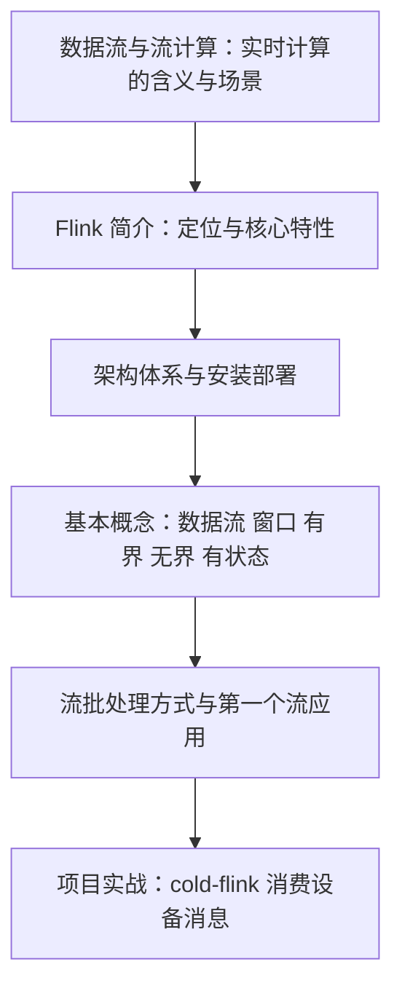

# day4 开篇：Flink 要接的这根接力棒是什么

> 🔒 安全提示：文中示例的口令/密钥均为课程教学环境演示口径，生产环境的安全要求见《安全与合规须知》。

day3 收官时，设备报文已经变成 JSON 消息躺在 Kafka 队列里。但队列只负责搬运，消息消费出去之后怎么算：五分钟内的平均温度、哪些设备超了阈值、要不要触发预警，这些全是实时计算的活。day4 整章用来打底，把 Apache Flink 这个实时流计算框架从概念、架构、安装一路讲到第一个可运行的流处理程序，为后续项目实战里消费 `device_msg_topic` 的实时计算任务铺路。开篇先把四个学习目标与技术点的映射摆清楚，后面每一课都能对号入座。

## 先给结论

- day4 的主线是 Apache Flink 入门：实时计算的含义与场景、Flink 架构体系与安装部署、基本概念、流处理方式与第一个应用。
- 实时流计算处理的是无界数据流：数据持续产生、没有头尾，冷链平台的设备报文、传感器的秒级读数都属于这一类。
- 基本概念里要盯住四个词：数据流、窗口、有界与无界、有状态，后面 day6 的阈值统计全部建立在这些语义上。
- 动手目标是跑通 flink-demo 工程的 SocketWordCount，看懂「数据源、转换、窗口聚合、输出」四段式结构，它就是项目实战实时计算任务的雏形。
- 衔接点已经埋好：采集服务 `application-dev.yml` 里的消费组 `coldflink`，就是留给 Flink 程序的。

## 一天的路线图



这张图是 day4 的行进路线：先立概念，再认框架，然后动手装环境、跑示例，最后指向项目实战。五段内容环环相扣，跳过任何一段，后面的实时计算任务都只能是照抄。

## 目标一：说清实时计算的含义与场景

实时计算的对立面是批处理：把数据攒成一批，隔一段时间跑一次，延迟以小时计。实时流计算则是数据一边产生一边处理，结果随数据滚动更新。PPT 里给数据流的类比很直观：像水管里的水流，一端持续进水，另一端看到的是连续不断的水流，没有开始也没有结束。

落到场景上，典型的流式数据都来自持续产生的源头：传感器的监测读数、客户端向 Web 应用生成的点击事件、电商交易请求、物联网设备的上报，产生间隔通常小于一秒。冷链监控平台的温湿度报文正是物联网上报这一类，设备每隔几秒发一条，平台要做的就是边收边算，这是 day4 选 Flink 的原因。

## 目标二：架构体系与安装部署

Flink 是主从架构的主节点与工作节点分工：JobManager 负责接收作业、调度任务、协调检查点，TaskManager 负责真正执行数据处理的算子。安装部署在课程环境的 Linux 虚拟机上完成（Kafka、Redis 等依赖同机运行，账号 root、密码 123456），standalone 模式的核心步骤如下（示例为按课程环境的部署写法补全）：

```bash
# 解压安装包到规划目录
tar -zxvf flink-1.8.0-bin-scala_2.11.tgz -C /opt/modules/
cd /opt/modules/flink-1.8.0

# conf/flink-conf.yaml 指定 JobManager 地址
jobmanager.rpc.address: 172.17.0.143

# conf/slaves 里填入 TaskManager 主机名，单机即本机
# 启动集群并确认进程
./bin/start-cluster.sh
# Web 控制台默认 8081 端口，可见 TaskManager 数量即部署成功
```

装完的验证标准不是命令不报错，而是打开 8081 端口的 Web 控制台能看到可用的 TaskManager，后续把 jar 提交上去跑才有着落。

## 目标三：把几个基本概念预习到位

day4 后半程的概念课提前立几个词。**数据流（DataStream）** 是程序里的统一抽象，无论数据来自 socket、Kafka 还是文件，进了 Flink 都是 DataStream。**窗口（Window）** 解决「无界流上怎么聚合」的问题：数据没有尽头，统计必须有边界，按时间或按条数切出一段来算。**有界流与无界流** 是数据的两种形态：有界流有头有尾，比如一份历史文件，适合批处理；无界流持续产生，适合流处理。**有状态（Stateful）** 指算子在处理过程中保存中间结果，比如当前窗口已经累计的计数，没有状态，跨条数据的统计无从谈起。

## 目标四：流处理方式与第一个应用

Flink 的处理方式分流处理与批处理两条线，day4 重点在流处理 DataStream API。动手目标是最经典的 SocketWordCount：从 socket 文本流实时统计单词数，每五秒滚一个窗口输出结果（来自 flink-demo 工程的真实代码，包名已改写）：

```java
public class SocketWordCount {
    public static void main(String[] args) throws Exception {
        //1. 设置执行环境
        final StreamExecutionEnvironment env = StreamExecutionEnvironment.getExecutionEnvironment();

        //2. 定义数据源：监听 socket 文本流
        DataStream<String> text = env.socketTextStream("172.17.0.143", 9000);

        //3. 业务逻辑：切词、按单词分组、5 秒滚动窗口聚合
        DataStream<WordWithCount> counts = text
            .flatMap(new FlatMapFunction<String, WordWithCount>() {
                @Override
                public void flatMap(String s, Collector<WordWithCount> collector) throws Exception {
                    for (String word : s.split("\\s")) {
                        collector.collect(new WordWithCount(word, 1L));
                    }
                }
            })
            .keyBy("word").timeWindow(Time.seconds(5))
            .reduce(new ReduceFunction<WordWithCount>() {
                @Override
                public WordWithCount reduce(WordWithCount t0, WordWithCount t1) throws Exception {
                    return new WordWithCount(t0.word, t0.count + t1.count);
                }
            });

        counts.print().setParallelism(1);

        //4. 执行程序
        env.execute();
    }
}
```

四段式结构就是 Flink 应用的通用骨架：环境、数据源、转换逻辑、启动执行。把 flatMap 换成 JSON 解析、把 socket 换成 Kafka 消费者、把 print 换成 MySQL Sink，它就变成冷链平台的实时计算任务，day6 的 cold-flink 工程正是这么长出来的，那时还会加上 `enableCheckpointing` 容错与 Redis 阈值合并。

## 常见误区

- **把 Flink 当成存储系统。** 错例是以为算完的结果自动存在 Flink 里。正解是 Flink 是计算引擎，状态只服务于计算过程，结果要靠 Sink 写到 MySQL、Kafka 或其他存储。
- **觉得概念课可以跳过，直接抄实战代码。** 错例是照着 cold-flink 抄一遍能跑就收工，窗口与时间的语义一知半解，阈值统计出了错位结果都查不出原因。正解是先把窗口、有界无界、有状态吃透再进实战。
- **安装只看命令不验证。** 错例是 start-cluster.sh 执行完就当部署成功。正解是确认 8081 控制台里 TaskManager 注册数量与预期一致，再提交第一个作业。
- **认为流处理是批处理的全面替代。** 错例是把所有数仓跑批也改成流。正解是有界数据用批处理吞吐更高、成本更低，流处理解决的是实时性问题，两者互补。

## 面试可能被问到的问题

1. 面试官追问：「实时计算和离线计算的核心区别是什么？」
   答：核心区别在数据形态与延迟要求。离线计算处理有界数据集，攒够一批再算，延迟可以到小时或天级；实时计算处理无界数据流，来一条处理一条，延迟以秒计，并且要长期 7×24 运行，容错是设计前提。
2. 面试官追问：「有界流和无界流分别对应什么处理模式？」
   答：有界流有明确的开始与结束，数据落定不再变化，适合批处理，用 DataSet API；无界流持续产生没有尽头，适合流处理，用 DataStream API，聚合必须借助窗口或增量计算。
3. 面试官追问：「流计算为什么必须是有状态的？」
   答：无界流上任何跨条数据的统计，比如窗口内计数、均值、阈值判断，都要在算子内存里保留中间结果，这就是状态。状态配合检查点机制还能在故障后恢复，否则重启后统计从头再来。
4. 面试官追问：「SocketWordCount 与项目里的实时计算任务是什么关系？」
   答：结构完全同构，都是环境、数据源、转换、执行四段式。项目里把数据源换成 FlinkKafkaConsumer 消费设备报文主题，转换逻辑里加 Redis 查询补齐设备档案与阈值，输出端换成 MySQL Sink 与 Kafka 生产者，骨架不变。

## 配套资料

- 代码：`materials/code/06/day4 Flink基础与流数据处理/`，flink-demo 工程的 SocketWordCount、StreamFromCollection、StreamFromKafka 与 `pom.xml`（Flink 1.8.0），均为真实随包文件；后续实战可对照 `materials/code/06/day6 实时计算 - 冷眼项目实战/` 的 cold-flink 工程。
- 说明：引用路径截至 day 目录层级，内层目录不再展开；包名与 groupId 已统一改写为 `com.study.coldchain`；安装部署命令为按课程环境写法补全的示例；`materials/docs/06/` 无讲义目录。
