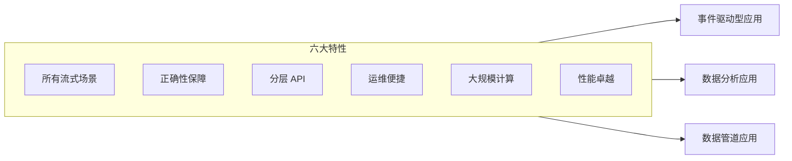

# Flink 应用场景：事件驱动、数据分析与数据管道三类落地

学计算框架最怕的状态是 API 背了一堆，却说不清它替业务做什么。Flink 对这个问题的回答很干脆：所有流式场景都支持，具体收拢成三类应用，事件驱动型、数据分析型和数据管道型（ETL）。把这三类的边界划清楚，再看冷链监控平台里温度告警、实时统计、报文入库这几件事，就能一一对号入座。

## 先给结论

- Flink 支持所有流式场景：事件驱动的应用、批处理分析、管道式 ETL 都在同一套运行时上完成，流与批合而为一。
- 正确性保障是三类场景共同的底座：状态执行 exactly-once（有且仅执行一次），按事件时间处理，并配有成熟的迟到数据处理机制，数据迟到结果依然正确。
- API 分层：最底层是 ProcessFunction 这类底层接口，中间 DataStream 与 DataSet 两套核心 API，再往上是 Table API 与 SQL，按需选层开发。
- 部署与规模不设障：可跑在 YARN、Mesos、Kubernetes 上，也支持裸机独立部署，启用高可用后没有单点失效；可扩展到数千核心，状态可达 TB 级。
- 冷链监控平台三类场景全占：温度超限告警是事件驱动，实时温湿度统计是数据分析，报文从 Kafka 抽取到入库是数据管道。

## 一、六大特性，是三类场景的底气

课程画面把 Flink 的能力画成六个模块：所有流式场景、正确性保障、分层 API、运维便捷、大规模计算、性能卓越。特性与场景是支撑关系：没有 exactly-once，风控告警不敢信；没有低延迟的内存计算，事件驱动就退化成事后分析；没有运维便捷，规模上不去。



这张图讲的是特性是因、场景是果，六个模块逐条说：

**所有流式场景。** 事件驱动应用、批处理分析、管道式 ETL 都支持，流与批统一在一套运行时里，批处理就是有界流。

**正确性保障。** 计算结果要正确，前提是状态的执行 exactly-once，有且仅执行一次。Flink 按事件时间处理数据，还配了成熟的迟到数据处理装置：数据晚到了，引擎能根据它携带的时间把以前的状态补足，结果依然正确。冷链场景里传感器网络抖动导致报文乱序迟到是常态，这一条直接决定告警可信度。

**分层 API。** 越往下越灵活：最底层是 ProcessFunction 这类底层 API，往上是 DataStream 与 DataSet 两套核心 API，DataStream 对应流处理，DataSet 对应批处理，再往上是 Table API 与 SQL。逻辑能用 SQL 表达就不必手写算子，需要精细控制时再下沉一层。

**运维便捷。** YARN、Mesos、Kubernetes 这些资源管理平台上都能部署，裸机集群独立部署也行，启用可用性保障后不存在单点失效。

**大规模计算。** 支持水平扩展与超大状态，数千台服务器、TB 级状态都在能力范围内。

**性能卓越。** 高吞吐、低延迟的内存计算模型，配合增量 checkpoint 机制，容错的开销被压得很低。

## 二、事件驱动型应用：数据一到立刻决策

事件驱动的含义是：平时只是监听，事件一发生立刻捕捉并响应。课程里列了五类典型代表。

**反欺诈。** 金融业务里判断欺诈用户或犯罪团伙，判断晚了钱已经划走，必须在转账操作发生的当下就识别出来。

**异常检测。** 几千台服务器持续产生日志，流计算实时盯住里面的异常行为。

**基于规则的报警。** 手机号命中黑名单就判定为危险用户，规则命中立即告警。

**业务流程监控。** 物流系统里各节点状态变化频繁，对每次状态变化实时监控。

**社交与电商的推荐营销。** 分析用户的点击行为判断兴趣，进而推荐不同的商品，做精准营销。

冷链监控平台的温度告警就是「基于规则的报警」的工程版：报文一进系统，立刻与 Redis 设备档案里的上下限比较，规则命中马上给出告警结论（按 cold-flink 工程的 MessageAggregate 真实代码整理）：

```java
// 温度阈值判断：报文读数与档案上下限比较，结论写入告警字段
if (value.getTem() > value.getMaxtem()) {
    value.setTemalert(1);      // 高温告警
} else if (value.getTem() < value.getMintem()) {
    value.setTemalert(-1);     // 低温告警
} else {
    value.setTemalert(0);      // 正常
}
```

告警字段一旦非零，下游写库与前台展示立刻可见，从报文进来到结论产生是毫秒级的距离。这件事若交给每天凌晨的批任务，冷库里的异常要第二天才被发现，事件驱动的价值就在这个时间差上。

## 三、数据分析型应用：边流入算出结论

数据分析型应用不直接触发动作，而是对流动的数据持续做统计分析，产出可观察的结果。典型场景有电信网络质量监控（实时判断网络质量好坏）、移动应用的产品更新与实验评估分析、消费者技术中的实时数据分析，以及大规模图分析。

冷链平台的实时统计属于这一类：设备报文持续流过，按公司与仓库维度持续聚合温湿度均值和超标次数，结果写进 MySQL 实时指标表，供大屏与查询服务读取。批报表回答「昨天怎么样」，流分析回答「此刻怎么样」，两者的时间视角完全不同。

## 四、数据管道型应用：持续运转的 ETL

管道可以理解成一根水管，作用是让数据持续流动，完成抽取、计算、存储这样一个 ETL 过程。传统 ETL 是批处理式的，按天或按小时跑一次；把批的间隔逐步做小、做到随时在算，就得到持续运转的 ETL。电商场景里还常用它做实时查询并构建搜索索引，新数据边进边进索引。

冷链平台的数据链路就是一根持续运转的管道：设备报文由采集服务写进 Kafka，Flink 作业从队列里抽取、解析，结合 Redis 档案加工，然后分成两路存储（按 cold-flink 工程的 StreamingJob 真实代码整理，包名与地址已改写）：

```java
// 结果两条出路：写 MySQL 供实时查询，回投 Kafka 供下游监听入库
out.addSink(new SinkToMySQL());
out.map((MessageEntity m) -> JSON.toJSONString(m))
   .addSink(new FlinkKafkaProducer<>("all_device_message",
           new SimpleStringSchema(), props));
```

一个作业同时扮演多种角色：对告警字段而言它是事件驱动，对两路输出而言它是数据管道，对持续聚合的指标而言它是数据分析。三类场景不是互斥的标签，而是同一份数据流上的三个观察角度。

## 常见误区

- **三类场景必须三选一。** 错例是把作业类型当成互斥分类。正解是同一份流可以同时承载多种角色，冷链平台的 Flink 作业既是事件驱动又是数据管道。
- **迟到数据只能丢弃。** 错例是乱序数据一来就当脏数据扔。正解是 Flink 有成熟的迟到数据处理机制，按事件时间归位、补足历史状态，迟到数据算出的结果依然正确。
- **ETL 等于一次性搬家工具。** 错例是只在系统迁移时才想起 ETL。正解是数据管道强调持续运转，业务数据只要还在产生，抽取、计算、存储的管道就不能停。
- **场景不够高大上就不用流计算。** 错例是觉得反欺诈、图分析离自己太远。正解是「数据流过就要及时处理」的需求都算，一条温度告警与一次金融风控在机制上没有区别。

## 面试可能被问到的问题

1. 面试官追问：「Flink 适合哪些应用场景？」
   答：三大类：事件驱动型应用（反欺诈、异常检测、规则报警、业务流程监控）、数据分析应用（网络质量监控、实时统计分析）、数据管道型应用（持续 ETL、实时构建搜索索引）。判断标准是数据是否需要边到达边处理。
2. 面试官追问：「事件驱动型和数据分析型的区别是什么？」
   答：事件驱动型直接对外决策，数据到达即触发业务动作；数据分析型是对数据做持续统计，产出指标或报表供人观察。前者强调响应速度，后者强调聚合口径。
3. 面试官追问：「Flink 怎么保证计算结果正确？」
   答：状态的执行 exactly-once，有且仅执行一次；按事件时间处理并配成熟的迟到数据处理机制，乱序迟到的数据也能补进正确的时间段，结果不受到达顺序影响。
4. 面试官追问：「持续 ETL 和传统 ETL 差在哪？」
   答：传统 ETL 是批处理，按固定周期跑，数据有等待窗口；持续 ETL 把批的间隔缩到极致变成流，数据一到就抽取、计算、存储，端到端延迟从小时级降到毫秒级。
5. 面试官追问：「你们项目里 Flink 算哪类应用？」
   答：监听 Kafka 的设备报文做温湿度阈值判断属于事件驱动；结果写 MySQL、回投 Kafka 构成数据管道；持续聚合出的实时指标供大屏查询属于数据分析，一个作业覆盖三类场景。
6. 面试官追问：「Flink 为什么能支撑大规模计算？」
   答：支持水平扩展，可扩展到数千核心，状态可达 TB 级；部署上覆盖 YARN、Mesos、Kubernetes 与独立集群，启用高可用后无单点失效；性能上靠内存计算模型与增量 checkpoint 保住吞吐。

## 配套资料

- 代码：`materials/code/06/day4 Flink基础与流数据处理/`，flink-demo 工程的 SocketWordCount、StreamFromKafka 等流处理示例；本课画面以特性与场景清单为主，无配套代码画面。
- 代码：`materials/code/06/day6 实时计算 - 冷眼项目实战/`，cold-flink 工程的 StreamingJob、MessageAggregate、SinkToMySQL 为真实代码（该目录名含项目代号，正文统一称冷链监控平台）。
- 说明：引用路径截至 day 目录层级；场景清单按课程 PPT 与主流资料整理；Java 包名统一改写为 `com.study.coldchain`。
