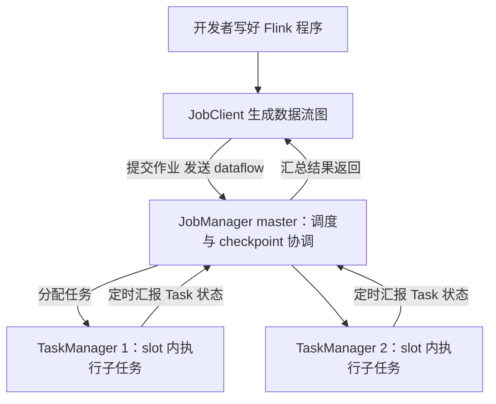
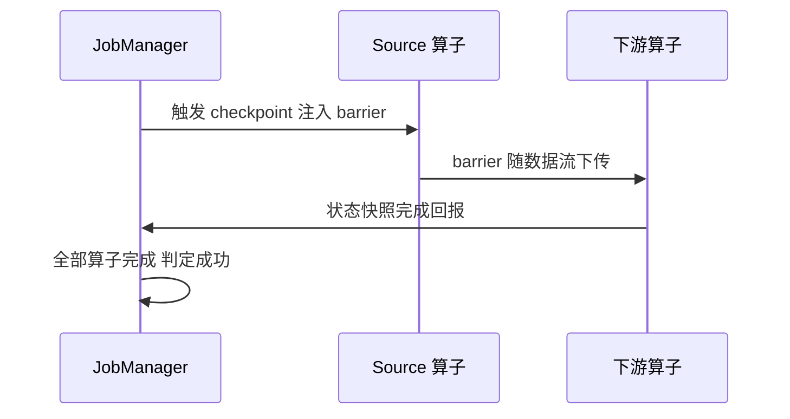

# Flink 架构原理：JobClient、JobManager 与 TaskManager 的分工

第一次把 Flink 作业提交到集群，最容易卡住人的不是代码，而是角色：作业交给谁、并行度落在哪、结果从哪看，日志报错时不知道该找哪个进程。Flink 运行时其实只有三个组件，把它们的分工与协作流程弄明白，提交、调度、汇报、出结果这一整条链就都通了。

## 先给结论

- Flink 运行时由三个组件组成：JobClient、JobManager、TaskManager。
- JobClient 是任务执行的起点，不属于集群内部进程：接收程序代码，创建数据流图提交给 JobManager，执行完把结果带回给用户。
- JobManager 是主进程（master）：安排任务、管理 checkpoint、故障恢复；高可用配置下多个 master 里只有一个是 leader，其余 standby。
- TaskManager 是工作节点：任务在 JVM 的线程里执行，并行度由任务槽（task slot）决定；slot 只隔离内存，不隔离 CPU。
- 流程一句话：程序经 JobClient 生成数据流图发给 JobManager，JobManager 分配给各 TaskManager 执行，TaskManager 定时汇报，JobManager 汇总后把结果返回 JobClient。

## 一、三个角色各管什么

**JobClient，执行的起点。** 它不是 Flink 程序执行的内部部分，而是任务执行的起点。JobClient 负责接收用户的程序代码，创建数据流，把数据流提交给 JobManager 进一步执行；执行完成后，JobClient 再把结果返回给用户。提交形态很自由：可以是后台的 Flink 可执行脚本（命令行提交），也可以是 Web 管理页面的提交入口。客户端内部还有 Optimizer / Graph Builder，会把程序优化并构建成有向无环图（dataflow graph）再发出去，作业层面支持 submit 与 cancel、update 等操作。

**JobManager，作业的大脑。** 主进程，也称为作业管理器，协调和管理程序的执行：安排任务、管理 checkpoint、故障恢复。集群至少要有一个 master，负责调度 task、协调 checkpoint 与容灾；高可用设置下可以有多个 master，但同一时刻要保证一个是 leader，其他 standby 待命。JobManager 内部有三个重要组件：Actor system、Scheduler、Checkpointing。

**TaskManager，干活的工人。** 从 JobManager 处接收需要部署的 Task，在 JVM 中的一个或多个线程里执行任务。每个 TaskManager 内部有四块结构：Task Slot（任务槽）、Memory & I/O Manager（内存与 IO 管理）、Network Manager（网络管理）、Actor System（通信体系）。

三者的协作关系先立起来一张分工图：



图里的两条反向线是关键：TaskManager 汇报状态、JobManager 汇总返回，协调者与执行者的闭环靠它们维持。

## 二、一次提交的完整旅程

把课程的两张原理图串成一条时间线：开发者把 Flink 程序开发完，用客户端方式提交。JobClient 把程序（dataflow 图）发给 JobManager，JobManager 回应提交成功。JobManager 随后把任务分配给不同的 worker（TaskManager），TaskManager 处理具体任务，定时向 JobManager 汇报执行情况；执行完把结果提交给 JobManager，JobManager 汇总后返回 JobClient，一次数据流处理的完整过程就此闭环。这套流程对部署位置不挑：独立集群、YARN、云服务器上都一样走。

## 三、任务槽：并行度的家

TaskManager 的并行能力由任务槽决定。每个任务槽代表一组固定资源，典型切法是均分内存：TaskManager 有 4 个 slot，每个 slot 分到 25% 的内存。两条规则要记住。

**slot 只对内存隔离，不对 CPU 隔离。** 一个 slot 一份固定内存配额，CPU 是大家共享的，所以 slot 数不等于 CPU 核数。

**同一作业的子任务默认共享 slot。** 只要来自同一个 job，不同算子的 subtask 可以挤进同一个 slot。共享带来更好的资源利用率：并行度低的算子不会白白占着整台机器的槽位。

工程代码里并行度是按算子设的，两条真实代码（前一条出自 flink-demo 的 SocketWordCount，后一条出自后续项目实战的流计算作业，包名已按约定改写）：

```java
// 算子级并行度：把打印 sink 固定为单并行度
wordWithCountDataStream.print().setParallelism(1);

// 项目实战里把 Kafka source 固定为单并行度，保证报文按到达顺序解析
DataStream<MessageEntity> stream = env.addSource(consumer)
        .setParallelism(1)
        .map(s -> JSON.parseObject(s, MessageEntity.class));
```

算子没显式设置时，落到集群配置的默认值 `parallelism.default`；作业实际需要的 slot 数由并行度最高的那段算子决定，超过集群 slot 总量作业就起不来，这是提交失败最常见的直接原因。

## 四、checkpoint 由谁协调（机制概览）

课程画面把「管理 checkpoint」写进 JobManager 的职责清单，具体机制按主流资料补一层：JobManager 触发 checkpoint 时向数据源注入 barrier（栅栏），barrier 随数据流一起往下游流动；算子收到 barrier 后把自身状态快照写出去并回报，全部算子完成，这一次 checkpoint 才算成功。故障恢复时，TaskManager 从最近一次快照重建状态继续计算。后续项目实战作业里每 5 秒一次的 checkpoint 配置，触发的正是这条链路。



## 常见误区

- **JobClient 是集群里的常驻进程。** 错例是把三个组件都当成集群角色去找。正解是 JobClient 是提交入口，不参与执行；集群内部只有 JobManager 与 TaskManager 两种角色。
- **slot 数等于 CPU 核数。** 错例是按核数配 slot。正解是 slot 只隔离内存不隔离 CPU，slot 数是内存资源的切分粒度。
- **不同作业共享 slot。** 错例是以为两个作业能挤进同一个 slot。正解是 slot 共享只发生在同一作业内部的不同算子子任务之间，作业之间靠 slot 总量隔离。
- **HA 就是多 master 同时干活。** 错例是以为多个 JobManager 在负载均衡。正解是同一时刻只有 leader 生效，其余 standby 待命，leader 失效 standby 才顶上。

## 面试可能被问到的问题

1. 面试官追问：「Flink 运行时由哪些组件组成？」
   答：JobClient、JobManager、TaskManager 三个组件。JobClient 是执行起点，接收代码、生成数据流图、提交并回传结果；JobManager 是主进程，调度任务、协调 checkpoint、故障恢复；TaskManager 是工作节点，以任务槽为单位执行子任务。
2. 面试官追问：「task slot 是什么，为什么默认允许共享？」
   答：slot 是 TaskManager 内一组固定资源的配额，主要切分内存；同一作业不同算子的子任务默认共享 slot，让并行度低的算子不浪费槽位，整体资源利用率更高。slot 只隔离内存，不隔离 CPU。
3. 面试官追问：「JobManager 挂了怎么办？」
   答：启用高可用后有多个 master，一个 leader 其余 standby；leader 失效后 standby 顶上，同时作业从最近一次 checkpoint 恢复状态继续计算。
4. 面试官追问：「作业提交之后内部发生了什么？」
   答：客户端把程序优化并构建成数据流图，提交给 JobManager；JobManager 按图把算子拆成并行子任务分配给 TaskManager；TaskManager 执行并定时汇报状态；JobManager 汇总后把结果返回 JobClient。
5. 面试官追问：「并行度怎么确定？」
   答：优先取算子级的 setParallelism，没设置时用集群配置 parallelism.default；作业需要的 slot 数由并行度最高的算子段决定，不能超过集群 slot 总量。
6. 面试官追问：「checkpoint 由谁协调？」
   答：JobManager 触发并协调：向 source 注入 barrier，barrier 随流下传，各算子把状态快照写出并回报，全部完成才判定成功；失败恢复时从最近快照重建状态。

## 配套资料

- 代码：`materials/code/06/day4 Flink基础与流数据处理/`，flink-demo 工程的 SocketWordCount，`print().setParallelism(1)` 出自该文件。
- 代码：`materials/code/06/day6 实时计算 - 冷眼项目实战/`，cold-flink 工程的 StreamingJob，Kafka source 单并行度与 `enableCheckpointing(5000)` 出自该文件（该目录名含项目代号，正文统一称冷链监控平台）。
- 说明：引用路径截至 day 目录层级；三组件职责与 slot 机制按课程 PPT 画面整理；barrier 机制为按主流资料补充；包名统一改写为 `com.study.coldchain`。
