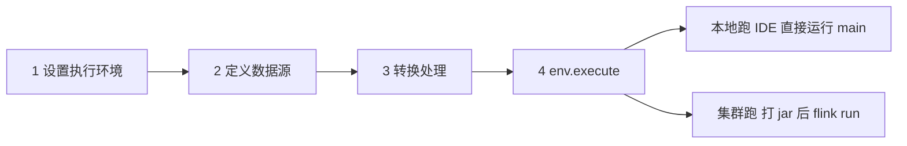

# 亲手搭一个 Flink 工程：从 Maven 骨架到第一个批式 WordCount

拿发行包里的示例 jar 跑通演示，只算会「用」Flink；真要写自己的作业，第一步是建工程。工程怎么生成、依赖怎么引、程序骨架长什么样、批处理和流处理的入口差在哪，这些问题在建工程时一次全冒出来。照着做一遍，从 Maven 骨架生成到批式 WordCount 出结果，工程层的底子就打好了。

## 先给结论

- 用 `mvn archetype:generate` 配 `flink-quickstart-java` 骨架生成工程，课程用 1.9.1 的骨架版本，与安装的 Flink 版本一致。
- 生成后 pom 里的核心依赖统一写 1.8.0：`flink-java` 与 `flink-streaming-java_2.11` 的 scope 是 provided，编译与本地运行可用，不打包进作业 jar。
- 工程自带两个入口类：BatchJob 持有 `ExecutionEnvironment` 走批处理，StreamingJob 持有 `StreamExecutionEnvironment` 走流处理。
- Flink 程序四步套路：设置执行环境、定义数据源、转换处理、执行程序；批式 WordCount 就是 flatMap 分词、`groupBy(0)` 分组、`sum(1)` 求和。
- 本地跑在 IDE 里直接运行 main 方法；上集群要 `mvn clean package` 打 jar，再用 `flink run` 提交，结果去 Web UI 看。

## 一、用快速启动骨架生成工程

建工程不需要手写 pom，Flink 提供了 Maven 骨架（archetype），名字是 `flink-quickstart-java`。在打算放工程的目录下打开命令行：

```bash
mvn archetype:generate \
  -DarchetypeGroupId=org.apache.flink \
  -DarchetypeArtifactId=flink-quickstart-java \
  -DarchetypeVersion=1.9.1
```

Maven 下载骨架后进入交互式问答，依次输入 groupId、artifactId、version、package，回车确认。课程演示的取值如下（包名按惯例改写为 `com.study.coldchain`）：

```text
Confirm properties configuration:
groupId: com.study.coldchain
artifactId: cold-flink
version: 1.0.0
package: com.study.coldchain
 Y : :
Project created from Archetype in dir: D:\项目\cold-flink
BUILD SUCCESS
```

生成的工程比想象的全：pom.xml 里 Flink 依赖与打包插件一应俱全；src/main/java 下自带两个入口类，各带一个 main 方法，等于把批、流两套起点都铺好了。

```text
cold-flink
├── src/main/java/com/study/coldchain
│   ├── BatchJob.java          # 批处理入口
│   └── StreamingJob.java      # 流处理入口
├── src/main/resources
└── pom.xml
```

IDE 打开工程，等依赖加载完就可以动工。课程工程名沿用 cold-flink，后面 day6 的实战工程也是这个名字。

## 二、两个执行环境，一套四步套路

**BatchJob 与 StreamingJob 的差别只在第一行。** BatchJob 里创建的是 `ExecutionEnvironment`，对应批处理的运行时环境；StreamingJob 里创建的是 `StreamExecutionEnvironment`，对应流处理的运行时环境。用哪个环境类，程序就是哪种作业，这一句同时决定了后面拿到的数据容器是 DataSet 还是 DataStream。

**四步套路在两个入口类里完全一致。** 模板代码里的注释就是流程：设置执行环境、定义数据源、数据的转换处理、执行程序。把 StreamingJob 填成一个最小可跑的样子（以 socket 为数据源）：

```java
package com.study.coldchain;

import org.apache.flink.streaming.api.datastream.DataStream;
import org.apache.flink.streaming.api.environment.StreamExecutionEnvironment;

public class StreamingJob {
    public static void main(String[] args) throws Exception {
        // 1. 设置执行环境
        final StreamExecutionEnvironment env =
                StreamExecutionEnvironment.getExecutionEnvironment();

        // 2. 定义数据源：socket 文本流，\n 表示按回车切分行
        DataStream<String> text = env.socketTextStream("172.17.0.143", 9000, "\n");

        // 3. 数据的转换、处理：先不做转换，直接打印
        text.print();

        // 4. 执行程序
        env.execute("Flink Streaming Java API Skeleton");
    }
}
```

**数据源决定了批与流的归属。** 从文本文件、文件系统读一批数据，是静态的批处理；从 socket 端口、Kafka 队列读数据，是不停到来的流处理。`DataStream<String>` 的泛型就是流里元素的类型，String 是基本类型，换成 Tuple、POJO 也行，类型体系后面单开一篇细讲。

对着 `text.` 敲补全，IDE 列出 map、filter、flatMap、coGroup、connect、countWindowAll 等一长串方法，每一个都把一条数据流变换成另一条数据流，这就是第 3 步「转换处理」的全部内容。四步的骨架一张图说清：



前三步都在搭数据流图，第 4 步的 execute 才真正触发计算；跑法分本地与集群两条岔路，下面各给一条可复现的路径。

## 三、批式 WordCount：最小可运行

模板里的 BatchJob 只有注释，真正的批处理示例看配套工程的 WordCount。它不依赖任何外部服务，跑完把结果写到磁盘，是最小的可运行批作业（包名改写后如下）：

```java
package com.study.coldchain.demo.flink.batch;

import com.study.coldchain.demo.flink.batch.util.WordCountData;
import org.apache.flink.api.common.functions.FlatMapFunction;
import org.apache.flink.api.java.DataSet;
import org.apache.flink.api.java.ExecutionEnvironment;
import org.apache.flink.api.java.tuple.Tuple2;
import org.apache.flink.util.Collector;

public class WordCount {

    public static void main(String[] args) throws Exception {
        // 1. 设置环境：批处理使用 ExecutionEnvironment
        final ExecutionEnvironment env = ExecutionEnvironment.createLocalEnvironment();
        env.setParallelism(2);

        // 2. 定义数据源：内置文本数据集，WordCountData 里用 env.fromElements 装入多行文本
        DataSet<String> text = WordCountData.getDefaultTextLineDataSet(env);

        // 3. 执行逻辑：分词、按第 0 个字段分组、对第 1 个字段求和
        DataSet<Tuple2<String, Integer>> counts =
                text.flatMap(new Tokenizer())
                    .groupBy(0)
                    .sum(1);

        // 4. 输出：写成 CSV，参数依次是目录、行分隔符、字段分隔符
        counts.writeAsCsv("d:\\dataset-test", "\n", " ");

        // 5. 执行程序
        env.execute("WordCount Example");
    }

    // 分词器：整行转小写，按非字母数字切分，每个词发出一条 (word, 1)
    public static final class Tokenizer
            implements FlatMapFunction<String, Tuple2<String, Integer>> {
        @Override
        public void flatMap(String value, Collector<Tuple2<String, Integer>> out) {
            String[] tokens = value.toLowerCase().split("\\W+");
            for (String token : tokens) {
                if (token.length() > 0) {
                    out.collect(new Tuple2<>(token, 1));
                }
            }
        }
    }
}
```

核心逻辑三行读顺：flatMap 把一行文本拆成若干 `(word, 1)` 的 Tuple2；`groupBy(0)` 按 Tuple 第 0 个位置的字段（单词）分组；`sum(1)` 对第 1 个位置的字段（计数）累加。批处理有明确终点：所有行处理完，结果落盘，execute 触发后程序退出。

## 四、本地跑与集群提交

同一段代码有两种跑法，差别在环境与交付物。

**本地跑，直接运行 main 方法。** `getExecutionEnvironment` 按上下文自适应：在 IDE 里执行 main 时它创建本地环境，起一个内嵌的迷你集群，print 的结果直接出现在 IDE 控制台；`createLocalEnvironment` 则是显式指定本地环境，效果相同。调试阶段用这种跑法，改完代码几秒看到结果。

**集群提交，先打包再交作业。** `mvn clean package` 打出 jar 后交给集群：

```bash
mvn clean package
flink run -c com.study.coldchain.demo.flink.batch.WordCount target/cold-flink-1.0.0.jar
```

提交后作业由集群调度，结果在 Web UI 的 TaskManager Stdout 里看，上一篇示例演示走的就是这条路。顺带留意 writeAsCsv 的路径参数：本地跑写的是本机目录，集群跑时路径是 TaskManager 视角的路径，生产上输出应对接文件系统连接器或外部 sink。

**provided scope 是两种跑法的分界线。** pom 里两个核心依赖声明为 provided，注释写得很直白：这些依赖不应该被打进 jar。编译与本地运行时它们在 classpath 上正常可用；打作业包时被排除，集群上由 Flink 发行包自己提供这些类。少了 provided，jar 会虚胖几十 MB，版本不一致时还会在集群上炸出 NoSuchMethodError 一类的冲突：

```xml
<properties>
    <flink.version>1.8.0</flink.version>
    <scala.binary.version>2.11</scala.binary.version>
</properties>

<!-- provided：本地编译运行可用，不打进作业 jar，提交集群后由集群提供 -->
<dependency>
    <groupId>org.apache.flink</groupId>
    <artifactId>flink-java</artifactId>
    <version>${flink.version}</version>
    <scope>provided</scope>
</dependency>
<dependency>
    <groupId>org.apache.flink</groupId>
    <artifactId>flink-streaming-java_${scala.binary.version}</artifactId>
    <version>${flink.version}</version>
    <scope>provided</scope>
</dependency>
```

依赖版本统一 1.8.0：骨架命令里的 1.9.1 只是生成骨架用的版本号，工程依赖以 pom 为准，提交作业时集群版本建议与之对齐。

## 常见误区

- **把骨架版本当成依赖版本。** 错例是 archetype 用 1.9.1 生成后，pom 依赖版本随手写成别的。正解是骨架版本只管生成，作业依赖统一按工程口径 1.8.0，集群版本与之对齐。
- **把 provided 依赖改成 compile 打进 jar。** 错例是作业包几十 MB，还在集群上报类冲突。正解是核心 Flink 依赖保持 provided，交给集群提供，作业包里只放自己的代码与真正需要的 connector。
- **写了 writeAsCsv 却没写 env.execute。** 错例是程序跑完目录里什么都没有。正解是 Flink 惰性执行，落盘动作也由 execute 触发，这一行不能省。
- **在 IDE 控制台找集群提交的结果。** 错例是 `flink run` 提交后盯着本地控制台等输出。正解是提交上集群后输出在 TaskManager 的 Stdout，去 Web UI 看；本地跑结果才在 IDE 控制台。

## 面试可能被问到的问题

1. 面试官追问：「flink-quickstart-java 骨架帮你做了什么？」
   答：生成带完整 pom 的 Maven 工程：Flink 核心依赖以 provided 引入、shade 打包插件配置好，并预置 BatchJob 与 StreamingJob 两个入口类，免去手工搭工程和配打包。
2. 面试官追问：「ExecutionEnvironment 和 StreamExecutionEnvironment 的区别？」
   答：前者是批处理运行时环境，数据容器是 DataSet，对应有限数据集；后者是流处理运行时环境，数据容器是 DataStream，对应无限数据流。用哪个环境，程序就按哪种作业提交。
3. 面试官追问：「一个 Flink 程序的标准流程分几步？」
   答：四步：设置执行环境、定义数据源、对数据做转换处理、调用 env.execute 触发执行。前三步都在构建数据流图，execute 之前不会真正计算。
4. 面试官追问：「为什么核心依赖要设成 provided？」
   答：集群运行时 Flink 发行包自身已提供这些类，作业 jar 里再带一份会增大包体并可能与集群版本冲突；provided 让依赖只在编译与本地运行时生效，不进入作业包。
5. 面试官追问：「getExecutionEnvironment 和 createLocalEnvironment 有什么不同？」
   答：前者按执行上下文自适应，在 IDE 的 main 方法里得到本地环境，提交到集群后得到集群环境，代码不用改；后者显式创建本地环境。一般用前者最省心。
6. 面试官追问：「批式 WordCount 里 groupBy(0) 和 sum(1) 是什么意思？」
   答：作用于 Tuple2 类型，groupBy(0) 按位置 0 的字段（单词）分组，sum(1) 对位置 1 的字段（计数）聚合求和，得到每个单词的总次数。

## 配套资料

- 代码：`materials/code/06/day4 Flink基础与流数据处理/`，flink-demo 工程的 batch/WordCount、batch/util/WordCountData、Streaming/StreamingJob 与 `pom.xml`（依赖 Flink 1.8.0），均为真实随包文件，正文包名改写为 `com.study.coldchain`。
- 说明：archetype 生成命令与交互输出按课程画面整理，包名按惯例改写；本地与集群两种跑法的差异说明按本课写法补充；引用路径截至 day 目录层级。
