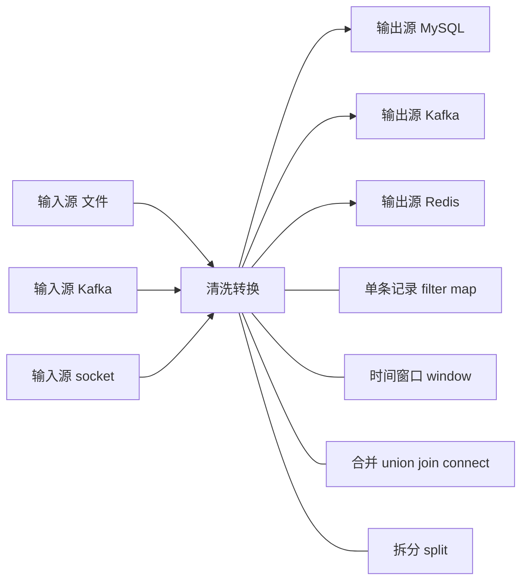

# DataStream 与 DataSet：有限数据集和无限数据流的两套抽象

读完两个 WordCount，问题自然冒出来：为什么批版用 groupBy、流版用 keyBy？为什么环境类有 ExecutionEnvironment 和 StreamExecutionEnvironment 两个？答案在 Flink 对「数据」的两套抽象上：DataSet 表示有限数据集，DataStream 表示无限数据流。把两套抽象的定位、算子对照和边界理清楚，写 API 时才知道每一步为什么这么落笔。

## 先给结论

- DataSet 与 DataStream 都表示「含重复元素的不可变集合」：DataSet 装有限数据，DataStream 装无限数据。
- 典型来源：文件系统里的文件、数据库里一批一批的数据对应 DataSet；Kafka 队列、硬件设备不停上报的数据对应 DataStream。
- 环境类成对出现：批处理用 org.apache.flink.api.java 包的 `ExecutionEnvironment`，流处理用 org.apache.flink.streaming.api.environment 包的 `StreamExecutionEnvironment`。
- 转换操作四类：基于单条记录的 filter 与 map、基于时间窗口的 window、合并数据流的 union 与 join 与 connect、拆分数据流的 split。
- 作业链路统一为：输入源 → 清洗转换 → 输出源，输出可以是 MySQL、另一个 Kafka 队列或 Redis。

## 一、两套抽象，一条边界

**定义只有一句话。** Flink 用 DataSet 和 DataStream 在程序中表示数据，可以把它们理解为包含重复项的不可变数据集合。不可变是关键词：任何转换都不改原来的集合，而是产生一个新的 DataSet 或 DataStream，一条链串下来就是一张数据流图，改写历史数据从来不是原地改。

**边界画在「有限」与「无限」上。** 关系型数据库里一批一批查出来的数据、文件系统里的某个文件，数据有终点，放进 DataSet；Kafka 里的消息、硬件设备不停提交上来的数据，没有终点，是持续到来的流，放进 DataStream。拿冷链监控平台打比方：设备每秒上报一条温度，这条流从设备开机起就没有「读完了」的时刻，天然属于 DataStream；昨天一整天的历史温度导出来分析，就是 DataSet。

| | DataSet | DataStream |
|---|---|---|
| 数据量 | 有限，有终点 | 无限，持续到来 |
| 典型来源 | 文件、数据库批量数据 | Kafka、socket、设备上报 |
| 运行时环境 | ExecutionEnvironment | StreamExecutionEnvironment |
| 分组算子 | groupBy | keyBy |
| 典型输出 | writeAsCsv、print | print、写 MySQL、回投 Kafka |

## 二、环境类与算子的对应关系

**环境类决定数据容器。** 创建 `ExecutionEnvironment` 后，链路上每个中间结果都是 DataSet；创建 `StreamExecutionEnvironment` 后，中间结果都是 DataStream。同一个单词统计，两套 API 的核心行对比如下，先看批版：

```java
// 批版：DataSet API，ExecutionEnvironment 起步
DataSet<Tuple2<String, Integer>> counts =
        text.flatMap(new Tokenizer())
            .groupBy(0)
            .sum(1);

counts.writeAsCsv("d:\\dataset-test", "\n", " ");
env.execute("WordCount Example");
```

再看流版，分组换成 keyBy，聚合前多了一个窗口：

```java
// 流版：DataStream API，StreamExecutionEnvironment 起步
DataStream<WordWithCount> counts = text
        .flatMap(new Tokenizer())
        .keyBy("word")
        .timeWindow(Time.seconds(5))
        .reduce(new ReduceFunction<WordWithCount>() {
            @Override
            public WordWithCount reduce(WordWithCount t0, WordWithCount t1) {
                return new WordWithCount(t0.word, t0.count + t1.count);
            }
        });

counts.print();
env.execute();
```

**算子对照有规律。** flatMap、map、filter 在两套 API 里同名同义，都是逐条处理；分组从 groupBy 换成 keyBy；聚合从直接 sum 换成开窗后再 sum 或 reduce；输出从 writeAsCsv 换成 print 或外接 sink。记住这张对照关系，批作业改流作业就有路可循，反过来也一样。

配套工程里两条链路都有真实样板：批版在 flink-demo 的 batch/WordCount，流版在 Streaming/StreamingJob，后者还把滚动窗口 `timeWindow(Time.seconds(30)).sum(1)` 与滑动窗口 `timeWindow(Time.seconds(60), Time.seconds(30))`、按条数窗口 `countWindow(100)` 一并写全了。

## 三、一条数据的旅程与四类转换

课程讲义把 Flink 作业的通用形态画成一张图：各种输入源把数据送进系统，中间做清洗转换，最后流向一个或多个输出源，输出源可以是 MySQL、另一个 Kafka 队列，也可以是 Redis。清洗转换是 Flink 的核心功能区；无论流还是批，落到个体上就是一条一条的数据，清洗转换就是对每条记录动手。

转换操作按用途分四类：

**基于单条记录的 filter 与 map。** filter 按条件过滤，比如温度超出阈值才放行；map 把一条数据映射成另一条，比如把字符串解析成对象。一条流进来，一条流出去。

**基于时间窗口的 window。** 「过去 5 秒之内的所有数据」就是一个窗口，把无限流切成一段一段的有限数据来算。它是流处理回答「何时计算」的机制，时间窗口的细节后面开专篇讲。

**合并数据流的 union、join、connect。** 两条流合成一条、按 key 关联两张表、两条异构流连接后分别处理，都是把多个数据流搓到一起再往下算。

**拆分数据流的 split。** 一条流按条件拆成多条，各走各的处理路径。



图中输入源与输出源都画了三个，对应讲义里「输入源 1..n、输出源 1..n」；中间的清洗转换挂着四类操作，这就是 Flink 作业的整体骨架。

**只有经过转换，数据才变成想要的结果。** 数据源只负责接入，输出源只负责落地，filter、map、window、union 这些转换才是计算本身。写对转换链的前提，是先想清楚手里的数据是有限还是无限，选对 DataSet 或 DataStream，再用对应那套算子。

## 常见误区

- **把不可变理解成不能算。** 错例是想办法往 DataSet 里增删记录。正解是不可变指集合本身不被修改，每次 map、filter 都产生新的集合对象，链式调用串起来正是 Flink 想要的数据流图。
- **在流处理里找 groupBy。** 错例是把批版代码搬到 DataStream 上，发现没有 groupBy 就卡住。正解是流里分组用 keyBy，两者是同一诉求在不同 API 里的名字；反过来 DataSet 里也没有 keyBy。
- **以为流处理有「跑完」的时刻。** 错例是等 DataStream 作业像批作业那样自己退出。正解是无限流没有终点，作业常驻运行，靠窗口把无限切成有限，周期性给出结果。
- **按旧习惯给新项目选 API。** 错例是所有新作业都照 DataSet API 写。正解是课程所用的 1.8、1.9 版本两套 API 并存，但社区主推流批一体的 DataStream API，DataSet API 已进入维护状态，新代码优先按流建模（此点为本课之外的补充）。

## 面试可能被问到的问题

1. 面试官追问：「DataSet 和 DataStream 的本质区别是什么？」
   答：都表示含重复元素的不可变集合，区别在数据边界：DataSet 装有限数据集，如文件与数据库批量数据；DataStream 装无限数据流，如 Kafka 消息与设备上报数据。
2. 面试官追问：「为什么批处理用 groupBy、流处理用 keyBy？」
   答：同一诉求在不同 API 里的算子名。批数据一次性分组聚合；流数据必须先 keyBy 分区，再靠窗口回答何时计算，所以 keyBy 总与 window 绑定出现。
3. 面试官追问：「Flink 的转换操作分哪几类？」
   答：四类：基于单条记录的 filter 与 map、基于时间窗口的 window、合并数据流的 union 与 join 与 connect、拆分数据流的 split。
4. 面试官追问：「两个执行环境类分别在哪个包、怎么选？」
   答：ExecutionEnvironment 在 org.apache.flink.api.java 包，配 DataSet；StreamExecutionEnvironment 在 org.apache.flink.streaming.api.environment 包，配 DataStream。数据有限选前者，数据持续到来选后者。
5. 面试官追问：「Flink 作业的整体链路是什么样的？」
   答：输入源接入数据，中间清洗转换完成计算，结果流向一个或多个输出源，如 MySQL、Kafka、Redis；转换层承载 filter、map、window、合并与拆分四类操作。

## 配套资料

- 代码：`materials/code/06/day4 Flink基础与流数据处理/`，flink-demo 工程的 batch/WordCount（DataSet API：ExecutionEnvironment、groupBy、sum、writeAsCsv）与 Streaming/StreamingJob、Streaming/SocketWordCount（DataStream API：keyBy、timeWindow 滚动与滑动窗口），均为真实随包文件，正文包名改写为 `com.study.coldchain`。
- 说明：对照表与四类转换按课程讲义画面与口播整理；union、join、connect、split 在随包示例中无独立运行类，按本课写法补全说明；流批一体演进为本课之外的补充；引用路径截至 day 目录层级。
