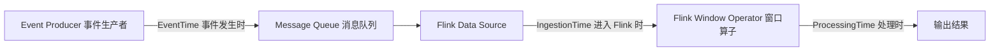

# Flink 窗口的含义：三种时间语义与滚动、滑动窗口

流数据没有终点，算子永远等不到「数据发完了」的那一刻，聚合就无从谈起。窗口就是为解决这个问题而生的：人为切出一段范围，把落在范围内的数据攒起来做计算。开窗之前还得先弄清楚另一件事，Flink 里说的「时间」到底是哪一个时间，因为三种时间语义会直接影响窗口怎么切、切得准不准。

## 先给结论

- 无界流必须开窗：窗口把无限的数据切成有限的一段，聚合、求 TopN 都发生在窗口边界触发的那一刻。
- Flink 有三种时间语义：EventTime 是事件真实发生的时间，IngestionTime 是事件进入 Flink 的时间，ProcessingTime 是算子处理事件的时间。
- 窗口按维度分两类：时间窗口按时间切，计数窗口按条数切；两类各自再分滚动与滑动两种形态。
- 滚动窗口首尾相接、互不重叠；滑动窗口带重叠，用「窗口长度加滑动步长」两个参数描述。
- flink-demo 的 StreamingJob 用四行代码把「时间、计数 × 滚动、滑动」四种组合全部写全，是最省事的记忆锚点。

## 一、三种时间语义：同一个事件有三个时间

拿课程里冷链采集器的例子走一遍数据的一生。温度采集器在某一刻采到温度，这个时刻就是事件发生时间；数据随后提交给 Kafka，Flink 监听队列刚拿到这条数据，这个时刻是事件进入 Flink 的时间；Flink 引擎对它做过滤、map、转换等处理，处理发生的时刻就是处理时间。对应到链路上：



三个时间通常并不相等：网络抖动、队列积压都会让「进入 Flink 的时刻」晚于「真实发生的时刻」。**用 ProcessingTime 开窗，数据迟到就会算错窗口**，比如采集器 10:00:00 产生的温度因为网络卡顿 10:00:07 才被处理，按处理时间会被算进 10:00:05 开始的窗口，与业务事实不符。按 EventTime 开窗则窗口切分依据数据自带的业务时间戳，结果可复现、可回溯，代价是要引入水位线机制来容忍乱序（水位线属于事件时间语义的配套机制，课程画面点到为止，后面单独补充一句）。IngestionTime 是折中项，实际工程用得少。

## 二、窗口的两个分类维度

课程 PPT 把窗口先按「切分依据」分，再按「形态」分，得到一个二乘二的组合：

- 按切分依据分：时间窗口（过去 5 秒、过去 5 分钟这类按时间范围切）与计数窗口（攒够 100 条就触发计算这类按条数切）。
- 按形态分：滚动窗口与滑动窗口。

**滚动窗口像把一张纸按等宽折叠**，时间轴被平均切成一段一段，每段首尾相接、互不重叠。5 秒滚动窗口就是 0 到 5 秒、5 到 10 秒各算各的账，一条数据只属于一个窗口。

**滑动窗口则带重叠**。典型需求是「每 5 分钟统计一次过去 10 分钟的数据」：窗口长度 10 分钟，滑动步长 5 分钟，任意一条数据会同时落在两个窗口里。重叠部分正是「最近十分钟」这个语义的来源。滑动也可以按计数来，比如每来 50 条统计一次最近 100 条。

计数窗口的概念值得多说一句：它不关心时间，只关心攒了多少条。适合流控、抽样这类按条数触发的场景；对「过去一段时间」的语义无能为力。

## 三、四行代码写全四种窗口

flink-demo 的 StreamingJob 把四种组合并排写在一起，注释直接标明了窗口形态，包名改写后如下：

```java
package com.study.coldchain.demo.flink.Streaming;

import org.apache.flink.streaming.api.datastream.DataStream;
import org.apache.flink.streaming.api.environment.StreamExecutionEnvironment;
import org.apache.flink.streaming.api.windowing.time.Time;

public class StreamingJob {
    public static void main(String[] args) throws Exception {
        // 1. 构建执行环境
        final StreamExecutionEnvironment env = StreamExecutionEnvironment.createLocalEnvironment();

        // 2. 定义数据源
        DataStream<String> text = env.socketTextStream("172.17.0.143", 9000, "\n");

        // 滚动的时间窗口：30 秒一个，互不重叠
        text.keyBy(0).timeWindow(Time.seconds(30)).sum(1).print();
        // 滚动的计数窗口：攒够 100 条触发
        text.keyBy(0).countWindow(100).sum(1);

        // 滑动的时间窗口：长度 60 秒，步长 30 秒，窗口重叠一半
        text.keyBy(0).timeWindow(Time.seconds(60), Time.seconds(30)).sum(0).print();
        // 滑动的计数窗口：每来 50 条，统计最近 100 条
        text.keyBy(0).countWindow(100, 50).sum(1).print();

        // 3. 执行程序
        env.execute();
    }
}
```

参数规律一眼可见：`timeWindow` 与 `countWindow` 只传一个参数就是滚动，传「长度、步长」两个参数就是滑动。单词统计示例里用过的 `timeWindow(Time.seconds(5))` 就是 5 秒滚动窗口。

## 四、水位线：事件时间窗口的迟到保险

按 EventTime 开窗后有个绕不开的问题：窗口该等到什么时候关闭？数据带着时间戳 10:00:04 的记录可能在 10:00:06 才到达，如果窗口到点就关，这条数据就丢了。水位线（Watermark）的思路是给事件时间加一层可控延迟：它是一条特殊标记，含义是「事件时间小于等于这个值的记录应该都到齐了」。窗口会一直等到「窗口结束时间早于当前水位线」才触发计算，乱序但迟到不多的数据就被兜住了。水位线与 EventTime 窗口是成对出现的配套机制，课程在这一讲只做概念铺垫，实现细节在后续窗口实战里再展开；接法用一条数据流示意（按主流写法补充的示意代码，Flink 1.9 API）：

```java
// 先给流里的记录标注事件时间戳，并生成容忍 3 秒乱序的水位线
DataStream<MessageEntity> withTs = env.addSource(kafkaConsumer)
        .assignTimestampsAndWatermarks(
                new BoundedOutOfOrdernessTimestampExtractor<MessageEntity>(Time.seconds(3)) {
                    @Override
                    public long extractTimestamp(MessageEntity element) {
                        return element.getTimestamp();
                    }
                });

// 再按事件时间开窗：窗口触发不再看墙上时钟，而是等水位线越线
withTs.keyBy("metercode")
        .timeWindow(Time.seconds(10))
        .sum("tem")
        .print();
```

面试里被问到「EventTime 窗口为什么需要 Watermark」时，答出「延迟关窗、容忍乱序」即可。

## 常见误区

- **把 ProcessingTime 窗口的结果当成业务事实。** 错例是按处理时间开 5 秒窗口统计温度超标次数，数据迟到就记错了窗口。正解是业务上以发生时刻为准的统计一律用 EventTime 窗口，配合水位线处理乱序。
- **认为滑动窗口是滚动窗口的升级版。** 错例是不管什么需求都上滑动窗口。正解是两者语义不同：报表类「每分钟产出上一分钟的量」用滚动，监控类「持续观察最近 N 分钟」用滑动；滑动窗口因为重叠，同一份数据会被多个窗口持有，状态与计算量都更大。
- **countWindow 只传一个参数就期待周期性输出。** 错例是写 `countWindow(100)` 后发现输出很不规律。正解是单参数计数窗口攒满 100 条才触发，数据稀疏时可能很久不触发；要周期性输出得用双参数形式，如 `countWindow(100, 50)`。
- **以为窗口越短越实时越好。** 错例是把 5 秒窗口改到 1 秒，结果数字抖动、聚合结果没什么参考价值。正解是窗口长度由业务对「统计粒度」的要求决定，监控告警通常要比抖动周期长。

## 面试可能被问到的问题

1. 面试官追问：「Flink 的三种时间分别是什么？在链路的哪个位置产生？」
   答：EventTime 是事件在产生端发生的时间；IngestionTime 是事件进入 Flink Data Source 的时间；ProcessingTime 是窗口算子处理事件的时间。三者沿数据链路依次产生，通常越来越晚。
2. 面试官追问：「滚动窗口和滑动窗口的区别是什么？」
   答：滚动窗口长度与步长相等，首尾相接、无重叠，每条数据只属于一个窗口；滑动窗口步长小于长度，窗口之间有重叠，每条数据可能属于多个窗口，适合「最近 N 分钟」类持续统计。
3. 面试官追问：「timeWindow(Time.seconds(60), Time.seconds(30)) 是什么含义？」
   答：滑动时间窗口，窗口长度 60 秒，每 30 秒向前滑动一次，相邻窗口重叠 30 秒；timeWindow 只传一个长度参数时就是滚动窗口。
4. 面试官追问：「为什么需要 Watermark？」
   答：EventTime 窗口的关闭依据是水位线而不是墙上时钟。数据可能乱序迟到，水位线以可控延迟声明某个事件时间之前的数据已到齐，窗口等到水位线越过结束时间才触发，从而把迟到不多的数据算进正确的窗口。
5. 面试官追问：「计数窗口适合什么场景？」
   答：适合只关心条数、不关心时间的触发，比如每 100 条做一次采样统计或流控；`countWindow(100, 50)` 这种双参数形式则是每来 50 条对最近 100 条做一次滑动统计。

## 配套资料

- 代码：`materials/code/06/day4 Flink基础与流数据处理/`，flink-demo 工程的 StreamingJob（四种窗口组合的真实代码）、SocketWordCount（5 秒滚动窗口），包名改写为 `com.study.coldchain`。
- 说明：水位线小节为按主流写法补充的概念延伸，课程画面仅做铺垫；文中时间语义链路图按课程画面整理；引用路径截至 day 目录层级。
