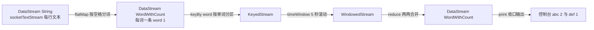

# 单词统计复盘：盯住类型变化，算子链就读通了

上一篇把 socket 单词统计敲出来跑通了。回看代码时，真正的卡点往往不在语法，而在那条链的形状：flatMap 完为什么接着 keyBy，keyBy 之后为什么还要 timeWindow，reduce 里拿到的东西到底是什么。换个视角复盘，盯住每调一个算子时流的类型怎么变，这条链就不再是一串死记的方法名。

## 先给结论

- 程序骨架四段：设置执行环境、定义数据源、转换计算、输出并执行；流处理与批处理共用这个骨架。
- socketTextStream 读进来的每行文本构成 `DataStream<String>`，String、Integer、Double 这类基础数据类型就能撑起一个流。
- flatMap 的本质是一次类型转换：把 `DataStream<String>` 转成 `DataStream<WordWithCount>`，POJO 类型从这里登场。
- keyBy 把 DataStream 变成 KeyedStream，timeWindow 再把它变成 WindowedStream，reduce 算完又回到 DataStream，类型随算子一路流转。
- 输出端不止 print：writeAsText、writeAsCsv、writeToSocket、writeAsOutputFormat、addSink 各管一路去向。

## 一、四段骨架先立住

单词统计程序整体分四部分。第一部分设置执行环境，流数据处理用的是 StreamExecutionEnvironment，字面意思就是流数据的执行环境；第二部分定义数据源，示例选了 socket，因为 socket 端口能持续吐数据，正好模拟流；第三部分对数据流做转换；第四部分把结果输出并执行。

```java
package com.study.coldchain.demo.flink.streaming;

// import 从略：FlatMapFunction、ReduceFunction、Collector、Time 等

public class SocketWordCount {

    public static void main(String[] args) throws Exception {
        // 1. 设置执行环境：针对流数据的处理环境
        final StreamExecutionEnvironment env =
                StreamExecutionEnvironment.getExecutionEnvironment();

        // 2. 定义数据源：socket 文本流，元素类型 String
        DataStream<String> text = env.socketTextStream("172.17.0.143", 9000);

        // 3. 转换计算：分词、分区、开窗、合并（下面逐段拆）
        // 4. 输出并执行：print 注册输出，execute 触发整张执行图
    }
}
```

数据源一侧的类型很朴素：socket 进来的一行就是一个 String。基础数据类型（String、Integer、Double 等）配上数据源，就构成了最简单的 `DataStream<String>`。除了 socket，数据源家族里还有基于集合的 `fromCollection` 系列与 `generateSequence(from, to)` 数字序列，本地调试时比 socket 更省事。

## 二、flatMap：把字符流转成 POJO 流

flatMap 要干的事，是把 String 流换成 WordWithCount 流。输入一行 `abc abc def`，`split("\\s")` 按空格拆成三个单词，每个单词发出一条 count 为 1 的记录。流里的元素类型从 String 变成了 POJO：

```java
DataStream<WordWithCount> wordWithCountDataStream = text
        .flatMap(new FlatMapFunction<String, WordWithCount>() {
            @Override
            public void flatMap(String s, Collector<WordWithCount> collector) throws Exception {
                for (String word : s.split("\\s")) {
                    collector.collect(new WordWithCount(word, 1L));
                }
            }
        });
```

转换之后出来的是 (abc,1)、(abc,1)、(def,1) 三条记录。泛型参数写得很清楚：进 String，出 WordWithCount，这正是 Flink 数据类型体系里 POJO 一族的用武之地，字段 public、带无参构造，规矩在数据类型一课已经立过。

## 三、keyBy 开窗 reduce：类型换了三次

分组算子 keyBy 按主键 word 把流拆成组：abc 一组带着两个元素，def 一组带一个元素。keyBy 之后流的类型不再叫 DataStream，而是 KeyedStream；接着 timeWindow(Time.seconds(5)) 每 5 秒取一次，类型变成 WindowedStream；reduce 把组内记录两两合并，ABC1 加 ABC1 变成 ABC2，算完又回到 DataStream。

```java
        text.flatMap(...)                  // DataStream<String> -> DataStream<WordWithCount>
            .keyBy("word")                 // -> KeyedStream<WordWithCount>
            .timeWindow(Time.seconds(5))   // -> WindowedStream<WordWithCount>
            .reduce(new ReduceFunction<WordWithCount>() {
                @Override
                public WordWithCount reduce(WordWithCount t0, WordWithCount t1) throws Exception {
                    return new WordWithCount(t0.word, t0.count + t1.count);
                }
            });                            // -> DataStream<WordWithCount>
```

这张图在讲算子链上的类型迁移，每过一个算子，类型就换一次：



图里类型换了四次，语义各不相同：flatMap 换元素类型，keyBy 换分区语义，timeWindow 定下计算边界，reduce 把窗口内容收拢回普通流。Flink 的转换家族比这条链大得多，从 DataStream 出发，keyBy 得到 KeyedStream，windowAll 得到 AllWindowedStream，connect 得到 ConnectedStream，split 得到 SplitStream，KeyedStream 再经 window 得到 WindowedStream。对应关系记一张表就够：

| 起点类型 | 算子 | 得到的类型 |
|---|---|---|
| DataStream | keyBy | KeyedStream |
| KeyedStream | window | WindowedStream |
| DataStream | windowAll | AllWindowedStream |
| DataStream | connect | ConnectedStream |
| DataStream | split | SplitStream |

家族里还有两位屏幕上出现过的特殊成员值得点名。split 配 select 做分流，一条流打标后拆成多条各走各路；iterate 做反馈循环，把 filter 出来的部分结果用 closeWith 送回流头接着算：

```java
// split 打标，select 取支
DataStream<Integer> even = split.select("even");
DataStream<Integer> odd = split.select("odd");

// iterate：满足条件的记录反馈回流头，形成循环
IterativeStream<Long> iteration = initialStream.iterate();
iteration.closeWith(feedback); // feedback 为 filter 出的大于 0 的部分
```

## 四、输出端六个出口按场景挑

转换结果装在 DataStream 里，去处不止控制台一种。课程把输出操作列全了六件：writeAsText 写文本文件，靠每个元素的 toString 拿字符串；writeAsCsv 把元组写成逗号分隔文件，行与字段分隔符可配；print 打印到控制台；writeAsOutputFormat 是自定义文件输出的基础；writeToSocket 把数据写到套接字；addSink 调用自定义接收器，Flink 的各类连接器从这里接入 Kafka、MySQL 等外部系统。

| 输出方法 | 去向 | 一句话特点 |
|---|---|---|
| writeAsText | 文本文件 | 逐元素 toString 写出 |
| writeAsCsv | CSV 文件 | 元组专用，分隔符可配 |
| print | 控制台 | 调试首选 |
| writeAsOutputFormat | 自定义文件 | 各类文件输出的底层基础 |
| writeToSocket | socket | 把结果推给网络对端 |
| addSink | 任意外部系统 | 自定义接收器，连 Kafka、MySQL 靠它 |

示例程序选 print，并且收了一道口子：

```java
wordWithCountDataStream.print().setParallelism(1);

// 4. 执行程序：所有 Flink 程序都要执行这一步
env.execute();
```

print 默认并行度随上游，设成 1 之后所有结果汇到一个子任务输出，日志不会散落在各并行实例里。execute 是整张执行图的扳机：算子调用只是搭图，不执行这一步，一个数据都不会流动。

## 常见误区

- **keyBy 的字段随手就写。** 错例是 `keyBy("words")` 这类手误，或者拿数组字段、没覆写 `hashCode` 的 POJO 字段当 key，编译期都没反应，提交运行后分区路由出错或直接报字段找不到。正解是字段名与 POJO 定义严格一致，key 选元组位置、基本类型、字符串这类可比对象。
- **拿 lambda 替换匿名内部类，运行期抛 InvalidTypesException。** 原因是 lambda 走类型擦除，Flink 从泛型参数里提不出类型信息。正解是给算子补 `.returns(TypeInformation)` 显式声明，或者沿用课程示例的匿名内部类写法。顺带记住函数对象会被序列化后分发到各 TaskManager，闭包里抓着不可序列化的对象会直接 NotSerializableException。
- **把输出当成自动发生。** 错例是写完 print 就等结果，控制台安静如鸡。DataStream 的 print 只是注册输出，`env.execute()` 才触发计算，缺了它整张图不动。
- **print 结果东一条西一条。** 多并行度下每个子任务各自打印，找日志像捉迷藏。正解是 `print().setParallelism(1)` 把输出收口到单一子任务。

## 面试可能被问到的问题

1. 面试官追问：「keyBy 之后流发生了什么变化？」
   答：DataStream 变成 KeyedStream，记录按 key 的哈希路由到对应并行子任务，同一个单词的所有记录落到同一子任务，后续窗口聚合才能按 key 各自进行。
2. 面试官追问：「为什么说 flatMap 是一次类型转换？」
   答：泛型签名是进 String 出 WordWithCount，一行文本拆分后每词发出一条 (word, 1)，流的元素类型从基础类型换成了 POJO，这正是数据类型转换操作的典型用法。
3. 面试官追问：「KeyedStream 和 WindowedStream 什么关系？」
   答：keyBy 把 DataStream 变成 KeyedStream，KeyedStream 上开 window 得到 WindowedStream；不开 keyBy 直接 windowAll 得到的是 AllWindowedStream，区别是有没有按 key 分区。
4. 面试官追问：「print 和 addSink 怎么选？」
   答：print 用于调试与验证，把元素 toString 后打到控制台；落地到 Kafka、MySQL 这类外部系统要用 addSink 挂自定义接收器或官方连接器，文件类需求另有 writeAsText 与 writeAsCsv。
5. 面试官追问：「lambda 写 flatMap 报 InvalidTypesException 是怎么回事？」
   答：lambda 无法向 Flink 提供泛型的类型信息，类型提取失败。解决办法是链上补 `.returns(...)` 显式给类型，或改用匿名内部类让编译器保留泛型签名。

## 配套资料

- 代码：`materials/code/06/day4 Flink基础与流数据处理/`，flink-demo 工程的 Streaming/SocketWordCount（四段骨架与算子链的真实主程序，包名改写为 `com.study.coldchain`）、Streaming/StreamFromCollection（fromCollection 集合数据源）、batch/PiEstimation（generateSequence 数字序列源）、batch/WordCount（批版对照），均为真实随包文件。
- 说明：算子类型迁移关系、输出端清单与 split、iterate 片段按课程画面整理；引用路径截至 day 目录层级。
