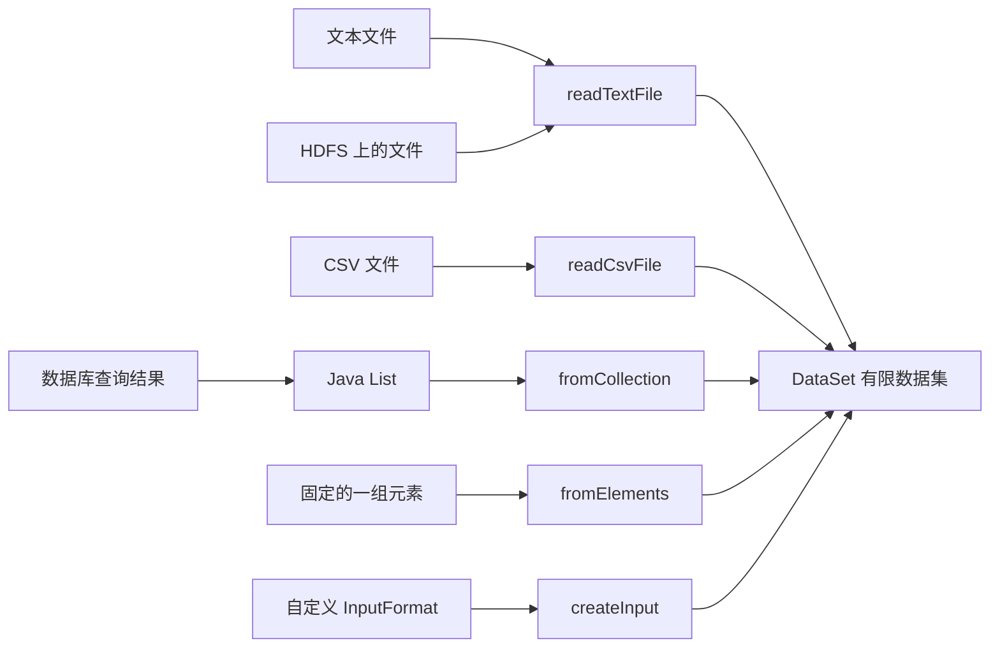

# DataSet 输入源：有限数据集从哪里进来

写批处理作业，第一行卡住人的代码往往不是转换逻辑，而是数据从哪来。DataSet 表示的是有限数据集，可文件路径怎么写、Java 集合怎么接、HDFS 上的文件能不能直接喂进去，这些入口问题不解决，后面的 map 与 filter 都无从下手。把输入源这一层理顺，批作业的代码骨架才算真正搭起来。

## 先给结论

- DataSet 的输入源分两大类：文件类（文本文件、CSV 文件、HDFS 上的文件）与集合类（Java 的 List、Collection 等内存集合）。
- 文件类对应 `readTextFile`、`readCsvFile`；集合类对应 `fromCollection`、`fromElements`；自定义格式走 `env.createInput`，传一个 InputFormat。
- 批处理用 org.apache.flink.api.java 包的 `ExecutionEnvironment`，通过 `getExecutionEnvironment()` 拿环境；流处理才用 StreamExecutionEnvironment，两者不能混。
- Flink 程序固定四步：设置执行环境、设置输入源、编写转换、触发执行。
- `print()` 内部会默认触发一次执行，作业里已经有 print 时不必再手动调 `env.execute()`，否则作业会再跑一遍。

## 一、两类输入源，各配一个入口方法

**文件类输入源。** 文本文件用 `readTextFile` 读入，一行文本就是一个 String 元素；CSV 文件用 `readCsvFile`，按列解析成元组；路径换成 `hdfs://` 开头就能直接读 HDFS 上的文件，代码不用改。这一类适合数据已经落盘的场景，比如冷库里昨天一整天的温度记录，导出来一次算完。

**集合类输入源。** Java 的 ArrayList、List、Collection 都能直接变成 DataSet。业务上常见的套路是先用 JDBC 把数据库查询结果装进一个 List，再把集合转成 DataSet，两步走完，关系库里的数据就进了批处理程序。集合类还有一个隐藏价值：数据量小、构造简单，验证程序逻辑时不用碰任何外部系统。



这张图从左到右就是「数据形态 → 环境方法 → DataSet」的对应关系：文件类走 readTextFile 与 readCsvFile，集合类走 fromCollection 与 fromElements，还有一条自定义 InputFormat 的扩展通道兜底。

## 二、四步骨架从执行环境开始

**第一步永远是设置执行环境。** 批处理与流处理的环境类是成对出现的：DataSet 配 org.apache.flink.api.java 包的 ExecutionEnvironment，DataStream 配 StreamExecutionEnvironment。批作业的第一行就是拿到批环境：

```java
// 1. 设置执行环境：批处理用 ExecutionEnvironment
ExecutionEnvironment env = ExecutionEnvironment.getExecutionEnvironment();
```

环境类一旦确定，链路上每个中间结果的类型就定了：ExecutionEnvironment 出来的都是 DataSet，StreamExecutionEnvironment 出来的都是 DataStream。

**后三步按顺序落。** 设置输入源、编写转换、触发执行，一个批作业的 main 方法就是这四段。下面把两个输入入口各落一个完整类。

## 三、从集合创建：fromCollection 与 fromElements

新建 batch 包，里面写一个 DataSetDemo，第一个例子从集合创建。完整代码如下：

```java
package com.study.coldchain.flink.batch;

import org.apache.flink.api.java.DataSet;
import org.apache.flink.api.java.ExecutionEnvironment;

import java.util.ArrayList;
import java.util.List;

public class DataSetDemo {
    public static void main(String[] args) throws Exception {
        // 1. 设置执行环境
        ExecutionEnvironment env = ExecutionEnvironment.getExecutionEnvironment();
        // 2. 从集合中创建 DataSet
        List<String> list = new ArrayList<>();
        list.add("abc");
        list.add("def");
        DataSet<String> dataSet = env.fromCollection(list);
        // 3. print 内部默认触发一次执行，不再手动调 env.execute()
        dataSet.print();
    }
}
```

运行后控制台打出 abc 与 def 两行，Java 集合的数据就装进了 DataSet。注意代码里没有 `env.execute()`：print 在内部默认会触发一次执行，再把 execute 写上，程序会把整个作业重新跑一遍，控制台就把结果打两份。

配套工程里还有一个更省事的集合入口 `fromElements`，元素固定且不多时直接把元素列在参数里。flink-demo 工程的 WordCountData 就是这样构造单词统计的默认数据集的：

```java
// 真实工程代码，包名已改写
public static DataSet<String> getDefaultTextLineDataSet(ExecutionEnvironment env) {
    return env.fromElements(WORDS);
}
```

fromCollection 收一个现成的集合对象，fromElements 收一组散装元素，两者产出完全等价，按手头数据的形态选即可。

## 四、从文件创建：readTextFile 与 readCsvFile

把 DataSetDemo 的第二个例子改成文件入口，一行代码完成对接：

```java
// 2. 从文本文件中创建 DataSet，一行文本一个元素
DataSet<String> dataSet = env.readTextFile("d:/txt/test.txt");
dataSet.print();
```

执行后控制台打出 test.txt 里的内容，文件中的每一行就是 DataSet 里的一个 String 元素。路径换成 HDFS 地址时写法不变，例如 `hdfs://node1:9000/input/words.txt`，这也是文件类输入源对批处理最友好的地方：本地调试与集群运行共用同一套代码。

CSV 文件要走 readCsvFile，按列声明类型，返回元组：

```java
// CSV 示例，按主流写法补全：两列逗号分隔文件读成元组
DataSet<Tuple2<String, Integer>> rows = env
        .readCsvFile("d:/data/temperature.csv")
        .ignoreFirstLine()                     // 跳过表头
        .fieldDelimiter(",")                   // 字段分隔符
        .types(String.class, Integer.class);   // 各列的类型
```

如果数据格式这两类方法都覆盖不了，就走 `env.createInput`，把解析逻辑写进自定义的 InputFormat，入口方法还是同一个。

## 常见误区

- **print 之后又补一个 env.execute()。** 错例是写完 `dataSet.print()` 再调 `env.execute()`，作业会被触发两次，输出打两份。正解是 print 内部已经触发执行，两者二选一。
- **文件路径不存在还照常跑。** 错例是路径写错，作业提交后才抛 NoSuchFileException。正解是本地调试先把文件放好、路径用正斜杠，报错时第一眼查路径。
- **改了原集合以为 DataSet 跟着变。** 错例是 fromCollection 之后继续往 List 里 add，然后等 DataSet 出新数据。正解是创建时集合内容已经复制进 Flink 的类型化结构，之后的修改不影响已生成的 DataSet。
- **拿流环境写批代码。** 错例是用 StreamExecutionEnvironment 调 fromCollection，得到的是 DataStream，后面接 groupBy 会发现算子对不上。正解是先判断数据有限还是无限，再选成对的环境类。

## 面试可能被问到的问题

1. 面试官追问：「DataSet 的输入源有哪些类别，分别用什么方法接入？」
   答：文件类与集合类两类。文件类用 readTextFile 读文本、readCsvFile 读 CSV，路径支持本地与 HDFS；集合类用 fromCollection 收 Java 集合、fromElements 收一组固定元素；特殊格式走 env.createInput 传自定义 InputFormat。
2. 面试官追问：「fromCollection 和 fromElements 有什么区别？」
   答：参数形态不同，fromCollection 接收一个现成的集合对象，fromElements 直接列出散装元素；产出都是同类型的 DataSet，按数据在手头的形态选择即可。
3. 面试官追问：「为什么调用 print 之后不需要再调 env.execute()？」
   答：print 属于会主动触发执行的输出操作，内部默认触发一次作业运行；而 writeAsText 这类文件输出是惰性的，必须靠 env.execute() 触发，两者机制不同。
4. 面试官追问：「readTextFile 能读 HDFS 吗，需要改代码吗？」
   答：能。路径写 hdfs:// 开头的完整地址即可，读取代码与本地文件完全一致，这正是文件接入对本地调试和集群运行透明的体现。
5. 面试官追问：「ExecutionEnvironment 和 StreamExecutionEnvironment 怎么选？」
   答：看数据边界。有限数据集选 ExecutionEnvironment，产出 DataSet；持续到来的流选 StreamExecutionEnvironment，产出 DataStream。两个环境类的方法互不通用，选错类型后面算子接不上。

## 配套资料

- 代码：`materials/code/06/day4 Flink基础与流数据处理/`，flink-demo 工程的 batch/util/WordCountData（fromElements 构造默认数据集的真实写法）与 batch/WordCount（fromElements 加 flatMap 加 groupBy 加 sum 的完整链路），均为真实随包文件，正文包名改写为 `com.study.coldchain`。
- 说明：day5 批处理输入源无独立源码包，DataSetDemo 按本课画面与口播整理补全；readCsvFile 与 createInput 在随包示例中无运行类，示例按主流写法补全并已在正文注明；引用路径截至 day 目录层级。
