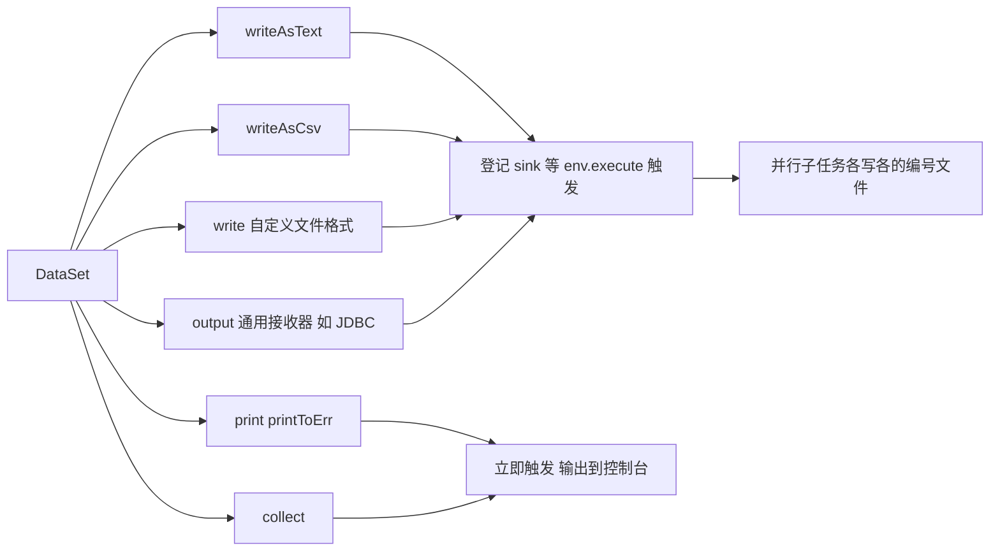

# DataSet 输出流：把批处理结果落到文件、控制台和任意接收器

转换链写完，程序跑完，目标目录里却没有文件，控制台也没有任何结果，很多人的批作业第一次都卡在这一步。原因通常不是转换写错，而是批处理输出的触发机制没对上：文件类输出是惰性的，只登记不执行，真正落盘要等 `env.execute()`。把输出方法对号入座、触发时机理清楚，结果才能按预期落地。

## 先给结论

- DataSet 输出方法按去处分三类：文件类 writeAsText、writeAsFormattedText、writeAsCsv、write；控制台类 print、printToErr、collect；通用接收器类 output。
- writeAsText 与 writeAsCsv 是惰性的，只向执行计划登记一个 sink，必须调 `env.execute()` 才真正落盘；print 与 collect 自己就会触发执行。
- 并行度大于 1 时，每个并行子任务写自己的文件，目标目录下出现带编号前缀的多个文件，下游读取时按目录读回。
- 目标文件已存在时默认不覆盖，直接报 FileAlreadyExistsException，加 `WriteMode.OVERWRITE` 才会覆盖。
- writeAsCsv 只对元组类型有意义，普通 String 数据集落盘用 writeAsText。

## 一、六种输出方法对号入座

| 方法 | 去处 | 说明 |
|---|---|---|
| writeAsText | 文本文件 | 按数据集里的顺序逐行写入 |
| writeAsFormattedText | 文本文件 | 按自定义格式逐行写入 |
| writeAsCsv | CSV 文件 | 把元组写为逗号分隔文件 |
| write | 自定义文件 | 自定义对象到字节流的转换 |
| print 与 printToErr | 控制台 | 标准输出 / 错误输出流 |
| output | 任意接收器 | 非文件的通用输出，例如 JDBC 写关系型数据库 |

前四种解决「数据往文件里怎么摆」，print 与 printToErr 解决「开发时快速看结果」，output 解决「去处不是文件」的场景：想写 MySQL、Redis 这类外部存储，就走 output，把接收器逻辑交给对应的 OutputFormat。后两种方法在随包示例里没有独立运行类，按主流写法理解即可。



图里上下两条触发路径要分开记：文件类与 output 走上面那条，登记完等 execute；print 与 collect 走下面那条，调用即触发。

## 二、SinkDemo：把集合数据写进文本文件

新建一个 SinkDemo 类，把从集合创建 DataSet 的流程接一个 writeAsText 出口：

```java
package com.study.coldchain.flink.batch;

import org.apache.flink.api.java.DataSet;
import org.apache.flink.api.java.ExecutionEnvironment;

import java.util.ArrayList;
import java.util.List;

public class SinkDemo {
    public static void main(String[] args) throws Exception {
        // 1. 设置执行环境
        ExecutionEnvironment env = ExecutionEnvironment.getExecutionEnvironment();
        // 2. 设置输入源
        List<String> list = new ArrayList<>();
        list.add("abc");
        list.add("def");
        DataSet<String> text = env.fromCollection(list);
        // 3. 输出到文本文件
        text.writeAsText("d:/1.txt");
        // 4. 触发执行，没有这一行文件不会生成
        env.execute();
    }
}
```

运行结束后打开 `d:/1.txt`，能看到 abc 与 def 两行。这个例子和上一节 print 那个例子只差一处：出口从 print 换成了 writeAsText，触发方式就必须从「print 自带触发」换成「显式调 env.execute()」。写批作业时先在心里给出口分类，再决定 main 方法结尾要不要 execute。

## 三、真实工程里的 writeAsCsv 与执行触发

元组类型的数据集走 writeAsCsv 最合适。flink-demo 工程的 WordCount 输出部分就是这样落的：

```java
// 输出：元组写为逗号分隔文件（真实工程代码，包名已改写）
counts.writeAsCsv("d:\\dataset-test", "\n", " ");

// 执行程序
env.execute("WordCount Example");
```

三个参数依次是目标路径、行分隔符与字段分隔符，`"\n"` 表示一行一条记录，空格分隔字段。`env.execute("WordCount Example")` 传入的是作业名，作业在提交记录里就按这个名字显示。目标文件不想被历史文件挡住时，补一个覆盖模式参数：

```java
// 覆盖已存在的目标文件
counts.writeAsCsv("d:\\dataset-test", "\n", " ", WriteMode.OVERWRITE);
```

`WriteMode` 来自 org.apache.flink.core.fs.FileSystem 包，默认值是 NO_OVERWRITE，目标已存在就抛异常；显式给 OVERWRITE 后每次运行都以新内容覆盖旧目录。

## 四、并行文件前缀与三种触发方式

**并行输出天然是多文件。** 批作业的并行度是多少，写文件的子任务就有多少个，每个子任务写自己的文件，目录里出现 `part-0`、`part-1` 这类带编号前缀的结果文件。这不是错误，是并行写入的正常形态；下游读取时直接把目录当输入，例如 `env.readTextFile("d:/dataset-test")` 会把目录下所有文件读进来。要强行合并成一个文件，只能把并行度设为 1，代价是失去并行写盘的速度。

**触发执行有三种入口。** 显式调 `env.execute("作业名")` 适合生产提交，作业带着名字进执行计划；print 与 collect 适合开发调试，调用即触发。collect 还能把结果收回本地变成 List，在断言和比对时特别好用：

```java
// 收回本地，适合本地调试与结果比对
List<Tuple2<String, Integer>> result = counts.collect();
```

## 常见误区

- **忘了 env.execute()。** 错例是 writeAsText 写完直接运行，程序正常退出、目录里却没有文件。正解是文件类输出惰性，main 结尾必须显式触发执行。
- **对非元组数据集调 writeAsCsv。** 错例是 String 类型的 DataSet 走 writeAsCsv，没有列结构可分。正解是 CSV 输出面向元组类型，普通类型落盘用 writeAsText。
- **文件已存在还用默认模式。** 错例是第二次运行抛 FileAlreadyExistsException 后不知道改哪里。正解是补 `WriteMode.OVERWRITE` 参数，或运行前清掉旧目录。
- **以为并行输出是一个文件。** 错例是盯着目录只找 1.txt 一个文件名。正解是并行度 N 就有 N 个带编号前缀的文件，读取时按目录读回。

## 面试可能被问到的问题

1. 面试官追问：「DataSet 有哪些输出方式，分别用在什么场景？」
   答：文件类 writeAsText 按行写文本、writeAsFormattedText 自定义行格式、writeAsCsv 写元组、write 走自定义字节流转换；控制台类 print 与 printToErr 快速看结果；output 是通用接收器，接 MySQL 这类非文件去处。
2. 面试官追问：「为什么 writeAsText 之后不调 execute，文件就不会生成？」
   答：Flink 的转换与文件输出都是惰性的，writeAsText 只是向执行计划登记一个 sink，真正跑作业的是 env.execute()；print 与 collect 属于会主动触发执行的少数操作，这是两套机制的区别。
3. 面试官追问：「print 和 collect 有什么区别？」
   答：print 把结果打到标准输出，printToErr 打到错误输出；collect 把结果以 List 收回本地程序，可以继续用代码断言或比对。两者都会主动触发作业执行。
4. 面试官追问：「并行输出为什么是一堆 part 文件，怎么合并读取？」
   答：每个并行子任务写自己的文件，文件名带编号前缀，这是并行写盘的正常形态。读取时把目录整体作为输入即可，比如 readTextFile 传目录路径；想真正合成一个文件只能把并行度降为 1。
5. 面试官追问：「统计结果要写进 MySQL，用哪个输出方法？」
   答：用 output 这个通用输出方法，配套 JDBC 形式的 OutputFormat，在格式类里完成对象到记录的转换与写入；文件类方法只负责落文件，外接数据库都走 output 这条通道。

## 配套资料

- 代码：`materials/code/06/day4 Flink基础与流数据处理/`，flink-demo 工程的 batch/WordCount（writeAsCsv 加 env.execute 的真实输出代码），真实随包文件，正文包名改写为 `com.study.coldchain`。
- 说明：day5 输出流无独立源码包，SinkDemo 按本课画面与口播整理补全；writeAsFormattedText、write、output、WriteMode 覆盖模式与并行文件前缀在随包示例中无运行类，按主流写法补充并已在正文注明；引用路径截至 day 目录层级。
