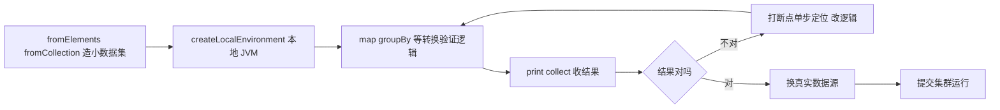

# Flink 程序调试：不连集群、不连真实数据，先把逻辑验对

在分布式集群上调程序，每改一行代码都要打包、提交、再翻各个节点的日志，一轮下来几分钟就过去了，验证的还只是逻辑对不对。而程序逻辑与数据无关：对小的数据集运行正确，对大的数据集同样应该正确。把验证逻辑这件事从集群上摘出来，搬到本地，用最简单的数据集跑通，开发效率才提得上去。

## 先给结论

- 调试拆成两个问题：程序在哪运行，数据从哪来。本地 JVM 加一个简单集合就能把逻辑验完，不必碰集群，也不必对接 Kafka、大量文本文件或 HDFS。
- 环境三法：`getExecutionEnvironment` 按运行上下文自动选环境，`createLocalEnvironment` 显式在本地 JVM 执行，`createRemoteEnvironment` 提交远程集群。
- 数据集用 fromElements、fromCollection 造；结果用 print、collect 收；本地环境就是一个普通 JVM 进程，可以直接打断点单步调试。
- 控制台输出靠 log4j 配置管理，flink-demo 工程的 resources/log4j.properties 就是现成模板。
- 两类高频报错各有固定排查路径：序列化错误查 lambda 捕获的变量与函数成员，类型提取错误查泛型擦除并显式声明类型。

## 一、为什么在本地调，而不是直接上集群

**成本与收益不成比例。** 集群上跑一轮调试，时间花在打包上传、分配资源、翻日志上，真正用来暴露逻辑问题的信号反而少。逻辑验证需要的是快进快出：改一行、跑一次、立刻看结果。

**逻辑与数据规模解耦。** map 里字符串拼接对不对、groupBy 分组键选得对不对，这些判断只跟数据结构有关，跟数据量无关。所以本地造几十条数据，足以把转换链验对；验对之后再换成 readTextFile、Kafka 这类真实数据源，逻辑一行不改。课程画面对应的正是 Flink 官方文档「调试程序」一节的两小节内容：本地执行环境，以及收集数据源和接收器。



这张图是完整的调试闭环：左侧造数据与本地环境，中间跑转换收结果，不对就断点回查，对了才换真实数据源上集群。

## 二、三种创建环境的方法

**getExecutionEnvironment。** 返回当前程序运行所在的环境：在 IDE 里直接跑，它就是本地环境；作业提交到集群，它就是集群环境。工程代码首选这个方法，一份代码本地与集群两处运行，不用改环境行。

**createLocalEnvironment。** 显式要求在本地 JVM 里执行。作业程序本可以放进集群的多台机器、跑在多台机器的 JVM 上，这个方法则把执行位置钉死在本机，专门服务于调试。配套工程的 WordCount 就是这样写的：

```java
// 真实工程代码，包名已改写
final ExecutionEnvironment env = ExecutionEnvironment.createLocalEnvironment();
env.setParallelism(2);
```

顺带把并行度设为 2，本地就能观察多子任务下分组与输出的行为，和集群形态更接近。

**createRemoteEnvironment。** 传入 host 与端口，把作业提交到指定的远程集群，调试阶段基本用不到，作为第三个选项了解即可。

本地环境也可以直接接文件数据源，只是调试逻辑时没必要：

```java
final ExecutionEnvironment env = ExecutionEnvironment.createLocalEnvironment();
DataSet<String> lines = env.readTextFile(pathToTextFile);
// build your program
env.execute();
```

## 三、用集合造数据，用 collect 收结果

课程画面里「收集数据源和接收器」给出了造数据集的标准姿势，三类入口：

```java
final ExecutionEnvironment env = ExecutionEnvironment.createLocalEnvironment();
// 从一组固定元素创建
DataSet<Integer> numbers = env.fromElements(1, 2, 3, 4, 5);
// 从任意 Java 集合创建
List<Tuple2<String, Integer>> data = new ArrayList<>();
data.add(new Tuple2<>("abc", 1));
data.add(new Tuple2<>("def", 2));
DataSet<Tuple2<String, Integer>> tuples = env.fromCollection(data);
```

数据集造好之后，转换链照常写。哪怕逻辑后续要处理的是 Kafka 里设备上报的温度流，本地也先用集合把 map 与 groupBy 验一遍：

```java
tuples.map(new MapFunction<Tuple2<String, Integer>, String>() {
    @Override
    public String map(Tuple2<String, Integer> s) throws Exception {
        // 验证转换逻辑：把元素拼成新结构
        return s.f0 + "_" + s.f1;
    }
}).groupBy(0);
```

**收结果有两种方式。** print 直接打到控制台；collect 把结果收回本地变成 List，能继续用代码比对：

```java
List<String> result = tuples.map(new MapFunction<Tuple2<String, Integer>, String>() {
    @Override
    public String map(Tuple2<String, Integer> s) throws Exception {
        return s.f0 + "_" + s.f1;
    }
}).collect();
```

**断点调试与普通 Java 程序没有区别。** 本地环境就是本机 JVM 里的一个进程，在 map 方法里打上断点，用 Debug 模式启动 main，数据一条一条进来，单步跟踪变量变化即可。这条路径在随包示例中没有独立运行类，按主流实践补充说明。业务逻辑复杂之后，这套「集合造数据加本地断点」的组合拳对开发过程的减负作用会越来越明显。

## 四、日志配置与两类高频报错

**控制台日志走 log4j。** 本地运行时控制台被日志刷屏，级别和格式都在 resources/log4j.properties 里控制，配套工程自带一份可用模板：

```properties
log4j.rootLogger=INFO, console

log4j.appender.console=org.apache.log4j.ConsoleAppender
log4j.appender.console.layout=org.apache.log4j.PatternLayout
log4j.appender.console.layout.ConversionPattern=%d{HH:mm:ss,SSS} %-5p %-60c %x - %m%n
```

这份配置把 root 级别定为 INFO、输出到控制台，行首是时间与级别。依赖方面，工程 pom 里已带 log4j 1.2.17 与 slf4j-log4j12，scope 为 runtime，本地一跑即生效。想安静一点就把级别调成 WARN。

**报错一：函数不可序列化。** 现象是作业启动时抛出实现类不可序列化的异常。Flink 会把算子函数对象分发到各执行进程，函数里捕获了不可序列化的外部变量，或者持有连接这类重型对象，都会触发。排查方向是让函数对象保持轻：被捕获的变量复制成方法内的局部变量；数据库连接这类资源不放到成员变量里 new，挪到算子的 open 生命周期里创建。

**报错二：类型提取失败。** 现象是 InvalidTypesException。Java 的泛型擦除让 Flink 从 lambda 表达式里推不出返回类型，于是运行前直接报错。排查方向是显式给类型：改回显式实现接口的内部类最稳，坚持用 lambda 就在算子链上补 `.returns(...)` 声明返回类型。还有一类「程序跑完没结果」不算报错：批处理惰性，print、collect 与 env.execute 至少要有一个，别把触发时机漏掉。

## 常见误区

- **以为调试必须提交集群。** 错例是每验证一行逻辑都打 jar 包上传。正解是 createLocalEnvironment 加集合数据集，本地把逻辑验完再上集群。
- **本地跑通、集群报错就怀疑逻辑。** 错例是一上集群就翻业务代码。正解是先看依赖打包与序列化：Flink 核心依赖是 provided 范围，打包配置漏了第三方库会直接类找不到，序列化问题则跟函数对象的写法有关，都不是逻辑问题。
- **lambda 版算子不带类型声明。** 错例是用 lambda 写 map 却不写 returns，遇到 InvalidTypesException 还以为是框架缺陷。正解是理解泛型擦除的存在，lambda 路线显式补类型，或改回内部类。
- **日志全靠 System.out.println。** 错例是在算子里随手打输出，集群上散在各节点收不回来。正解是走 log4j 按级别与包名控制，关键路径才留痕。

## 面试可能被问到的问题

1. 面试官追问：「getExecutionEnvironment、createLocalEnvironment、createRemoteEnvironment 有什么区别？」
   答：第一个按运行上下文自动返回对应环境，IDE 里是本地、集群上是集群环境；第二个显式钉在本地 JVM，专用于调试；第三个传 host 与端口，把作业提交到指定远程集群。
2. 面试官追问：「本地调试时数据集怎么造，结果怎么收？」
   答：数据集用 fromElements 从一组固定元素造、fromCollection 从 Java 集合造；结果用 print 打控制台，或用 collect 收回本地 List 做比对。两者都会主动触发执行。
3. 面试官追问：「Flink 能像普通 Java 程序一样打断点调试吗？」
   答：本地可以。createLocalEnvironment 创建的环境就是本机 JVM 进程，在算子函数里打断点、以 Debug 模式启动 main 即可单步跟踪；集群上的调试则主要依赖日志与 Web 界面观察。
4. 面试官追问：「作业报函数不可序列化，通常是什么原因，怎么排查？」
   答：Flink 会把算子函数对象分发到执行进程，函数捕获了不可序列化的外部变量或持有连接这类成员就会报错。排查方向是让函数保持轻：捕获变量改成局部变量，连接资源挪到 open 生命周期里创建。
5. 面试官追问：「InvalidTypesException 是怎么产生的，怎么解决？」
   答：Java 泛型擦除导致 Flink 无法从 lambda 推断算子的返回类型。解决办法是显式声明类型，比如链上补 returns 给出 TypeInformation，或者放弃 lambda 改用显式实现接口的内部类。

## 配套资料

- 代码：`materials/code/06/day4 Flink基础与流数据处理/`，flink-demo 工程的 batch/WordCount（createLocalEnvironment 与 setParallelism 的真实用法）、batch/util/WordCountData（fromElements 造数据集）、resources/log4j.properties 与 pom.xml（log4j 1.2.17 与 slf4j-log4j12 依赖），均为真实随包文件，正文包名改写为 `com.study.coldchain`。
- 说明：day5 调试主题无独立源码包，造数据与收结果的示例按本课画面与口播整理补全；断点调试与序列化、类型提取报错排查在随包示例中无运行类，按主流实践补充并已在正文注明；引用路径截至 day 目录层级。
