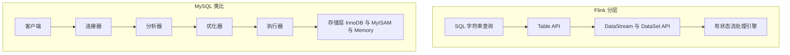

# Table API 与 SQL 简介：架在 DataStream 之上的关系型查询层

DataStream 和 DataSet 的算子已经足够把统计逻辑写出来，但代价是每个查询维度都要重铺一遍转换链，SQL 背景的人接手 Flink 工程时门槛也陡增。Flink 在这两套核心 API 之上封了一层关系型抽象，对外提供 Table API 和 SQL 两种查询方式。这层抽象在架构里站哪个位置、查询过程为什么和 MySQL 如此相似、工程里要引哪两支依赖，先把骨架立清楚，后面两节的示例才看得懂。

## 先给结论

- Flink 针对流处理和批处理统一提供两种关系型 API：Table API 与 SQL，无论有界数据还是无界数据，都能用同一种方式查询。
- Table API 允许以直观的链式调用完成 select、filter、join 等操作；SQL 基于 Apache Calcite 实现，写成标准 SQL 字符串交给引擎解析执行。
- 架构分层自下而上是：有状态流处理引擎、DataStream/DataSet API（核心层）、Table API（Calcite 组件）、SQL；查询的内部流程与 MySQL 的连接器、分析器、优化器、执行器流水线大致对应。
- 工程上要补两支依赖：`flink-table-api-java-bridge_2.11` 与 `flink-table-planner_2.11`，版本 1.8.0，与阶段内工程保持一致。
- Table API 的调用链在编译期就能查出类型错误，SQL 是运行时才解析的字符串，拼接时少一个空格都会在执行阶段炸出来。

## 一、关系型抽象站在哪一层

Table API 和 SQL 不是替代 DataStream 与 DataSet 的第三套编程模型，而是压在它们之上的顶层查询层。分层看最清楚，底层引擎不动，中间的核心 API 不动，顶上多了一个关系型组件：

这张图在讲 Flink 关系型能力的分层位置，右侧是 MySQL 的查询流水线类比：



左图自上而下读：SQL 写成的查询语句交给 Table API 这一层，Table API 坐在 Apache Calcite 组件之上，再往下翻译成 DataStream 与 DataSet 的作业逻辑，最终跑在有状态流处理引擎上。右图是类比：一个客户端连上服务端，先过连接器，SQL 语句被送进分析器做语法与语义分析，优化器接着做内部优化，执行器具体执行，数据落在 InnoDB、MyISAM 这类存储引擎里。Flink 的查询执行原理与这条流水线大致对应，分析、优化、执行各司其职；对应到存储层，DataStream 与 DataSet 相关的 Processors 扮演了类似角色。实际开发不必深究引擎内部，理解「顶层声明查询、底层翻译执行」这个定位即可。

## 二、Table API 链式调用与 SQL 字符串

两种 API 干的是同一类事，形态完全不同。Table API 是语言内嵌的，查询以方法调用的形式组织成链，select、filter、join 全部挂在 Table 对象上，IDE 能补全，写错类型编译期就报红。SQL 则是一段标准 SQL 字符串，交给 `sqlQuery` 执行，语法来自 Apache Calcite，会 SQL 的人几乎零成本上手。两种写法可以混用，产出的都是 Table 类型。拿阶段工程里的真实代码对照一下：

```java
// SQL 写法：字符串交给引擎，运行时解析
Table result = tEnv.sqlQuery("SELECT * FROM " + tableA + " WHERE amount > 2 union all " +
        "select * from " + tableB + " where amount < 2");

// Table API 写法：链式调用，编译期检查
Table result2 = tableA.where("amount > 2")
        .unionAll(tableB.where("amount < 2"));
```

同样的「两张表各取满足条件的行再合并」，SQL 版是一整串字符串，Table API 版是 `where` 加 `unionAll` 的方法链。Table API 的行内表达式（如 `"amount > 2"`）仍是字符串，但操作本身由方法调用组织，漏写步骤或链错对象编译不过；SQL 版的任何笔误都要等到运行时才暴露。两者的产物都是 Table，可以继续参与下一步查询。

## 三、把流和批抽象成表

这层查询能力能同时罩住流和批，靠的是统一的数据抽象。批数据是有界的表，行数固定，攒齐了算；流数据则是一张随时间不断追加行的动态表，查询声明一次，数据持续到来持续生效。输入表、输出表这一对概念也建立在这层抽象上：查询引用的是输入表，结果写到输出表，至于底下垫的是有界的 DataSet 还是无界的 DataStream，声明查询的人不用关心。

对 1.8 这个版本而言，把动态表理解成「能被 Table API 和 SQL 查询的流批统一抽象」就够用了，更完整的时态语义是后续版本逐步补齐的。这个抽象最直接的收益在工程协作上：写统计逻辑的人声明查询，接 Kafka、socket 数据源的人照旧用 DataStream 搭管道，两边在 Table 这个交界处会合。

## 四、依赖坐标：bridge 与 planner 两支

在已有的 Flink 工程里跑 Table API 或 SQL，pom 需要补两支依赖。阶段工程 `flink-demo` 引入的就是这一组，版本 1.8.0，Scala 二进制版本沿用 2.11：

```xml
<properties>
    <flink.version>1.8.0</flink.version>
    <scala.binary.version>2.11</scala.binary.version>
</properties>

<dependencies>
    <!-- 桥接层：把 Table API 接到 DataStream 与 DataSet 上 -->
    <dependency>
        <groupId>org.apache.flink</groupId>
        <artifactId>flink-table-api-java-bridge_${scala.binary.version}</artifactId>
        <version>1.8.0</version>
    </dependency>
    <!-- planner：负责查询的优化与执行计划，类似优化器加执行器的角色 -->
    <dependency>
        <groupId>org.apache.flink</groupId>
        <artifactId>flink-table-planner_${scala.binary.version}</artifactId>
        <version>1.8.0</version>
    </dependency>
</dependencies>
```

两支依赖分工明确：`flink-table-api-java-bridge` 是桥，Java 程序里的 Table 对象、TableEnvironment 入口都由它提供，没有它程序里根本没有 Table 这个类型可写；`flink-table-planner` 对应架构图里优化器与执行器那一层，查询的解析、优化、翻译成 DataStream 作业全靠它。名字后缀的 `_2.11` 是 Scala 二进制版本标记，必须与工程里其他 Flink 依赖一致，混用 2.11 与 2.12 会在运行时抛出类找不到的错。底下的 flink-java 与 flink-streaming-java 照旧保留，Table 层做输入输出时还要靠它们。

## 常见误区

- **只加 planner 不加 bridge，或反过来。** 错例是看到报错缺 planner 就补 planner，结果 `org.apache.flink.table.api.Table` 还是 import 不进来。正解是 bridge 提供 API 类型与入口，planner 提供优化执行，两支缺一不可。
- **SQL 字符串拼接时漏空格。** 错例是 `"SELECT * FROM " + tableA + "WHERE amount > 2"`，拼出来 `tableAWHERE`，运行时抛 SQL 解析异常。正解是每个拼接片段首尾都留好空格，关键字之间不能黏连。
- **把 Table API 和 SQL 当成绕开 DataStream 的独立体系。** 错例是想全程只用 SQL，却发现数据进不来出不去。正解是数据入口出口仍由 DataStream/DataSet 承担，`fromDataStream` 进、`toAppendStream` 出，Table 层只负责中间的查询段。
- **从文档复制 SQL 时混入中文标点或弯引号。** 错例是条件里带了全角引号，Calcite 解析直接失败。正解是 SQL 字符串里只用英文半角符号。

## 面试可能被问到的问题

1. 面试官追问：「Flink 已经有 DataStream 和 DataSet API 了，为什么还要提供 Table API 和 SQL？」
   答：DataStream/DataSet 面向过程，每个查询都要铺算子链，SQL 背景的人门槛高、维护成本也高。Table API 和 SQL 是声明式的关系型查询层，写一句 select 就能表达同样的统计逻辑，且流批统一、底层仍翻译成 DataStream/DataSet 执行，降低使用门槛的同时没有脱离 Flink 引擎。
2. 面试官追问：「Table API 和 SQL 有什么区别，各自适合什么场景？」
   答：Table API 是语言内嵌的链式调用，编译期可查错、易与 Java 逻辑混排，适合在代码里精细组装查询；SQL 是基于 Apache Calcite 的标准语法字符串，业务与数据分析人员上手快，适合相对独立、可能频繁调整的查询。两者产出都是 Table，可以混用。
3. 面试官追问：「一条 Flink SQL 从提交到执行大概经过哪些阶段？」
   答：与 MySQL 的流水线类似：语句先进解析与分析阶段做语法语义检查，再进优化器做内部优化，最后由执行器翻译执行；在 Flink 里这段职责由 Calcite 与 planner 承担，产物最终落回 DataStream/DataSet 层运行。
4. 面试官追问：「flink-table-api-java-bridge 和 flink-table-planner 两个依赖怎么分工？」
   答：bridge 是 Java 与 Table 体系的桥接层，提供 TableEnvironment、Table 等类型与 DataStream/DataSet 的互转入口；planner 负责查询的解析、优化与执行计划生成。依赖坐标要带 `_2.11` 这样的 Scala 二进制后缀，且版本与其他 Flink 依赖保持一致。
5. 面试官追问：「什么是动态表？」
   答：Flink 关系型层对流与批的统一抽象：批数据是有界的静态表，流数据是随时间不断追加行的动态表。查询在表上声明一次，由引擎翻译成持续的 DataStream 作业或一次性的批作业，声明方不用关心底下是有界还是无界数据。

## 配套资料

- 代码：`materials/code/06/day4 Flink基础与流数据处理/`，flink-demo 工程的 pom.xml（`flink-table-api-java-bridge_2.11` 与 `flink-table-planner_2.11` 两支依赖真实存在，版本 1.8.0）、table/StreamTable（SQL 与 Table API 两种写法对照的真实类），均为真实随包文件，包名改写为 `com.study.coldchain`。
- 说明：day5 无独立代码目录，示例为按课程画面写法补全；分层架构与查询流水线按课程讲解整理，动态表概念为按 Flink 1.8 官方口径补全的说明；引用路径截至 day 目录层级。
