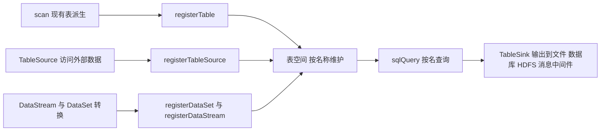

# 在表空间中注册表：让 SQL 按名字查到你的数据

SQL 靠表名找数据，而在 Flink 里直接 `sqlQuery` 一个从没登记过的名字，引擎立刻报找不到表。名字登记在哪里？在 TableEnvironment 维护的表空间里，它按名称管理所有注册的表。哪些东西有资格注册成表、批与流各用什么方法注册、注册前后这张表的生命周期有什么差别、查完的结果怎么送出去，这一节把注册的几条路一次走全。

## 先给结论

- 表空间按名称维护注册的表；表分输入表与输出表两类，可以近似理解成 DataSet/DataStream 编程里的输入源与输出源。
- 成为输入表有三条路：对现有表查询派生新表、用 TableSource 访问外部数据、由 DataStream/DataSet 转换注册。
- 输出方向实现 TableSink，把查询结果送到文件、数据库、HDFS、消息中间件等外部系统。
- 批环境用 registerDataSet 注册，流环境用 registerDataStream 注册，都能显式指定字段名；结果再用 toDataSet 或 toAppendStream 转回底层 API。
- 未注册的 Table 只是内存里的临时对象，SQL 看不见它；注册后按名进入目录，生命周期随 TableEnvironment，同名重复注册会被拒绝。

## 一、表空间与输入表、输出表

TableEnvironment 的角色之一就是表空间：一个按名称维护表的目录。往这个目录里登记的表分两类，输入表供 API 与 SQL 查询引用，输出表负责把查询结果发到外部系统。这对概念直接对应批流编程里已经熟悉的输入源与输出源，只是换到了关系型这一层：数据源不再以算子形式出现，而是以「注册成一张表」的形式进入查询体系。

这张图在讲表从哪里注册进来、又从哪里送出去，中间是表空间这个枢纽：



图里左边三条来路对应三种注册方向，中间的表空间由 TableEnvironment 持有，查询从目录里按名取表，结果的出口统一走 TableSink。三条来路里，DataStream 与 DataSet 转换这条在批流与 Table 集成编程里已经见过，重点补齐另外两条，再把注册前后的差别讲清楚。

## 二、第一条路：从现有表派生新表

已经注册过的表还能再加工：从表空间里查出来，select 投影一番，得到的结果再登记成新表：

```java
// 创建流表环境（BatchTableEnvironment 用法类似）
StreamTableEnvironment tableEnv = StreamTableEnvironment.create(env);
// 从表空间中查询表，并执行 select 操作，得到一张临时表
Table projTable = tableEnv.scan("tableName").select(/* 字段表达式 */);
// 把临时表注册成新表
tableEnv.registerTable("projectedTable", projTable);
```

流程分三拍：scan 按名从表空间里找到已有表；select 对它做投影，产出一张表，此刻它还在内存里，只是个临时对象；registerTable 把它登记进表空间，从此 `projectedTable` 这个名字可以被任何 SQL 引用。这张图在课程画面里是文档示例，工程里照此写法补全即可。派生表的价值在于把常用查询固化成新表名，后续查询直接用短名，SQL 层次感也随之建立。

## 三、批环境注册 DataSet：registerDataSet

第三条路在批场景的真实代码里走一遍。DataSet 注册成表，SQL 直接分组聚合，这正是 Table 层最省事的地方：

```java
package com.study.coldchain.demo.flink.table;

import org.apache.flink.api.java.DataSet;
import org.apache.flink.api.java.ExecutionEnvironment;
import org.apache.flink.table.api.Table;
import org.apache.flink.table.api.java.BatchTableEnvironment;

public class DataSetTable {
    public static void main(String[] args) throws Exception {
        // 1. 批执行环境与批 Table 环境
        ExecutionEnvironment env = ExecutionEnvironment.getExecutionEnvironment();
        BatchTableEnvironment tEnv = BatchTableEnvironment.create(env);

        // 2. 输入源：三个 WC 对象
        DataSet<WC> data = env.fromElements(
                new WC("hello", 2),
                new WC("word", 3),
                new WC("hello", 4)
        );

        // 3. DataSet 注册成表，显式声明字段 word 与 frequency
        tEnv.registerDataSet("WordCount", data, "word, frequency");

        // 4. SQL 分组聚合：按 word 对 frequency 求和
        Table table = tEnv.sqlQuery(
                "select word, sum(frequency) as frequency from WordCount group by word");

        // 5. 结果 Table 转回 DataSet 输出
        DataSet<WC> result = tEnv.toDataSet(table, WC.class);
        result.print("WC");

        env.execute();
    }

    public static class WC {
        public String word;
        public long frequency;

        public WC() {}

        public WC(String word, long frequency) {
            this.word = word;
            this.frequency = frequency;
        }

        @Override
        public String toString() {
            return "WC " + word + ":" + frequency;
        }
    }
}
```

对照批版单词统计的算子链（flatMap 分词、groupBy 分组、sum 求和），这段代码把聚合段整个换成了 `registerDataSet` 加一句 SQL：注册时第二个参数 `"word, frequency"` 把 WC 的 public 字段映射成表的列名，SQL 的 `group by word` 加 `sum(frequency)` 直接产出统计结果。注册是双向通道的另一端也齐了：`toDataSet(table, WC.class)` 把查询结果转回 DataSet，print 带上 `WC` 标识输出，最后照常 `env.execute()`。运行结果：

```text
WC hello:6
WC word:3
```

hello 两条记录的 2 与 4 聚成 6，word 保持 3（按课程演示整理）。

## 四、流环境注册 DataStream：registerDataStream

流场景的注册与转换在另一个真实类里，注册、转换、转回三个动作齐备：

```java
StreamExecutionEnvironment env = StreamExecutionEnvironment.getExecutionEnvironment();
StreamTableEnvironment streamTableEnvironment = StreamTableEnvironment.create(env);
env.setParallelism(2);

DataStream<Tuple2<String, Integer>> stream = env.fromElements(
        new Tuple2<>("hello", 2),
        new Tuple2<>("world", 3)
).setParallelism(3);

// 注册表 myTable，元组字段用默认名 f0 与 f1
streamTableEnvironment.registerDataStream("myTable", stream);
// 注册表 myTable2，显式指定字段名 word 与 count
streamTableEnvironment.registerDataStream("myTable2", stream, "word, count");

// 不注册也行：直接由流转换出 Table 对象
Table table = streamTableEnvironment.fromDataStream(stream, "word, count");

// Table 转回 DataStream：声明目标类型信息
TupleTypeInfo<Tuple2<String, Integer>> tupleTypeInfo = new TupleTypeInfo<>(
        Types.STRING(),
        Types.INT()
);
DataStream<Tuple2<String, Integer>> dataStream =
        streamTableEnvironment.toAppendStream(table, tupleTypeInfo);
```

（Types 来自 `org.apache.flink.table.api` 包。）这段代码浓缩了注册与转换的全部要点。注册时字段名两种给法：不给，元组按默认位置名 f0、f1 建列；给了，如 myTable2 显式映射成 word 与 count，SQL 里引用起来清楚得多。`registerDataStream` 与 `fromDataStream` 的分工在这里一目了然：前者把流登记进表空间，SQL 能按名查；后者只产出 Table 对象，只能被对象引用着做链式调用。转回方向，`toAppendStream` 除了传 Table 还要传类型信息，这里构造了一个 `TupleTypeInfo` 声明目标类型，转出来的 DataStream 可以继续走流处理的老路。

## 五、TableSource 与 TableSink：外部数据进与出

第二条来路和出口方向靠一对接口支撑。TableSource 把外部数据包装成输入表，文件系统、数据库、消息中间件里的数据都能这样接进来；TableSink 是它的镜像，把表数据写到外部系统。以最常见的 CSV 为例：

```java
// TableSource：把 CSV 文件登记成输入表（示例为按主流写法补全）
TableSource csvSource = new CsvTableSource("/path/to/file", fieldNames, fieldTypes);
tableEnv.registerTableSource("CsvTable", csvSource);

// TableSink：登记输出表，字段名与类型和写入格式对齐
TableSink csvSink = new CsvTableSink("/path/to/file", ",");
String[] fieldNames = {"a", "b", "c"};
TypeInformation[] fieldTypes = {Types.INT(), Types.STRING(), Types.LONG()};
tableEnv.registerTableSink("CsvSinkTable", fieldNames, fieldTypes, csvSink);
```

注册 TableSource 用 `registerTableSource`，注册 TableSink 用 `registerTableSink`，后者还要求同时声明字段名与字段类型，因为输出表的 schema 必须与目标文件或目标库的列对齐。查出结果要落地时，把查询结果表 insert 到注册好的输出表即可。除了内置的 CSV 实现，文件、HDFS、关系型数据库、消息队列都有对应的 source 与 sink 实现可选，接口形态是一致的：进来实现 TableSource，出去实现 TableSink。

## 六、注册前后的生命周期

注册这个动作改变了 Table 的存在方式。注册之前，`fromDataStream` 或 select 产出的 Table 是内存里的临时对象，只能通过对象引用参与 Table API 的链式调用，SQL 字符串里写它的任何名字都找不到；引用一丢，对象就不可达了。注册之后，它按名字进入 TableEnvironment 的目录，程序里任何一处 `sqlQuery` 都能按名引用，名字成了这张表的钥匙。注册的是逻辑视图而不是数据副本，数据不动、不物化，查询执行时才翻译成作业去跑，所以注册本身开销很小；代价是名字归属这个 TableEnvironment，环境结束，目录连同里面所有名字一起消失，同名表重复注册也会被拒绝。一句话收束：临时对象靠引用活着，注册表靠名字活着，名字的生命周期不会超过它的表空间。

## 常见误区

- **SQL 里引用没注册的表名。** 错例是 fromDataStream 拿到一个 Table 对象，直接在 SQL 字符串里写它的变量名，运行时报找不到表。正解是要么注册成表名，要么把 Table 对象拼进 SQL 字符串。
- **把注册当成数据复制。** 错例是担心 registerDataStream 会把流拷贝一份占内存。正解是注册只建立名称到数据源的逻辑映射，数据不物化，查询时才执行。
- **registerTableSink 忘了给字段名与类型。** 错例是只传 sink 不传 schema，输出表结构对不上，写库或写文件时报类型错误。正解是 fieldNames 与 fieldTypes 和目标存储的列严格对齐。
- **批流注册方法用串门。** registerDataSet 只存在于批表环境，流表环境对应的是 registerDataStream，环境选错方法根本不存在。
- **同一表名反复注册。** 表空间按名唯一，重复注册同名表会被拒绝，需要换名或先做版本管理。

## 面试可能被问到的问题

1. 面试官追问：「什么是表空间？输入表和输出表分别对应什么？」
   答：表空间是 TableEnvironment 按名称维护的表目录。输入表供 API 与 SQL 查询引用，对应批流编程里的输入源；输出表承接查询结果并发往外部系统，对应输出源。
2. 面试官追问：「哪些东西可以注册成输入表？」
   答：三类：对现有表执行查询派生的新表，scan 加 select 再 registerTable；通过 TableSource 访问的外部数据，如 CSV、数据库、消息中间件；由 DataStream 或 DataSet 转换注册的表，批用 registerDataSet、流用 registerDataStream。
3. 面试官追问：「registerDataStream 和 fromDataStream 有什么区别？」
   答：registerDataStream 把流注册进表空间，SQL 能按名引用；fromDataStream 只产出 Table 对象，靠引用参与 Table API 链式调用，SQL 字符串看不见它。要跨 SQL 引用就必须注册。
4. 面试官追问：「Table 查询结果怎么转回 DataSet 或 DataStream？」
   答：批环境用 toDataSet 并指定目标类，流环境用 toAppendStream 指定目标类或类型信息；带聚合更新语义的结果则要 retract 回撤流。Table 是无类型行列，转换时声明的类型决定了恢复成什么数据结构。
5. 面试官追问：「TableSink 的作用是什么，注册时要提供什么？」
   答：TableSink 定义表数据发往外部系统的出口，文件、数据库、HDFS、消息队列都有对应实现。注册时调用 registerTableSink，除 sink 实例外还要声明字段名数组与字段类型数组，保证输出表 schema 与目标存储对齐。
6. 面试官追问：「注册的表是什么时候真正执行的？」
   答：注册只登记逻辑映射，不物化数据；SQL 查询声明式地挂在表上，执行时机由作业触发决定，查询时才翻译成 DataStream/DataSet 作业运行，这也是声明式查询与算子链写法的本质差异。

## 配套资料

- 代码：`materials/code/06/day4 Flink基础与流数据处理/`，flink-demo 工程的 table/DataSetTable（registerDataSet 注册加 SQL 分组聚合加 toDataSet 转回的真实批程序）、table/TableTransfer（registerDataStream、fromDataStream、toAppendStream 转回的真实流程序），均为真实随包文件，包名改写为 `com.study.coldchain`。
- 说明：day5 无独立代码目录；scan 派生表与 CsvTableSource、CsvTableSink 示例为按课程画面与主流写法补全；运行输出按课程演示整理；引用路径截至 day 目录层级。
