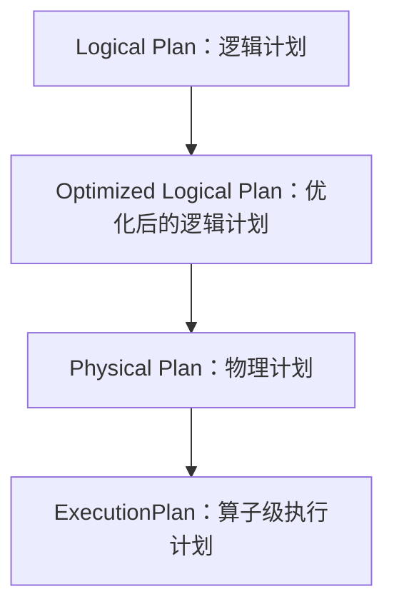
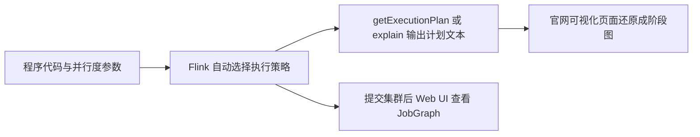

# Flink 执行计划分析：把 getExecutionPlan 与 explain 的输出读成一张图

作业提交上去，Flink 会把它拆成不同任务交给 TaskManager 执行，至于怎么拆、按什么顺序流动，是 Flink 根据程序参数和集群里 TaskManager 的数量自动选定的执行策略。数据始终在一棵有向无环图上流动计算，这张图长什么样、每个节点做了什么，直接决定你能不能判断程序慢在哪、并行度设没设对。Flink 提供了至少两种查看执行计划的方式：代码里打印计划文本再贴到官网可视化页面，以及提交后在 Web UI 上看作业的执行图。DataStream、DataSet 与 Table 各有各的计划，读法各有侧重。

## 先给结论

- 执行计划是 Flink 自动选定的执行策略的具象化：一棵有向无环图，节点是任务，边是数据流向。
- DataStream 与 DataSet 的计划用 `env.getExecutionPlan()` 打印，输出一段 JSON；Table 的计划用 `tableEnv.explain(table)` 打印，输出分逻辑计划、优化逻辑计划、物理计划几段。
- JSON 里每个节点有 id、type、contents、parallelism 等字段，节点之间的连线由 predecessors 里的 id 指出，读计划先读关系、再读内容。
- 计划 JSON 贴到 Flink 官网的执行计划可视化页面，可以还原成阶段图，例如数据源阶段与算子阶段。
- Web UI 的 Running Jobs 与 Completed Jobs 里，每个作业都能看到执行图，节点与并行度一目了然。

## 一、执行计划解决什么问题

写代码时你只声明了转换链，并没有告诉 Flink 怎么分任务。Flink 会结合客户端提交的程序参数，以及当前集群中 TaskManager 的机器数量，自动选取它认为合理的执行策略：哪里并行、哪里串成一条链、数据在节点之间怎么交换，都由它决定。了解 Flink 为每个任务选定的执行计划，对理解客户端程序如何被执行非常有帮助。

在 Web UI 上这一点可以直接看到：提交完程序，Running Jobs 或 Completed Jobs 里每一个任务都有一个执行计划，分成若干节点，从这个节点到那个节点做了什么操作都标得清清楚楚。看懂它，就能回答「我的程序先执行了哪一步、再执行了哪一步、每步之间是什么关系、数据如何流动」。

## 二、两种打印：getExecutionPlan 与 explain

先在代码层面开发一个查看执行计划的程序。DataStream 的执行计划用执行环境的 getExecutionPlan 方法打印；Table 的执行计划需要先把流转成表，再用表环境的 explain 方法打印：

```java
package com.study.coldchain.demo.flink.table;

import org.apache.flink.api.common.functions.FlatMapFunction;
import org.apache.flink.streaming.api.datastream.DataStream;
import org.apache.flink.streaming.api.environment.StreamExecutionEnvironment;
import org.apache.flink.table.api.Table;
import org.apache.flink.table.api.java.StreamTableEnvironment;
import org.apache.flink.util.Collector;

import java.util.ArrayList;
import java.util.List;

public class ExplainTest {

    public static void main(String[] args) {
        // 1. 两个执行环境：流执行环境与流式 Table 环境
        StreamExecutionEnvironment env = StreamExecutionEnvironment.getExecutionEnvironment();
        StreamTableEnvironment tableEnv = StreamTableEnvironment.create(env);

        // 2. 数据源：集合里的整数经 flatMap 每个元素乘 2，并行度设为 2
        List<Integer> list = new ArrayList<>();
        DataStream<Integer> stream = env.fromCollection(list)
                .flatMap(new FlatMapFunction<Integer, Integer>() {
                    @Override
                    public void flatMap(Integer integer, Collector<Integer> collector) throws Exception {
                        collector.collect(integer * 2);
                    }
                })
                .setParallelism(2);

        // 3. 打印 DataStream 的执行计划：输出一段 JSON
        System.out.println(env.getExecutionPlan());

        // 4. 流转成表，字段命名为 num，打印 Table 的执行计划
        Table table = tableEnv.fromDataStream(stream, "num");
        System.out.println(tableEnv.explain(table));
    }
}
```

运行后先打印出 DataStream 的计划，它是一段 JSON。拷贝到 Flink 官网专门做执行计划可视化的页面粘贴进去，页面会把它还原成图。Table 的计划同样有输出，长相却不一样，下一节展开。

随包工程里还有一个更接近真实查询的 ExplainTable，两条流各自转成表后做过滤与联合，再交给 explain：

```java
package com.study.coldchain.demo.flink.table;

import org.apache.flink.api.java.tuple.Tuple2;
import org.apache.flink.streaming.api.datastream.DataStream;
import org.apache.flink.streaming.api.environment.StreamExecutionEnvironment;
import org.apache.flink.table.api.Table;
import org.apache.flink.table.api.java.StreamTableEnvironment;

public class ExplainTable {

    public static void main(String[] args) {
        StreamExecutionEnvironment env = StreamExecutionEnvironment.getExecutionEnvironment();
        StreamTableEnvironment streamTableEnvironment = StreamTableEnvironment.create(env);

        DataStream<Tuple2<Integer, String>> stream1 = env.fromElements(
                new Tuple2<>(1, "hello"),
                new Tuple2<>(2, "world"),
                new Tuple2<>(5, "flink")
        );
        DataStream<Tuple2<Integer, String>> stream2 = env.fromElements(
                new Tuple2<>(5, "hello1"),
                new Tuple2<>(2, "world1"),
                new Tuple2<>(3, "flink1")
        );

        // 位置 0 命名为 count，位置 1 命名为 word
        Table table1 = streamTableEnvironment.fromDataStream(stream1, "count, word");
        Table table2 = streamTableEnvironment.fromDataStream(stream2, "count, word");

        // 过滤加联合的查询，交给 explain 输出执行计划
        Table result = table1.where("like(word, 'w%')")
                .unionAll(table2);

        String explanation = streamTableEnvironment.explain(result);
        System.out.println(explanation);
    }
}
```

## 三、explain 与 JSON 输出怎么读

DataStream 的计划 JSON 每个节点大致长这样：

```json
{
  "id": 0,
  "type": "Flat Map",
  "operator": "Flat Map",
  "contents": "Flat Map",
  "parallelism": 2,
  "predecessors": [
    {
      "id": 1,
      "operator": "Source",
      "type": "SOURCE",
      "side": "second"
    }
  ]
}
```

读法上先抓三样东西：type 告诉你节点是什么算子，parallelism 告诉你并行度（flatMap 节点是 2，说明流上的 setParallelism 生效了），predecessors 的 id 告诉你上游是谁。把可视化页面还原出来的阶段图配合着看更直观：

```text
Stage 1: Data Source
content: collect elements with CollectionInputFormat

Stage 2: Operator
content: Flat Map
```

第一个阶段是数据源任务，用 CollectionInputFormat 从集合里收集元素；第二个阶段是算子任务，执行 Flat Map。源与算子被拆成两个阶段，正是因为流上显式设置了并行度，Flink 无法把它们链在一起。

Table 的 explain 输出则是三段式，从逻辑计划一路走到物理计划：



逻辑计划段能看到形如 `FlinkLogicalDataStreamScan(id=[2], fields=[num])` 的节点，含义是「对一条数据流做扫描」，id 是系统默认生成的编号，fields 是这张表的字段，也就是把流转表时命名的 num。优化后的逻辑计划段保留扫描节点，是优化器按规则改写之后的结果；物理计划段则落到具体步骤：先从 CollectionInputFormat 设置 DataStream 数据源，接着执行 Flat Map，再把 DataStream 转换成 Table。对照上一课的六个阶段，正好是逻辑计划、优化逻辑计划、物理计划的文本呈现。

## 四、优化器做了什么，Web UI 上看什么

优化器的工作全部发生在 explain 输出的两段之间：基于 Calcite 通用规则与 Flink 定制规则改写逻辑计划，例如调整节点形态、合并可以合并的操作。它是规则驱动的改写，不是猜测性调参；对比 explain 输出里优化前后两段，就能看出它动了哪些节点。日常开发中值得养成一个习惯：复杂查询先 explain 一把，确认优化器给出的计划符合预期，再去提交。

Web UI 侧则是另一扇窗。作业提交到集群后，无论运行中还是已完成，点开作业就能看到执行图。课程的管理页面上有一个已完成的流式迭代示例作业，执行图里 IterationSource、Map、Sink: Print to Std.、IterationSink 这些节点串成一条线，每个节点旁边标着并行度。本地打印的计划与 Web UI 的执行图描述的是同一套策略，只是呈现形式一个是 JSON 文本、一个是图。



这张图把查看执行计划的两条路径放在一起：代码里打印是提交前的静态分析，Web UI 是提交后的实地核对，两边对得上，作业怎么跑就心里有数了。

## 常见误区

- **只看节点内容、不看连线关系。** 错例：盯着 contents 字段确认有 Flat Map 就完事。正解：predecessors 里的 id 才描述拓扑，先理清谁连谁，再看每个节点做什么。
- **把 Table 的 explain 与 DataStream 的 getExecutionPlan 混为一谈。** 错例：以为两者输出同一种东西。正解：前者分逻辑计划、优化逻辑计划、物理计划多段，后者只有算子级 JSON，字段与读法都不同。
- **以为打印执行计划会触发作业执行。** 正解：getExecutionPlan 与 explain 只生成计划描述文本，不会把作业跑起来，可以放心在提交前反复打印。
- **本地计划与集群执行图不一致就以为出了问题。** 正解：执行策略受提交参数与集群 TaskManager 数量影响，本地与集群资源不同，计划形态随之调整，应结合参数看差异。

## 面试可能被问到的问题

1. 面试官追问：「怎么查看一个 DataStream 作业的执行计划？」
   答：本地可用 env.getExecutionPlan() 打印 JSON，贴到 Flink 官网的执行计划可视化页面还原成阶段图；提交集群后在 Web UI 的 Running Jobs 与 Completed Jobs 里也能看到每个作业的执行图。
2. 面试官追问：「Table 的 explain 输出分几部分，各是什么？」
   答：分逻辑计划、优化后的逻辑计划、物理计划三段。逻辑计划里有 FlinkLogicalDataStreamScan 这类扫描节点，物理计划段给出具体的源、算子与转换步骤。
3. 面试官追问：「执行计划 JSON 里最值得看哪些字段？」
   答：type 与 contents 看节点是什么算子，parallelism 看并行度是否生效，predecessors 的 id 看节点间的数据流向。
4. 面试官追问：「优化器在计划生成过程中承担什么职责？」
   答：在逻辑计划生成后做两轮规则改写，先 Calcite 通用规则、再 Flink 定制规则，产出优化逻辑计划并据此生成物理计划；explain 输出里优化前后两段的差异就是它的成果。
5. 面试官追问：「Flink 为什么能自动选执行策略？」
   答：它综合客户端提交的程序参数与集群中 TaskManager 的数量来决定任务拆分与数据交换方式，执行计划就是这份策略的具象化描述。
6. 面试官追问：「DataStream 计划里源和 Flat Map 为什么是两个阶段？」
   答：算子上显式设置了不同的并行度后，Flink 无法把源与算子链接成同一任务，就拆成两个阶段；阶段数与并行度设置直接相关。

## 配套资料

- 代码：`materials/code/06/day4 Flink基础与流数据处理/`，flink-demo 工程的 table 包 ExplainTable（过滤加联合查询打印执行计划的真实写法），真实随包文件，包名改写为 `com.study.coldchain`。
- 说明：集合源加 flatMap 的 ExplainTest 演示类无随包源码，按课程画面写法补全；引用路径截至 day 目录层级。
