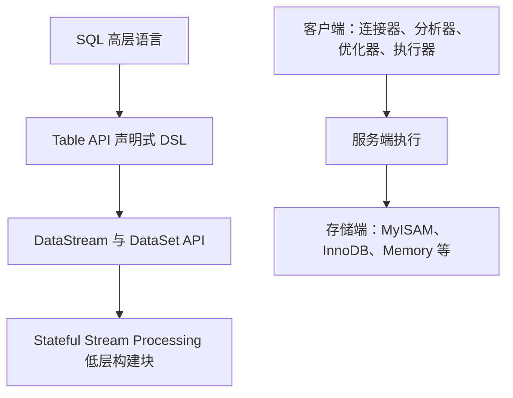

# day5 复盘：DataSet 批处理与 Table SQL 的知识地图收口

day5 一天的内容密度比 day4 更高：DataSet 批处理一条线，Table API 与 SQL 一条线，中间穿插调试、执行计划、流批互转，收尾还接了一次 MySQL 数据源。散着听完容易只剩「都学过」的模糊印象，收口靠复盘：把知识点挂回两张地图，配上几个自查必答题，答不上来的地方回到对应小节补。

## 先给结论

- day5 两大块：DataSet 批处理与 Table API 和 SQL，前者管有界数据，后者把计算表达升级成关系型查询。
- DataSet 程序三段式：输入源、转换、输出。输入源覆盖文本文件、集合与 createInput 通用输入格式，MySQL 数据也能从这里进来。
- Table API 与 SQL 底层复用 Apache Calcite 做连接、分析、优化、执行，核心类 TableEnvironment 衍生 Batch 与 Stream 两个表环境，分别服务有限数据集与实时数据流。
- 流、批与 Table 双向互转；MySQL 表经 JDBCInputFormat 读入注册后同样能 sqlQuery 查询，day5 由此形成从写查询、看计划到接数据的最小闭环。
- 这套底座直接支撑 day6 的实时计算（冷眼）实战：Kafka 进数据、Redis 富化、MySQL 落明细，用的全是这两天搭起来的能力。

## 一、DataSet 一条线：输入、转换、输出加调试

DataSet 处理有界数据：文本文件里的历史内容、手里现成的有限集合，都有算完的时刻。程序结构沿用三段式，先接输入源，再对 DataSet 做转换，最后输出到不同的数据源。转换的本质是把一种数据类型变成另一种，或者把一种数据源的类型变成另一种，万变不离这条。

输入源按三类记：文本文件走 readTextFile 与 readFile；集合走 fromCollection、fromIterable、fromElements、fromParallelCollection、generateSequence 这组方法；createInput 接通用输入格式 InputFormat，day5 收尾读 MySQL 的 JDBCInputFormat 就是挂在这个入口上。

高频转换先吃透三个，差异在「一进几出、按什么粒度处理」：

```java
// map：一进一出，字符串解析成整数
data.map(new MapFunction<String, Integer>() {
    public Integer map(String value) { return Integer.parseInt(value); }
});

// flatMap：一进多出，按空格拆词
data.flatMap(new FlatMapFunction<String, String>() {
    public void flatMap(String value, Collector<String> out) {
        for (String s : value.split(" ")) {
            out.collect(s);
        }
    }
});

// mapPartition：按分区处理一批，适合带初始化或分区级汇总的场景
data.mapPartition(new MapPartitionFunction<String, Long>() {
    public void mapPartition(Iterable<String> values, Collector<Long> out) {
        long c = 0;
        for (String s : values) {
            c += s.length();
        }
        out.collect(c);
    }
});
```

调试也是 day5 的正式内容。批程序数据有限、跑完即停，本地执行环境加模拟数据就能断点看每一步：

```java
final ExecutionEnvironment env = ExecutionEnvironment.createLocalEnvironment();
DataSet<String> lines = env.readTextFile(pathToTextFile);
// 程序搭好后触发执行
env.execute();
```

这套调试手感不止用在批上，对流程序同样适用，是工程阶段排查问题的第一技能。

## 二、Table 一条线：分层架构与 Calcite

Table API 与 SQL 架在核心 API 之上。架构图从上到下四层：SQL 这类高层语言、Table API 这类声明式 DSL、DataStream 与 DataSet 核心 API、最底层的 Stateful Stream Processing。客户端一侧由连接器、分析器、优化器、执行器串成一条链，把查询交给服务端，服务端再落到存储端与 DataStream、DataSet API 上。



图上要读出两层关系：纵向上层语言逐级翻译到低层构建块，横向上客户端四段链路把一条查询送进引擎。SQL 与 Table API 的查询之所以像数据库，原因在底层框架：Flink 用 Apache Calcite 承担连接、分析、优化、执行这一整套查询处理，Hive、Phoenix 等引擎同样基于它。工程里要引的依赖跟随 scala.binary.version 走，2.11 对应一套带后缀的包名，版本要与集群的 Flink 对齐。

## 三、TableEnvironment：注册表、执行过程与执行计划

TableEnvironment 是 Table API 和 SQL 的核心类，记住它的两个衍生：BatchTableEnvironment 处理有限数据集，StreamTableEnvironment 处理实时数据流。表环境上可以创建或注册 Flink Table，注册的过程执行的就是 Table 的执行过程，内部再落到执行计划上。

执行过程按解析、校验、优化、执行四段理解：写错关键字在解析或校验阶段就报错，优化阶段产出可执行的物理计划。执行计划本身也能看：Table 用 explain 打出逻辑计划、优化逻辑计划与物理计划三段；DataStream 用 getExecutionPlan 拿到算子级 JSON，贴到官方可视化工具还原成图；提交集群后 Web UI 里能看到 Source、Map、Sink 组成的执行图，每个节点的 parallelism 与连线关系都在上面。

## 四、互转与 MySQL 数据源收口

互转把 Table 与流批打通。批侧的完整小例：DataSet 注册成表，SQL 聚合，取回 DataSet 打印：

```java
ExecutionEnvironment env = ExecutionEnvironment.getExecutionEnvironment();
BatchTableEnvironment tEnv = BatchTableEnvironment.create(env);
DataSet<WC> data = env.fromElements(
        new WC("hello", 2), new WC("word", 3), new WC("hello", 4));

// DataSet 注册成表并声明字段名
tEnv.registerDataSet("WordCount", data, "word, frequency");

// SQL 聚合后取回批数据
Table table = tEnv.sqlQuery(
        "select word, sum(frequency) as frequency from WordCount group by word");
DataSet<WC> result = tEnv.toDataSet(table, WC.class);
result.print("WC");
env.execute();
```

流侧对应 registerDataStream、fromDataStream 与 toAppendStream、toRetractStream，字段名都能在转换或注册时声明，Tuple 默认按 f0、f1 排。

MySQL 数据源给这条线收口：flink-jdbc 连接器与 mysql-connector-java 驱动两支依赖进场，JDBCInputFormat 用构建器配连接串、账号、查询语句与行类型，env.createInput 读成 DataSet 再 registerDataSet 注册，之后 sqlQuery 直接查。至此 day5 的闭环成立：能写查询、能看计划、能把外部数据接进来查。

## 五、自查与 day6 衔接

复盘收口前过一遍必答题：

- DataSet 三段式，每一段能举出两个以上例子吗？
- Calcite 在 Flink 里负责哪一段，执行过程四段各发生什么？
- 两个表环境怎么选，注册成表与转换成 Table 差在哪？
- 一张 MySQL 表变成可 SQL 查询的 Flink 表要几步？

答案都顺的话，day5 就真的拿下了。day6 进入实时计算（冷眼）项目实战：cold-flink 工程把这两天的心智串成业务，Kafka source 来自 day4 的流处理，MySQL 落库沿用 RichSinkFunction 手写 JDBC 的套路，Redis 富化是新面孔，SQL 查询能力交给下游的查询服务。底座已经打好，实战开场。

## 常见误区

- **表环境选错族。** 错例：DataSet 配了 StreamTableEnvironment。正解：批配 BatchTableEnvironment，流配 StreamTableEnvironment，跟着数据的有界性走。
- **把 createInput 当成只能读文件。** 正解：它接受通用 InputFormat，文本、数据库都在射程内，JDBCInputFormat 是其中一种。
- **以为 sqlQuery 直接查外部数据库。** 正解：查询发生在 Flink 表环境里，外部数据先读进来注册成表，注册之后再谈查询。
- **把执行计划当执行结果。** 正解：explain 与 getExecutionPlan 只产出计划描述，不触发作业执行，可以提交前反复打印。

## 面试可能被问到的问题

1. 面试官追问：「DataSet 程序的开发步骤是什么？」
   答：三段式四步。创建 ExecutionEnvironment 批环境，接输入源如读文件、集合或 createInput 通用格式，中间做 map、flatMap、groupBy 等转换，输出并 execute 触发，程序算完退出。
2. 面试官追问：「TableEnvironment 是什么角色，两个子环境怎么分？」
   答：它是 Table API 和 SQL 的核心类，负责创建注册表、执行查询与管理执行过程。BatchTableEnvironment 配 ExecutionEnvironment 处理有限数据集，StreamTableEnvironment 配 StreamExecutionEnvironment 处理实时数据流。
3. 面试官追问：「Flink 的 SQL 用了什么框架做解析优化？」
   答：Apache Calcite，承担连接、分析、优化、执行整套查询处理，执行过程分解析、校验、优化、执行四段，Hive、Phoenix 等引擎也基于 Calcite。
4. 面试官追问：「流、批与 Table 互转各用什么方法？」
   答：流转表 registerDataStream 或 fromDataStream，表转流 toAppendStream 或 toRetractStream；批侧对应 registerDataSet 与 toDataSet，转换或注册时可声明字段名。
5. 面试官追问：「一张 MySQL 表怎么变成可 SQL 查询的 Flink 表？」
   答：引 flink-jdbc 与 MySQL 驱动，JDBCInputFormat 配齐连接参数与 RowTypeInfo，env.createInput 读成 DataSet，registerDataSet 注册进 BatchTableEnvironment，之后 sqlQuery 查询。
6. 面试官追问：「DataSet 程序怎么调试？」
   答：用 createLocalEnvironment 起本地环境，配模拟数据断点运行；批数据有限、执行确定，每步转换的输入输出都看得清，手法可以迁移到流程序。

## 配套资料

- 代码：`materials/code/06/day4 Flink基础与流数据处理/`，flink-demo 工程的 batch 包（WordCount、PiEstimation、ParamTest、DistributedCache）与 table 包（DataSetTable、StreamTable、ExplainTable、TableTransfer），day5 沿用该工程做演示，均为真实随包文件，包名改写为 `com.study.coldchain`。
- 说明：day5 无独立代码目录；map、flatMap、mapPartition 与本地调试片段按课程画面写法整理；引用路径截至 day 目录层级。
