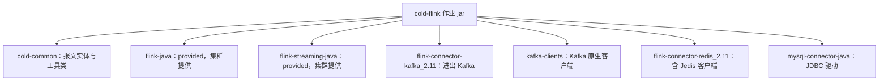

# Flink 工程的 pom.xml：把实时计算的依赖一次配齐

新建一个 Flink 计算工程，最先撞上的往往不是代码问题，而是依赖问题：Kafka 连接器没引进来，程序一起动就在 source 一行抛类找不到；MySQL 驱动缺位，算完的结果永远落不了库。冷链监控平台的实时计算子系统（课程口径称作「冷眼」项目）里，承担实时计算的工程叫 cold-flink，它的 `pom.xml` 就是这套计算的物料清单。逐段读完这份清单，每个依赖为什么在、以什么 scope 在，就都清楚了。

## 先给结论

- 工程有两种创建方式：普通 Maven 工程手写依赖，或用 Maven 的 Flink 模板骨架生成，两种方式最终都落到同一份 pom 结构上。
- 依赖分五类：cold-common 公共包、Flink 内核、Kafka 连接器、Redis 连接器与 Jedis 客户端、MySQL 驱动，各自对应实时链路上的一环。
- Flink 内核依赖的 scope 是 provided：集群运行时自带这些类，作业 jar 里再打一份反而会冲突。
- 打包交给 maven-shade-plugin，把依赖归并成一个 fat jar，过滤签名文件，并把 mainClass 指向 StreamingJob。
- 本地 IDEA 运行靠一个专属 profile 兜底：检测到 `idea.version` 属性时，把两个内核依赖临时改回 compile。

## 两种创建途径，终点是同一份 pom

**第一种是常规 Maven 工程。** 按 Java 工程的方式建好骨架，再往 `pom.xml` 里手工添加 Flink 相关依赖。好处是每个依赖都是自己加的，清楚它为什么存在。

**第二种是 Maven 模板工程。** 用 Maven 的 archetype 机制，以 Flink 官方的 quickstart 模板生成工程，pom 里已经预置好内核依赖、打包插件和本地运行的 profile，改改坐标就能开工。课程里两种方式的创建过程都演示了，最终形态是一致的：坐标、打包方式、属性、仓库、依赖、构建插件，六段各司其职。

工程头部的坐标与打包方式如下（按 cold-flink 工程真实 pom 整理，包名按约定改写）：

```xml
<groupId>com.study.coldchain</groupId>
<artifactId>cold-flink</artifactId>
<version>0.0.1-SNAPSHOT</version>
<packaging>jar</packaging>
<name>cold-flink</name>
```

packaging 是 jar：这是一个被打成作业 jar 提交到 Flink 集群运行的计算工程，不是 Web 应用，也不是常驻的服务进程。

## properties 与 repositories：版本收拢在一处

```xml
<properties>
    <project.build.sourceEncoding>UTF-8</project.build.sourceEncoding>
    <flink.version>1.8.0</flink.version>
    <java.version>1.8</java.version>
    <scala.binary.version>2.11</scala.binary.version>
    <maven.compiler.source>${java.version}</maven.compiler.source>
    <maven.compiler.target>${java.version}</maven.compiler.target>
</properties>
```

properties 段把版本号收拢成变量：Flink 固定 1.8.0，JDK 用 1.8，编码统一 UTF-8，编译源码与目标字节码都钉在 1.8。`scala.binary.version` 的值是 2.11，这个变量会在依赖坐标里反复出现，因为 Flink 内核由 Scala 实现，连接器类的模块按 Scala 二进制版本发布构件，坐标里要带 `_2.11` 这样的后缀，作业与集群两侧的 Scala 版本必须对齐。

repositories 段配置了 Apache 的快照仓库，releases 关闭、snapshots 开启，只为拉取 Apache 体系的快照版本构件，常规发布版本走默认中央仓库即可。这个仓库在国内网络下很慢，如果没有明确的快照依赖需求，注释掉也不影响编译。

## 依赖清单：每个 jar 对应链路上的一环

依赖区的完整清单（保留关键项，注释为讲解所加）：

```xml
<dependency>
    <groupId>com.study.coldchain</groupId>
    <artifactId>cold-common</artifactId>
    <version>0.0.1-SNAPSHOT</version>
</dependency>
<!-- Avro 序列化支持，模板按固定版本引入 -->
<dependency>
    <groupId>org.apache.flink</groupId>
    <artifactId>flink-avro</artifactId>
    <version>1.8.0</version>
</dependency>
<!-- Flink 内核：provided，不打入作业 jar -->
<dependency>
    <groupId>org.apache.flink</groupId>
    <artifactId>flink-java</artifactId>
    <version>${flink.version}</version>
    <scope>provided</scope>
</dependency>
<dependency>
    <groupId>org.apache.flink</groupId>
    <artifactId>flink-streaming-java_${scala.binary.version}</artifactId>
    <version>${flink.version}</version>
    <scope>provided</scope>
</dependency>
<dependency>
    <groupId>org.apache.flink</groupId>
    <artifactId>flink-connector-kafka_2.11</artifactId>
    <version>1.8.0</version>
</dependency>
<dependency>
    <groupId>org.apache.kafka</groupId>
    <artifactId>kafka-clients</artifactId>
    <version>2.2.1</version>
</dependency>
<dependency>
    <groupId>org.apache.bahir</groupId>
    <artifactId>flink-connector-redis_2.11</artifactId>
    <version>1.0</version>
</dependency>
<dependency>
    <groupId>mysql</groupId>
    <artifactId>mysql-connector-java</artifactId>
    <version>5.1.38</version>
</dependency>
```

**公共包 cold-common。** 实时计算的两头都靠它：入口的 `MessageEntity` 报文实体定义在它的 netty 包里，出口要用的设备档案实体、Redis 工具类与序列化工具类也在里面。少了这个包，主程序连数据长什么样都不知道。

**Flink 内核。** `flink-java` 与 `flink-streaming-java_${scala.binary.version}` 构成批与流两套 API 的核心，scope 都是 provided。provided 的语义是「编译期可见、打包期剔除」：Flink 集群自身带着完整的运行时类，作业 jar 里再塞一份，加载时新旧版本混在一起，轻则警告重则冲突。官方模板的注释原话就是「这些依赖是 provided 的，因为它们不应该被打进 jar」。

**Kafka 连接器。** `flink-connector-kafka_2.11` 提供 `FlinkKafkaConsumer` 与 `FlinkKafkaProducer`：实时计算的数据从 Kafka 队列 `device_msg_topic` 进来，结果也要回投到 `all_device_message` 队列，进出都靠它。旁边的 `kafka-clients` 是 Kafka 原生客户端，连接器底层会用到。

**Redis 连接器。** 坐标在 `org.apache.bahir` 下：Flink 主仓库之外的外部系统连接器由 Apache Bahir 项目承载，这份依赖同时把 Jedis 客户端传递引入，计算算子正是用 `redis.clients.jedis.Jedis` 访问设备档案。

**MySQL 驱动。** `mysql-connector-java` 5.1.38 版本，自定义 Sink 用 JDBC 直连 MySQL 写实时指标表。另有 `slf4j-log4j12` 与 `log4j` 声明为 runtime scope，只为本地运行出日志，打包时会被 shade 排除。

依赖关系一张图：



图里两条线最值得记：一条指向业务（cold-common 的实体与工具），一条指向外部系统（Kafka、Redis、MySQL），Flink 内核反而不进 jar。

## 打包与依赖归并：maven-shade-plugin

Flink 作业的部署单元是一个自包含的 fat jar，maven-shade-plugin 负责在 package 阶段把依赖归并进去（节选关键配置）：

```xml
<plugin>
    <groupId>org.apache.maven.plugins</groupId>
    <artifactId>maven-shade-plugin</artifactId>
    <version>3.0.0</version>
    <executions>
        <execution>
            <phase>package</phase>
            <goals>
                <goal>shade</goal>
            </goals>
            <configuration>
                <artifactSet>
                    <excludes>
                        <exclude>org.apache.flink:force-shading</exclude>
                        <exclude>org.slf4j:*</exclude>
                        <exclude>log4j:*</exclude>
                    </excludes>
                </artifactSet>
                <filters>
                    <filter>
                        <artifact>*:*</artifact>
                        <excludes>
                            <exclude>META-INF/*.SF</exclude>
                            <exclude>META-INF/*.DSA</exclude>
                            <exclude>META-INF/*.RSA</exclude>
                        </excludes>
                    </filter>
                </filters>
                <transformers>
                    <transformer implementation="org.apache.maven.plugins.shade.resource.ManifestResourceTransformer">
                        <mainClass>com.study.coldchain.flink.StreamingJob</mainClass>
                    </transformer>
                </transformers>
            </configuration>
        </execution>
    </executions>
</plugin>
```

三个动作各有含义。排除 slf4j 与 log4j：日志桥接包冲突是 Flink 作业最常见的报错来源，集群有自己的日志体系，作业 jar 不带。过滤 `META-INF` 下的签名文件：归并依赖时各 jar 的数字签名也被合并进来，签名与合并后的内容对不上，运行时直接抛 SecurityException，这组 exclude 是必留项。指定 mainClass：提交作业时集群从 manifest 里找入口类，这里指向实时计算主程序 StreamingJob。打包成功后 shade 还会生成一份 `dependency-reduced-pom.xml`，记录归并后的依赖视图，属于正常产物。

## 本地 IDEA 运行：provided 的一次反向操作

provided 依赖在集群上是对的，在 IDE 里直接 run main 方法却是另一回事：本地没有 Flink 运行时，内核类不在 classpath 上，程序起不来。pom 底部的 profile 专门解决这件事：

```xml
<profile>
    <id>add-dependencies-for-IDEA</id>
    <activation>
        <property>
            <name>idea.version</name>
        </property>
    </activation>
    <dependencies>
        <dependency>
            <groupId>org.apache.flink</groupId>
            <artifactId>flink-java</artifactId>
            <version>${flink.version}</version>
            <scope>compile</scope>
        </dependency>
        <dependency>
            <groupId>org.apache.flink</groupId>
            <artifactId>flink-streaming-java_${scala.binary.version}</artifactId>
            <version>${flink.version}</version>
            <scope>compile</scope>
        </dependency>
    </dependencies>
</profile>
```

activation 条件是存在名为 `idea.version` 的属性，这个属性只在 IDEA 导入工程时被设置。于是同一份 pom 在两种环境里表现两种行为：IDEA 里内核依赖生效，本地直接跑通；命令行打包时 profile 不激活，内核不进 jar，交给集群提供。两种运行环境的差异全部消化在构建脚本里，代码零改动。

## 常见误区

- **依赖没配错，IDEA 里却报 `NoClassDefFoundError`。** 错例是以为 jar 没下载下来，反复 reimport。正解是内核依赖本来就是 provided，本地没有运行时，确认 add-dependencies-for-IDEA 这个 profile 处于激活状态即可。
- **图省事把内核依赖改成 compile。** 后果是 fat jar 里多出一份 Flink 内核，提交到集群后与运行时的类互相覆盖，冲突报错难定位。保持 provided，让集群提供运行时。
- **精简 shade 配置时删掉签名文件过滤。** 运行作业时抛 SecurityException，报错信息指向某个依赖 jar 的签名，与业务代码毫无关系，很难想到是打包配置动了。
- **连接器坐标的后缀随意改。** `_2.11` 对应 Scala 二进制版本，与本机开发无关却与集群强相关，后缀不匹配会埋下序列化与类加载层面的兼容隐患。

## 面试可能被问到的问题

1. 面试官追问：「Flink 作业依赖里为什么大量使用 provided scope？」
   答：Flink 集群运行时自带内核类，作业 jar 只需要携带业务代码与连接器。内核打进作业 jar 会造成类重复加载与版本冲突，所以 flink-java、flink-streaming-java 声明为 provided，编译可见、打包剔除。
2. 面试官追问：「maven-shade-plugin 在 Flink 工程里解决什么问题？」
   答：把业务代码与全部依赖归并成一个自包含的 fat jar，作为 Flink 的部署单元；同时排除签名文件避免 SecurityException，排除日志桥接包避免冲突，并在 manifest 里写明 mainClass 供集群定位入口类。
3. 面试官追问：「flink-connector-kafka 的坐标为什么要带 _2.11 后缀？」
   答：Flink 内核由 Scala 实现，连接器构件按 Scala 二进制版本发布。作业与集群的 Scala 版本必须一致，否则可能出现序列化与类加载层面的不兼容，所以坐标要带 scala.binary.version 对应的后缀。
4. 面试官追问：「同一份 pom 怎么做到本地能跑、线上打包又不带内核？」
   答：用 profile 按环境切换。定义 add-dependencies-for-IDEA，activation 绑定 idea.version 属性，把两个内核依赖重新声明为 compile；IDEA 导入时属性存在、依赖生效，命令行打包时 profile 不激活、内核剔除。
5. 面试官追问：「Redis 连接器为什么在 org.apache.bahir 下？」
   答：Flink 官方主仓库只维护核心与常用连接器，Redis 等外部系统连接器由 Apache Bahir 扩展项目提供，坐标 org.apache.bahir:flink-connector-redis，它还把 Jedis 客户端作为传递依赖引入。

## 配套资料

- 代码：`materials/code/06/day6 实时计算 - 冷眼项目实战/`，cold-flink 工程的 `pom.xml` 为真实配置，依赖清单、shade 打包与 IDEA profile 均出自该文件（该目录名含项目代号，正文统一称冷链监控平台）。
- 代码：`materials/code/06/day1 背景介绍与系统介绍/`，cold-common 工程的 `MessageEntity` 报文实体与 `JedisUtil`、`SerializeUtil` 工具类。
- 说明：引用路径截至 day 目录层级；包名统一改写为 `com.study.coldchain`。
