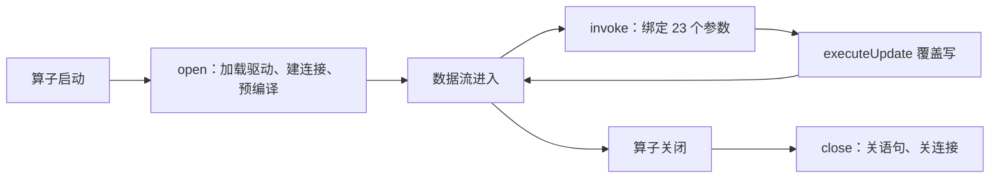

# 自定义 Sink 把计算结果写进 MySQL：SinkToMySQL 逐行拆解

Flink 的内置 Sink 覆盖了文件、Kafka、Elasticsearch 等常见去处，数据库写入却要自己动手。实时计算的最后一步，是把带告警结论的消息落进 MySQL 的实时指标表，供前台按设备查询。cold-flink 工程为此写的 SinkToMySQL，代码不长，却把 Flink 自定义 Sink 的生命周期、JDBC 的用法与流式写库的幂等问题全摆在了明面上，也是 day6 实时计算主线的收官代码。

## 先给结论

- 自定义 Sink 继承 RichSinkFunction，核心是 open、invoke、close 三个生命周期方法：open 建连接，invoke 逐条写，close 释放资源。
- 连接参数集中成成员变量，JDBC URL 上带字符集、useSSL、自动重连等参数。
- 写库语句是 `replace into`：实时指标表以设备为主键保留最新读数，重复写入结果一致，是朴素的幂等手段。
- invoke 里按占位符序号 setString、setInt 绑定 23 个字段后 executeUpdate。
- 生产化短板同样看得清楚：逐条执行、异常只打印、密码明文，改进方向是攒批提交与配置外置。

## RichSinkFunction 的三个生命周期方法

先看骨架：

```java
public class SinkToMySQL extends RichSinkFunction<MessageEntity> {
    @Override
    public void open(Configuration parameters) throws Exception {
        super.open(parameters);
    }

    @Override
    public void close() throws Exception {
        super.close();
    }

    @Override
    public void invoke(MessageEntity value, Context context) throws Exception {
    }
}
```

RichSinkFunction 是 Flink 提供的富 Sink 基类，泛型 MessageEntity 声明这条 Sink 只接收报文实体。三个方法的分工一句话说清：open 在算子启动时执行一次，适合建连接这类一次性开销；invoke 每流进一条数据被调用一次，承担真正的写库动作；close 在算子关闭时执行一次，负责回收。连接的生命周期与算子实例绑定而不是与数据绑定，这正是 Rich 系列函数的价值所在。

## JDBC 参数与连接 URL

```java
//设置jdbc参数
private Connection connection = null;
private PreparedStatement preparedStatement = null;
private String userName = "cold";
private String password = "cold123";
private String driverName = "com.mysql.jdbc.Driver";
private String DBUrl = "jdbc:mysql://mysql.example.com:3306/cold?allowMultiQueries=true&useUnicode=true&characterEncoding=UTF-8&useSSL=false&autoReconnect=true";
private StringBuffer sql = new StringBuffer();
```

驱动类名 `com.mysql.jdbc.Driver` 是 mysql-connector-java 5.x 的入口，pom 里引的正是 5.1.38，两者配套。URL 参数逐个看：characterEncoding=UTF-8 保证设备名、仓库名这类中文不落成乱码；useSSL=false 关闭连接的证书协商，适合内网环境；autoReconnect=true 让连接被服务端断开后尝试重连；allowMultiQueries 允许一次提交多条语句。目标库是课程环境的 cold 库，账号密码随代码写在成员变量里属于演示便利，生产环境应外置到配置中心或启动参数。

## replace into：实时指标表的覆盖写

```java
public SinkToMySQL() {
    this.getSQL();
}

private void getSQL() {
    sql.append("replace into cz_message_realtime(");
    sql.append("meterCode, meterId, meterName, ");
    sql.append("hostId, hostCode, hostName, ");
    sql.append("houseId, houseCode, houseName, ");
    sql.append("companyId, companyName, ");
    sql.append("tem, maxTem, minTem, ");
    sql.append("hum, maxHum, minHum, ");
    sql.append("temAlert, humAlert, state, ");
    sql.append("lon, lat, curtime) ");
    sql.append("values(");
    sql.append("?, ?, ?, ");
    sql.append("?, ?, ?, ");
    sql.append("?, ?, ?, ");
    sql.append("?, ?, ");
    sql.append("?, ?, ?, ");
    sql.append("?, ?, ?, ");
    sql.append("?, ?, ?, ");
    sql.append("?, ?, ?)");
}
```

语句在构造函数里拼好，为 open 里的预编译做准备。表 `cz_message_realtime` 是实时指标表，23 列与报文实体一一对应：设备、主机、仓库、公司四级归属，温湿度读数与上下限，两个告警结论，加状态、经纬度与时间。

动词用的是 `replace into` 而不是 `insert into`：这张表以设备编码为主键，同一设备的新报文到达时覆盖旧行，表里永远只留每台设备的最新读数与告警。replace 在主键冲突时先删旧行再插新行，写多少遍结果都一致，Kafka 的重复消费、故障恢复后的重放都不会把表写脏，这是流式写入最朴素的幂等方案。代价也明确：删除加插入产生更多 binlog，高频覆盖场景用 `insert ... on duplicate key update` 更省。

## open 与 close：连接的建立与释放

```java
@Override
public void open(Configuration parameters) throws Exception {
    super.open(parameters);
    Class.forName(driverName);
    connection = DriverManager.getConnection(DBUrl, userName, password);
    preparedStatement = connection.prepareStatement(sql.toString());
}

@Override
public void close() throws Exception {
    super.close();
    if (preparedStatement != null) {
        preparedStatement.close();
    }
    if (connection != null) {
        connection.close();
    }
}
```

open 里三步：加载驱动类，按 URL 与账号建立连接，用拼好的 SQL 创建预编译语句。Class.forName 在 JDBC 4.0 之后理论上可省，显式写出来让驱动依赖一目了然。PreparedStatement 持有的是带 23 个问号的语句模板，open 一次、invoke 万次，预编译开销被摊薄。close 判空后先关语句再关连接，顺序与创建相反；两步之间没有互相保护，若语句关闭抛异常，连接会漏关，更稳妥的写法是各自捕获或改用 try-with-resources。

## invoke：绑定参数并执行

```java
@Override
public void invoke(MessageEntity value, Context context) {
    try {
        this.setStatement(value);
        preparedStatement.executeUpdate();
    } catch (Exception e) {
        e.printStackTrace();
    }
}

private void setStatement(MessageEntity value) throws Exception {
    preparedStatement.setString(1, value.getMetercode());
    preparedStatement.setString(2, value.getMeterid());
    preparedStatement.setString(3, value.getMetername());
    // 第 4 至 11 个参数依次为主机、仓库、公司三级归属，均为字符串
    preparedStatement.setInt(12, value.getTem());
    preparedStatement.setInt(13, value.getMaxtem());
    preparedStatement.setInt(14, value.getMintem());
    preparedStatement.setInt(15, value.getHum());
    preparedStatement.setInt(16, value.getMaxhum());
    preparedStatement.setInt(17, value.getMinhum());
    preparedStatement.setInt(18, value.getTemalert());
    preparedStatement.setInt(19, value.getHumalert());
    preparedStatement.setInt(20, value.getState());
    preparedStatement.setString(21, value.getLon());
    preparedStatement.setString(22, value.getLat());
    preparedStatement.setString(23, value.getCurtime());
}
```

参数按序号绑定，与 replace into 的列序严格对应：编码与归属类字段全是字符串走 setString，温湿度读数、阈值与告警结论是 int 走 setInt，经纬度与时间以字符串落库。executeUpdate 执行覆盖写。主流程把 setStatement 单独抽成方法，invoke 里只剩绑定加执行两步，23 个参数的绑定代码再长也不影响主流程的阅读。

## 异常处理与批量优化思路

这段代码能跑通，离生产还有三步。**第一步是失败出路。** invoke 里 catch 住所有异常只打印堆栈，写库失败的那条数据等于被丢掉，没有重试也没有补偿。常见做法是有限次重试，失败计数加告警日志，或者把失败数据写进死信存储事后追补。**第二步是吞吐。** 每条数据一次 executeUpdate，网络往返花掉的时间远多于计算本身。主流优化是攒批：Sink 内部维护缓冲，攒够条数或到达定时间隔就一次批量提交，批大小与 checkpoint 周期对齐，还能顺带理顺故障恢复时的语义。**第三步是配置外置。** 账号密码与地址移出代码，交给配置中心或启动参数。

攒批的骨架长这样（按主流写法补全的示例，非工程源码）：

```java
private List<MessageEntity> buffer = new ArrayList<>();

@Override
public void invoke(MessageEntity value, Context context) throws Exception {
    buffer.add(value);
    if (buffer.size() >= 200) {
        flush();
    }
}

private void flush() throws Exception {
    for (MessageEntity value : buffer) {
        this.setStatement(value);
        preparedStatement.addBatch();
    }
    preparedStatement.executeBatch();
    buffer.clear();
}
```

invoke 攒够 200 条触发一次 flush，循环内逐条绑定参数后 addBatch，最后 executeBatch 一次提交，网络往返从 200 次降到 1 次。真实工程没有这段代码，它按本课写法补全，用来示意「攒够一批再提交」的形态；若要结合 checkpoint 追求严格语义，还需配合两阶段提交或保持幂等写。

Sink 的生命周期与数据流向一张图：



open 一次、invoke 万次、close 一次，连接随算子生灭，数据随流写入。

## day6 收官

至此实时计算子系统的代码主线走完：采集端把设备报文写进 Kafka，StreamingJob 从队列取数并解析，MessageAggregate 合并 Redis 档案算出告警结论，SinkToMySQL 把结果落进实时指标表，同时回投 Kafka 交给下游做历史入库。四段代码拼起来，就是一条从设备读数到可查询告警的完整链路，实时查询服务再从指标表取数供前台展示。

## 常见误区

- **invoke 里打印堆栈就算处理了异常。** 打印之后数据已经丢了，流处理不会替你重放这一条。要有明确的失败策略：有限次重试、计数告警或死信兜底，不能让静默丢弃成为默认行为。
- **把建连接写进 invoke。** 每条数据建一次连接，几百条就把数据库拖垮。连接属于算子级资源，放 open，一次建立反复使用。
- **close 顺序随意或漏判空。** 先关语句再关连接，且两步各自保护，否则前一步抛异常会让连接泄漏。
- **以为 replace into 与 insert 等价。** replace 在主键冲突时是删除加插入，自增主键会换号、删除触发器会触发；按主键覆盖最新状态的场景合适，需要保留历史的表要用 insert。

## 面试可能被问到的问题

1. 面试官追问：「Flink 里怎么自定义一个写数据库的 Sink？」
   答：继承 RichSinkFunction，泛型指定数据类型；open 里初始化 JDBC 连接与预编译语句，invoke 里绑定参数执行写入，close 里释放资源。用 addSink 挂到数据流上即可，连接与算子实例同生命周期。
2. 面试官追问：「初始化放构造函数和放 open 有什么区别？」
   答：构造函数在客户端生成对象时执行，对象随后要经序列化分发到各个并行实例；open 在每个实例于运行节点开始工作前执行，此时运行上下文与并行度都已确定。连接这类重资源放 open，各并行子任务各建各的连接，互不共享。
3. 面试官追问：「这里为什么用 replace into 而不是 insert？」
   答：实时指标表按设备编码做主键，只保留每台设备的最新读数。replace into 冲突时覆盖旧行，重复消费或故障重放写出的结果一致，是简单有效的幂等手段；代价是删除加插入的 binlog 开销更高，高频场景可换 insert on duplicate key update。
4. 面试官追问：「逐条 executeUpdate 太慢，怎么优化？」
   答：攒批。Sink 内部用缓冲列表攒数据，攒够条数或到达时间间隔就 addBatch 加 executeBatch 一次提交，减少网络往返；批大小与 checkpoint 周期对齐，兼顾吞吐与故障恢复语义，上游可配合 keyBy 让同设备数据落在同一实例。
5. 面试官追问：「写库失败的数据去哪了？」
   答：按这段真实代码，异常被 catch 后只打印堆栈，数据实际丢失。生产上要给失败数据出路：有限次重试、失败计数与告警，或写入死信存储事后追补。
6. 面试官追问：「这个 Sink 能保证 exactly-once 吗？」
   答：单独看不能，它是一次一条的普通 JDBC 写，没有参与两阶段提交。整条链路靠 replace into 的幂等性逼近结果上的不重：故障恢复后重复写覆盖的是同一行，结果仍正确；要严格语义需要两阶段提交 Sink 配合 checkpoint。

## 配套资料

- 代码：`materials/code/06/day6 实时计算 - 冷眼项目实战/`，cold-flink 工程的 `SinkToMySQL.java` 为真实代码（该目录名含项目代号，正文统一称冷链监控平台）。
- 代码：`materials/code/06/day1 背景介绍与系统介绍/`，cold-common 工程的 `MessageEntity`，其字段与实时指标表的 23 列一一对应。
- 说明：引用路径截至 day 目录层级；数据库地址以 example.com 占位；攒批示例为按主流写法补全，非工程源码；包名统一改写为 `com.study.coldchain`。
