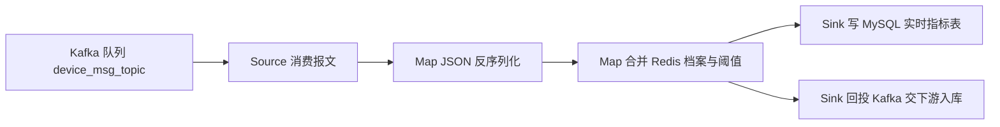

# 把 cold-flink 工程打成 jar 提交到 Flink 集群

在 IDEA 里点 Run 能看到计算结果，只证明代码逻辑是对的；实时计算子系统要长期不间断运行，就必须把 cold-flink 工程打成 jar，提交到 Flink 集群里常驻。部署动作本身不多，坑却集中：依赖没归并全，作业一提交就抛 ClassNotFoundException；入口类没配对，Web UI 连主类都识别不出来；作业报错不知道去哪看日志。把这一整套流程走顺，实时计算的代码才算真正上线。

## 先给结论

- 打包执行 Maven 的 install，工程配置的 maven-shade-plugin 在 package 阶段把依赖归并进一个 fat jar，入口主类在 pom 里指定为 StreamingJob。
- 提交有两条路：命令行 `flink run`，或 Flink Web UI 的 Submit new Job 页面上传 jar，课程演示走 Web UI。
- 作业跑起来后重点看四处：Overview 的算子图与并行度、Timeline 的调度时间线、Exceptions 的异常列表、TaskManager 的日志。
- Flink 自身依赖在 pom 里是 provided 作用域，不打进 jar；本地 IDEA 调试靠 add-dependencies-for-IDEA 这个 profile 临时把它们转回 compile。
- 课程环境的作业并行度是 1，与 Sink 逐条建立 JDBC 连接的写法相匹配。

## 打包：shade 把依赖归并进 fat jar

Flink 集群的节点上只有 Flink 自身的运行环境，工程里用到的 Kafka 连接器、Redis 连接器、MySQL 驱动、fastjson，集群上一概没有。jar 里不带齐这些依赖，作业提交瞬间就会抛 ClassNotFoundException。cold-flink 的 pom 为此配置了 maven-shade-plugin，在 package 阶段把 compile 依赖解包再合并进同一个 jar：

```xml
<!-- cold-flink 工程真实配置，有删节 -->
<plugin>
    <groupId>org.apache.maven.plugins</groupId>
    <artifactId>maven-shade-plugin</artifactId>
    <version>3.0.0</version>
    <executions>
        <execution>
            <phase>package</phase>
            <goals>
                <goal>shade</goal>
            </goals>
            <configuration>
                <artifactSet>
                    <excludes>
                        <exclude>org.slf4j:*</exclude>
                        <exclude>log4j:*</exclude>
                    </excludes>
                </artifactSet>
                <transformers>
                    <transformer implementation="org.apache.maven.plugins.shade.resource.ManifestResourceTransformer">
                        <!-- 入口主类，提交作业时按它启动 -->
                        <mainClass>com.study.coldchain.flink.StreamingJob</mainClass>
                    </transformer>
                </transformers>
            </configuration>
        </execution>
    </executions>
</plugin>
```

三处细节各管一件事。ManifestResourceTransformer 把入口主类写进 MANIFEST，Web UI 上传后能自动识别出 Entry Class 靠的就是它。slf4j 与 log4j 被显式排除，日志框架交给集群统一提供，避免与集群自带的日志 jar 冲突。插件还过滤 META-INF 下的 SF、DSA、RSA 签名文件，依赖 jar 里的签名信息混进 fat jar 会触发 SecurityException。

在 IDEA 的 Maven 面板执行 install，生命周期先走 package，shade 在这一步生效，target 目录里得到按 artifactId 加版本号命名的 jar。视频演示里用的是 cold-flink-1.0.0.jar，资料包 pom 记录的版本是 0.0.1-SNAPSHOT，命名规则一致，以各自工程的配置为准。

## 提交：命令行与 Web UI 两条路

命令行提交适合写成脚本接进发布流程（命令为按主流写法补全的示例，工程里没有现成脚本）：

```bash
# -c 指定入口类，后面跟 jar 路径
flink run -c com.study.coldchain.flink.StreamingJob /opt/jars/cold-flink-1.0.0.jar

# 查看与终止作业
flink list
flink cancel <jobId>
```

课程演示走另一条路，也就是 Web UI 提交。课程环境本地装了一套 Flink 集群，4 个 TaskManager、8 个 slot，浏览器打开 Dashboard 就能看到集群概况。从打包到作业运行，整条链路是：


这条链里最容易断的一环是 Entry Class：它来自 pom 的 mainClass。包名重构后 pom 没同步，页面就解析不出主类，Submit 等于空转。上传完成后列表里出现这条 jar 记录，点选中，页面解析出 com.study.coldchain.flink.StreamingJob，确认后点 Submit，作业随即出现在 Running Jobs 列表里。

## 作业页面与结果验证

作业内部的算子图长这样：



Overview 页从左到右正是主程序里搭出来的数据流：Source 从 Kafka 取原始报文，第一个 Map 把 JSON 字符串反序列化成 MessageEntity，第二个 Map 执行 MessageAggregate 合并 Redis 里的设备档案与阈值，末端分出两个 Sink，一个 `replace into` 写 MySQL 实时指标表，一个回投 Kafka 交给下游做历史入库。每个算子上标着并行度，课程环境全部是 1。Timeline 页展示各算子从创建、调度到运行的时间先后；Exceptions 页保持空白，说明作业健康无异常；Tasks 一栏全部处于 running 状态。切回前台监控页面的实时报警列表，新数据已经出现，数据库里查到的正是 Flink 写进去的结果，部署闭环就此完成。

## 参数传入与日志查看

主程序里 topic 与 Kafka 地址是写死的成员变量，改一次参数就得重新打包，并不体面。主流做法是参数化（代码为按主流写法补全的示例，工程源码未做这一步）：

```java
// 从启动参数读取，缺省值兜底
ParameterTool params = ParameterTool.fromArgs(args);
String topic = params.get("topic", "device_msg_topic");
String servers = params.get("bootstrap.servers", "kafka.example.com:9092");
```

```bash
flink run -c com.study.coldchain.flink.StreamingJob \
    --topic device_msg_topic \
    --bootstrap.servers kafka.example.com:9092 \
    /opt/jars/cold-flink-1.0.0.jar
```

日志查看的位置，本地与集群完全不同。本地 IDEA 跑，输出就在控制台；集群跑，控制台早就不属于你，要进 Web UI 的 TaskManager 页，选中实例后看 Stdout 或 Log 标签，写库失败的堆栈、Kafka 重连的告警都在这里。排查一个只在集群上出现的异常，第一动作是打开这个页面，而不是翻提交客户端的输出。

## 本地跑与集群跑的差异

pom 里 flink-java 与 flink-streaming-java 声明为 provided，含义是编译期可见、运行期由集群提供，因此不打进 fat jar：

```xml
<dependency>
    <groupId>org.apache.flink</groupId>
    <artifactId>flink-streaming-java_2.11</artifactId>
    <version>${flink.version}</version>
    <scope>provided</scope>
</dependency>
```

本地 IDEA 里没有 Flink 运行环境，provided 会让代码直接编译不过。pom 底部为此留了一个按 `idea.version` 属性自动激活的 profile，把这两个依赖临时转回 compile：

```xml
<profile>
    <id>add-dependencies-for-IDEA</id>
    <activation>
        <property>
            <name>idea.version</name>
        </property>
    </activation>
    <dependencies>
        <dependency>
            <groupId>org.apache.flink</groupId>
            <artifactId>flink-java</artifactId>
            <version>${flink.version}</version>
            <scope>compile</scope>
        </dependency>
    </dependencies>
</profile>
```

于是同一个工程出现两种运行形态：IDEA 里属性存在，profile 激活，照常点 Run；命令行打包时属性不存在，依赖回到 provided，不进 jar。冲突的根源被 profile 隔开，两边互不干扰。

## 常见误区

- **拿普通 jar 去提交。** 只用 jar 插件打出的瘦 jar 不含依赖，提交后立刻 ClassNotFoundException。要的是 shade 产出的 fat jar，target 目录里体积最大的那个。
- **把 Flink 依赖打进包。** 把 provided 改成 compile 后，jar 自带一份 Flink 类，与集群版本冲突，运行期报各种 NoSuchMethodError。Flink 自身依赖保持 provided。
- **改了主类包名忘了改 pom。** ManifestResourceTransformer 里的 mainClass 仍指向旧类名，Web UI 解析不出 Entry Class，提交流程卡在最后一步。
- **在提交客户端的控制台找日志。** 集群作业的日志在 TaskManager 节点上，Web UI 的 TaskManager 页才是正确入口。

## 面试可能被问到的问题

1. 面试官追问：「maven-shade-plugin 解决什么问题？」
   答：把工程依赖解包合并进一个可执行 fat jar，并在 MANIFEST 里写入入口主类；还能排除指定坐标与签名文件，解决集群环境缺少业务依赖、多个依赖 jar 合并时的冲突问题。
2. 面试官追问：「为什么 Flink 依赖要设成 provided？」
   答：集群每个节点都有完整的 Flink 运行时，jar 里再带一份会因版本差异产生类冲突。provided 表示编译期可见、打包期排除、运行期由集群提供，是 Flink 官方工程模板的默认写法。
3. 面试官追问：「作业提交后怎么定位失败原因？」
   答：先看 Web UI 的 Exceptions 页拿异常栈，再进对应 TaskManager 的 Stdout 与 Log 看算子级输出，结合 Timeline 判断卡在调度还是运行阶段；本地复现则直接看 IDEA 控制台。
4. 面试官追问：「作业的并行度怎么定？」
   答：上限受集群 slot 数约束，课程环境 8 个 slot；同时要考虑 Sink 的承受能力，这份代码每个并行实例持有一条 JDBC 连接，盲目调大并行度会把连接数等比放大，课程环境按 1 运行。
5. 面试官追问：「同一个工程怎么做到本地与集群两不误？」
   答：Flink 依赖声明为 provided 保证打包正确，再用一个以 idea.version 属性激活的 profile 在 IDEA 环境里把依赖转回 compile；激活条件互斥，两种运行形态自动切换。

## 配套资料

- 代码：`materials/code/06/day6 实时计算 - 冷眼项目实战/`，cold-flink 工程的 `pom.xml`（shade 配置与 IDEA profile）与 `StreamingJob.java`（入口主类）为真实代码（该目录名含项目代号，正文统一称冷链监控平台）。
- 说明：引用路径截至 day 目录层级；`flink run` 命令与 ParameterTool 参数化为按主流写法补全的示例，非工程源码；Kafka、Flink 主机名以 example.com 占位；包名统一改写为 `com.study.coldchain`。
