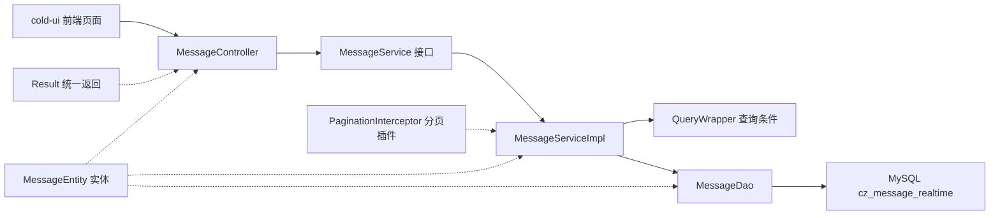

# 实时数据查询的类结构：从页面请求到数据库的一条链

需求与表都定了，cold-monitor 工程里要落哪些类、谁依赖谁，先画清骨架再填代码。分层骨架搭错，典型症状是 controller 里直接拼 SQL、service 返回裸 List 让前端猜格式；骨架搭对，后面每个类只填自己的那一段逻辑。这一课把实时查询的类清单与依赖关系一次讲透。

## 先给结论

- 对外接口由 MessageController 提供，两个端点挂在 `device/monitor` 路径下，进出统一走公共工程的 Result 包装。
- 业务层 MessageService 接口继承 MyBatis Plus 的 IService，实现类 MessageServiceImpl 继承 ServiceImpl 并以 MessageDao 为操作入口，单表 CRUD 与分页能力全部继承而来。
- 查询条件用 QueryWrapper 组装；讲解图上画的 MessageQueryWrapper，在工程落地时收敛为实现类里的私有方法 getMessageCondition。
- 分页能力来自 MybatisPlusConfig 注册的 PaginationInterceptor Bean，容器启动时创建。
- 数据层 MessageDao 在公共工程 cold-common 里，@Mapper 标注，继承 BaseMapper 后一行 SQL 都不用写。

## 一条调用链：谁指向谁

从页面点击到数据库返回，涉及的类与依赖方向是：



实线是调用关系，虚线是使用到的公共组件。实体 MessageEntity、数据访问接口 MessageDao、返回包装 Result 都在公共工程 cold-common 里，cold-monitor 以依赖包的形式引入；控制器、业务接口、业务实现留在 monitor 工程里。这张图也是 microservice 单表查询模块的通用形状，换张表换套字段，骨架不变。

## 类清单与各自职责

- MonitorApplication：Spring Boot 启动类，容器与注册中心入口。
- MessageController：定义 `/device/monitor/list` 与 `/device/monitor/realtime` 两个端点，把前端参数透传给业务层，把结果包成 Result。
- MessageService：业务接口，继承 `IService<MessageEntity>`，额外声明 `queryMessageRealtime`。
- MessageServiceImpl：业务实现，继承 `ServiceImpl<MessageDao, MessageEntity>`，组装查询条件并调 `page` 完成分页查询。
- MessageDao：公共工程里的数据访问接口，`@Mapper` 加持，继承 `BaseMapper<MessageEntity>`。
- MessageEntity：与 `cz_message_realtime` 一一对应的实体，公共工程提供。
- Result：统一返回结构，讲解图里常简写作 R，控制器返回给前端的格式由它定。
- MybatisPlusConfig：注册分页插件的配置类，产出 PaginationInterceptor Bean。

前四个类在 monitor 工程，后四个来自公共工程或配置层，工程边界与依赖方向都清晰可查。

## 业务层：接口继承与实现

MessageService 的声明只有两行核心：

```java
public interface MessageService extends IService<MessageEntity> {
    IPage queryMessageRealtime(Map<String, Object> parames);
}
```

继承 IService 之后，save、remove、update、list 这些单表方法已经具备，接口里只需要补充业务自定义的查询。实现类才是结构的核心：

```java
@Service("messageService")
public class MessageServiceImpl extends ServiceImpl<MessageDao, MessageEntity> implements MessageService {

    @Override
    public IPage queryMessageRealtime(Map<String, Object> parames) {
        //组装查询条件
        QueryWrapper queryWrapper = getMessageCondition(parames);

        //查询
        int page = Integer.valueOf(parames.get("page").toString());
        int size = Integer.valueOf(parames.get("pagesize").toString());
        return this.page(new Page<MessageEntity>(page, size), queryWrapper);
    }

    private QueryWrapper getMessageCondition(Map<String, Object> params){
        QueryWrapper<MessageEntity> queryWrapper = new QueryWrapper<>();

        String companyid = params.get("companyId") == null ? null : params.get("companyId").toString().trim();
        if(companyid != null){
            queryWrapper.eq("companyId", companyid);
        }
        //其他参数按同样方式追加
        return queryWrapper;
    }
}
```

`ServiceImpl<MessageDao, MessageEntity>` 这个泛型组合把数据访问入口 MessageDao 与操作实体 MessageEntity 绑定给父类，`this.page` 因此能直接发起分页查询。查询条件的组装被抽成独立的私有方法，条件再怎么增长都不碰分页主流程，这段代码虽然短，分层意识却在：条件归条件，分页归分页。

## 讲解图里的 MessageQueryWrapper 去哪了

课程的结构图把参数封装画成一个独立类 MessageQueryWrapper，由前端参数构造、再交给业务层使用。工程落地时没有单列这个类，它的职责被收敛进 `getMessageCondition` 这个私有方法：前端传来的 Map 在这里被翻译成 QueryWrapper。两种做法意图相同，都是不让条件拼装散落在分页代码里；差异只在规模，条件多到需要复用、需要单测时，抽成独立类才划算。读图与读代码对不上时，认这个意图即可，不必执着于类名。

## 公共工程三件套：Dao、Entity 与 Result

数据访问接口在 cold-common 里，全部代码三行：

```java
@Mapper
public interface MessageDao extends BaseMapper<MessageEntity> {
}
```

BaseMapper 是 MyBatis Plus 的通用 Mapper，insert、delete、update、selectPage 等方法在启动时按实体与表结构自动注入，单表操作零 SQL。实体 MessageEntity 用 `@TableName("cz_message_realtime")` 锚定表名，字段与列一一对应。控制器返回值是公共工程的 Result，类上有静态方法 `ok`，把业务数据装进统一信封；结构图里把它简写作 R，指的是同一件事：返回格式由一个类说了算，前端拿到的每个接口都是同一种形状。

## MybatisPlusConfig：分页为什么必须注册 Bean

分页插件是独立组件，需要显式注册：

```java
@Configuration
public class MybatisPlusConfig {

    // 分页插件
    @Bean
    public PaginationInterceptor paginationInterceptor() {
        return new PaginationInterceptor();
    }
}
```

这个 Bean 在 Spring Boot 容器启动时创建，作用是把 `page` 调用拦截下来，在 SQL 上拼出 limit 与 count。缺了它，`this.page` 不报错、照常返回结果，但返回的是全表数据，页码与页大小形同虚设。这类「不报错但功能失效」的坑最隐蔽，启动类注解再正确也查不出原因，只能对着分页结果不对劲的现象反查插件配置。

## 常见误区

- **把 MessageDao 当成 monitor 工程的类。** 它在公共工程 cold-common 里，monitor 只是使用方；找不到这个类时去依赖包里翻，而不是在当前工程里新建。
- **以为继承 ServiceImpl 就自带一切。** CRUD 方法来自 BaseMapper 的通用注入，前提是泛型参数给出正确的 Dao 与 Entity，写错泛型会在启动或运行时报映射异常。
- **漏注册分页插件。** page 照常返回，只是不分页，数据量一大接口直接拖垮；新工程先配 PaginationInterceptor 再写查询。
- **在 controller 里绕过 Result 自己拼返回体。** 前端按统一格式解析，个别接口自创结构会让整个前端的响应处理出现特例，得不偿失。

## 面试可能被问到的问题

1. 面试官追问：「IService、ServiceImpl、BaseMapper 三者是什么关系？」
   答：BaseMapper 是数据层通用 Mapper，注入单表 SQL；IService 是业务层接口，聚合了面向实体的服务方法；ServiceImpl 是它的默认实现，持有 BaseMapper 与实体类型，把业务方法转调给 Mapper。三者靠泛型串联，形成从表到业务的通用骨架。
2. 面试官追问：「QueryWrapper 相对手写 SQL 有什么取舍？」
   答：优点是条件动态拼装免拼接字符串、字段由实体校验不易写错列名，简单查询效率高；缺点是复杂多表与聚合表达不了，可读性在条件多时下降。规则是单表用 Wrapper，复杂查询回 XML 手写。
3. 面试官追问：「分页插件的工作原理是什么？」
   答：以拦截器形式挂在 MyBatis 执行链上，捕获带 Page 参数的查询，先发一条 count 语句拿总数，再改写原 SQL 加上 limit 偏移量，把结果与分页元信息一起装进 IPage 返回。
4. 面试官追问：「实体和 Dao 为什么下沉到公共工程？」
   答：同一张表被 Flink 写入侧与查询服务两侧使用，实体放公共包保证两侧字段一致；Dao 随实体走，任何服务引入依赖即获得单表能力，避免每个服务复制一份实体造成字段漂移。
5. 面试官追问：「统一返回结构 Result 的设计动机是什么？」
   答：让所有接口以相同信封返回状态码、消息与数据，前端写一套统一的响应拦截与错误处理；业务数据放进 data 字段，成功失败靠状态码区分，接口契约稳定不随业务变动。

## 配套资料

- 代码：`materials/code/06/day6 实时计算 - 冷眼项目实战/`，cold-monitor 工程的 `MessageController.java`、`MessageService.java`、`MessageServiceImpl.java` 为真实代码（该目录名含项目代号，正文统一称冷链监控平台）。
- 代码：`materials/code/06/day1 背景介绍与系统介绍/`，cold-common 工程的 `MessageDao.java` 与 `MessageEntity.java`。
- 代码：`materials/code/06/day2 微服务框架与基础服务/`，cold-admin 工程的 `MybatisPlusConfig.java`，与课程讲解同款的分页插件配置。
- 说明：引用路径截至 day 目录层级；包名统一改写为 `com.study.coldchain`。
