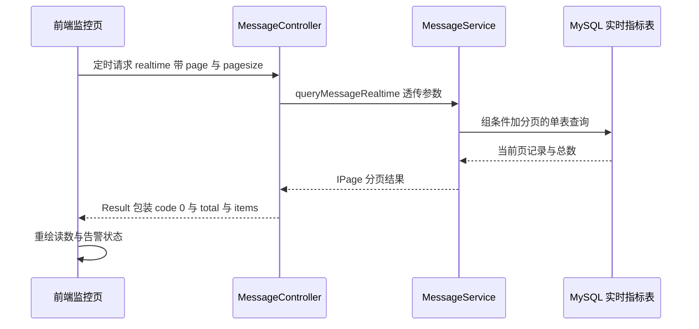

# 实时数据查询的 Controller：两个接口把实时读数递给前端

Service 层的分页查询已经就绪，只差最外面这层 HTTP 的皮。监控服务 cold-monitor 的 Controller 要对外开两个接口：仓库监控列表与实时监控数据，前者给监控页取一屏设备的读数，后者带着分页元信息支撑列表页的定时刷新。这一层代码不厚，但 URL 怎么规划、参数怎么接、返回怎么包，每一处都是前端联调时第一个要对齐的地方。

## 先给结论

- 类上 @RestController 加 `@RequestMapping("device/monitor")` 定根路径，两个子路径 /list 与 /realtime 分别对应仓库监控列表与实时监控数据。
- 入参统一用 @RequestParam 的 `Map<String, Object>` 接收，键值对原样透传给 Service，前端加查询条件不用动方法签名。
- 返回统一包成 Result：默认 code 为 0、msg 为 success，业务数据放 items，分页元信息放 total 与 page。
- 两个接口共用同一个 Service 方法，差别只在返回包装，/realtime 比 /list 多回总条数与总页数。
- 实现类漏标 @Service 会让 @Autowired 注入失败，服务启动直接报错，这是本课现场踩到并当场修复的坑。

## REST 接口的骨架

```java
@RestController
@RequestMapping("device/monitor")
public class MessageController {

    @Autowired
    private MessageService messageService;
}
```

@RestController 是 @Controller 与 @ResponseBody 的合体，类里每个方法的返回值都直接序列化成 JSON 写进响应体，方法上不用再逐个标注。`@RequestMapping("device/monitor")` 把这个类的所有接口挂在同一个根路径下，设备监控相关的地址都在 device/monitor 前缀里，子路径再按功能细分。@Autowired 注入的正是 Service 层那个标了 @Service 的 MessageService 实现。

根路径之下按页面需求分两个子路径，接口全貌如下：

| 接口 | 方法 | 用途 | 返回要点 |
|---|---|---|---|
| `device/monitor/list` | deviceList | 仓库监控列表 | items 数据列表 |
| `device/monitor/realtime` | realtime | 实时监控数据 | total、page、items |

## 仓库监控列表：/list

```java
/**
 * 仓库监控列表
 */
@RequestMapping("/list")
public Result deviceList(@RequestParam Map<String, Object> params) {
    List<MessageEntity> list = messageService.queryMessageRealtime(params).getRecords();
    Map<String, Object> map = new HashMap<>();
    map.put("items", list);
    return Result.ok(map);
}
```

`@RequestMapping("/list")` 补上子路径后，接口的完整地址是 device/monitor/list。@RequestParam 的 Map 把请求里的查询参数一网打尽：前端传 page、pagesize、companyId，Map 里就是这几个键，多传不报错，少传由 Service 那边兜底。Map 原样递给 queryMessageRealtime，从返回的 IPage 里取 getRecords() 拿到当前页的记录列表，装进 items 键，Result.ok(map) 打包返回。

Service 层坚持收 Map 的原因在这里看得明白：Controller 从 URL 上收到的本来就是键值对，原样透传即可，Service 那边加查询条件时 Controller 一行代码都不用改。

## 实时监控数据：/realtime

```java
/**
 * 实时监控数据
 */
@RequestMapping("/realtime")
public Result realtime(@RequestParam Map<String, Object> params) {
    IPage<MessageEntity> list = messageService.queryMessageRealtime(params);
    Map<String, Object> map = new HashMap<>();
    map.put("total", list.getTotal());
    map.put("page", list.getPages());
    map.put("items", list.getRecords());

    return Result.ok(map);
}
```

与 /list 相比多出来的信息都在分页元数据里：getTotal() 是符合条件的总条数，getPages() 是总页数，前端分页组件靠它们渲染页码。注意键名 page 里装的是总页数而不是当前页码，命名有点容易误读，前端按约定取值即可。

两个接口底层调的是同一个 Service 方法，数据同源，差别只在包装：/list 只回数据列表，适合一屏铺开的监控页；/realtime 带分页元信息，适合带页码翻页的列表页。实际项目里收敛成一个接口、把元信息一并返回也完全成立，课程保留两种写法，正好演示同一份数据可以按页面需要裁剪返回形态。

监控页对时效的要求靠前端轮询满足：页面定时器每隔几秒请求一次 /realtime，拿到的永远是最新的设备读数与告警状态，界面上数字自动跳变，不用人工刷新。接口本身是单表分页查询，响应足够快，轮询开销可控。

一次请求的完整往返长这样：



轮询请求一圈下来，参数进、JSON 出，中间三层各司其职，前端只关心 items 里的读数有没有变化。

## 返回包装 Result 与联调验证

Result 是平台公共模块里的统一响应容器，继承 HashMap：

```java
public class Result extends HashMap<String, Object> {
    public Result() {
        put("code", 0);
        put("msg", "success");
    }

    public static Result ok(Map<String, Object> map) {
        Result result = new Result();
        result.putAll(map);
        return result;
    }
}
```

构造时默认写入 code 0 与 msg success，ok(map) 把业务数据并入；error 系列方法写入非 0 code 与错误信息。前端拿到的响应长这样（示例）：

```json
{
  "msg": "success",
  "code": 0,
  "total": 12,
  "page": 2,
  "items": [
    {"meterCode": "M0001", "hostName": "1号冷库主机", "tem": 4, "hum": 60, "temAlert": 0}
  ]
}
```

前端按 code 判断成败，按 msg 提示信息，items、total、page 各归各位。所有接口的响应形状保持一致，前端封装一层请求工具就能通吃。

联调验证分两步。先用接口工具或浏览器直接请求，检查 JSON 结构与字段值：

```bash
curl "http://monitor.example.com:8080/device/monitor/realtime?page=1&pagesize=10&companyId=C100"
```

返回 code 为 0、items 里有数据，接口这一关就算过了。再回到前端监控页面，观察定时刷新后的读数是否与 MySQL 实时指标表一致。两头都对上，从 Flink 计算到页面展示的实时查询链路才算真正打通。

## 常见误区

- **实现类漏标 @Service。** 错例是写了实现类却忘了加注解，Controller 里 @Autowired 找不到 bean，服务启动直接失败。正解是给 MessageServiceImpl 标上 @Service，报错里出现找不到 messageService 的 bean 时先查这里。
- **把 @RestController 当 @Controller 用。** 错例是类上标 @Controller 又忘了 @ResponseBody，方法返回的 Result 会被当成视图名去找模板，前端收到 404 或一串页面名。正解是 JSON 接口统一用 @RestController。
- **返回结构各接口各写各的。** 错例是这个接口回 items、那个接口回 list，前端要逐个接口单独适配。正解是统一 Result 包装，code 与 msg 恒定，业务键名在团队内对齐约定。
- **当前页码与总页数混为一谈。** 错例是看到键名 page 就当当前页用。正解是按约定取值：total 对总条数，page 对总页数，当前页码从入参回显。

## 面试可能被问到的问题

1. 面试官追问：「@RestController 和 @Controller 的区别是什么？」
   答：@RestController 等于 @Controller 加 @ResponseBody，类中所有方法的返回值直接序列化为 JSON 写入响应体；@Controller 默认把返回值当视图名解析，要返回 JSON 得逐个方法加 @ResponseBody。纯前后端分离的服务用 @RestController 最省事。
2. 面试官追问：「为什么 Controller 用 Map 接收参数并透传给 Service？」
   答：查询类接口的参数是键值对，@RequestParam 的 Map 一次收齐，透传给 Service 后增删查询条件都不用动 Controller 与 Service 的方法签名，改动收敛在条件组装一处。缺点是键名无强约束，要靠约定与判空防护。
3. 面试官追问：「两个接口调同一个 Service 方法，为什么不合并成一个？」
   答：功能上可以合并，把 total 与 page 一并返回、前端各取所需即可。保留两种返回形态是在演示同一份分页数据可以按页面需要裁剪；真实项目里优先收敛接口数量，减少重复代码。
4. 面试官追问：「统一返回结构有什么好处？code 里放的是什么？」
   答：所有接口共用一个响应容器，code 表业务状态，0 成功、非 0 失败，msg 给提示，业务数据放自定义键。前端按统一规则解析，异常处理与提示逻辑可以做成通用组件，HTTP 状态码只留给传输层错误。
5. 面试官追问：「前端页面的实时刷新是怎么实现的？」
   答：前端定时器按固定间隔轮询 /realtime 接口，每次拿到设备最新读数与告警状态后重绘列表。接口是单表分页查询、响应轻，轮询开销可控；要再进一步可以换 WebSocket 或 SSE 推送，但秒级容忍度的监控场景里轮询已经够用。

## 配套资料

- 代码：`materials/code/06/day6 实时计算 - 冷眼项目实战/`，cold-monitor 工程的 `MessageController.java`，正文接口代码即出自这里（该目录名含项目代号，正文统一称冷链监控平台）。
- 代码：`materials/code/06/day1 背景介绍与系统介绍/`，cold-common 工程的 `Result` 与 `MessageEntity`，统一响应容器与消息实体。
- 说明：包名统一改写为 `com.study.coldchain`；引用路径截至 day 目录层级；联调示例的地址与端口为演示占位，响应 JSON 为按接口实际结构整理的示例。
