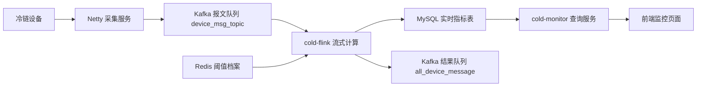

# day6 收官：实时计算与实时查询的全链路复盘

查询接口吐出第一屏 JSON 的那一刻，day6 的实时链路才算真正闭环。这一天横跨两个工程：cold-flink 负责把 Kafka 里的设备报文算成带告警结论的实时数据，cold-monitor 负责把这些数据按条件、按分页查给前端。复盘的价值在于把散落的知识点重新串成线：输入从哪来、计算做什么、结果去哪里、查询怎么接、部署怎么跑，顺手再清点一遍遗留问题，给 day7 的统计分析留好接口。

## 先给结论

- 实时计算模块两半分工：cold-flink 是流式计算端，cold-monitor 是查询端；前者打包成 jar 交给 Flink 运行环境常驻执行，后者是 Spring Boot 服务。
- 计算输入两路：Kafka 队列里的结构化设备报文，Redis 里的温湿度阈值档案；两者合并才能算出告警结论。
- 计算输出两路：覆盖写进 MySQL 实时指标表供查询，回投 Kafka 结果队列交给下游做历史与统计。
- 查询端本质是 JDBC 单表查询：Controller 收参数，Service 组条件加分页，BaseMapper 执行。
- 掌握自检三条：会开发 Flink Java 工程、会组织实时计算的代码结构、会把 jar 提交到 Flink 运行环境执行。

## 全链路一张图

这张图把设备读数走到页面展示的完整路径收进一处：



左半段是采集链路，在 day6 之前已经打通；中间的 Flink 计算与右半段的查询是这一阶段补齐的两段。MySQL 实时指标表只保留每台设备的最新读数，回答「现在怎么样」；历史读数随结果队列流向下游，回答「过去怎么样」的引擎在 day7 落地。

## 计算端：cold-flink 的三段结构

主程序 StreamingJob 把环境配置、数据源、转换与输出排进 main 方法，浓缩后是这样的：

```java
public class StreamingJob {
    public static void main(String[] args) throws Exception {
        // kafka队列名称
        String kafka_topic = "device_msg_topic";
        final StreamExecutionEnvironment env = StreamExecutionEnvironment.getExecutionEnvironment();
        //设置容错
        env.enableCheckpointing(5000);
        //设置重启策略
        env.getConfig().setRestartStrategy(RestartStrategies.fixedDelayRestart(4, 1000));

        //kafka队列属性
        Properties properties = new Properties();
        properties.setProperty("bootstrap.servers", "kafka.example.com:9092");
        properties.setProperty("group.id", "coldflink");
        properties.setProperty("auto.offset.reset", "earliest");

        //kafka队列consumer，接收netty发送过来的数据
        FlinkKafkaConsumer<String> consumer = new FlinkKafkaConsumer<String>(
                kafka_topic, new SimpleStringSchema(), properties);

        //设置实时数据源：kafka队列
        DataStream<MessageEntity> stream = env.addSource(consumer)
                .setParallelism(1)
                .map(string -> JSON.parseObject(string, MessageEntity.class));

        //从redis中获取设备信息，合并至消息中
        DataStream<MessageEntity> outStream = stream.map(new MessageAggregate());

        //存储设备指标消息
        outStream.addSink(new SinkToMySQL());

        //将消息发送到kafka队列
        FlinkKafkaProducer<String> myProducer = new FlinkKafkaProducer<String>(
                "all_device_message", new SimpleStringSchema(), properties);
        outStream.map(new MapFunction<MessageEntity, String>() {
            @Override
            public String map(MessageEntity value) throws Exception {
                return JSON.toJSONString(value);
            }
        }).addSink(myProducer);

        env.execute("冷链设备实时监控任务");
    }
}
```

按四段读这段代码就够了。环境段设 checkpoint 周期 5000 毫秒与固定延迟重启策略，流任务常驻运行的容错底线在这里定下。数据源段挂 FlinkKafkaConsumer 消费报文队列，字符串经 map 反序列化成 MessageEntity。计算段把 MessageAggregate 接上去，它负责到 Redis 取设备的阈值档案、合并进消息并比对出温度与湿度告警结论。输出段两路并发：SinkToMySQL 把结果覆盖写进实时指标表，FlinkKafkaProducer 把结果序列化后回投 all_device_message 队列，注释里写明的下游正是做统计的引擎。

查询端的结构一句话收束：三层包装，Controller 收键值对参数并返回统一 Result，Service 组装 QueryWrapper 与 Page，BaseMapper 执行单表分页查询，查的是实时指标表里每台设备的最新一行。

## 部署与联调闭环

计算端是普通 Java 工程，只是引了 Flink 的一组依赖，打包与提交的动作并不神秘（按课程环境整理的示例命令）：

```bash
# 打包实时计算工程
mvn clean package -DskipTests
# 提交到 Flink 运行环境
bin/flink run -c com.study.coldchain.flink.StreamingJob cold-flink-0.0.1-SNAPSHOT.jar
```

jar 提交之后任务在 Flink 运行环境里常驻，Web 管理界面能看到任务状态与算子情况。查询端是 Spring Boot 服务，启动后注册进注册中心，前端经网关访问。验证建议从下游往上游推：先看 MySQL 实时指标表有没有新数据，有数据说明计算端通了；再打查询接口看 JSON 是否成形；最后回到前端页面看定时刷新。用设备模拟器发一条超阈值报文，页面上告警状态从正常翻成告警，全链路就验完了。

## 掌握点自检

课程给 day6 定了三条掌握目标，逐条配上检验方法：

| 掌握点 | 检验方法 |
|---|---|
| 开发 Flink Java 工程 | 能从零建工程、引依赖、写出环境配置与数据源 |
| 组织实时计算的代码结构 | 说清主程序、合并算子、Sink 各自职责与衔接方式 |
| 提交程序到 Flink 运行环境 | 会打包 jar 并用命令提交，能在 Web 界面确认任务运行 |

三条都能对着工程讲出来，day6 就算过关；讲不出来就回到对应环节的代码再走一遍。

## 遗留问题与 day7 预告

账单不长，但每条都有去向：

- SinkToMySQL 异常只打印堆栈、逐条 executeUpdate，失败数据会丢、吞吐也吃亏，攒批提交与失败重试是要补的课。
- 查询条件目前只有公司维度，主机、仓库、时间范围还没接上，QueryWrapper 的扩展位已经留好。
- 实时指标表只留最新值，报警记录与温湿度曲线这类历史诉求它给不了。

最重的一条指向同一个方向：历史数据。结果队列 all_device_message 里的每条消息都是完整的设备读数快照，下游需要一个擅长时序存储与聚合的引擎把它们接住，按时间、按设备聚合成报警记录与温湿度曲线。day7 的统计分析就做这件事：安装配置 Apache Druid，走通离线与实时两条导入路，再用多种查询方式在冷链监控平台里把统计报表落地。

## 常见误区

- **把 day6 学成「会写一个 Sink」。** 错例是只记得 SinkToMySQL 的三段式生命周期。正解是按链路记：输入、合并、输出、查询、部署五个环节各解决什么问题，单独的代码只是环节的实现。
- **以为任务提交完就万事大吉。** 错例是 jar 提交后不看数据不看页面。正解是从下游往上游验证：表有数据、接口有 JSON、页面会刷新，三步走完才算部署成功。
- **把实时表当历史库用。** 错例是想从 cz_message_realtime 查一周的温度曲线。正解是这张表按设备主键覆盖写只留最新值，历史聚合交给专门的时序引擎。
- **忽略计算端的容错配置。** 错例是把 checkpoint 与重启策略当样板代码抄抄就过。正解是流任务常驻运行，没有容错配置，一次异常就可能让实时链路静默中断。

## 面试可能被问到的问题

1. 面试官追问：「介绍一下你做过的实时计算模块的整体结构？」
   答：分计算与查询两半。计算端是普通 Java 工程引 Flink 依赖，消费 Kafka 的设备报文，合并 Redis 里的阈值档案算出告警结论，结果一路覆盖写 MySQL 实时指标表，一路回投 Kafka 交给下游做历史统计；查询端是 Spring Boot 服务，单表分页查询供前端取数。
2. 面试官追问：「为什么要回投一个 Kafka 队列，结果直接都写库不行吗？」
   答：MySQL 那张表按设备覆盖只存最新值，历史明细与聚合分析需要专门的时序存储。结果队列把每条快照广播给下游，统计端与实时查询端解耦，统计引擎出问题也不影响实时查询。
3. 面试官追问：「Flink 任务怎么部署与验证？」
   答：工程打包成 jar，用 flink run 提交到运行环境，任务常驻执行，Web 管理界面看运行状态。验证从下游往上游：MySQL 实时表有新数据，查询接口返回 JSON，前端页面定时刷新，再发一条超阈值报文看告警状态变化。
4. 面试官追问：「实时查询的数据为什么查 MySQL 而不是也走 Kafka？」
   答：查询要的是每台设备当前最新状态，需要按条件过滤、分页与索引，关系型表最合适；Kafka 是流转队列，适合顺序消费而不是随机条件查询。两者各管一段：队列管流转发，MySQL 管可查询的最新快照。
5. 面试官追问：「这条链路里的告警结论是怎么算出来的？」
   答：设备报文里只有当前读数，阈值档案在 Redis。Flink 的合并算子按设备取档案，把读数与上下限比对，算出温度告警与湿度告警两个结论，连同读数一起输出，查询端拿到即是结论，不用再算。

## 配套资料

- 代码：`materials/code/06/day6 实时计算 - 冷眼项目实战/`，cold-flink 工程的 `StreamingJob.java`、`MessageAggregate.java`、`SinkToMySQL.java`，以及 cold-monitor 查询工程（该目录名含项目代号，正文统一称冷链监控平台）。
- 代码：`materials/code/06/day1 背景介绍与系统介绍/`，cold-common 工程的 `MessageEntity`，链路里流转的消息实体。
- 说明：包名统一改写为 `com.study.coldchain`；中间件地址以 example.com 占位；提交命令为按本课环境整理的示例；引用路径截至 day 目录层级。
