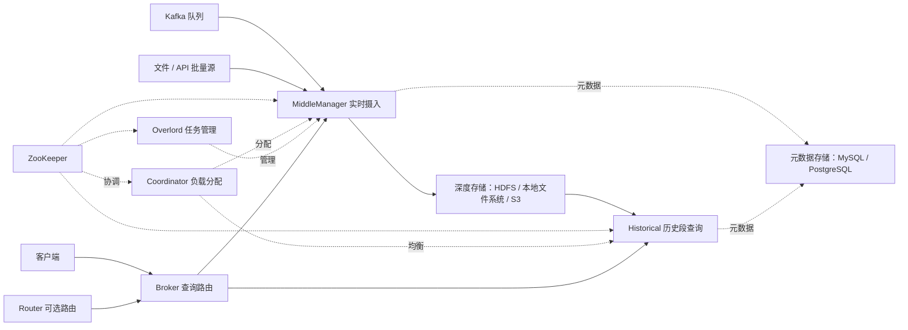

# Apache Druid 再认识：能力边界、数据模型与选型理由

结果队列里的设备快照一直在排队，接住它的引擎已经定下是 Apache Druid。名字在技术架构篇里出现过，五个进程角色也点过名，真要把统计分析放心交给它，还差三件事没说透：它的能力覆盖什么、它拒绝吃什么数据、数据进去之后长什么样。三件事补齐之后，选型与建模才站得住，「两个 Druid」的边界也顺手再钉一次。

## 先给结论

- Druid 的三大特性：存得下 TB 级大数据量、提供实时与准实时查询、高容错高性能且聚合能力内建，统计分析不必再写 MapReduce 或 Spark 作业。
- 适用场景四类：交互式聚合与快速探查、实时查询分析、每天 10TB 级增量的大数据量、大数据流的实时分析。
- 不适用场景三类：更新频繁的数据（流式插入可以，流式更新不行）、离线报表系统（Hive 更合适）、大表 join。
- 数据模型三概念：DataSource 是表，Segment 是按时间切出的数据段，timeChunk 是段粒度决定的时间块；roll-up 在摄入时把同粒度同维度的行预合并成一行。
- 冷链监控平台选它的对应关系：设备快照只增不改、查询按时间切片加维度聚合、Flink 回投的结果队列需要被常驻监听实时入库。

## 一、三大特性：存得下、查得快、自带聚合

**第一是存得下。** Druid 与 Hadoop 体系一样面向海量数据，TB 级规模放进集群是常态。

**第二是查得快。** Hadoop 体系存得多，但实时性差，跑一个分析任务要排队调度，分钟级起步；OLTP 数据库如 MySQL、Oracle 能实时响应，数据量一大查询就拖垮。Druid 补的是中间这块空地：数据量向 Hadoop 看齐，查询向 OLTP 看齐，提供实时或准实时的分析查询。

**第三是自带聚合。** Druid 是高容错、高性能的分析引擎，聚合统计是内建能力。算每小时平均温度、每个仓库超温次数，写查询就行，不需要再开发一套 MapReduce 或 Spark 程序去跑批。对团队来说，这一条直接决定要不要引入它：统计分析的成本从「养一套计算作业」降到「写一条 SQL」。

## 二、设计三原则：为什么它敢承诺快

官方给 Druid 定的设计原则有三条，每条都对准一个性能瓶颈。

**快速查询**：部分数据预聚合、热数据常驻内存、查询时引用现成结果，扫描量与计算量在摄入阶段就砍掉一大截。**水平扩展**：数据分布到集群、查询并行化，加机器就能扩容，单点不构成天花板。**实时分析**：数据不可更改、只能追加，写入路径因此极简，不用处理行级锁与事务冲突。

第三条也是一条纪律：凡是「写进去就算数、回头不改」的数据，Druid 都接得住；要频繁涂改的数据，它从设计上就没打算伺候。

## 三、场景对号：什么进得来，什么进不来

适用场景有五条：需要交互式聚合和快速探查大量数据时；需要实时查询与分析时；数据量大且持续增长时，比如每天数亿条事件、每天 10TB 级的增量；需要对大数据流做实时分析时；需要一个高可用、高容错、高性能数据库时。

不适用场景有三条，条条有替身：

- 更新频繁的数据。Druid 支持流式插入，不支持流式更新，改动要走后台批处理任务重算。
- 离线报表系统。报表对查询延迟不敏感，T+1 出数即可，用 Hive 更合适，没必要为此上 Druid。
- 大表 join。多张大表关联是传统 OLAP 的舒适区，Druid 的强项是单事实表按维度聚合，join 不是它的主战场。

## 四、数据模型三概念与 roll-up

课件把笔墨集中在架构上，数据模型的概念按官方口径在这里补齐，后面的导入与查询都会用到。

**DataSource** 是数据源，对应关系型数据库里的表，设备快照进 Druid 就是一张叫 `all_device_message` 的 DataSource。**Segment** 是数据段，DataSource 按时间切片后落到磁盘的基本单元，查询时 Historical 进程按段加载、并行扫描。**timeChunk** 是时间块，摄入配置里 segmentGranularity 决定按什么粒度切块，比如按小时一块，一块内再按行数切成若干 Segment。

**roll-up 预聚合**发生在摄入时：同一个时间粒度内、维度值完全相同的行，合并成一行，数值列按聚合器预计算，count 类指标累加。落库行数因此骤减，查询扫到的就是汇总结果。一份摄入配置里，这几件事写在 granularitySpec 与 metricsSpec：

```json
"granularitySpec": {
  "type": "uniform",
  "segmentGranularity": "hour",
  "queryGranularity": "minute",
  "rollup": true
},
"metricsSpec": [
  { "type": "count", "name": "report_count" },
  { "type": "doubleMax", "name": "tem_max", "fieldName": "tem" }
]
```

`segmentGranularity: hour` 表示一小时一个 timeChunk，`queryGranularity: minute` 表示查询能按分钟粒度取数，`rollup: true` 打开预聚合。预聚合的成果在查询时直接兑现，按分钟取设备最大温度，就是一次普通的 GROUP BY（SQL 为按官方写法补全的示例）：

```sql
SELECT TIME_FLOOR(__time, 'PT1M') AS minute_bucket,
       metercode,
       SUM(report_count) AS report_count,
       MAX(tem_max)      AS max_tem
FROM coldchain_meter
WHERE __time >= TIMESTAMP '2026-11-05 00:00:00'
GROUP BY 1, 2
```

代价同样要清楚：原始明细行被合并后拿不回来，需要明细的场合要么关掉 roll-up，要么把明细另存一份。

## 五、架构走读：五节点、两类数据流、三个存储

技术架构篇已把五个进程角色对过号，这里按课件架构图把连线画全，图里实线是数据与查询链路，虚线是元数据与协调关系。



数据流有两类，都汇进 MiddleManager。一类是流数据：业务系统把数据推进 Kafka，Druid 直接监听队列，数据不必先落到别的系统就实时入库，这条线正是冷链平台 Flink 结果队列的来路。另一类是批数据：把文件或某个 API 接口的数据，通过定时任务的方式周期性导入。

查询链路是 Broker 收请求，分别问 MiddleManager 上的实时数据和 Historical 上的历史数据，合并后返回客户端。Router 是可选进程，负责把各类请求路由到对应节点。

三个存储各司其职。深度存储放数据段本体，本地文件系统、HDFS、AWS 的 S3 都可以，实时节点按策略把段写进去，历史节点再按策略加载；元数据存储放 Druid 自身的库表、任务与数据段登记信息，MySQL 或 PostgreSQL 均可；ZooKeeper 负责节点间的协调与发现。Coordinator 协调摄入负载分给哪个 MiddleManager，并均衡 Historical 上的段；Overlord 管理摄入任务。正是这套分工撑起了实时性、历史大数据量存储、高可用高并发高扩展三件事。

## 六、与连接池 Druid 的边界，再钉一次

工程依赖里的 `druid-spring-boot-starter` 来自 Alibaba，是应用进程内的数据库连接池，管的是 JDBC 连接的复用；Apache Druid 是独立部署的分析集群，吃的是 Kafka 里的报文与批量文件。分辨只看两点：依赖坐标里带 `com.alibaba` 的是连接池，独立部署、有 8888 控制台的是 Apache Druid。day7 之后所有「Druid」字样，都指后者。

## 常见误区

- **把 Druid 当 MySQL 的替代品。** 错例：想把实时指标表也迁进去当业务库。正解：Druid 只增不改、按时间聚合，可事务更新的业务表留在 MySQL，两者分工不替代。
- **以为支持流式更新。** 错例：发现某条快照算错了，直接改库里的行。正解：Druid 只支持流式插入，纠错通过后台批处理任务重算覆盖，没有行级更新。
- **离线报表也硬上 Druid。** 错例：T+1 出数的报表也建在 Druid 上。正解：查询延迟不是关键因素的离线报表，Hive 更合适，Druid 的价值在交互式与实时。
- **以为 roll-up 之后还能取回明细。** 错例：开着 roll-up 又想按设备查单条上报。正解：合并后的行不含原始明细，要么摄入时关掉 roll-up，要么明细另存。

## 面试可能被问到的问题

1. 面试官追问：「Druid 和 Hadoop 体系比，优势在哪？」
   答：两者都能存大数据量，差别在实时性与聚合能力。Hadoop 体系的查询要跑批调度，分钟级起步；Druid 提供实时或准实时的聚合查询，且聚合能力内建，不用额外开发 MapReduce 或 Spark 作业。
2. 面试官追问：「什么数据不该放进 Druid？」
   答：三类：需要频繁更新的数据，它只有流式插入没有流式更新；离线报表数据，对延迟不敏感的场景 Hive 更合适；需要大表 join 的多维关联分析，它的强项是单事实表按时间与维度聚合。
3. 面试官追问：「DataSource、Segment、roll-up 分别是什么？」
   答：DataSource 是数据源，相当于表；Segment 是按时间切片后落盘的数据段，是查询并行扫描的基本单元；roll-up 是摄入时的预聚合，把同时间粒度内维度相同的行合并成一行，数值列按聚合器预算，落库即汇总。
4. 面试官追问：「数据从哪两条路进 Druid？」
   答：流数据与批数据两条路。流数据由 Druid 直接监听 Kafka 队列实时摄入；批数据把文件或 API 接口的数据通过定时任务周期导入。两条路都汇到 MiddleManager，再落到深度存储。
5. 面试官追问：「元数据存储和深度存储分别存什么？」
   答：元数据存储用 MySQL 或 PostgreSQL，存 Druid 自身的表结构、任务记录与数据段登记信息；深度存储用本地文件系统、HDFS 或 S3，存数据段本体。前者是账本，后者是货仓，Historical 从深度存储加载段后对外提供查询。

## 配套资料

- 代码：`materials/code/06/day7 统计分析/`，day7 的 cold-druid 查询工程（DruidHelper、DruidService、DruidController），本节认识的分析引擎就是它查询的对象。
- 说明：Druid 集群无源码包，granularitySpec 与 metricsSpec 节选为按 Apache Druid 0.15 通用写法补全的示例；数据模型概念口径参考官方文档。
- 说明：引用路径截至 `materials/code/06/` 的 day 目录层级；工程内包名统一按 `com.study.coldchain` 口径改写。
