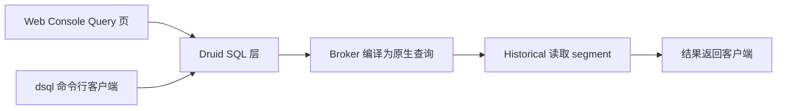

# 查 Druid 里的数据：Console 查询页与 dsql 命令行

数据导入成功只是前半程，业务与排查都要求把数据查出来。查 MySQL 的肌肉记忆是打开一个客户端连上去敲 SQL；查 Druid 同样有现成客户端，而且不止一种。把两类客户端用熟，导入后的验证、临时统计、给报表取数前先看数据形状，这几件事都能直接在终端与浏览器里完成。

## 先给结论

- Druid 自带两类客户端：Web Console 的 Query 页，浏览器里写 SQL 直接执行；bin 目录下的 dsql 命令行客户端，使用体验与 mysql 命令行一致。
- 两类客户端殊途同归：语句先进 Druid 的 SQL 层，再由 Broker 编译成原生查询分发执行。
- Console 里先 Run with limit 限行数预览，确认语句没问题再全量执行。
- 时间过滤基准列是 __time，聚合统计用 GROUP BY 配合时间函数表达。
- timeseries、topN、groupBy 是最常用的三类原生查询，Console 里写的多数统计 SQL 最终会翻译成它们。

## 两类客户端与一条查询链路



这张图说明客户端只是入口：无论浏览器还是命令行，语句都走同一条链路，由 Broker 编译分发、Historical 出数，行为完全一致。关键路径是 SQL 到原生查询的编译，掌握 SQL 写法几乎等于掌握了查询能力的大半。

## Console Query 页：浏览器里跑 SQL

数据导入完成后，管理台（课程环境 8888 端口的 Web Console）里有个 Query 页，地址栏形如 `unified-console.html#query`。在左侧编辑器输入 `select * from wikipedia`，点 Run with limit，结果以表格逐行返回，单行可展开看原始 JSON。带 limit 的执行是预览性质，防止手滑拉全量；语句确认无误后再点 Run 全量跑。适合三类场景：导入后验证数据、临时统计、给业务取数前先确认字段与量级。

## dsql：命令行里的 SQL 客户端

Druid 安装目录的 bin 下自带 dsql 脚本，定位相当于 MySQL 的 mysql 客户端：启动即连接本机 Druid 服务，提示符下直接敲 SQL：

```bash
# 进入 Druid 安装目录，启动自带 SQL 命令行客户端
cd /opt/druid/
dsql
# 提示符下执行 SQL，先取一条看字段结构
dsql> select * from wikipedia limit 1;
# 再取一小批样例
dsql> select * from wikipedia limit 10;
```

`limit 1` 看结构，`limit 10` 看样例；演示数据源里只有几条记录，不加 limit 也是瞬间返回。mysql 客户端连 MySQL 服务器，dsql 连的就是 Druid 服务，语法是 Druid SQL，大多数标准 SQL 直觉可以照搬。部分新版本发行包不再附带这个脚本，此时用 Console 或任意支持 JDBC 的 SQL 工具可以等价替代。

## SQL 之外：三类原生查询长什么样

Console 执行的统计 SQL，最终由 Broker 编译成原生查询 JSON。三类最高频的形态值得认识一下，排查慢查询、读懂执行计划时都用得上。

**timeseries 按时间聚合**，回答「每小时多少条」这类沿时间轴的统计：

```json
{
  "queryType": "timeseries",
  "dataSource": "wikipedia",
  "granularity": "hour",
  "intervals": ["2015-09-12/2015-09-13"],
  "aggregations": [{ "type": "count", "name": "edits" }]
}
```

**topN 维度排名**，回答「编辑量前十的页面」这类取前 N 名的问题（示例按 Druid 官方快速上手写法）：

```json
{
  "queryType": "topN",
  "dataSource": "wikipedia",
  "intervals": ["2015-06-12/2015-06-13"],
  "granularity": "all",
  "dimension": "page",
  "metric": "count",
  "threshold": 10,
  "aggregations": [{ "type": "count", "name": "count" }]
}
```

**groupBy 分组统计**，回答「每个频道每小时多少条」这类完整分组结果：

```json
{
  "queryType": "groupBy",
  "dataSource": "wikipedia",
  "granularity": "hour",
  "intervals": ["2015-09-12/2015-09-13"],
  "dimensions": ["channel"],
  "aggregations": [{ "type": "count", "name": "edits" }]
}
```

同样的统计用 SQL 表达更顺手：

```sql
-- 对应 timeseries：按小时统计编辑量
SELECT FLOOR(__time TO HOUR) AS hour_time, COUNT(*) AS edits
FROM wikipedia
WHERE __time >= TIMESTAMP '2015-09-12 00:00:00'
GROUP BY FLOOR(__time TO HOUR)

-- 对应 topN：编辑量前十的页面
SELECT page, COUNT(*) AS edits
FROM wikipedia
GROUP BY page
ORDER BY edits DESC
LIMIT 10
```

三类的分工：timeseries 只要时间轴上的指标序列，topN 只要一个维度排序后的前 N 行，groupBy 要完整的分组结果。SQL 里它们分别对应按时间函数 GROUP BY、ORDER BY 加 LIMIT、普通 GROUP BY，写熟之后两边可以互相翻译。

## 结果核对

查询出来的数据要对得上账，核对三点：

- 行数一致：查出的行数与导入阶段投递的消息条数相同，演示里导入几条就查出几条。
- 时间落位正确：结果的时间戳都在投递消息携带的时间范围内。
- 字段值一致：channel、page 这类维度值与源消息逐字相同，包括大小写。

建议的顺序是先 `select * ... limit 1` 看结构与字段名，再跑聚合看总量，最后与业务口径比对数值。

## 常见误区

- **把 Console 当只读面板。** 错例：以为管理台只能看任务状态与数据源列表。正解：Query 页是完整的 SQL 执行入口，临时统计与验证都在这里完成。
- **时间过滤条件写错列。** 错例：拿业务字段当时间过滤依据，写了一堆条件结果全表扫描。正解：导入时时间列已映射为 __time，SQL 的时间过滤基准就是它。
- **原生查询里维度名大小写随手写。** 错例：cityName 写成 cityname，查出来的值全是 null。正解：原生查询 JSON 里的维度名要与导入声明逐字一致，大小写敏感。
- **不分场景全量 select。** 错例：在大数据源上直接 select 所有列所有行。正解：先 limit 看形状，统计需求交给聚合查询，明细全量拉取既慢又占内存。

## 面试可能被问到的问题

1. 面试官追问：「Druid 的 SQL 是怎么执行的？」
   答：SQL 先进 Druid 的 SQL 层，由 Broker 基于 Calcite 解析并编译成原生查询 JSON，再分发到持有数据段的节点执行，结果在 Broker 合并后返回。客户端只感知 SQL，底层执行的全是原生查询。
2. 面试官追问：「timeseries、topN、groupBy 三类原生查询分别适合什么场景？」
   答：timeseries 适合沿时间轴的指标序列，比如每小时编辑量；topN 适合单个维度取前 N 名，比如编辑量前十的页面；groupBy 适合多维度完整分组，比如每个频道每小时的统计量。选对形态能让查询在引擎里走最优路径。
3. 面试官追问：「dsql 客户端是什么，怎么用？」
   答：Druid bin 目录自带的 SQL 命令行客户端，启动后连接 Druid 服务进入交互提示符，直接执行 Druid SQL。使用方式与 mysql 客户端一致，适合服务器上快速验证；不带该脚本的版本可用 Console 或 JDBC 工具替代。
4. 面试官追问：「怎么验证导入的数据是完整且正确的？」
   答：行数与投递条数对账，时间戳落在预期区间，维度值与源消息逐字比对；先用 limit 1 看结构，再聚合看总量，最后抽几条明细与源数据核对，三层都对上才算验证完成。

## 配套资料

- 代码：`materials/code/06/day7 统计分析/`，cold-druid 查询工程，程序化查询的写法见工程实现。
- 说明：本课客户端查询在管理台与命令行演示，无独立源码包；原生查询 JSON 与 SQL 示例为按 Druid 官方快速上手与本课写法补全；引用路径截至 day 目录层级。
