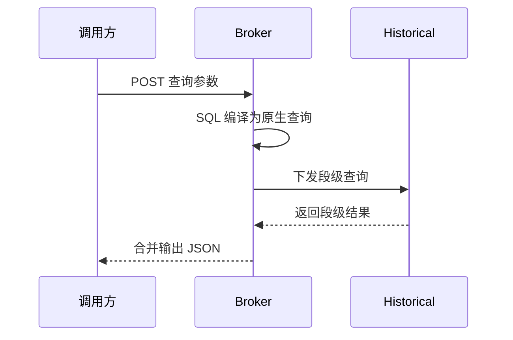

# 用 API 查 Druid：两种提交格式与 cold-druid 工程落地

在 Console 里点一下 Run 就有结果，但业务系统不能靠人守着浏览器：报表要取数、定时任务要汇总、前端温湿度曲线要刷新，都得把查询变成一次可编程的调用。把 Console 的查询动作拆开看，它本身就是一次 API 调用：把格式化的参数 POST 给后台查询端点，拿回 JSON 结果。API 查询做的事一模一样，只是把「人点按钮」换成「程序发请求」。

## 先给结论

- 查询本质是向 Broker 的 8082 端口 POST 参数：SQL 语句提交到 `/druid/v2/sql`，原生查询 JSON 提交到 `/druid/v2?pretty`。
- 参数有两种格式：SQL 格式是把一条语句装进 JSON 的 query 字段；原生 JSON 用 queryType 描述查询，能力覆盖最全。
- Java 工程不必手写 HTTP：cold-druid 通过 Avatica JDBC 走同一条 SQL 通道，DruidHelper 管连接，DruidServiceImpl 拼 SQL 并映射结果，DruidController 开 HTTP 接口。
- 平台两个查询接口：`apache-druid/query/select` 查明细列表，`apache-druid/query/temhum` 查设备最近温湿度。
- 查询条件按 metercode、stTime、endTime、limit 四个参数组装，时间过滤基准是 __time 列。

## 查询的 API 本质

Console 提交一条 `select * from wikipedia`，前端实际是把语句作为参数 POST 给后台查询端点，后台返回 JSON 结果。API 方式与此完全同构，参数有两类。

**SQL 格式参数**，把语句装进 query 字段（对应 Druid 快速上手目录里的 wikipedia-top-pages-sql 文件）：

```json
{
  "query": "SELECT page, COUNT(*) AS Edits FROM wikipedia WHERE \"__time\" BETWEEN TIMESTAMP '2015-06-12 00:00:00' AND TIMESTAMP '2015-06-13 00:00:00' GROUP BY page ORDER BY Edits DESC LIMIT 10"
}
```

**原生 JSON 参数**，用 queryType 描述一次 topN 查询，也就是编辑量前十的页面（对应 wikipedia-top-pages 文件）：

```json
{
  "queryType": "topN",
  "dataSource": "wikipedia",
  "intervals": ["2015-06-12/2015-06-13"],
  "granularity": "all",
  "dimension": "page",
  "metric": "count",
  "threshold": 10,
  "aggregations": [{ "type": "count", "name": "count" }]
}
```

两类参数的提交命令，注意端点结尾路径不同：

```bash
# SQL 格式参数提交到 /druid/v2/sql，POST 方式，Content-Type 为 JSON
curl -X POST -H "Content-Type:application/json" -d @wikipedia-top-pages-sql.json \
  http://druid.example.com:8082/druid/v2/sql

# 原生 JSON 参数提交到 /druid/v2，?pretty 让返回结果格式化便于阅读
curl -X POST -H "Content-Type:application/json" -d @wikipedia-top-pages.json \
  http://druid.example.com:8082/druid/v2?pretty
```

两条命令的差别只在端点与参数文件：SQL 走 `/druid/v2/sql`，原生 JSON 走 `/druid/v2?pretty`，返回都是 JSON 数组，一条记录一个统计结果。



这张图是两种参数共同的执行路径：Broker 是查询入口，SQL 在这里编译成原生查询，再分发到持有数据段的节点；调用方拿到的始终是合并后的 JSON。关键差别只在入口参数的格式，背后的执行引擎完全一样。

## 连接层：DruidHelper 管连接

Java 工程里不必手写 HTTP 调用。Druid 的 SQL 层提供 Avatica 协议端点，工程引入 avatica-core 依赖后，用 JDBC 驱动连上去就是标准 JDBC 编程模型。DruidHelper 负责连接的建立与释放（真实代码，包名按规范改写，地址以 example.com 占位）：

```java
public class DruidHelper {

    private String url = "jdbc:avatica:remote:url=http://druid.example.com:8888/druid/v2/sql/avatica/";
    private Properties conf = new Properties();
    private Connection connection;

    /**
     * 获得 Druid 连接
     */
    public Connection getConnection() {
        try {
            if (null == connection) {
                connection = DriverManager.getConnection(url, conf);
            }
        } catch (SQLException e) {
            e.printStackTrace();
        }
        return connection;
    }

    /**
     * 关闭 Druid 连接，结果集、语句、连接依次释放
     */
    public void close(Connection connection, Statement st, ResultSet rs) {
        try {
            if (rs != null) {
                rs.close();
            }
            if (st != null) {
                st.close();
            }
            if (connection != null) {
                connection.close();
            }
        } catch (SQLException e) {
            e.printStackTrace();
        }
    }
}
```

连接串指向 Druid 的 Avatica 端点，管理台所在的 8888 端口背后是 Router，SQL 请求经它转发给 Broker。getConnection 采用惰性初始化，第一次查询才真正握手，之后复用同一个连接。释放顺序固定为结果集、语句、连接，封装成 close 一处调用。

## 服务层：DruidServiceImpl 拼 SQL 与映射结果

查询条件由前端参数动态拼装（真实代码节选）：

```java
private String querySQL(Map<String, Object> params) {
    StringBuffer stringBuffer = new StringBuffer();
    stringBuffer.append("SELECT * from all_device_message where 1= 1 ");

    // 设备编码
    String metercode = params.get("metercode").toString().trim();
    if (!metercode.equals("")) {
        stringBuffer.append(" and metercode = '");
        stringBuffer.append(metercode);
        stringBuffer.append("' ");
    }

    // 前台传入开始、结束时间
    String startTime = params.get("stTime").toString().trim();
    if (!startTime.equals("")) {
        stringBuffer.append(" and __time > '");
        stringBuffer.append(startTime);
        stringBuffer.append("' ");
    }
    String endTime = params.get("endTime").toString().trim();
    if (!endTime.equals("")) {
        stringBuffer.append(" and __time < '");
        stringBuffer.append(endTime);
        stringBuffer.append("' ");
    }

    stringBuffer.append(" order by __time desc");

    // 查询条数，默认 10
    String limit = params.get("limit") != null ? params.get("limit").toString().trim() : "10";
    stringBuffer.append(" limit ");
    stringBuffer.append(limit);
    return stringBuffer.toString();
}
```

四个参数各有用途：metercode 过滤设备，stTime 与 endTime 圈定时间区间，limit 控制返回条数，整体按 __time 倒序，拿到的是最近的快照。执行与映射是一段标准 JDBC 流程：

```java
connection = helper.getConnection();
st = connection.createStatement();
rs = st.executeQuery(sql);
while (rs.next()) {
    resultList.add(Rs2Entity(rs));
}
Map<String, Object> map = new HashMap<>();
map.put("items", resultList);
return R.ok(map);
```

Rs2Entity 按列名逐列读取：metercode、hostname、tem、hum、curtime 等二十来个字段填进 MessageEntity，温湿度与上下限做整型转换，时间用 curtime 字符串承载；finally 里调 helper.close 统一释放，异常路径返回 R.error。

曲线查询 queryDruidTumHum 复用列表查询的结果：从每行的 curtime 里截取时分秒拼出横轴时间数组，tem 与 hum 两个数组用 Collections.reverse 调成时间正序，返回的 xAxis、tem、hum 三个键正好对应前端曲线的三条数据源。

## 接口层与联调

DruidController 把服务能力暴露成 HTTP 接口（真实代码节选）：

```java
@RestController
@RequestMapping("apache-druid/query")
public class DruidController {

    @Autowired
    private DruidService druidService;

    /**
     * 查询 Druid 中数据列表
     */
    @RequestMapping(value = "/select")
    public R Select(@RequestParam Map<String, Object> params) {
        return druidService.queryDruidList(params);
    }

    /**
     * 查询 Druid 中温度湿度数据（设备最近 10 条数据）
     */
    @RequestMapping("/temhum")
    public R temhumLine(@RequestParam Map<String, Object> params) {
        return druidService.queryDruidTumHum(params);
    }
}
```

工程配置的服务端口是 8182、context path 为 /cold，服务注册到 Eureka 后可经网关访问，联调期直连更快：

```bash
# 直连 cold-druid 服务，查某台设备最近 10 条温湿度快照
curl "http://example.com:8182/cold/apache-druid/query/temhum?metercode=M001&limit=10"
```

返回 JSON 里 xAxis 是时间数组，tem 与 hum 是对应时刻的温湿度序列，select 接口则返回 items 明细集合。核对方法：把同一组条件换成 SQL，在 Console 里执行 `select * from all_device_message order by __time desc limit 10`，两边行数与数值一致即联调通过。

## 常见误区

- **两类端点互相串用。** 错例：把原生查询 JSON 发给 `/druid/v2/sql`，或把 SQL 语句发给 `/druid/v2`，结果只收到报错。正解：SQL 参数认 `/druid/v2/sql`，原生 JSON 认 `/druid/v2`，`?pretty` 只影响返回排版不影响语义。
- **以为查 Druid 必须手写 HTTP。** 正解：Avatica JDBC 封装了 SQL 通道，工程用 Statement 与 ResultSet 的标准写法取数，连接管理交给工具类。
- **查询完不释放资源。** 错例：只关连接不关 ResultSet，长期运行句柄泄漏。正解：按结果集、语句、连接的顺序释放，工程里封装在 helper.close 一处调用，finally 里保证执行。
- **时间条件与数据格式不匹配。** 错例：时间字符串带了时区又写反了区间方向，查出来的永远是空。正解：时间格式要与导入时的时间处理一致，stTime 在前、endTime 在后，过滤基准始终是 __time 列。

## 面试可能被问到的问题

1. 面试官追问：「Druid 的 SQL 查询和原生 JSON 查询是什么关系？」
   答：SQL 先进 Druid 的 SQL 层，由 Broker 编译成原生查询再执行；原生 JSON 是查询的底层表达，能力覆盖最全。日常统计用 SQL 顺手，需要 SQL 表达不了的查询形态时直接提交原生 JSON，两者端点也不同。
2. 面试官追问：「Avatica 是什么，Java 工程为什么能用 JDBC 连 Druid？」
   答：Avatica 是 Calcite 体系下的远程 JDBC 协议实现，Druid 的 SQL 层对外暴露 Avatica 端点。工程引入 avatica 依赖，连接串写 jdbc:avatica:remote:url 指向该端点，之后就是标准 JDBC 编程模型，Statement 执行 SQL、ResultSet 逐行取数。
3. 面试官追问：「查询接口的参数是怎么组装成 SQL 的？」
   答：接口收一个参数 Map，metercode 非空就拼设备等值条件，stTime 与 endTime 非空分别拼成对 __time 的大于与小于条件，limit 控制条数并默认 10，整体按 __time 倒序。拼装完交给 Statement 执行，时间过滤基准始终是 __time 列。
4. 面试官追问：「查询结果是怎么转成业务对象返回的？」
   答：ResultSet 逐行读出后由 Rs2Entity 按列名填充 MessageEntity，温湿度等字段做整型转换，列表查询把集合装进 items 随 R 包装返回。曲线接口复用列表结果，从 curtime 截取时分秒作横轴，温湿度数组反转成时间正序后返回。
5. 面试官追问：「为什么不直接查 MySQL 而要查 Druid？」
   答：链路里 MySQL 实时指标表按设备主键覆盖写，只保留每台设备最新读数；完整快照流进了 Druid。查历史明细、按时间段取温湿度曲线必须查 Druid，两者分工是最新状态归 MySQL，历史明细与聚合归 Druid。

## 配套资料

- 代码：`materials/code/06/day7 统计分析/`，cold-druid 查询工程，含 DruidHelper、DruidService、DruidServiceImpl、DruidController 与启动类。
- 代码：`materials/code/06/day6 实时计算 - 冷眼项目实战/`，cold-flink 工程，向 all_device_message 队列投递完整快照的生产端。
- 说明：包名统一改写为 com.study.coldchain；curl 命令与两个查询参数文件为按本课画面与 Druid 官方快速上手写法补全，地址以 example.com 占位；引用路径截至 day 目录层级。
