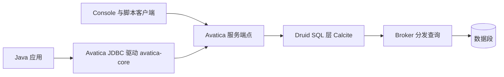

# 用 JDBC 查 Druid 数据：Avatica 驱动把标准 SQL 通道接进 Java 工程

上一节的 API 查询已经能拿到 JSON 结果，但调用方要自己拼 HTTP 请求、自己解析响应。Java 工程师手里最顺手的取数工具其实是 JDBC：一段 `Statement` 加 `ResultSet` 的代码，换到 MySQL、Oracle 上照样能跑。于是问题来了，Druid 是个时序数据库，`DriverManager` 凭什么连得上它？这一节从原理讲到代码，把这条链路打通。

## 先给结论

- Druid 的 SQL 层构建在 Apache Calcite 之上，对外暴露 Avatica 协议端点，任何带 Avatica JDBC 驱动的程序都能用标准 JDBC 连接它。
- 依赖只有一个：`org.apache.calcite.avatica` 的 `avatica-core`。
- 连接串固定格式为 `jdbc:avatica:remote:url=http://<host>:<port>/druid/v2/sql/avatica/`，端口用 Broker 的 8082 或 Router 的 8888。
- 编程模型三步走：设置 JDBC 参数、执行 SQL、遍历 `ResultSet`。
- cold-druid 工程的 `DruidHelper` 就是这套流程的封装，平台的列表查询与温湿度曲线最终都跑在这条 JDBC 通道上。

## 能连上的原理：Calcite 与 Avatica

Druid 没有自己发明一套私有协议。它的 SQL 能力来自 Apache Calcite，一个动态数据管理框架：SQL 解析、优化、执行计划这些「数据库的经典模块」都在里面，但数据存储不归它管。真正让远程程序能用 JDBC 的，是 Calcite 体系下的 Avatica：JDBC 调用在客户端被翻译成远程消息，发到服务端的 Avatica 端点，服务端执行后再把结果序列化传回来。

回头看前面两种查询方式：Console 界面点 Run，客户端脚本发参数，本质上都是调用 Druid 后台的查询服务。我们的应用与它们地位平等，同样可以经 Avatica 这一层访问数据，只是 Console 的客户端是现成的，Java 应用需要自己引入驱动。



这张图在讲同一条链路的两个入口：Console 与 Java 应用最终都汇聚到 Avatica 服务端点，差别只在客户端一侧，Java 应用要先装上 `avatica-core` 这个驱动。图后的关键解读：SQL 层编译出的查询仍由 Broker 分发到持有数据段的节点，与 API 查询背后的执行引擎完全一致。

## 动手写第一个 JDBC 查询程序

演示工程就是一个最简 Maven 工程，不掺任何框架。写一个查询类按三步走：第一步设置 JDBC 参数，第二步执行 SQL，第三步显示返回结果。

### 第一步：引入 Avatica 依赖

`pom.xml` 里加一个依赖（画面上的演示工程用 1.18.0，cold-druid 实际工程用 1.15.0，两个版本都能连 Druid 0.15 集群）：

```xml
<dependency>
    <groupId>org.apache.calcite.avatica</groupId>
    <artifactId>avatica-core</artifactId>
    <version>1.15.0</version>
</dependency>
```

依赖落下来，Avatica 的 jar 包就进了 classpath，驱动类由 `DriverManager` 通过 SPI 自动发现，不需要显式 `Class.forName`。

### 第二步：设置 JDBC 参数

```java
// 1. 设置 JDBC 参数
String url = "jdbc:avatica:remote:url=http://druid.example.com:8082/druid/v2/sql/avatica/";
Properties properties = new Properties();
```

这行 URL 与常见的 MySQL 连接串长得不一样，拆开看就清楚了：`jdbc:avatica:remote:url=` 是 Avatica 驱动的固定前缀，后面跟着的才是真正的 HTTP 服务地址 `/druid/v2/sql/avatica/`。端口有两个选择，8082 是 Broker 的端口，8888 是 Router 的端口（管理台背后也是它），两个端口都暴露了同一个 Avatica 端点，效果等价。

SQL 语句可以先在 Console 里验证一遍再搬进代码：

```sql
select * from wikipedia order by __time desc limit 10
```

这条语句按内置时间列 `__time` 倒序取 10 条，Console 能直接返回结果，说明语句本身没问题，JDBC 查询执行的就是它。

### 第三步：执行 SQL 并遍历结果

```java
// 2. 执行 SQL，建立连接后创建语句并查询
Connection connection = DriverManager.getConnection(url, properties);
ResultSet rs = connection.createStatement().executeQuery(sql);

// 3. 显示返回结果
while (rs.next()) {
    System.out.println(rs.getString("page") + "\t" + rs.getString("comment"));
}
```

`DriverManager.getConnection` 传入 URL 与 `Properties` 两个参数，拿到连接后照常创建语句、执行查询。`ResultSet` 用 `while (rs.next())` 逐行推进，按列标签取值打印。运行程序，控制台输出 wikipedia 表里最新的 10 条记录，与 Console 执行同一条 SQL 的结果一致，JDBC 链路就算打通了。

## 工程化封装：cold-druid 的 DruidHelper

演示程序验证完原理，真实工程把这套流程收进工具类。cold-druid 工程里的 `DruidHelper` 管连接的建立与释放（真实代码，包名按规范改写，地址以 example.com 占位）：

```java
public class DruidHelper {

    private String url = "jdbc:avatica:remote:url=http://druid.example.com:8888/druid/v2/sql/avatica/";
    private Properties conf = new Properties();
    private Connection connection;

    /**
     * 获得 Druid 连接
     */
    public Connection getConnection() {
        try {
            if (null == connection) {
                connection = DriverManager.getConnection(url, conf);
            }
        } catch (SQLException e) {
            e.printStackTrace();
        }
        return connection;
    }
}
```

连接串指向 8888 端口的 Avatica 端点，请求经 Router 转发给 Broker。`getConnection` 采用惰性初始化，第一次查询才真正握手，之后复用同一个连接；配套的 `close` 方法按结果集、语句、连接的顺序统一释放。平台的 `/select` 明细列表与 `/temhum` 温湿度曲线两个接口，底层取数就是这段 JDBC 代码，服务层只负责拼 SQL 和映射实体。

## JDBC 还是 HTTP API，怎么选

两种方式没有绝对优劣，按场景挑：

**写法成本。** JDBC 是 Java 工程师熟悉的模型，能直接接上 `JdbcTemplate`、连接池这类现成设施；HTTP API 要自己管请求构造、序列化与重试。

**能力覆盖。** 原生 JSON 查询的形态最全，后面几节要讲的 timeseries、topN、groupBy 都属于这一支；SQL 与 JDBC 能表达其中的大部分统计需求，个别 SQL 写不出的形态才需要回到原生端点。

**依赖体积。** JDBC 多一个 `avatica-core` 依赖，HTTP 零依赖，用 `curl` 或任何语言的 HTTP 客户端都行。

平台的选择是 JDBC：报表与曲线接口都是标准 SQL，服务层代码与查 MySQL 的风格保持一致，团队上手成本最低。

## 常见误区

- **连接串抄成 `jdbc:mysql://` 那种格式。** 错例：`jdbc:avatica:http://ip:8082/...`，少写 `remote:url=` 段直接连不上。正解：完整前缀是 `jdbc:avatica:remote:url=`，后面才是 HTTP 地址。
- **把 JDBC 端点与原生查询端点混为一谈。** 错例：给 `/druid/v2` 发 JDBC 连接，或拿 Avatica 地址去 POST 查询 JSON。正解：JDBC 认 `/druid/v2/sql/avatica/`，原生 JSON 认 `/druid/v2`，两条通道不要串。
- **时间列少写一个下划线。** 错例：`order by _time`，直接报列不存在。正解：Druid 的内置时间列是 `__time`，双下划线开头。
- **长驻服务不释放连接。** 演示程序跑完就退出，资源随进程回收；服务型工程必须在 `finally` 里按结果集、语句、连接的顺序关闭，工程里已封装成 `helper.close` 一处调用。

## 面试可能被问到的问题

1. 面试官追问：「Java 为什么能用 JDBC 连 Druid？驱动是谁提供的？」
   答：Druid 的 SQL 层基于 Apache Calcite，对外暴露 Avatica 协议端点。客户端引入 `org.apache.calcite.avatica` 的 `avatica-core` 后，Avatica JDBC 驱动把标准 JDBC 调用翻译成对该端点的远程调用，`Statement`、`ResultSet` 这套编程模型原样可用。
2. 面试官追问：「连接串那么长，各段是什么含义？」
   答：`jdbc:avatica:remote:url=` 是 Avatica 驱动的固定前缀，等号后面的 HTTP 地址才是真正的服务端点 `/druid/v2/sql/avatica/`。端口写 Broker 的 8082 或 Router 的 8888 都可以，两者暴露同一个端点。
3. 面试官追问：「JDBC 查询和 HTTP API 查询怎么选？」
   答：Java 服务优先 JDBC，编程模型熟悉、能接连接池与 `JdbcTemplate`；跨语言调用或需要 SQL 表达不了的查询形态时走 HTTP 原生 JSON。两条通道背后的执行引擎相同，差别只在入口格式。
4. 面试官追问：「查询结果怎么映射成业务对象？」
   答：`ResultSet` 逐行 `next`，按列名取值填实体。cold-druid 工程里的 `Rs2Entity` 把 metercode、tem、hum、curtime 等二十来个字段填进 `MessageEntity`，温湿度字段做整型转换，再交给接口层包装返回。
5. 面试官追问：「`__time` 是什么，为什么按它排序就能拿到最新数据？」
   答：`__time` 是 Druid 每张数据表自带的内置时间列，来自数据导入时的时间戳字段，是整张表的主时间轴。`order by __time desc limit 10` 即按时间倒序取最近 10 条，与实时监控里「看最新状态」的查询意图正好吻合。

## 配套资料

- 代码：`materials/code/06/day7 统计分析/`，cold-druid 查询工程，含 `DruidHelper`、`DruidService`、`DruidServiceImpl`、`DruidController`、启动类与 `pom.xml`（`avatica-core` 依赖见 `pom.xml`）。
- 说明：`Wiki` 演示程序为按本课画面与 Druid 官方 Avatica JDBC 写法补全的示例，地址以 example.com 占位；包名统一改写为 com.study.coldchain；引用路径截至 day 目录层级。
