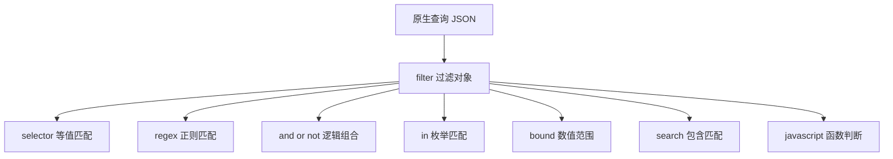

# Druid 查询过滤器 filter：七种类型与 SQL where 的对照写法

SQL 查询靠 where 条件圈定范围，Druid 原生查询里承担同样职责的是 `filter` 对象。原生查询不带 filter 时扫全表，带错 filter 时结果全空，而 filter 的写法多达七种，各有适用场景。这一节把七种过滤器逐个配上 JSON 示例，并与熟悉的 SQL where 一一对照。

## 先给结论

- `filter` 是原生查询里的 where 条件，支持七种类型：selector 等值、regex 正则、and/or/not 逻辑、in 枚举、bound 范围、search 包含、javascript 函数。
- 过滤普通维度用 filter，过滤时间列 `__time` 不走 filter，交给 `intervals`。
- bound 过滤器默认按字典序比较字符串，数字范围必须声明 `ordering: numeric`，否则「10」会小于「9」。
- not 过滤器配单数 `field`，and 与 or 配复数 `fields`，字段名混用是高频手滑点。
- javascript 过滤器最灵活但默认禁用，生产环境开启要谨慎。

## filter 是原生查询的 where

cold-druid 工程的查询服务拼 SQL 时，设备条件写成 `and metercode = 'M001'`，时间条件写成 `and __time > '...'`，这些都是 where 子句。换成原生查询 JSON，同样的语义要拆成两处：设备编码交给 filter 对象，时间范围交给 `intervals`。这个分工先立住，后面逐个看过滤器时才不会把时间条件塞错位置。



这张图在讲 filter 的类型体系：一个 filter 对象挂进查询骨架，内部按 `type` 分流出七种判断方式，逻辑类型还能继续嵌套其他 filter，构成条件树。

## 七种过滤器逐个过

### selector：等值匹配

```json
{
  "filter": {
    "type": "selector",
    "dimension": "metercode",
    "value": "M001"
  }
}
```

`dimension` 是维度名，`value` 是要相等的值，等价 `WHERE metercode = 'M001'`。最简单也最常用，平台里查某台设备的历史快照就是它。

### regex：正则匹配

```json
{
  "filter": {
    "type": "regex",
    "dimension": "metercode",
    "pattern": ".*[a-zA-Z].*"
  }
}
```

等价 `WHERE metercode REGEXP '...'`。课程里给的场景很实际：设备编码本不该含字母，用这个正则能把混入字母的异常数据筛出来，顺带完成一次数据质量检查。

### and、or、not：逻辑组合

```json
{
  "filter": {
    "type": "and",
    "fields": [
      { "type": "selector", "dimension": "metercode", "value": "M001" },
      { "type": "bound", "dimension": "tem", "lower": "10", "upper": "30", "ordering": "numeric" }
    ]
  }
}
```

and 内部的 `fields` 列表全部为真，整体才为真，等价 `WHERE metercode = 'M001' AND tem BETWEEN 10 AND 30`。or 的骨架与之相同，任一条件为真即为真；not 只包一个条件，取反：

```json
{
  "filter": {
    "type": "or",
    "fields": [
      { "type": "selector", "dimension": "housecode", "value": "H01" },
      { "type": "selector", "dimension": "housecode", "value": "H02" }
    ]
  }
}
```

```json
{
  "filter": {
    "type": "not",
    "field": { "type": "selector", "dimension": "state", "value": "0" }
  }
}
```

or 等价 `WHERE housecode IN ('H01','H02')`，not 等价 `WHERE NOT (state = '0')`。三种逻辑过滤器可以层层嵌套，把复杂业务条件表达成条件树。

### in：枚举匹配

```json
{
  "filter": {
    "type": "in",
    "dimension": "outlaw",
    "values": ["good", "bad", "ugly"]
  }
}
```

等价 `WHERE outlaw IN ('good','bad','ugly')`，是 or 加一排 selector 的简写，维度取值在列表内即命中。

### bound：范围匹配

```json
{
  "type": "bound",
  "dimension": "age",
  "lower": "21",
  "upper": "31",
  "ordering": "numeric"
}
```

等价 `WHERE age > 21 AND age < 31`，文档里的经典示例就是查 21 到 31 岁之间。`ordering` 指定为 `numeric` 后按数值比较；默认区间是开区间，需要闭区间时加 `lowerInclusive`、`upperInclusive`。平台里查超温设备，把 lower 设成阈值上限即可。

### search：包含匹配

```json
{
  "filter": {
    "type": "search",
    "dimension": "product",
    "query": {
      "type": "insensitive_contains",
      "value": "foo"
    }
  }
}
```

等价 `WHERE product LIKE '%foo%'`，`insensitive_contains` 还忽略大小写。它与 selector 的差别一句话说清：selector 是相等，search 是包含，字段值里带这个字符就算命中。

### javascript：函数判断

```json
{
  "type": "javascript",
  "dimension": "tem",
  "function": "function(value) { return value > 30; }"
}
```

把判断逻辑写成 JavaScript 函数，等价一个自定义 where 条件，灵活性最高。代价也最大：Druid 默认关闭该功能，需在配置里开启 `druid.query.javascript.enabled=true`，且脚本在服务端执行，性能与安全都要评估。常规需求能不用就不用。

七种过滤器与 SQL 的对照收拢成一张表：

| 过滤器 | type | 对应 SQL |
|---|---|---|
| 等值 | `selector` | `WHERE dim = 'v'` |
| 正则 | `regex` | `WHERE dim REGEXP '...'` |
| 逻辑 | `and` / `or` / `not` | `AND` / `OR` / `NOT` |
| 枚举 | `in` | `WHERE dim IN (...)` |
| 范围 | `bound` | `> <` 组合，可配区间开关 |
| 包含 | `search` | `WHERE dim LIKE '%v%'` |
| 函数 | `javascript` | 自定义条件表达式 |

## 嵌套组合与时间过滤的分工

逻辑过滤器是容器，selector、regex、bound、in、search 都能作为它的子节点，嵌套出多级条件树。时间条件的位置要单独强调：`__time` 列不进 filter，原生查询里时间范围由 `intervals` 表达，SQL 里才写成 `__time > '...'` 的 where 形式。两种查询的分工对照 cold-druid 的 querySQL 看得很清楚：metercode 非空拼 selector，stTime 与 endTime 对应 intervals，limit 对应结果条数控制，条件逐个归位，查询才既准确又高效。

各过滤器的执行效率并不相同。Druid 为每个维度的取值维护倒排位图索引，selector、in、bound 这类能预先圈定取值集合的过滤器直接命中位图，用位运算完成与或组合，几乎不碰原始行；regex、search、javascript 无法预先确定命中哪些取值，只能逐行求值，数据量大时开销明显。等值判断写成 selector 而不是正则，正是这个原因。

## 常见误区

- **数字范围忘配 `ordering: numeric`。** 错例：bound 查温度 10 到 30 度，按默认字典序比较，「9」「15」这类值的排序全乱，该命中的行查不出来。正解：数值维度一律声明 `numeric`。
- **and/or 写成单数 `field`，not 写成复数 `fields`。** 错例：and 里放 `field`，提交后解析失败。正解：记住口诀，多条件用复数 `fields` 列表，not 取反单个条件用 `field`。
- **想过滤时间却写了 selector。** 错例：`"dimension": "__time"` 配 selector 查时间段。正解：时间范围交给 `intervals`，filter 只管普通维度。
- **生产环境随手用 javascript 过滤器。** 错例：本可一个 selector 表达的等值条件写成脚本，还要为此开启全局开关。正解：javascript 留给表达式确实复杂的场景，简单条件用声明式过滤器。

## 面试可能被问到的问题

1. 面试官追问：「Druid 原生查询的 filter 有哪几种类型？」
   答：七种：selector 等值、regex 正则、and/or/not 逻辑组合、in 枚举、bound 范围、search 包含、javascript 函数判断。前六种都是声明式配置，javascript 需要额外开启配置项。
2. 面试官追问：「selector 过滤器和 search 过滤器有什么区别？」
   答：selector 要求维度值与给定值完全相等，search 是包含匹配，值里含有目标字符串即命中，`insensitive_contains` 还忽略大小写，语义上分别对应 SQL 的等值条件与 LIKE。
3. 面试官追问：「bound 过滤器有什么容易踩的坑？」
   答：默认按字典序比较字符串，数字范围必须声明 `ordering: numeric`，否则会出现「10」小于「9」的错误结果；另外默认开区间，需要边界值时设置 `lowerInclusive`、`upperInclusive`。
4. 面试官追问：「原生查询里时间过滤写在哪，为什么？」
   答：写在 `intervals`，不进 filter。Druid 按时间分段存储，Broker 依据 intervals 直接剪掉不相关数据段，与普通维度的行级过滤走的是不同机制，时间条件塞进 filter 反而无法利用分段裁剪。
5. 面试官追问：「逻辑过滤器怎么组合复杂条件？」
   答：and、or、not 本身也是 filter，子节点放在 `fields` 列表或单个 `field` 里，内部可以继续嵌套逻辑过滤器，形成条件树，表达能力与 SQL 的括号嵌套等价。

## 配套资料

- 代码：`materials/code/06/day7 统计分析/`，cold-druid 查询工程，`DruidServiceImpl` 的 querySQL 展示 SQL 侧 where 条件的拼装，与原生查询的 filter 对应。
- 说明：七种过滤器的 JSON 示例取自课程画面并按 Druid 0.15 官方写法补全维度取值，引用路径截至 day 目录层级。
