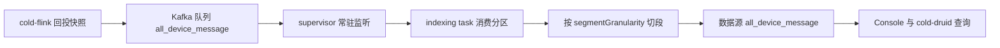

# 提交 supervisor 任务：把 all_device_message 实时存进 Druid

扩展装好、服务重启，管理台的 Supervisors 页还空着：Druid 现在有能力监听 Kafka，但还没被告知听哪个队列、按什么格式解析。这一步要交出一份 JSON 摄入规格。规格里的字段动辄二三十个，看起来吓人，拆开其实就是三个问题：数据读成什么样、监听哪个队列、性能参数给多少。这份规格落定，设备快照才开始实时进库。

## 先给结论

- 提交一份 type 为 kafka 的 supervisor 规格即完成实时存储：dataSchema 定解析格式与维度，tuningConfig 定内存与分段参数，ioConfig 定队列地址与任务数。
- 数据源名与队列名同名，都叫 all_device_message，一处投递、一处落库，对账方便。
- 时间列是 curtime，格式 yyyyMMddHHmmss，解析正确与否决定整批数据能否被查到。
- 维度列表按数据结构表的字段名逐字填写，键名与消息 JSON 完全一致；rollup 保持 false，保留明细。
- 提交后按三处验证：Supervisors 页任务 RUNNING，Tasks 页 task 运行，Query 页查出刚投递的快照。

## 快照要存成什么样

supervisor 规格里的每个字段，都能在数据结构表里找到出处。课件里的数据结构表以驼峰写法展示字段，实际消息 JSON 的键全为小写，就是 MessageEntity 的字段名，下表按消息键整理，分三块：

| 分组 | 字段 | 说明 |
| --- | --- | --- |
| 归属信息 | metercode、meterid、metername、hostid、hostname、houseid、housecode、housename、companyid、companyname | 设备、主机、仓库、公司的编码与名称 |
| 阈值上下限 | maxtem、mintem、maxhum、minhum | 计算时从 Redis 带出的判定依据 |
| 读数与状态 | tem、hum、temalert、humalert、state、lon、lat、curtime | 温湿度读数、报警状态、设备状态、经纬度与提交时间 |

表里的名字与消息 JSON 的键一致，规格里的维度列表照着抄就是。这张图是规格提交后数据的流向：supervisor 常驻监听，task 消费分区，消息解析切段后成为可查询的数据源。



关键路径在 task 到数据源这一段：时间列解析正确，快照按天切段入库；解析失败，数据要么报错要么落进错误时段，整批查不出来。所以规格里最值得抠的细节是 timestampSpec。

## supervisor 规格逐段拆

提交入口在管理台 Supervisors 页，点 Submit supervisor，把整份 JSON 贴进去。规格分段看（完整规格按课程画面分段抄录，granularitySpec 一段按 Druid 常用写法补全）：

**dataSchema：读成什么样。** type 是 kafka，声明这是 Kafka Indexing Service 的规格；dataSource 是落库后的数据源名，与队列同名；parser 用 string 按行读、json 格式解析；timestampSpec 指定时间列 curtime，格式 yyyyMMddHHmmss，与报文里的提交时间完全对应：

```json
{
  "type": "kafka",
  "dataSchema": {
    "dataSource": "all_device_message",
    "parser": {
      "type": "string",
      "parseSpec": {
        "format": "json",
        "timestampSpec": {
          "column": "curtime",
          "format": "yyyyMMddHHmmss"
        },
        "dimensionsSpec": {
          "dimensions": [
            "companyId", "companyname", "curtime", "hostid", "hostname",
            "housecode", "metercode", "meterid", "metername", "lon", "lat",
            "maxTem", "minTem", "maxHum", "minHum"
          ]
        }
      }
    },
    "granularitySpec": {
      "segmentGranularity": "DAY",
      "queryGranularity": "DAY",
      "rollup": false
    }
  }
}
```

维度列表来自数据结构表的字段名。照抄画面有两点要补：键名必须与消息 JSON 逐字一致，工程里 MessageEntity 序列化出的键全为小写，画面上这份混着大小写的列表提交前要对照真实消息核一遍；tem、hum、temalert、humalert、state、houseid、housename、companyid 这些读数与状态列也要列全，查询接口按列名取值，少一个查不到一个。

granularitySpec 控制两个粒度：segmentGranularity 按天切段，一天一个段文件；queryGranularity 按天聚合查询结果，也可以改成 HOUR 换更细的粒度。rollup 保持 false，同维度同粒度的行不被预合并，按设备查最近若干条明细才不会丢行。metricsSpec 这一段规格里没有配置，它是可选的聚合指标定义，比如统计总条数、平均值，当前需求查明细用不上，留空即可。

**ioConfig：监听哪个队列。** topic 与 consumerProperties 指向结果队列和 Kafka 地址；replicas 是每个分区的 task 副本数，1 在演示环境够用，生产可调 2 容错；taskCount 是并行 task 数，与分区数对齐；taskDuration 控制单个 task 的工作时长，到点后由 supervisor 派新任务接续 offset；completionTimeout 是任务完成交接的超时预算：

```json
{
  "ioConfig": {
    "topic": "all_device_message",
    "replicas": 1,
    "taskCount": 1,
    "taskDuration": "PT6000S",
    "consumerProperties": {
      "bootstrap.servers": "172.17.0.143:9092"
    },
    "useEarliestOffset": false,
    "completionTimeout": "PT1200S"
  }
}
```

useEarliestOffset 为 false 表示不从头补历史消息，从当前 offset 开始消费；如果是断档后重新接线、需要补旧数据，把它临时改为 true 提交一次即可。

**tuningConfig：性能给多少。** 内存攒批、中间固化周期、段压缩这些参数决定 task 的资源占用（节选）：

```json
{
  "tuningConfig": {
    "type": "kafka",
    "maxRowsInMemory": 1000000,
    "maxRowsPerSegment": 5000000,
    "intermediatePersistPeriod": "PT10M",
    "basePersistDirectory": "/opt/druid/var/temp",
    "indexSpec": { "type": "concise" },
    "dimensionCompression": "lz4",
    "metricCompression": "lz4"
  }
}
```

maxRowsInMemory 是 task 在内存里攒 100 万行才落一次盘的量级，intermediatePersistPeriod 是每 10 分钟强制固化一次中间快照，两者谁先到谁触发，兜住任务崩溃时的重放成本。其余 httpTimeout、shutdownTimeout、chatRetries 等参数保持默认，超时类是 10 秒的 HTTP 等待、60 秒的关闭等待，量级合理不必动。

## 提交后的摄入验证

提交完成后，验证按三处走。队列侧先回读，确认快照还在持续投递：

```bash
# 回读结果队列，确认快照持续投递
./bin/kafka-console-consumer.sh --bootstrap-server 172.17.0.143:9092 --topic all_device_message --from-beginning
```

Druid 侧看两个页面：Supervisors 页对应行状态 RUNNING，Tasks 页能看到正在运行的 indexing task。Query 页执行下面的语句，刚投递的快照立刻出现，从投递到可查通常在一分钟内：

```sql
select * from all_device_message order by __time desc limit 10
```

可用性核对再做两件事：一是对照 `__time` 与 curtime，查出来的时间与消息里的提交时间一致，说明 timestampSpec 解析正确；二是用 cold-druid 查询工程联调，`/select` 接口按 metercode 查最近 10 条，字段齐全、数值与队列消息对得上，摄入链路才算真正交付给统计功能使用。

## 常见误区

- **数据源名与队列名混为一谈。** 错例：以为同名就是一个东西，改了 topic 名却发现 dataSource 没变。正解：topic 是 Kafka 的队列名，dataSource 是 Druid 里的数据源名，两者只是取了相同的名字便于对账，各自独立修改。
- **时间格式与消息不匹配。** 错例：format 写成带分隔符的 yyyy-MM-dd HH:mm:ss，消息里的 curtime 是 20181117172120 这种紧凑串。正解：format 必须逐字对应消息格式 yyyyMMddHHmmss，解析失败整批数据落不进正确时段。
- **维度键名大小写不一致。** 错例：消息键是 companyname，维度里写成 companyName。正解：JSON 解析按键名精确匹配，照着真实消息的键抄，拿不准就先用控制台消费者回读一条看原始 JSON。
- **rollup 顺手打开。** 错例：以为开了 rollup 查询更快。正解：rollup 会把同维度同粒度的行预合并，按设备查最近 10 条明细会丢行，统计口径也被锁死，明细场景保持 false。

## 面试可能被问到的问题

1. 面试官追问：「supervisor 规格里 dataSchema、ioConfig、tuningConfig 各管什么？」
   答：dataSchema 定数据怎么解析与存储，包括数据源名、时间列、维度列表与聚合粒度；ioConfig 定从哪来，包括 topic、Kafka 地址、副本与任务数；tuningConfig 定性能参数，比如内存攒批行数、固化周期。三段拼起来就是一份完整摄入规格。
2. 面试官追问：「timestampSpec 配错了会怎样？」
   答：Druid 以解析出的时间作为内置 `__time` 列，是整张表的主时间轴。格式与消息不匹配时，数据要么解析报错，要么落到 1970 年附近，查询按时间段过滤就查不到。所以时间列名与格式必须与消息逐字对应。
3. 面试官追问：「segmentGranularity 和 queryGranularity 有什么区别？」
   答：前者决定段文件的切分粒度，按天切段就是一天一个段，影响存储布局；后者决定查询结果的聚合粒度，按天聚合就是把同一天的数据合成一行返回。两者独立配置，可以段按天、查询按小时。
4. 面试官追问：「replicas 和 taskCount 分别起什么作用？」
   答：taskCount 是消费分区的并行任务数，决定摄入吞吐；replicas 是每个分区的任务副本数，副本所在进程故障时另一个副本接管，摄入不中断。演示环境都是 1，生产建议 replicas 至少 2。
5. 面试官追问：「怎么确认实时摄入真的通了？」
   答：三处对照加一次联调。Supervisors 页任务 RUNNING，Tasks 页 task 在跑，Query 页按 `__time` 倒序能查到刚投递的快照；再用查询工程按 metercode 取数，字段与队列里的消息一致，才交付下游。

## 配套资料

- 代码：`materials/code/06/day6 实时计算 - 冷眼项目实战/`，cold-flink 工程，向 all_device_message 队列回投快照的生产端。
- 代码：`materials/code/06/day7 统计分析/`，cold-druid 查询工程，摄入完成后联调验证的查询侧。
- 说明：supervisor 规格按课程画面分段抄录，granularitySpec 与 tuningConfig 的部分参数按 Druid 常用写法补全；Kafka 地址为课程内网环境地址；引用路径截至 day 目录层级。
