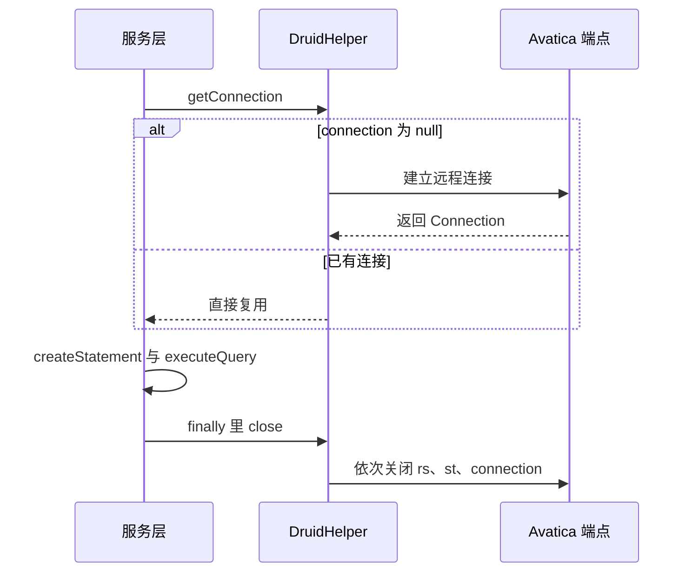

# 封装 Avatica JDBC 工具类：DruidHelper 逐行拆解与工程化取舍

JDBC 查 Druid 的原理已经清楚：引入 avatica-core，连接串指向 Avatica 端点，标准 Statement 与 ResultSet 就能用。但服务层每写一个查询都重复一遍建连、执行、释放，漏一次关闭就是句柄泄漏。工具类要做的就是把这两件事收口：一个方法管连接，一个方法管释放。类只有几十行，取舍却不少：连接是每次新建还是复用，配置是硬编码还是外置，这一节把它逐行讲透。

## 先给结论

- DruidHelper 放在工程的 common 包里，只暴露两个方法：getConnection 惰性建连，close 统一释放结果集、语句、连接。
- 连接串是 `jdbc:avatica:remote:url=http://druid.example.com:8888/druid/v2/sql/avatica/`，8888 端口经 Router 转发查询请求。
- 使用四步：getConnection、createStatement、executeQuery、遍历 ResultSet，finally 里 close。
- 课程实现是「每请求一连接」：服务层每次 new 一个 helper，查询完整体释放，简单且无并发争抢；高并发场景应换连接池或按线程隔离。
- url 硬编码在类里是课程写法，工程化要外置到 `application.yml`，随环境切换。

## 工具类逐行拆解

工具类落在 cold-druid 工程的 common 包下，与业务代码隔开，谁要用连接谁引这个包。整份类（真实代码，包名按规范改写，地址以 example.com 占位）：

```java
package com.study.coldchain.druid.common;

import java.sql.*;
import java.util.Properties;

public class DruidHelper {

    private String url = "jdbc:avatica:remote:url=http://druid.example.com:8888/druid/v2/sql/avatica/";
    private Properties conf = new Properties();
    private Connection connection;

    /**
     * 获得 Druid 连接
     */
    public Connection getConnection() {
        try {
            if (null == connection) {
                connection = DriverManager.getConnection(url, conf);
            }
        } catch (SQLException e) {
            e.printStackTrace();
        }
        return connection;
    }

    /**
     * 关闭 Druid 连接，结果集、语句、连接依次释放
     */
    public void close(Connection connection, Statement st, ResultSet rs) {
        try {
            if (rs != null) {
                rs.close();
            }
            if (st != null) {
                st.close();
            }
            if (connection != null) {
                connection.close();
            }
        } catch (SQLException e) {
            e.printStackTrace();
        }
    }
}
```

**成员三件套。** url 是 Avatica 的固定格式，`jdbc:avatica:remote:url=` 是驱动前缀，等号后面的 HTTP 地址才是服务端点 `/druid/v2/sql/avatica/`；conf 是一个空的 Properties，Avatica 端点匿名访问时不带认证参数；connection 是成员持有的连接引用，初始为 null，是惰性初始化的关键。

**getConnection：惰性初始化。** 方法体只有一个判断：connection 为 null 才调 DriverManager.getConnection 真正握手，否则直接复用。惰性初始化的价值在单例场景下最明显，工具类被注入成单例时，进程生命周期里只建一次连接。异常被捕获后打印堆栈并返回 null，调用方拿到 null 会空指针，这是课程写法保留的简化，改进方向在后面的异常处理小节展开。

**close：从小到大逆序释放。** 参数把三类资源一起收进来，按 ResultSet、Statement、Connection 的顺序逐个判空关闭。顺序不是随意的：ResultSet 依赖 Statement 存在，Statement 依赖 Connection 存在，先关依赖者再关被依赖者，与 JDBC 的资源关系一致。三个判空收在一个方法里，调用方 finally 一行搞定，不会漏。

这张图是工具类被服务层使用时的完整时序，建连只在连接为空时发生，释放集中在 finally：



关键路径是 alt 分支：连接是否重建取决于成员 connection 的状态，这正是惰性初始化的运行时表现；close 出现在 finally 里，保证异常路径也能走完释放。

## 用起来只有四步

服务层的真实用法（真实代码节选）：

```java
DruidHelper helper = new DruidHelper();
Connection connection = null;
Statement st = null;
ResultSet rs = null;
try {
    connection = helper.getConnection();
    st = connection.createStatement();
    rs = st.executeQuery(sql);
    while (rs.next()) {
        resultList.add(Rs2Entity(rs));
    }
    return R.ok(map);
} catch (Exception e) {
    e.printStackTrace();
} finally {
    helper.close(connection, st, rs);
}
```

四步对应关系清楚：getConnection 拿连接，createStatement 建语句，executeQuery 执行 SQL，while 循环里按列名读出快照填实体。注意服务层是每次查询都 new 一个 DruidHelper，connection 成员随实例走，查询结束 close 把连接一并关掉，下次查询重新握手，实例与连接同生同灭。

## 单连接、连接池与配置外置

每请求一连接、单例复用、连接池，三种形态各有适用面。
- 每请求一连接是课程写法，语义最简单：连接生命周期与请求对齐，不存在多线程共享同一个 Connection 的问题，故障排查也直观。代价是每次查询都付一次建连往返，Avatica 的建连是 HTTP 会话创建，比 MySQL 的 TCP 握手开销大一些，低频查询无感，高频轮询能感觉到。
- 单例复用一把连接，建连只付一次，但 JDBC 规范要求一个 Connection 同一时刻只被一个线程使用，Avatica 的远程连接同样不是线程安全的，并发下会出现语句互串与结果错乱，这条路不能走。
- 连接池是生产形态：池子维护多个 Avatica 连接，借出归还与 MySQL 连接池同一个模型，既复用又并发安全。Avatica 建连成本低、池化收益相对 MySQL 小，量级不大的查询用每请求一连接也完全够，需要时再引入池不迟。

**配置外置。** url 写死在类里，换环境就要改代码重新打包。工程化做法是挪进 `application.yml`：

```yaml
druid:
  avatica:
    url: http://druid.example.com:8888/druid/v2/sql/avatica/
```

再用 `@Value("${druid.avatica.url}")` 注入成员变量，dev 与 prod 配各自的地址。课程版本的硬编码是为了把注意力集中在工具类本身，配置外置的示例按 Spring Boot 常用写法补全，两种写法的类结构完全一致，差别只在 url 的来源。

**异常处理的小改进。** catch 里只 printStackTrace 会把问题藏进日志，调用方拿 null 更难排查。改进方向是捕获后转成带上下文的运行时异常抛出，让上层统一兜底；如果接了日志框架，换成 log 输出，把堆栈、SQL、端点地址一起打出来，定位一次到位。

## 常见误区

- **只关连接不关语句与结果集。** 错例：finally 里写 connection.close 一行完事，长期运行下游对象泄漏。正解：按 ResultSet、Statement、Connection 的顺序全部关闭，封装进工具类的 close 一处调用。
- **把工具类做成单例共享连接。** 错例：helper 注入成 Spring 单例又被并发请求共用，多个线程跑在同一 Connection 上。正解：要么保持每请求一连接，要么引入连接池按线程借还，JDBC 连接不是线程安全对象。
- **异常后继续使用返回值。** 错例：getConnection 捕获异常后返回 null，调用方直接 createStatement 抛空指针。正解：捕获后抛带上下文的业务异常，或调用前判空，让失败尽早、明确地暴露。
- **close 写在 try 里。** 错例：查询正常时资源能关，一旦 executeQuery 抛异常，close 被跳过。正解：close 固定放在 finally 里，异常路径与正常路径都执行释放。

## 面试可能被问到的问题

1. 面试官追问：「getConnection 里的惰性初始化解决什么问题？」
   答：把建连推迟到第一次真正查询时。进程启动阶段不付握手成本，也不用担心启动顺序；在单例复用场景下，成员 connection 保证整个生命周期只建一次连接，后续调用直接复用。
2. 面试官追问：「为什么不能让所有线程共用一个 Connection？」
   答：JDBC 规范要求 Connection 同一时刻只被一个线程使用，语句与事务上下文都挂在连接上，并发共用会互相覆盖。Avatica 的远程连接同样遵循这个约束，并发查询要么每请求一连接，要么用连接池借还。
3. 面试官追问：「close 为什么要按 ResultSet、Statement、Connection 的顺序？」
   答：资源之间存在依赖关系，结果集依附于语句，语句依附于连接，先关上层依赖再关底层连接，避免关闭底层后上层对象进入失效状态。逆序释放是 JDBC 资源管理的一贯做法。
4. 面试官追问：「Avatica 连接池化与 MySQL 连接池有什么不同？」
   答：模型相同，都是维护连接集合按需借还；差别在底层，MySQL 是 TCP 长连接，握手与鉴权成本高，池化收益大；Avatica 是基于 HTTP 的远程会话，建连成本低，池化主要解决并发隔离而不是性能，必要时再引入。
5. 面试官追问：「连接串里的端口写 8888 还是 8082？」
   答：都能连，两个端口背后都是 Avatica 端点。8082 是 Broker 直连，8888 是 Router 入口，管理台查询也走它；单机演示无所谓，集群环境走 Router 更合适，由它统一转发。

## 配套资料

- 代码：`materials/code/06/day7 统计分析/`，cold-druid 查询工程，含 DruidHelper、DruidServiceImpl（四步用法的真实调用方）与 pom.xml（avatica-core 1.15.0 依赖）。
- 说明：连接池方案与配置外置示例为按 Spring Boot 主流写法补全，地址以 example.com 占位；包名统一改写为 com.study.coldchain；引用路径截至 day 目录层级。
