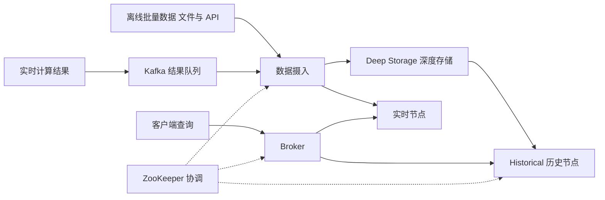

# day7 复盘：Druid 统计分析从摄入到项目落地的一条闭环

一天讲完一个 OLAP 引擎，信息量不小：架构里十来个节点名词、导入分两条路、查询有好几种入口，临到收尾很容易学成散点。复盘的正确姿势是把当天内容串回一条主线：数据怎么进来、进来存到哪、怎么被查出来、最后在冷链监控平台里落到哪两个业务。按这条线过一遍，day7 就不再是清单，而是一个闭环。

## 先给结论

- Apache Druid 是一个数据库，存的是与时间关联的事件数据，写入时就能做聚合统计分析；适用场景三个关键词：数据量大、基本不变、查询要秒级或亚秒级出结果。
- 联表关联查询与频繁的批量更新是它的边界，落在这两边的需求不该交给 Druid。
- 架构记两条流向：数据从离线批量与实时流两条路进入深度存储，再加载到历史节点；查询从客户端经 Broker，命中历史节点或实时节点。
- 项目实战里，实时计算的结果队列被 Supervisor 持续摄入成 `all_device_message` 表，撑起报警记录与温湿度曲线两个查询出口。
- 数据侧打通之后，day8 转向 Apache Superset，解决「统计结果给人看」的问题。

## Druid 的定位与边界

一句话定位：存时间相关事件数据、内置聚合能力的分析型数据库。设备每分钟上报一条温湿度快照，读数只增不改、查询永远围绕时间段与维度做聚合，这类数据交给 Druid 正对口。适用场景可以浓缩成三个条件：数据量比较大、数据不易改变、聚合统计分析要求秒级甚至亚秒级返回。三条同时成立，选 Druid 才划算。

边界同样要记牢。联表关联查询它不擅长，需要 join 的业务数据留在 MySQL；批量更新、频繁修改也不适合，Druid 的数据写入后基本不可变，改数据靠重新导入而非原地 update。冷链监控平台里两者分工清楚：实时指标表管最新状态与业务事务，Druid 管历史明细与统计分析。

## 架构记两条流向就够了

Druid 的节点名很多，当天讲架构时把「数据怎么进、查询怎么出」两条流向抓住，其余名词都挂在流向上有据可查：



读图抓关键：摄入侧，批量数据与流式数据都汇进数据摄入环节，落地在深度存储，历史节点从深度存储加载分段并常驻内存对外服务；查询侧，客户端请求统一打到 Broker，由它分发给历史节点或实时节点再汇总返回。ZooKeeper 负责集群协调，元数据另由元数据库（当天演示环境用 MySQL）承载。记不住全部节点名没关系，两条流向走通了，架构就不会乱。

## 装环境与喂数据的复盘

安装清单按依赖顺序回忆：JDK 先就位，ZooKeeper 与 Kafka 是集群前置，MySQL 驱动要放进 Druid 的目录供元数据存储使用，Druid 本体下载解压、改配置文件、启动即可，当天演示环境是 CentOS 加 JDK 1.8 加 Druid 0.15.8 的组合。

数据导入分两路。离线导入吃本地文件与 API 来源，一次性加载存量数据；实时导入靠 Supervisor 任务持续监听 Kafka 队列，关键的连接信息浓缩出来就是一段 JSON（按课程配置精简，地址以 example.com 占位）：

```json
{
  "topic": "all_device_message",
  "replicas": 1,
  "taskcount": 3,
  "consumerProperties": {
    "bootstrap.servers": "kafka.example.com:9092"
  }
}
```

topic 指向结果队列，taskcount 决定同时跑几个摄入任务，副本数为 1 是演示环境的取舍。删除数据的操作也过了一遍，处理异常数据或清库时会用到，日常运维里出现频率不高，会操作即可。

## 查询这条线复盘

查询入口当天讲了两类三样：客户端交互一类，包括 dsql 命令行与 Console 网页，随手验证最方便；程序调用一类，包括 HTTP API（JSON 原生与 SQL 两种格式）和 Avatica JDBC。围绕 JSON 原生查询的一组要素是理解的重点，查询类型、聚合粒度、过滤器、聚合器、Search 查询，全都是描述「怎么聚合」的词汇。一条 groupBy 查询把这些要素占全了：

```json
{
  "queryType": "groupBy",
  "dataSource": "wikipedia",
  "granularity": "hour",
  "dimensions": ["language"],
  "aggregations": [
    {"type": "count", "name": "count"}
  ],
  "intervals": ["2019-01-01/2019-01-02"]
}
```

`queryType` 定查询形态，`granularity` 定聚合粒度，`dimensions` 定按什么分组的字段，`aggregations` 定组内怎么算，`intervals` 定时间范围。换成冷链的表也一样：维度放设备、仓库，聚合器放最大温度、告警次数，一条统计查询就成型了。SQL 与 JDBC 入口最终都编译到这套能力上，前面项目实战里查报警记录、查温湿度曲线走的就是 JDBC 通道。

## 项目实战复盘：一条队列养活两个业务

实战部分的链路是 day6 与 day7 的接缝：实时计算工程把每台设备的温湿度快照结果写进 Kafka 结果队列，Druid 的 Supervisor 监听这条队列，把数据实时摄入成 `all_device_message` 表。存储完成只是手段，查询出口才是目的，当天落地了两个：

**报警记录查询。** 从 Druid 里按条件查明细，条件包括设备编码、开始时间与结束时间，SQL 按参数动态拼装，结果逐行映射成实体后包成统一返回结构，交给前端的报警列表页。

**温湿度曲线查询。** 单台设备最近 10 条温湿度，取出来把时间截成时分秒做 x 轴、温度湿度做两条 y 序列、按时间正序重排，前端画折线图就是一条设备健康轨迹。

这两个接口的完整代码在 day7 的项目实战篇里已逐一展开，复盘时记住数据路径即可：队列进、Supervisor 收、JDBC 查、接口出。

## 面向 day8：数据能用，还要能看

day7 的终点是把数据与查询通道打通，可接口吐出来的终究是 JSON，运营人员与管理者不会去调接口看数。day8 转向数据可视化，主角换成 Apache Superset：接入 Druid 数据源、配置图表、拼装看板，把冷库温度趋势、告警分布这些统计结果变成一眼能读的图形。维度与指标这两个词会在 day8 开篇反复出现，它们正是从今天讲的 `dimensions` 与 `aggregations` 延伸出来的概念，图表配得对不对全看这一步分得清不清。

## 常见误区

- **把 Druid 当万能库，join 与频繁更新也压给它。** 错例：想让 Druid 直接联业务表出报表。正解：联表与事务更新留在 MySQL，Druid 只吃宽表形态的时序数据，需求落在边界外就换工具。
- **节点名死记硬背，流向没记住。** 错例：分不清深度存储与历史节点谁在服务查询。正解：深度存储管落地备份，历史节点管加载后对外服务，查询打到 Broker，两条流向理顺即可推演。
- **导入只练一遍就放下。** 错例：Supervisor 任务建完不再看状态。正解：实时摄入任务常驻运行，队列地址、topic、格式任何一处变化都会让它停摆，导入与治理是持续运维。
- **查询方式贪多求全。** 错例：JSON、SQL、JDBC 每种都浅尝辄止。正解：要素思想相通，queryType、粒度、过滤器、聚合器吃透 JSON 原生这一支，其余入口只是换了表达方式。

## 面试可能被问到的问题

1. 面试官追问：「Druid 适合什么场景，不适合什么场景？」
   答：适合数据量大、写入后基本不变、以时间段与维度聚合为主、要求秒级亚秒级查询的分析场景，如监控明细与指标曲线。不适合需要联表关联、批量更新修改频繁的场景，这类需求留在关系型数据库。
2. 面试官追问：「深度存储和历史节点各起什么作用？」
   答：深度存储是分段数据的持久落地层，摄入完成的数据写入其中做备份与共享；历史节点从深度存储加载分段到本地并常驻内存，真正对外提供历史查询服务。一个管存储，一个管服务。
3. 面试官追问：「Supervisor 在实时导入里是什么角色？」
   答：Supervisor 是实时摄入的控制器，按配置持续创建并管理监听 Kafka 的摄入任务，维护位点与容错。冷链平台里它监听实时计算的结果队列，把每条温湿度快照实时写进 all_device_message 表。
4. 面试官追问：「聚合粒度 granularity 调大调小影响什么？」
   答：粒度越粗，聚合发生得越早、返回的行数越少，查询越快，适合大盘趋势；粒度越细，细节越多但代价越高，最细到原始流水。曲线查询的体验很大程度取决于粒度选得对不对。
5. 面试官追问：「你们项目里 Druid 的数据从哪来，查询走哪条路？」
   答：数据来自实时计算的结果队列，由 Supervisor 实时摄入；查询走 Avatica JDBC，Java 服务用标准 JDBC 模型拼 SQL 取数，撑起报警记录与温湿度曲线两个接口。

## 配套资料

- 代码：`materials/code/06/day7 统计分析/`，cold-druid 查询工程，报警记录与温湿度曲线两个接口的真实实现。
- 代码：`materials/code/06/day6 实时计算 - 冷眼项目实战/`，实时计算工程，结果队列 all_device_message 的生产端。
- 说明：Supervisor 配置为按课程配置精简的节选，连接地址以 example.com 占位；groupby 查询 JSON 依据官方样例数据 wikipedia 摘录；包名统一改写为 com.study.coldchain；引用路径截至 day 目录层级。
