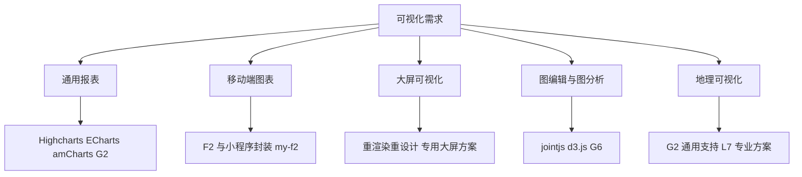

# 数据可视化的场景与工具：五类需求一张地图，以及冷链监控平台为什么选 Superset

同样是「画图」，给运营出一周报表、给 APP 做一个流量敏感的小图表、给会议室拼一块大屏，是三种完全不同的工程活，工具选错了要么白写一堆代码，要么扛不住量。把场景分类捋清楚，再对着每一类看主流工具，冷链监控平台最终落到 Superset 的理由也就浮出来了。

## 先给结论

- 可视化需求通常分五类：通用报表、移动端图表、大屏可视化、图编辑与图分析、地理可视化。
- 通用报表占企业开发需求的 85% 甚至 90% 以上，常用图表库有 Highcharts、ECharts、amCharts，AntV 的 G2 以图形语法见长：千变万化自由组合、几行代码出图、交互能力可自定义。
- 移动端选 F2：专注移动、开箱即用，兼容 H5、node、weex 与多种小程序环境，小程序封装版为 my-f2。
- 图编辑与图分析用 jointjs、d3.js 或 G6（节点边、事件交互、树布局与力导布局，上层还有 G6-Analyzer 与 G6-Editor）；地理可视化 G2 提供通用支持，L7 是专业方案，WebGL 渲染加多线程矢量瓦片。
- 图表库之外还有 BI 路线：ECharts 这类库要写代码、面向开发者；Grafana 偏时序监控、Kibana 偏日志检索；Superset 是 SQL 驱动的自助分析 BI。冷链监控平台选 Superset，决定性理由是与存储层 Apache Druid 深度集成，业务人员拖拽出图，看板可嵌入自有系统。

## 五类场景一张地图



这张图是选型速查表：先判断需求落在哪一类，再沿箭头找工具；BI 自助分析这条路线在下一节单独展开。

## 通用报表：日常开发的主战场

企业开发面临的 85% 甚至 90% 以上需求都属于通用报表：管理层想看运营数据、财务数据、业务数据，希望用图表形式呈现；财务人员看财务报表与增长率；运营人员看自己的报表。不同角色有不同报表，多数都是通用型。这一类需求用一般图表库就能满足日常开发，行业内比较常用的有 Highcharts、ECharts、amCharts。

AntV 在此之上开源了基于图形语法的图表库 G2，三个特性常被拿来当卖点。**一是千变万化，** 自由组合，从数据出发，几行代码就能得到想要的图表效果。**二是生动易实现，** 建立在大量产品实践之上，提供绘图引擎、完备图形语法与专业设计规范。**三是丰富的交互能力，** 在图形语法的基础上提供自定义交互。同体系里还有面向 React 的 BizCharts 等衍生库，对前端开发都很友好。

## 移动端与大屏：两块屏幕两种活法

移动端屏幕小，流量要求也比 PC 端苛刻。如果 PC 和移动都要覆盖，可以用 G2 再适配移动端屏幕；但如果是 APP 内用 H5 或小程序开发，就该选 F2。F2 是专注移动、开箱即用的可视化解决方案：兼容 H5，同时支持 node、weex 与多种小程序环境，图形语法完备，配专业的移动设计指引，重心放在代码体积、性能和表现力上。小程序场景另有封装版 my-f2。

大屏可视化面向会议、业务监控、风险预警、地理分析等场景，对图形渲染和可视化设计的要求高，在 2B 领域应用广泛。它的活和报表不一样：分辨率按定制尺寸来，动效与布局要围绕业务叙事组织，工具上要么用专门的大屏方案，要么基于渲染引擎自研。

## 图编辑图分析与地理可视化

图编辑与图分析是两个相邻领域。图编辑用于图建模（ER 图、UML 图）、流程图、脑图等场景，需要用户参与实体和关系的创建、编辑、删除；图分析用于风控、安全、营销中的关系发现，对环、关键路径、连通性这些图概念做业务解读，图数据库的展现层用的就是这类能力。开源框架有 jointjs 和 d3.js；G6 是图可视化基础框架，覆盖节点与边、事件交互（点击节点触发操作）、常见布局（树布局、力导布局），上层还有面向图分析的 G6-Analyzer 与面向图编辑的 G6-Editor。

地理可视化面向空间数据，分三类：信息应用，展示位置相关的报表、信息图与路径变化；大屏应用，以地铁、道路、航运等地理数据为载体；地理专业应用，需要地理数据的交互分析，如导航、选址、风险监控等业务系统。工具上 G2 提供通用的地理数据图表支持，L7 是更专业的地理数据可视化方案，采用 WebGL 渲染技术，支持多线程的矢量瓦片方案。

## 图表库之外的路线：BI 工具与 Superset 的胜出

上面五类场景配的工具基本都是图表库与可视化框架，共同点是图靠开发写代码或写配置产出来，面向的是程序员。但冷链监控平台的真实诉求里还有一条：运营、质量这些角色想自己配图自己看，需求一周一变，每张图都占前端排期根本追不上。这就轮到 BI 工具出场，主流候选各有侧重：

| 工具 | 定位 | 典型场景 | 对冷链平台 |
|---|---|---|---|
| ECharts 等图表库 | 前端图表库，代码出图 | 把图嵌进自家业务页面 | 开发做定制页时用 |
| Grafana | 时序指标监控面板 | 服务器监控、指标告警 | 偏运维视角，不适合业务自助分析 |
| Kibana | Elastic Stack 可视化层 | 日志检索与分析 | 日志在 Elasticsearch 里时才顺手 |
| Superset | SQL 驱动的自助分析 BI | 多数据源、拖拽建图、看板编排、权限与缓存 | 业务人员自助出图的主力 |

选 Superset 有三条硬理由。**第一，数据侧无缝。** 平台的温度湿度时序数据存在 Apache Druid 里，Superset 与 Druid 深度集成，数据集直接建在 Druid 数据源上，海量数据的聚合图表响应依然快。**第二，使用侧零代码。** 业务人员通过选数据源、拖字段、选图表类型完成配图，维度指标在数据集层定义一次，全平台口径统一。**第三，交付侧可嵌入。** 配好的看板能以 iframe 方式嵌进冷链监控平台自己的页面（示例，地址以 example.com 占位）：

```html
<!-- BI 路线：图是业务人员在 Superset 里拖拽配置的，前端只需一行嵌入（示例） -->
<iframe
  src="https://superset.example.com/superset/dashboard/3/?standalone=1"
  width="100%"
  height="900"
  frameborder="0">
</iframe>
```

对照一下图表库路线的长相，同样是「各仓库当日最高温」这张图，前端要这么写（示例，按本课写法补全）：

```javascript
// 图表库路线：每张图都是一段代码（示例）
const chart = echarts.init(document.getElementById('temChart'));
chart.setOption({
  xAxis: { type: 'category', data: ['一号库', '二号库', '三号库'] },
  yAxis: { type: 'value', name: '最高温度 ℃' },
  series: [{ type: 'bar', data: [6.2, 8.5, 5.1] }]
});
```

两段代码放一起，路线差异一目了然：图表库适合开发可控的定制页面，BI 工具适合需求多变、由业务人员自助维护的分析场景。冷链监控平台两条都要，但报表分析主力落在 Superset，后面会从安装、配置一路演示到图表嵌入。

## 常见误区

- **一把锤子敲所有钉子。** 错例：业务要自助分析，还让前端一张一张写 ECharts。正解：图表库面向开发者写代码，自助分析交给 BI 工具。
- **拿 Grafana 或 Kibana 干 BI 的活。** 错例：用 Grafana 搭业务经营看板，多维聚合能力对不上。正解：按定位选，时序监控找 Grafana，日志检索找 Kibana，多维业务分析找 Superset。
- **移动端硬套 PC 图表库。** 错例：小程序里直接引 PC 端库，包体积和性能都超标。正解：H5 与小程序场景选 F2 或其小程序封装 my-f2。
- **大屏只堆动效。** 错例：3D 光效拉满，业务指标反而看不清。正解：大屏服务业务叙事，渲染效果以不牺牲信息传达为前提。

## 面试可能被问到的问题

1. 面试官追问：「数据可视化的常见场景分哪几类？」
   答：五类：通用报表、移动端图表、大屏可视化、图编辑与图分析、地理可视化。通用报表占企业开发的 85% 以上，各类场景有不同的主流工具，选型先判断场景再定工具。
2. 面试官追问：「G2 和 F2 怎么选？」
   答：G2 为传统中后台产品设计，报表之外交互与分析能力强，适合 PC 端、BI 分析系统和联动型业务系统；F2 专注移动端，关注代码体积、性能和表现力，适合 APP 内 H5 与小程序。两端都要覆盖可以用 G2 再适配移动屏幕。
3. 面试官追问：「图表库和 BI 工具的区别是什么？」
   答：图表库面向开发者，图靠代码产出来，灵活但要占用开发人力；BI 工具面向业务人员，拖拽字段、选图表类型就能出图，口径在数据集层统一定义，自带权限与缓存。需求多变的分析场景优先 BI。
4. 面试官追问：「你们项目为什么选 Superset？」
   答：三条：与存储层 Apache Druid 深度集成，时序数据的聚合图表响应快；业务人员零代码自助配图，不占前端排期；看板可以 iframe 嵌入自有系统。加上它开源免费、是 Apache 顶级项目，落地成本低。
5. 面试官追问：「G6 和 L7 分别解决什么问题？」
   答：G6 是图可视化基础框架，处理节点与边的编辑和分析，支持事件交互与树布局、力导布局，上层有 G6-Analyzer 与 G6-Editor；L7 是地理数据可视化专业方案，用 WebGL 渲染并支持多线程矢量瓦片，适合轨迹、选址、风险监控等空间场景。

## 配套资料

- 代码：`materials/code/06/day8 数据可视化/`，本课无配套源码包，iframe 嵌入与 ECharts 初始化示例为按本课写法补全，地址以 example.com 占位。
- 代码：`materials/code/06/day7 统计分析/`，cold-druid 查询工程，图表示例所用温度湿度数据的来源以该工程为准。
- 说明：Java 包名统一改写为 com.study.coldchain；引用路径截至 day 目录层级。
