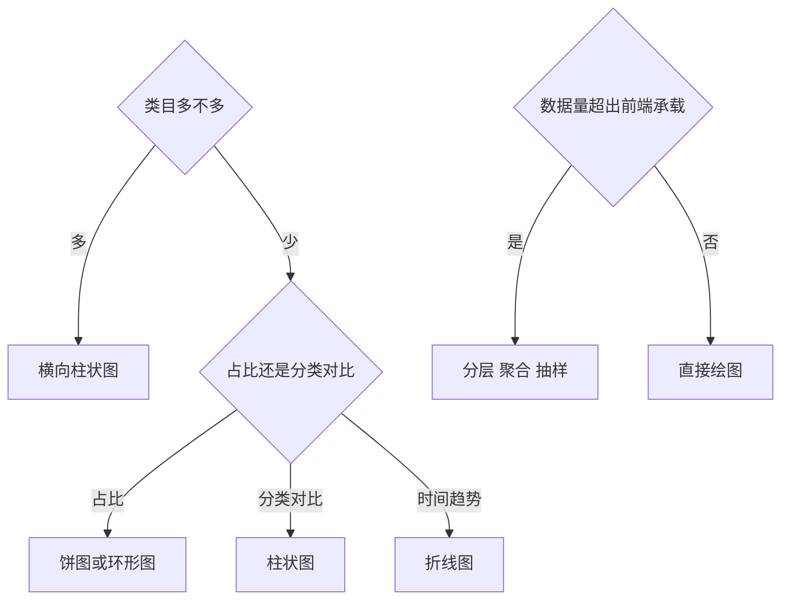

# 数据可视化常见问题：选错图、选错端、数据量太大怎么办

图表能把数据画出来，不等于画对了。一张塞了三十多个分类的饼图、一条把游戏类型串起来的折线、一块被原始流水撑爆的页面，都是可视化上线后最常见的翻车现场。这类问题有一组高频清单：图表误用、端选择、数据量太大，再加上工程细节里的配色、口径与刷新。

## 先给结论

- 分类过多的占比或对比场景不要用饼图，横向柱状图十个、三十个类目也能一目了然。
- 表示分类对比的数据用柱状图，不用折线图：折线表达连续趋势，分类之间没有顺序。
- 端的选择：PC 中后台、BI 分析系统、联动型业务系统用 G2；移动 APP 内 H5 与小程序报表用 F2。
- 数据量太大有三板斧：数据分层（按层级逐级下钻）、数据聚合（同维度汇总，本质也是分层）、数据抽样（限定范围看部分）。
- 工程上还要盯三件事：配色语义服务信息传达、口径在数据集层统一、刷新机制与采集周期匹配。

## 图表误用：两个经典错例

**错例一：分类过多还硬用饼图。** 场景是想展现不同省份的人口占比，做横向对比。饼图看着直观，可省份有三十多个，扇区细碎、图例一长串，眼花缭乱，看不出哪个省多哪个省少、两者之间是什么关系。这种场景推荐横向柱状图：类目从上到下排开，十个、二十个、三十个的对比都一目了然，还能按占比排序让差距更清晰。

**错例二：分类对比误用折线图。** 场景是不同游戏类型的销量对比，类别有 Sports、Strategy、Action、Shooter、Other。折线的语义是「连续变化的趋势」，点与点之间暗示存在顺序和过渡，而游戏类型是并列的分类，彼此没有先后关系；用折线把分类串起来，观者会误读出「从 Sports 到 Other 的走势」。分类对比的正确答案是柱状图，高度直接编码销量大小，类目之间互不暗示。

再补两个高频陷阱：3D 饼图的透视会压缩远端扇区的视觉面积，占比被系统性歪曲，饼图保持平面即可；双 Y 轴图的两条纵轴刻度独立伸缩，容易制造不存在的相关性，确要用时必须对齐两条轴的量程并明示两套刻度。



这棵决策树把选图逻辑压成两个入口：上面一个管图表类型，下面一个管数据量；多数误用都是没过这两个判断直接动手。

## 端的选择：G2 还是 F2

AntV 提供了 G2 和 F2 两个统计图表框架，业务同时有移动端和 PC 端时就面临二选一。本质差别在产品设计目标：G2 为传统中后台产品设计，除报表展示外还提供大量交互，分析能力强；F2 专注移动端开发，关注代码大小、性能和表现力。按场景给的选型清单：

| 场景 | 选择 | 原因 |
|---|---|---|
| 用户主要来自 PC 端 | G2 | 中后台定位，交互与分析能力强 |
| 用户来自移动端 APP 或 H5 | F2 | 体积小、性能优，专注移动体验 |
| 开发 BI 系统，报表之外还要分析 | G2 | 分析能力是硬需求 |
| 开发报表联动系统，点进去看下层报表 | G2 | 联动依赖交互能力 |
| 报表系统但用户主要通过移动端查看 | F2 | 场景整体在移动端 |

## 数据量太大：分层、聚合、抽样

前端可视化只能处理小规模数据，一个图表装不下全国所有省、市、区的明细。常用三类操作：

**数据分层。** 第一层按省份对比；选定某个省份后进入第二层，看省下的市；再往下第三层看区。一张图只呈现一层，层级靠交互切换，总量大但每屏小。

**数据聚合。** 按相同维度做汇总，比如所有区县的数据按市聚合后再对比，组数从几千压到几十，本质上是另一种形式的分层。

**数据抽样。** 限定查看范围，只在某个省、某个市甚至某个区里取数绘图，用局部代表整体，代价是看不到全貌。

三条路线在取数侧都有对应实现：分层对应下钻查询，聚合对应 `GROUP BY`，抽样对应时间窗加 `LIMIT`（cold-druid 工程的查询服务就带着 limit 参数，默认 10 条）。

## 工程实践里的三个坑

图表误用、端选择、数据量太大是课程圈定的三类问题，实际工程里还有三件小事同样天天出状况。

**配色与可读性。** 错例：警戒线和正常曲线用同色系，超温看不出急迫感。正解：配色服务语义，超温用暖色、正常用中性色，同屏分类颜色不超过七八种，避免红绿并列给色弱用户添堵，图例、单位、时间范围一样不缺。

**数据口径不一致。** 同一张图两个系列对不上号，多半是口径混用。`all_device_message` 表里既有设备上报的温度原值 `tem`，也有设备侧维护的当日最高温快照 `maxtem`，两种口径并排画就会出现「同一仓库两个最高温」：

```sql
-- 口径 A：设备侧当日最高温快照字段（示例，按本课写法补全）
SELECT housename, MAX(maxtem) AS day_max
FROM all_device_message
WHERE __time >= TIMESTAMP '2026-11-05 00:00:00'
  AND __time <  TIMESTAMP '2026-11-06 00:00:00'
GROUP BY housename;

-- 口径 B：对温度原值在查询窗口内重新聚合，含义完全不同
SELECT housename, MAX(tem) AS win_max
FROM all_device_message
WHERE __time >= TIMESTAMP '2026-11-05 00:00:00'
  AND __time <  TIMESTAMP '2026-11-06 00:00:00'
GROUP BY housename;
```

正解：口径在数据集层定义一次，所有图表复用同一套定义（Superset 的语义层正是为此而生），时间范围与聚合方式随图注明。

**刷新与实时性。** 监控图表要么定时轮询要么推送。轮询实现简单，间隔要和采集周期匹配，设置不当会出现告警延迟一个周期才反映到图上；实时性要求高的超温告警场景考虑推送。轮询的常规写法（示例，按本课写法补全，接口来自 cold-druid 工程的查询服务）：

```javascript
// 每 30 秒拉一次设备温度湿度，增量更新图表（示例）
setInterval(async () => {
  const res = await fetch('/apache-druid/query/temhum?metercode=M0001');
  const data = await res.json();   // { xAxis: [...], tem: [...], hum: [...] }
  chart.setOption({
    xAxis: { data: data.xAxis },
    series: [{ data: data.tem }, { data: data.hum }]
  });
}, 30000);
```

## 常见误区

- **图能画出来就交差。** 错例：三十个省份的饼图直接上线。正解：过一遍选图决策，类目多换横向柱状图。
- **折线图当万能图。** 错例：给并列分类连一条线看「走势」。正解：折线只表达连续趋势，分类对比交给柱状图。
- **图表口径随手写。** 错例：这张图用 `maxtem`，那张图用 `MAX(tem)`，都叫最高温。正解：口径在数据集层统一，图表只引用定义好的指标。
- **刷新间隔拍脑袋。** 错例：采集五分钟一次，页面十秒轮询一次，接口白白承压还拿不到新数据。正解：轮询间隔与采集周期对齐，实时性要求高的告警场景改推送。

## 面试可能被问到的问题

1. 面试官追问：「图表误用有哪些典型情况？」
   答：分类过多用饼图，扇区细碎看不出占比关系，应换横向柱状图；分类对比用折线图，折线暗示连续趋势而分类没有顺序，应用柱状图。本质都是视觉编码和数据的语义不匹配。
2. 面试官追问：「折线图和柱状图怎么选？」
   答：看数据类型。时间序列等连续数据看趋势用折线；并列分类的对比用柱状图，高度编码数值大小，类目之间不产生顺序暗示。
3. 面试官追问：「移动端和 PC 端图表库怎么选？」
   答：G2 为中后台设计，交互与分析能力强，PC 端、BI 系统、联动系统选它；F2 专注移动端，关注代码体积、性能与表现力，APP 内 H5 和小程序选它，小程序另有封装版 my-f2。
4. 面试官追问：「前端可视化处理不了大数据量怎么办？」
   答：三板斧：分层，按省市区逐级下钻，每屏只呈现一层；聚合，按维度汇总压缩组数，本质也是分层；抽样，限定时间或范围取局部数据。取数侧对应下钻查询、GROUP BY 聚合和时间窗加 LIMIT。
5. 面试官追问：「两张图上的最高温数字对不上，可能是什么原因？」
   答：大概率口径不一致：一个取设备上报的当日最高温快照字段，一个对温度原值在查询窗口内重新聚合，含义不同。排查顺序：先对时间范围，再对聚合方式，最后对字段口径；根治办法是在数据集层统一定义指标。
6. 面试官追问：「监控图表的实时性怎么保证？」
   答：轮询实现简单，间隔与采集周期对齐，避免告警延迟一个周期才上屏；实时性要求高的场景改推送，服务端数据到达即更新图表。冷链平台超温告警类图表对延迟敏感，轮询周期不能比采集周期大太多。

## 配套资料

- 代码：`materials/code/06/day7 统计分析/`，cold-druid 查询工程，`all_device_message` 表字段（tem、maxtem、housename、curtime 等）、limit 参数与 `/apache-druid/query/temhum` 接口取自该工程。
- 代码：`materials/code/06/day8 数据可视化/`，本课无配套源码包，口径 SQL 与刷新示例为按本课写法补全。
- 说明：Java 包名统一改写为 com.study.coldchain；引用路径截至 day 目录层级。
