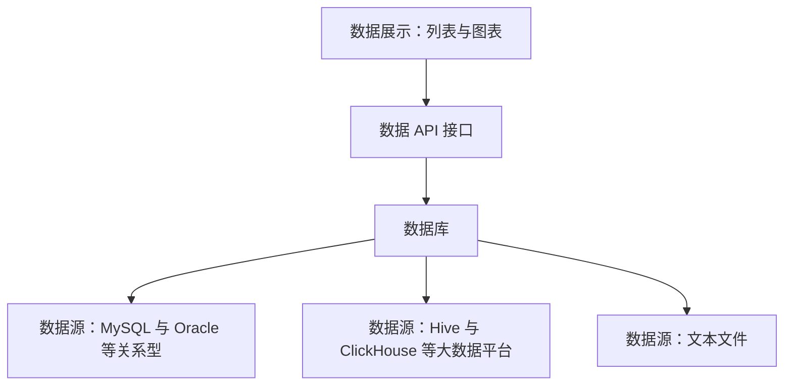

# Superset 简介：BI 平台凭什么接管报表开发

报表需求听着不大，落地却横跨三个工种：前端画图、后台供数、数据接入。业务今天要柱状图，明天加一个字段，后天换一个数据源，每改一次三处联调，三五天起步，数据源一复杂十天半个月也正常。更拧巴的是分工：开发不懂业务，答不了「平均温度要不要剔除停机时段」；业务最懂口径，却不会写接口。冷链监控平台的时序数据已经存进 Apache Druid，day8 数据可视化要解决的就是让报表生产脱离开发排期，接手这件事的是 Apache Superset。

## 先给结论

- Superset 是 Airbnb 开源、用 Python 构建的数据分析与可视化平台，也就是常说的 BI 工具，业务人员自助定义数据与样式，所见即所得。
- BI 平台把报表生产压缩成两件事：定义数据源、定义展现形式，取数、聚合、渲染都由平台完成。
- 取数有两条路线：数据抽取把数据搬出来，数据映射留在原库上做字段映射；库多量大时抽取扛不住，Superset 走映射路线，映射层由 SQLAlchemy 承担。
- SQLAlchemy 支持 MySQL、Oracle、MSSQL、Hive、ClickHouse、BigQuery 等十余种数据库，每种库装一个驱动、认一个 URI 前缀。
- 课程用 Docker 镜像 `amancevice/superset` 部署，示例同时展示 MySQL 与 Druid 两类数据库；权限体系与查询缓存开箱即用。

## 一、一张报表压出来的三段工作量

传统报表的调用链是一根直线：页面上的数据展示（列表或图表）向上对接业务，向下通过数据 API 接口取数，接口再去查数据库。图表本身可以用 ECharts 这类前端框架画出来，真正花时间的是整条链。

这张图是传统链路的全景，自上而下每一段都是一份人力投入。第一段是前端报表开发：选图表框架、调样式、写交互。第二段是后台接口开发：为每张报表写聚合查询、开接口、处理分页导出。第三段是数据接入：把散在 MySQL、Oracle、Hadoop Hive、ClickHouse 甚至文本文件里的数据凑齐。三段都动，交付速度注定追不上业务：加字段、新开一张报表、跨多个数据源取数，在业务侧都是一句话的事，落到开发侧都是一轮排期。

**开发与业务各守一半的尴尬**又加深了这个矛盾。开发人员不熟悉业务口径，一个「毕业生数量」按自然年还是按学年统计都要来回确认；业务人员对图表样式与数据来源最有发言权，却只能提需求排队。两头叠在一起，催生了 BI（Business Intelligence，商业智能）平台：业务人员自己定义报表样式、自己定义数据来源，定义完立刻看到结果，开发只负责把平台与数据准备好。

## 二、BI 系统只做两件事：定义数据源与定义展现形式

把 BI 系统的功能收拢，核心就是数据管理里的两条：定义数据源，回答从哪个库、哪张表、取哪些字段；定义展现形式，回答用柱状图、饼状图还是折线图呈现。两条都由业务人员在界面上完成，不再经过开发。

取数环节存在两种做法。**第一种是数据抽取。** 把各数据源的数据真正搬进 BI 系统自己的存储再展示，听着干净，坏处很明显：一个平台往往对接几十个库，Hive、ClickHouse 这类大数据平台的库动辄上亿行，全量搬既搬不动也搬不起，最多抽一小部分，效果打折。**第二种是数据映射。** 数据留在原始库里不动，BI 系统只维护一张映射表：原始库里的 A、B、C 三个字段，映射成展示用的 a、b、c 三个别名，查询发生时按映射关系翻译回原始表取数。库的多样性、字段命名的业务化，都在映射层消化。

这张图把映射层的位置钉住：上承多个异构数据源，下接 Superset 的三层模型。数据集把口径定义成维度与指标，图表绑定可视化类型，看板把多张图表编排成可交互页面；传统链路里那个「数据 API 接口」环节，在 Superset 里由平台按图表配置自动生成，业务人员感知不到。用户查询 a 字段时，平台顺着映射关系找到原始表的真实字段，取数聚合一气呵成，数据不搬家，量大也不再是障碍。

## 三、SQLAlchemy：映射层的地基

Superset 用 Python 开发，映射框架选了 Python 生态的 ORM 标准 SQLAlchemy。ORM 即对象关系映射，通俗讲就是在程序对象与数据库表之间做翻译。Superset 把「业务别名到原始字段」的映射交给它，也就天然继承了它对数据库的广泛支持。

每种数据库接入要装对应驱动、认对应的前缀，课程文档给出的常用清单摘录如下：

| 数据库 | 驱动安装命令 | SQLAlchemy URI 前缀 |
|---|---|---|
| MySQL | `pip install mysqlclient` | `mysql://` |
| Postgres | `pip install psycopg2` | `postgresql+psycopg2://` |
| Hive | `pip install pyhive` | `hive://` |
| Oracle | `pip install cx_Oracle` | `oracle://` |
| MSSQL | `pip install pymssql` | `mssql://` |
| Presto | `pip install pyhive` | `presto://` |
| Greenplum | `pip install psycopg2` | `postgresql+psycopg2://` |
| ClickHouse | `pip install sqlalchemy-clickhouse` | `clickhouse://` |

前缀表有两个用处：连接数据库时按它拼 SQLAlchemy URI；排查连接失败时先核对驱动装没装、前缀对不对。十余种数据库共用同一套映射机制，业务人员在界面上感受到的是统一的「选库、选表、选字段」，感知不到底下方言的差异。

## 四、版本、部署方式与外围能力

按课程口径，部署选 Docker 镜像 `amancevice/superset`，这是托管在 Docker Hub 上为 Superset 定制的社区镜像；本例用 Superset 同时展示 MySQL 与 Druid 两类数据库，MySQL 承接示例业务表，Druid 承接冷链监控平台的时序数据。与 Druid 的深度集成是选型的决定性理由，海量时序数据的聚合出图依然快。

外围能力一并打包：SQL 查询工具内置，连上库就能写 SQL 验证口径；权限体系控制谁能看什么，粒度不算特别细；查询与配置做了缓存，重复访问不再穿透到数据库；图表基于 D3.js，具备二次开发能力时还能接入 ECharts、AntV 扩展图表类型。管理端有安全、管理、数据源、SQL 工具箱、看板、Charts 六大功能区，Docker 安装步骤与功能走读在 day8 随后的内容里逐一展开。

## 常见误区

- **把 BI 当成数据抽取工具。** 错例：以为上了 BI 就要把数据搬进平台存一份。正解：Superset 走数据映射路线，数据留在原始库，平台只存映射关系与图表定义，量大也不怕。
- **把 SQLAlchemy 当成 Superset 的私有组件。** 错例：在 Superset 文档之外见不到它，就以为随平台私有。正解：SQLAlchemy 是 Python 通用的 ORM 框架，URI 前缀与驱动规则都是通用规则，换框架也用得上。
- **URI 前缀随手写。** 错例：连 ClickHouse 也写 `mysql://`。正解：每种数据库有固定前缀与驱动，驱动未装或前缀写错，第一步连接就失败。
- **以为换数据库要重做报表。** 错例：数据从 MySQL 迁到 Druid 就以为图表全部重来。正解：映射层屏蔽方言差异，多数图表改一下数据源指向即可，维度与指标的口径定义可以复用。

## 面试可能被问到的问题

1. 面试官追问：「为什么报表需求要用 BI 平台承接，而不是继续自研？」
   答：自研报表每次改动都要前端、接口、取数三处联调，交付以天计，业务变化快就必然积压。BI 平台把定义数据源与定义展现形式交给业务人员自助完成，所见即所得，开发只维护平台与数据准备，深度定制页面才走自研。
2. 面试官追问：「数据抽取和数据映射两条路线怎么选？」
   答：数据源少、量小、需要深度二次加工时抽取可行；数据源多、单库数据量大时抽取成本失控，映射更合适。映射把数据留在原库，只维护别名与口径关系，Superset 走的就是映射路线。
3. 面试官追问：「Superset 靠什么连接这么多异构数据库？」
   答：靠 SQLAlchemy 这层 ORM。每种数据库装对应驱动、用对应 URI 前缀，如 MySQL 用 mysqlclient 配 mysql://，Hive 用 pyhive 配 hive://，映射层对上屏蔽方言，对下统一取数。
4. 面试官追问：「BI 平台上线后，开发人员还做什么？」
   答：负责平台部署运维、数据库连接与账号权限管理、复杂口径的数据集设计；简单图表与看板由业务人员自助，双方按需求复杂度分工。
5. 面试官追问：「这个项目为什么选 Superset？」
   答：时序数据在 Apache Druid 里，Superset 与 Druid 深度集成，聚合出图快；再加 Python 实现部署轻、Docker 镜像开箱即用、SQL 工具与权限缓存齐备，综合成本最低。

## 配套资料

- 代码：`materials/code/06/day8 数据可视化/`，本课无配套源码包，SQLAlchemy URI 与连接示例为按本课写法补全。
- 代码：`materials/code/06/day7 统计分析/`，cold-druid 查询工程为真实工程，数据来源 all_device_message，SQL 网关端口 8888，可对照理解 Superset 之外程序化取数的另一条入口。
- 说明：包名统一改写为 com.study.coldchain；主机地址以 example.com 占位；引用路径截至 day 目录层级。
