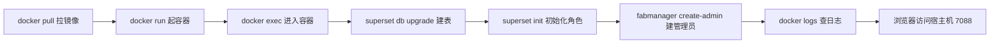

# Docker 安装 Superset：从拉镜像到登录页

Superset 是一套 Python 应用栈：Flask 服务、元数据库、缓存，外加一大串 Python 依赖，裸机安装免不了跟 Python 版本和依赖冲突缠斗。Docker 镜像把整套环境打包成型，安装就剩三步：拉镜像、起容器、进容器初始化。课程环境是 CentOS 7，从 docker search 到登录页一条链走完。

## 先给结论

- 镜像用社区维护的 `amancevice/superset`，`docker search` 搜到后 `docker pull` 拉取，下载耗时取决于网速。
- 容器内 8088 是 Superset 的默认端口，宿主机用 7088 映射：`-p 7088:8088`，外部访问走宿主机的 7088。
- `-v /opt/superset:/home/superset` 把宿主机目录挂进容器，配置与数据落在宿主机，容器删除重建也不丢。
- 容器内初始化三连：`superset db upgrade` 建元数据库表，`superset init` 初始化角色权限，`fabmanager create-admin --app superset` 创建管理员。
- 课程环境管理员账号 admin、密码 admin123；`docker logs -f` 确认启动日志后，浏览器访问宿主机 7088 即见登录页。

## 一、搜镜像、拉镜像

```bash
# 搜索 superset 相关镜像
docker search superset
# 拉取社区维护的 superset 镜像
docker pull docker.io/amancevice/superset
# 查看本地镜像，确认已落地
docker images | grep superset
```

docker search 会列出一串 superset 相关镜像，选排序最前的 `amancevice/superset`，它是为 Superset 定制的扩展镜像，课程文档里直接给出了这个镜像的托管地址，省去自己写 Dockerfile 构建的功夫。随后一条 pull 把镜像下载进本地镜像库，耗时取决于网速，镜像体积在 1.4GB 上下，网络一般时要等几分钟。docker images 用 grep 过滤，看到 `amancevice/superset` 的 latest 标签就说明镜像就绪，可以起容器了。

## 二、起容器：端口与目录两条映射

```bash
# 后台运行，宿主机 7088 映射容器 8088，宿主机目录挂进容器
docker run -d -p 7088:8088 -v /opt/superset:/home/superset --name superset amancevice/superset
# 确认容器已启动
docker ps
```

参数逐个拆。`-d` 后台运行；`-p 7088:8088` 是端口映射，冒号左边是宿主机端口，右边是容器内端口，8088 是 Superset 的默认端口，课程里把宿主机侧改成 7088，页面上访问用 7088 即可；`-v /opt/superset:/home/superset` 是目录映射，同样是左宿主机右容器，宿主机的 /opt/superset 挂到容器的 /home/superset，配置与数据写进挂载目录，容器重建数据仍在；`--name` 给容器起名，不起名 Docker 会随机分配一个，后续 exec、logs 都得先查容器 ID，起名方便得多。docker ps 的输出里能看到 Up 状态和 `0.0.0.0:7088->8088/tcp` 这样的映射行，两条映射生效的样子就在这里，容器层宣告完成。



这条链前三步是容器层面的事，中间三步在容器内完成，最后两步做验证。顺序不能乱：元数据库表没建好之前，初始化与建管理员都会失败。

## 三、进容器初始化

```bash
# 进入容器，容器 ID 取 docker ps 结果的前几位即可
docker exec -it 58488c34c5 /bin/bash
# 升级 superset 元数据库：建表并执行迁移
superset db upgrade
# 初始化默认角色与权限
superset init
```

`superset db upgrade` 负责把 Superset 自己的元数据库建起来：用户、角色、图表、看板的定义都存在这套元数据里，默认是容器内置的 SQLite，命令执行时会滚动输出一大片建表与迁移日志，属正常现象。这也解释了目录挂载为什么不可省：元数据库文件落在挂载目录里，容器销毁重建，账号与图表定义照样在。`superset init` 接着初始化默认的角色与权限数据。两条都是 Flask 应用的管理命令，在容器内直接执行。

## 四、创建管理员并验证登录

```bash
# 创建管理员账号
fabmanager create-admin --app superset
```

交互式输入：Username 直接回车，默认就是 admin；Firstname、Lastname 回车跳过；Password 输入 admin123，Repeat for password 再输一次确认。完成后 admin/admin123 就是课程环境的管理员账号。老镜像里这条命令叫 fabmanager（Flask 应用基于 FAB 做认证授权），新版本 Superset 已换成 `superset fab create-admin`，见到命令不存在先查版本。

重复执行这条命令会提示 `Username is already in use`，这是账号已存在的提示而不是故障，直接用现有账号登录即可。

回到宿主机看日志并验证：

```bash
# 跟踪容器日志确认服务正常
docker logs -f 58488c34c5
```

日志持续滚动、没有异常退出，就可以在浏览器访问 `http://<宿主机IP>:7088`，出现 Superset 登录页，用 admin/admin123 登录进入首页，安装闭环。首次打开登录页可能偏慢，Superset 前端资源体积不小，第一次加载等它拉完就好，之后会明显变快。

日常运维记住三条就够：`docker stop superset` 停、`docker start superset` 起、`docker logs -f superset` 跟踪日志。元数据库与配置都在宿主机挂载目录里，容器随便折腾，数据不心疼。

## 常见误区

- **端口映射写反。** 错例：`-p 8088:7088`，访问宿主机 7088 不通。正解：`-p` 左边宿主机、右边容器，Superset 默认端口 8088 在容器里，宿主机侧映射成 7088。
- **跳过 db upgrade 直接用。** 错例：容器一起来就建图表，页面报元数据表不存在。正解：先 `superset db upgrade`，再 `superset init`，最后建管理员，顺序固定。
- **重复建管理员当成故障。** 错例：再跑一次 create-admin 见到 `Username is already in use` 就怀疑装坏重装。正解：提示只说明账号已存在，直接登录。
- **省掉 -v 挂载。** 错例：`docker run` 不做目录映射，容器删除重建后账号与配置全丢。正解：配置与数据落宿主机目录，容器只是运行体。
- **拿容器端口访问宿主机。** 错例：浏览器直接开 8088。正解：8088 只在容器网络内监听，宿主机访问走映射后的 7088。

## 面试可能被问到的问题

1. 面试官追问：「为什么用 Docker 装 Superset？」
   答：Superset 是 Flask 应用加元数据库加一堆 Python 依赖的组合，裸装要与 Python 版本、依赖冲突缠斗；镜像把环境打包好，一条 docker run 拉起，环境一致、回滚容易，配合目录挂载，数据也不依赖容器生命周期。
2. 面试官追问：「-p 7088:8088 两个端口分别是什么？」
   答：8088 是容器内 Superset 服务的默认端口，7088 是宿主机映射端口，外部访问宿主机 7088 转发到容器 8088。记法：冒号左边宿主机，右边容器。
3. 面试官追问：「superset db upgrade 和 superset init 各做什么？」
   答：db upgrade 对元数据库建表并执行迁移，用户、角色、图表、看板的定义都存元数据库；init 灌入默认角色与权限数据。先有表结构再初始化数据，顺序不能颠倒。
4. 面试官追问：「fabmanager create-admin 是什么，密码怎么定？」
   答：Superset 基于 FAB 做认证授权，fabmanager 是 FAB 的账号管理命令，--app 指定应用；交互里用户名直接回车默认 admin，课程环境密码 admin123。重复执行提示用户名已存在，不是错误。
5. 面试官追问：「容器删掉，Superset 的配置和账号会丢吗？」
   答：取决于 -v 挂载。把宿主机目录挂到容器工作目录后，配置与元数据落在宿主机，容器删除重建挂回去即可；没有挂载就随容器一起消失。

## 配套资料

- 代码：`materials/code/06/day8 数据可视化/`，本课无配套源码包，安装命令按课程实操记录整理。
- 代码：`materials/code/06/day7 统计分析/`，cold-druid 真实工程，装好 Superset 后要连的数据侧就是该工程查询的 all_device_message。
- 说明：主机地址以 example.com 占位；引用路径截至 day 目录层级。
