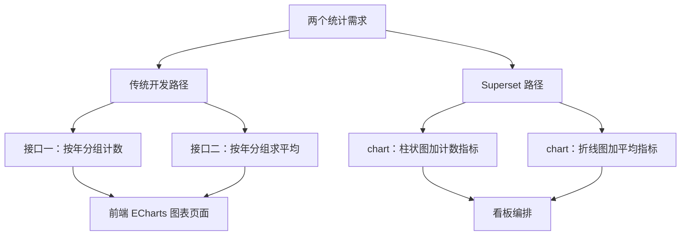
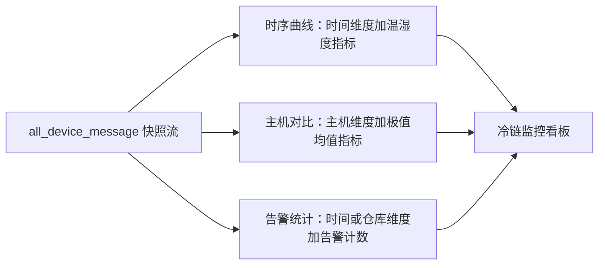

# Superset 出图前先把需求拆成维度与指标

真正动手拖图表之前，需求分析决定这张图有没有价值。课程选了一个极小的示例：MySQL 里一张 users 表，三个业务字段，两个统计需求。小到十分钟就能建完，却完整演示了从表结构到图表配置的整套拆法；这套拆法原样搬回冷链监控平台，温湿度时序曲线、主机对比、告警统计三张图的方案就能直接落纸。

## 先给结论

- 示例数据源是 MySQL，表 users，业务字段三个：用户名称、年龄、毕业日期。
- 需求一：每年毕业生数量的柱状图；需求二：每年毕业生平均年龄的折线图；两个需求的维度都是毕业年份，指标分别是计数与平均年龄。
- 传统开发要做两个后台接口加一个 ECharts 图表页面；Superset 里是同一数据集上的两张图表，不写代码。
- Superset 的开发流程四步：创建数据库、创建数据表、创建图表 charts、把图表显示在看板。
- 冷链监控平台的三张图（温湿度时序曲线、主机对比、告警统计）用同一套拆法，字段全部来自 Druid 的 all_device_message。

## 一、先看表，再看需求

users 表简单到极致（示例建表语句按本课写法补全）：

```sql
CREATE TABLE users (
  id              INT PRIMARY KEY AUTO_INCREMENT,
  name            VARCHAR(50) COMMENT '用户名称',
  age             INT COMMENT '年龄',
  graduation_date DATE COMMENT '毕业日期'
);
```

表里的数据也只有几行：张三 30 岁、2012 年毕业，赵六 31 岁、2012 年毕业，王五 2002 年毕业，李四 2014 年毕业。需求跟着数据走：第一，每年毕业生数量的柱状图，一眼看出 2012 年有两个毕业生，2002 年与 2014 年各一个；第二，每年毕业生平均年龄的折线图，2012 年的平均年龄是 (30+31)/2 等于 30.5 岁。

两个需求用维度与指标的语言重述：维度都是毕业年份，即 graduation_date 按年粒度离散化；需求一的指标是计数，需求二的指标是 AVG(age)。维度与指标的拆法在数据可视化章节已系统铺垫，这里直接套用。两条统计 SQL 长这样（示例按本课写法补全）：

```sql
-- 需求一：每年毕业生数量
SELECT YEAR(graduation_date) AS grad_year,
       COUNT(*)              AS grad_count
FROM users
GROUP BY YEAR(graduation_date);

-- 需求二：每年毕业生平均年龄
SELECT YEAR(graduation_date) AS grad_year,
       AVG(age)              AS avg_age
FROM users
GROUP BY YEAR(graduation_date);
```

先写 SQL 不是为了在 Superset 里手工查询，而是把口径钉死：图表配置界面里选的维度与指标，落到数据库就是这两条语句。口径在 SQL 层验证无误，再进图表向导，出图后数字才对得上预期。

## 二、两条路径的成本对比

传统开发路径：后台写接口一，按年分组查毕业生数量；接口二，按年分组查平均年龄；前端用 ECharts 这类图表工具画柱状图与折线图再串起来。功能不复杂，但从接口到页面每个环节都是代码，需求一变（比如再按学院分组）就要重新排期。

Superset 路径：数据集建好后，两张 chart 各自选维度毕业年份、配指标计数与平均年龄、选图表类型柱状图与折线图，配置即完成。两条路径的对比画成一张图：



传统路径的三块工作在 Superset 路径里压缩成两个图表配置，这正是 BI 平台的分工逻辑：口径与样式由使用者在界面上定义，平台负责取数与渲染，需求变化不再占用开发排期。

## 三、开发流程四步

课件把 Superset 的开发流程归纳为四步：创建数据库，即接入 MySQL 连接；创建数据表，即把 users 建成数据集并定义字段口径；创建图表 charts，为两个需求各配一张；将图表显示在看板，编排成可交互页面。数据侧两步、展示侧两步，顺序与数据依赖一致：没有连接就没有数据集，没有数据集图表就无米下锅，看板编排永远放最后。

## 四、同一套拆法搬回冷链监控平台

users 示例练的是方法，方法落到平台要看三张图的需求拆解。数据来源统一是 Druid 的 all_device_message，可用字段包括 curtime、tem、hum、hostname、housename、temalert、humalert、state 等，三张图的方案如下：

| 看板图表 | 维度 | 指标 | 图表类型 | 数据来源字段 |
|---|---|---|---|---|
| 温湿度时序曲线 | 采集时间，按小时或分钟粒度 | tem、hum 序列或组内均值 | 折线图 | curtime、tem、hum |
| 主机对比 | hostname 或 housename | MAX(tem)、AVG(hum) | 柱状图 | hostname、housename、tem、hum |
| 告警统计 | 时间（按天）或仓库 | 告警次数计数 | 柱状图或折线图 | temalert、humalert、state、housename |



这张图是三张图与数据源的映射关系：同一份快照流，按不同维度切、按不同指标算，长出三张图。时序曲线与 cold-druid 工程温湿度查询的口径一致，即取指定设备最近若干条按时间排成 tem 与 hum 两条序列，只是取数入口从 Java 接口换成 Superset 数据集；主机对比是典型横比，维度换成仓库就是仓库对比；告警统计把 temalert、humalert 聚合成次数，按天或按仓库切分。三张图配上 users 示例的操作步骤，后续图表制作与看板编排的内容可以直接照着做。

## 常见误区

- **拿原始日期字段直接当维度。** 错例：graduation_date 不做年份转换就拖进分组框，每个日期一组，图没法看。正解：先按年或天粒度离散化，年份才是业务要的维度。
- **两个需求硬拼一张图。** 错例：把毕业生数量与平均年龄塞进同一张图，量纲不同互相挤压。正解：数量与均值分开两张 chart，共用同一维度与数据集，看板里并排呈现。
- **只写 SQL 不定口径。** 错例：SQL 验证完就扔，图表向导里临时选字段。正解：指标名、聚合方式、时间粒度在数据集层定义清楚，所有图表复用同一套定义。
- **跳过需求分析直接拖图。** 错例：打开图表向导再想分组和聚合。正解：先列维度与指标清单，核对数据来源字段与时间范围，再动手配置。

## 面试可能被问到的问题

1. 面试官追问：「拿到一个统计需求，动手建图表前要做什么？」
   答：把需求翻译成维度与指标：确定从哪个角度看数据（时间、主机、仓库），组内算什么数（计数、平均、极值），再核对数据来源有没有对应字段与足够的时间范围，口径用 SQL 验证后才进图表配置。
2. 面试官追问：「为什么示例要把两条统计拆成两张图？」
   答：毕业生数量与平均年龄量纲不同，塞进一张图互相挤压还容易误读；两者共用同一维度与数据集，各自绑定图表类型，看板里并排呈现，口径互不干扰。
3. 面试官追问：「传统报表开发和 Superset 出图的差别在哪？」
   答：传统路径要后台接口加前端图表页，改动即排期；Superset 在数据集上配置维度指标与图表类型即可，无代码，业务可自助，平台统一负责取数与渲染，需求变化的响应成本大幅下降。
4. 面试官追问：「冷链监控看板的温湿度曲线，维度指标怎么定？」
   答：维度是采集时间，按小时或分钟粒度；指标是温度与湿度的原值序列或组内均值，图表类型折线图；数据来自 all_device_message 的 curtime、tem、hum 字段，口径与 Java 查询接口保持一致。
5. 面试官追问：「告警统计图怎么做才有说服力？」
   答：单看告警次数的绝对数不够，要按仓库或时间维度切分出趋势，必要时除以在线设备数算告警率；数据上用 temalert、humalert 的计数做指标，配合 state 区分告警与恢复，绝对数与相对数一起看。

## 配套资料

- 代码：`materials/code/06/day8 数据可视化/`，本课无配套源码包，users 建表与统计 SQL 为按本课写法补全。
- 代码：`materials/code/06/day7 统计分析/`，cold-druid 查询工程为真实工程，all_device_message 的字段清单（metercode、hostname、housename、tem、hum、temalert、humalert、curtime 等）以该工程实体定义为准。
- 说明：包名统一改写为 com.study.coldchain；引用路径截至 day 目录层级。
