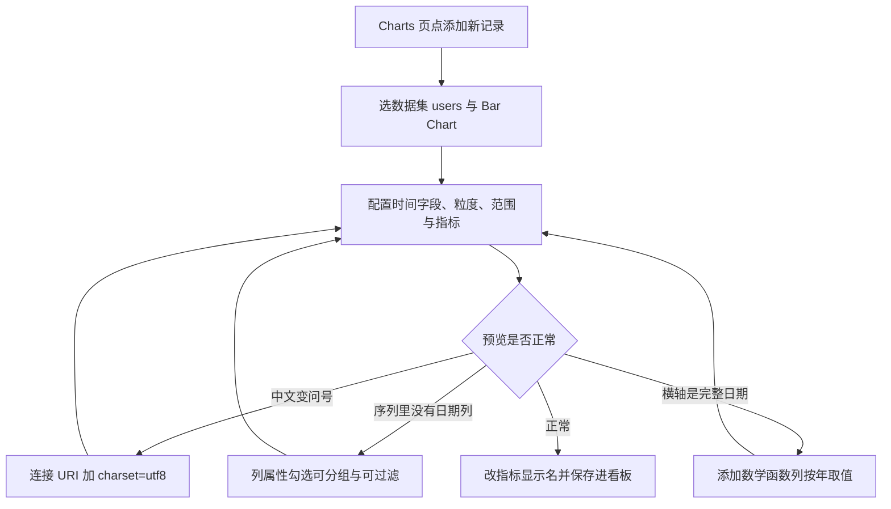

# Superset 图表开发全流程：从空面板到保存进看板

> 🔒 安全提示：文中示例的口令/密钥均为课程教学环境演示口径，生产环境的安全要求见《安全与合规须知》。

数据集就绪之后，出图这一步最容易卡住：图表编辑器左侧十几个配置项，右侧一片空白，配置随手一点，预览出来的可能是问号乱码，也可能按用户名而不是按年分组。这节课把 users 表那张「每年毕业生数量」柱状图从头做到保存进看板，途中踩掉的三个坑，回到冷链监控平台做温湿度曲线时一个都躲不开。

## 先给结论

- 图表编辑器三区：左侧「数据」区定取数口径，左侧「自定义」区管样式属性，右侧实时预览；配置项随图表类型变化，换类型先重认一遍面板。
- 出图四要素：数据集、可视化类型、维度（时间字段加时间粒度）、指标；预览提示「序列至少选一项」，先把序列补齐再谈别的。
- 中文乱码的根因在数据库连接，SQLAlchemy URI 补上 `?charset=utf8` 保存后刷新即可，与图表配置无关。
- 日期列默认不可分组、不可过滤，要在数据集列属性里勾选；按年归组靠一个表达式为 `Year(graduated)` 的数学函数列。
- 图表保存时可选择加入现有看板或新建看板；指标显示名在数据集的指标页签里改，图表标签随之更新。

## 编辑器三区，配置项从哪来

入口在管理页面的 Charts 菜单，列表右上角点「添加新记录」，弹出表单只问两件事：数据集选 users，可视化类型选 Bar Chart，同类可选的还有饼状图、折线图等。确认后进入编辑器，界面大致分三部分：左侧上方是「数据」区，放着数据源、按什么分组、对什么聚合、时间字段与时间粒度这些口径项；左侧下方是「自定义」区，管图表的样式属性；右侧是实时预览区，每点一次查询就重画一次。

有一点要提前有预期：不同图表类型的配置项不一样。序列这样的控件是 Bar Chart 才有的，换一种图表类型，面板上能配的东西就变了，有的字段在别的类型里根本没有对应位置。这也决定了排错顺序：图不对，先确认动的是当前图表类型的配置项，再去怀疑口径。

按需求填四要素：时间字段选 graduated，即毕业日期，users 数据集的列是 id、user_name、age、graduated、create_time、update_time，本例只关心 user_name 与 graduated 两列；时间粒度选「年」；时间范围选 no filter，不过滤、吃全部数据；指标选「求和」。点查询，预览区先报了一个提示，序列里至少要选中一项。随手把序列选成 user_name，柱状图出来了，但两个问题同时暴露在屏幕上。

## 两个问题：乱码与分组

第一个问题是中文变问号，用户名一栏全是乱码。根因不在图表，在数据库连接：当初创建 MySQL 连接时，URI 里没带中文编码标识。回到「数据源 → 数据库」编辑这条连接，URI 末尾补上 charset 参数（主机与库名按环境替换）：

```text
mysql://root:123456@<数据库主机>:3306/<库名>?charset=utf8
```

保存后回到图表刷新，问号恢复成中文，数据本身没有动过。

第二个问题是分组不对：横轴站着的是用户名，需求要的是年份。原因有两层。表层原因是序列选了 user_name，口径自然跟着它走；深层原因是 graduated 列在序列下拉里根本不出现，因为它在数据集里没有开放「可分组」与「可过滤」。到「数据源 → 编辑数据表」的列页签里编辑 graduated，把「可分组」「可过滤」两项勾上保存，重新走一遍图表向导，序列里才出现 graduated。重新选好时间字段、粒度与范围，查询，柱子出来了，可横轴是 2012-06-30、2014-06-30、2002-06-30 这样的完整日期，其中 2012-06-30 那根柱求和是 2，恰好是同一天毕业的两个人，但读者要的 2012、2014、2002 并没有出现，按年统计还差最后一步。

## 按年归组：数学函数列

同一年归成一组，得让维度取值变成「年」而不是日期。回到数据集编辑页，给 graduated 加一个数学函数列，表达式与 MySQL 的函数写法一致：

```sql
-- 数据集编辑页里给毕业日期列添加的计算列
Year(graduated)
```

保存后回到图表，把序列换成这个按年取值的计算列，再查询，横轴变成 2012、2014、2002，2012 年合计 2，2014 与 2002 各 1，与统计 SQL 的口径完全对上。序列这个东西可以理解为「按某一类展开」，但它和 SQL 里手写的 GROUP BY 不完全一样：序列绑定在数据集的列定义上，列怎么定义图就怎么分，改口径要去数据集层改，不在图表面板里硬调。

顺手把指标显示名改掉。数据集编辑页的指标页签里，编辑默认的求和指标，把显示名从「求和」改成「毕业生数量」，图表的标签与悬浮提示跟着变。本例每行计 1，求和累出来的数值恰好等于条数，柱子高度就是人数，求和指标在这里就当计数用。

## 保存进看板

图对了就点保存。对话框问三件事：图表名称，填「毕业生数量」；加入现有看板还是新建看板。保存后 Charts 列表里能看到这张图，看板页里再把它编排上墙。后续改配置再次保存同名图表，系统提示 Chart has been overwritten，属于覆盖更新，不是异常。整条路径画成一张图：



这张图是图表开发的完整回路：三个坑全部发生在预览检验这一步，修复动作全部落在数据源与数据集层。图表面板里只做选择，不改口径，这是 Superset 里职责边界最清楚的一条线。

## 搬回冷链监控平台

users 示例练的是动作，换数据集重放就是平台的图。课程环境的图表列表里已经躺着基于 all_device_message 的「设备异常率」，同一套动作再放一次，时序曲线就有了。它的口径与 day7 cold-druid 工程的温湿度查询接口保持一致：指定设备取最近若干条，按时间正排成 tem 与 hum 两条序列，Java 版长这样（包名已按统一口径改写）：

```java
// cold-druid 的温湿度序列接口：指定设备最近 N 条，排成 tem 与 hum 两条序列
public R queryDruidTumHum(Map<String, Object> params) {
    List<MessageEntity> list = queryDruidList(params);
    List<String> times = new ArrayList<>();
    List<Integer> tems = new ArrayList<>();
    List<Integer> hums = new ArrayList<>();
    for (MessageEntity m : list) {
        String t = m.getCurtime();
        times.add(t.substring(8, 10) + ":" + t.substring(10, 12) + ":" + t.substring(12, 14));
        tems.add(m.getTem());
        hums.add(m.getHum());
    }
    // 查询按时间倒序取数，出图前反转为正序
    Collections.reverse(times);
    Collections.reverse(tems);
    Collections.reverse(hums);
    // xAxis、tem、hum 三组数据返回给前端画折线
}
```

同一口径挪进 Superset：数据集选 all_device_message，时间字段 curtime，时间粒度按小时或分钟，维度加 hostname 或 housename 区分设备，指标取 tem 与 hum 的均值或原值序列，图表类型 Line Chart。取数入口从 Java 接口换成数据集配置，接口代码省掉，口径反而更集中：分组、聚合、显示名全部钉在数据集的列与指标定义上，接口改动才需要的重新发版，这里刷新一下图表就生效。

## 常见误区

- **乱码去改图表样式。** 错例：字体、编码、CSS 一通调。正解：乱码根因在数据库连接，SQLAlchemy URI 补 `?charset=utf8` 并保存连接，刷新图表即可恢复。
- **序列里找不到日期列就换字段凑数。** 错例：拿 user_name 顶替。正解：进数据集编辑页给日期列勾选「可分组」「可过滤」，序列下拉里才会出现它。
- **按年统计靠过滤条件逐个年份查。** 错例：横轴停在完整日期，每年查一遍。正解：建 `Year(日期列)` 计算列当维度，同年数据自动归组，一张图看全。
- **改口径去图表面板里碰运气。** 错例：图不对就在图表配置里乱试。正解：分组、聚合、显示名都定义在数据集层，图表只引用定义，先改数据集再回图表刷新。

## 面试可能被问到的问题

1. 面试官追问：「Superset 图表编辑器由哪几部分组成？」
   答：左侧「数据」区定义取数口径，包括数据源、维度与序列、指标、时间字段与时间粒度；左侧「自定义」区管样式属性；右侧实时预览。配置项随图表类型变化，换类型面板内容会不同。
2. 面试官追问：「图表里的中文变成问号，怎么定位？」
   答：先查数据库连接而不是图表本身。MySQL 连接的 SQLAlchemy URI 没带 charset=utf8 时，中文列值读出来就是乱码；补上参数保存连接，刷新图表恢复。
3. 面试官追问：「按年统计为什么建数学函数列，直接选日期字段不行吗？」
   答：日期字段按原值分组，一天一组，达不到按年归组的目的；建 YEAR(日期) 计算列当维度，同年数据聚到同一根柱，口径固定在数据集里可复用。
4. 面试官追问：「序列和 SQL 的 GROUP BY 是一回事吗？」
   答：语义相近，都是按某一类展开，但不完全等价。序列绑定数据集的列定义，是否可分组、用什么计算列由数据集决定；图表面板只选择引用，改口径应回数据集层。
5. 面试官追问：「图表保存时有哪些选择，重复保存会怎样？」
   答：填图表名称，选择加入现有看板或新建看板；再次保存同名图表会覆盖原定义，并给出 overwritten 提示，属于正常更新。

## 配套资料

- 代码：`materials/code/06/day8 数据可视化/`，本课无配套源码包，users 相关连接串与计算列示例为按本课写法补全。
- 代码：`materials/code/06/day7 统计分析/`，cold-druid 工程的温湿度序列接口为口径参照的真实实现，all_device_message 字段清单以该工程实体定义为准。
- 说明：包名统一改写为 com.study.coldchain；引用路径截至 day 目录层级。
