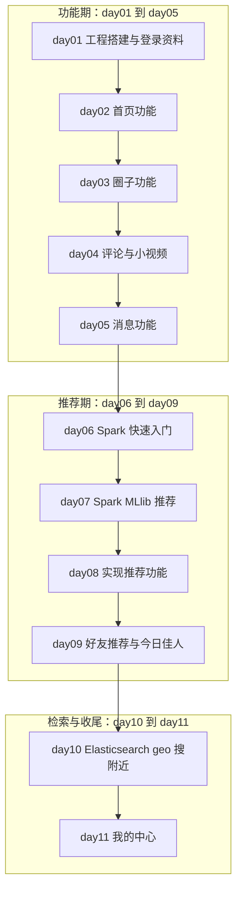

# 探花交友开篇：社交匹配 App 后台的 11 天路线图与第一天任务

> 🔒 安全提示：文中示例的口令/密钥均为课程教学环境演示口径，生产环境的安全要求见《安全与合规须知》。

阶段六的冷链监控平台是一条「设备到看板」的数据链路，这一阶段换到 C 端场景：做一个陌生人社交 App 的完整后台。业务形态变了，考察点也变了，推荐、即时通讯、地理位置检索这些东西不再靠中间件堆出来，而是直接长在业务上。开课第一天先建立项目认知，再把工程搭起来，用登录与完善个人信息这两个功能给整个项目开一个能跑的头。

## 先给结论

- 项目定位是移动端陌生人社交 App「探花交友」的后台，核心业务是推荐匹配与社交互动，功能域覆盖交友、圈子、小视频、消息、我的。
- day01 的主线五块：项目介绍、工程搭建、阿里云 OSS 服务应用、人脸识别、完善个人信息，登录与短信验证码贯穿其中。
- 验证码对接第三方短信平台下发，图片上传对接阿里云 OSS，头像强制真人像校验走人脸识别，非人像图片会被提醒。
- 数据底座是 mytanhua 库：tb_user 管账号认证（手机号加 MD5 密码），tb_user_info 管展示资料（昵称、头像、性别、城市、生日等），两表按 user_id 一对一关联。
- 11 天分三段：前 5 天做功能（首页、圈子、评论、小视频、消息），中段 4 天做推荐（Spark 与 Spark MLlib），尾段用 Elasticsearch geo 做搜附近，我的中心收尾。

## 一、项目定位：陌生人社交 App 的后台

探花交友是移动端社交匹配类应用，用户群、玩法与商业模式在背景与市场分析一课里展开，工程视角只需要记住一件事：这是一个以「推荐匹配」为核心的 App，后台要同时支撑内容互动与算法服务。资料包里的移动端原型（Axure 导出的静态页）把功能域切得很清楚：

```text
探花交友移动端原型 V1.2
├─ 登录页.html
├─ 首次登录信息完善.html
├─ 交友.html          （推荐匹配主页）
├─ 圈子.html          （动态社区）
├─ 小视频.html
├─ 消息.html          （私信与通知）
├─ 我的.html          （个人中心）
└─ 异常页面.html
```

八个页面对应八个功能域，其中交友页是产品的主战场：平台按推荐结果给用户出候选卡片，用户左滑右滑表达兴趣，匹配成好友后进入消息与圈子互动。后台的所有技术选型都围着这条主链路展开，这也是它与普通管理后台项目最大的不同。

## 二、day01 任务拆解：登录与资料完善的闭环

课程目录高亮的顺序就是开发顺序：项目介绍、工程搭建、阿里云 OSS 服务应用、人脸识别、完善个人信息。整条链路画出来是这样：


几个环节的技术要点说透。**登录走手机号加短信验证码。** 服务端生成验证码并设置有效期，对接第三方短信平台把验证码发到用户手机，前端提交后校验，通过即建立登录态。**图片上传对接阿里云 OSS。** 用户头像、封面这类静态资源放到对象存储里，库里只存 URL，应用服务器不背文件服务的负担。**人脸识别是真人资料的卡口。** 社交产品的信任基础是真实头像，上传的图片先过人脸识别服务，判定非人像就给用户提醒并拒绝作为头像，判定通过才放行入库。**完善个人信息是前几项的综合题。** 昵称、性别、年龄、城市等字段一次补全，头像走 OSS 加人脸识别，写库后首次登录流程结束。

学习目标清单里对应的表述是：掌握工程搭建、掌握发送短信验证码、掌握阿里云 OSS 的应用、掌握人脸识别技术的使用，并独立完成登录与完善个人信息两个功能。工程搭建是后面十天的地基，环境问题务必当天清零。

## 三、数据底座：两张表看账号与资料

day01 的资料包带真实的建库脚本 mytanhua.sql，两张核心表把「账号与资料分离」的设计写在明面上。账号表管认证：

```sql
CREATE TABLE `tb_user` (
  `id`       bigint(20)  NOT NULL AUTO_INCREMENT,
  `mobile`   varchar(11) DEFAULT NULL COMMENT '手机号',
  `password` varchar(32) DEFAULT NULL COMMENT '密码，需要加密',
  `created`  datetime    DEFAULT NULL,
  `updated`  datetime    DEFAULT NULL,
  PRIMARY KEY (`id`),
  KEY `mobile` (`mobile`) USING BTREE
) ENGINE=InnoDB DEFAULT CHARSET=utf8 COMMENT='用户表';
```

资料表管展示：

```sql
CREATE TABLE `tb_user_info` (
  `id`        bigint(20)  NOT NULL AUTO_INCREMENT,
  `user_id`   bigint(20)  NOT NULL COMMENT '用户id',
  `nick_name` varchar(50) DEFAULT NULL COMMENT '昵称',
  `logo`      varchar(100) DEFAULT NULL COMMENT '用户头像',
  `tags`      varchar(50) DEFAULT NULL COMMENT '用户标签：多个用逗号分隔',
  `sex`       tinyint(1)  DEFAULT '3' COMMENT '性别，1-男，2-女，3-未知',
  `age`       int(11)     DEFAULT NULL COMMENT '用户年龄',
  `city`      varchar(20) DEFAULT NULL COMMENT '居住城市',
  `birthday`  varchar(20) DEFAULT NULL COMMENT '生日',
  `industry`  varchar(20) DEFAULT NULL COMMENT '行业',
  `income`    varchar(20) DEFAULT NULL COMMENT '收入',
  `marriage`  varchar(20) DEFAULT NULL COMMENT '婚姻状态',
  `created`   datetime    DEFAULT NULL,
  `updated`   datetime    DEFAULT NULL,
  PRIMARY KEY (`id`),
  KEY `user_id` (`user_id`)
) ENGINE=InnoDB DEFAULT CHARSET=utf8 COMMENT='用户信息表';
```

两张表的设计意图值得咀嚼。tb_user 只有认证四件事：手机号、密码、创建与更新时间，mobile 上建了普通索引支撑按手机号查人；password 存的是加密后的 32 位值，示例数据里是 MD5（种子账号密码即 123456 的 MD5 值）。tb_user_info 则把对外展示的资料收拢：昵称、头像 URL、性别、年龄、城市、生日、行业、收入、婚姻状态，全部可空，等用户完善时再填。两表按 user_id 一对一关联，认证层稳定少变，资料层频繁演化，拆开互不拖累；头像字段 logo 存 OSS 的 URL 而不是文件本身，与上传链路呼应。tags 字段用逗号分隔存多个标签，是社交产品里典型的轻量标签方案，后续做推荐时可以直接喂给算法侧。

## 四、技术栈总览与 11 天路线图

按领域把整个阶段会碰到的东西归拢成一张表，每行回答「这个组件替谁干活」：

| 领域 | 技术 | 在项目里干什么 |
|---|---|---|
| 服务骨架 | Spring Boot、MyBatis-Plus | 后台服务与持久层基础 |
| 关系库 | MySQL | 账号、资料等结构化数据 |
| 文档库 | MongoDB | 动态、评论等半结构化数据 |
| 缓存 | Redis | 验证码暂存、热数据 |
| 即时通讯 | 第三方 IM 平台对接 | 消息模块的私信能力 |
| 云服务 | 第三方短信平台、阿里云 OSS | 验证码下发、图片对象存储 |
| 人工智能 | 人脸识别服务 | 头像真人像校验 |
| 推荐计算 | Spark、Spark MLlib | 好友推荐、今日佳人 |
| 位置检索 | Elasticsearch geo | 附近的用户检索 |

11 天的日程与关键技术点如下：

| 天 | 业务模块 | 关键技术点 |
|---|---|---|
| day01 | 工程搭建、登录与完善个人信息 | 短信验证码、阿里云 OSS、人脸识别 |
| day02 | 首页功能 | 推荐卡片与基础接口串联 |
| day03 | 圈子功能 | 动态发布与浏览，MongoDB 落数据 |
| day04 | 评论、小视频 | 互动数据与小视频能力 |
| day05 | 消息功能 | 私信与 IM 对接 |
| day06 | Spark 快速入门 | 大数据计算基础 |
| day07 | Spark MLlib 推荐系统快速入门 | 推荐算法基础 |
| day08 | 实现推荐功能 | 推荐服务落地 |
| day09 | 好友推荐、今日佳人 | 推荐业务闭环 |
| day10 | Elasticsearch geo 实现搜附近 | 地理位置检索 |
| day11 | 我的中心 | 个人中心与阶段收尾 |



三段各有主线。功能期把社交 App 的必备业务逐个纵切实现，每天都是「页面、接口、存储」的完整闭环；推荐期转向数据与算法，Spark 打底、MLlib 建推荐模型，最终落成好友推荐与今日佳人两个业务功能；检索与收尾期补上地理位置维度（搜附近是陌生人社交的刚需入口），再以我的中心整理个人侧功能。功能期做的东西会反复出现在推荐期之后，因为推荐结果要回到首页卡片、消息与圈子里去消费，学习时注意这条回环。

## 常见误区

- **当纯 CRUD 项目学。** 前五天确实大量增删改查，但推荐系统与地理位置检索才是简历含金量所在，跨到 day06 之后的学习节奏不能松。
- **账号表和资料表混为一谈。** 错例：把昵称头像塞进 tb_user。正解：认证与展示职责分离，tb_user 管登录，tb_user_info 管资料，user_id 关联。
- **把头像上传当普通文件上传。** 错例：直接存文件路径。正解：OSS 对象存储加人脸识别卡口，非人像拒绝入库，URL 落库。
- **工程搭建留尾巴。** 错例：依赖下载失败、数据库脚本没执行就往后学。正解：day01 结束时登录与完善信息必须能跑通，环境问题当天清零。

## 面试可能被问到的问题

1. 面试官追问：「用一分钟介绍探花交友这个项目。」
   答：一个移动端陌生人社交 App 的后台，核心是推荐匹配：平台按推荐结果给用户出候选卡片，右滑喜欢左滑不喜欢，匹配后进入消息与圈子互动。后台以 Spring Boot 加 MyBatis-Plus 为骨架，MySQL 存账号资料，MongoDB 存动态评论，Redis 做缓存与验证码，对接短信平台、阿里云 OSS、人脸识别与 IM 服务，推荐侧用 Spark 与 Spark MLlib，附近的人用 Elasticsearch geo。
2. 面试官追问：「账号和资料为什么分成两张表？」
   答：职责与变更频率不同。tb_user 只服务认证，字段少且稳定，mobile 建索引支撑登录查询；tb_user_info 承载展示资料，字段多且随产品演化频繁调整。一对一按 user_id 关联，登录高频读窄表，资料页才读宽表，互不干扰。
3. 面试官追问：「用户头像上传的完整链路是什么？」
   答：前端把图片上传到阿里云 OSS，服务端先调人脸识别服务校验是否真人像，非人像返回提醒并拒绝；通过后将 OSS 返回的 URL 写入 tb_user_info 的 logo 字段，应用服务器不落文件，扩展与备份交给对象存储。
4. 面试官追问：「短信验证码登录怎么做才安全？」
   答：服务端生成验证码并设短有效期，对接第三方短信平台下发，同一手机号限制发送频率；校验时校验码与有效期一次性消费，通过后建立登录态。验证码通常在 Redis 里带过期时间暂存，失败次数也要限制。
5. 面试官追问：「这个项目 11 天的路线是怎么分段的？」
   答：三段。功能期 day01 到 day05 做工程搭建、首页、圈子、评论小视频、消息；推荐期 day06 到 day09 学 Spark 与 Spark MLlib 并落地推荐功能；最后 day10 用 Elasticsearch geo 实现搜附近，day11 我的中心收尾。推荐结果最终回到首页卡片与互动模块消费，前后是回环关系。

## 配套资料

- 代码：`materials/code/07/day01 探花交友-项目搭建以及登录完善个人信息/`，内含 `day01/代码/mytanhua.sql`（tb_user、tb_user_info 真实建表脚本）、`day01/学习目标.md` 与 `day01/资料/探花交友移动端原型V1.2/`（登录页、首次登录信息完善、交友、圈子、小视频、消息、我的等页面原型）。
- 讲义：`materials/docs/07/` 不存在，本阶段无讲义文本，内容以画面线为准。
- 说明：包名按画面线去品牌改写为 com.study.tanhua 一类中性包名；引用路径截至 day 目录层级。
