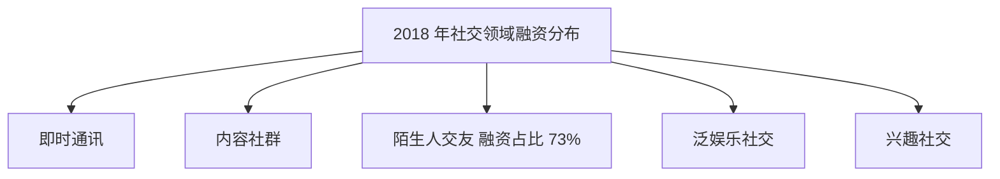

# 陌生人社交的市场逻辑：探花交友的背景、赛道与目标用户

动手写第一行业务代码之前，得先能回答三个产品问题：这个项目从哪里来，赛道有多大，做给谁用。答案不在代码里，在行业数据与用户画像里；面试里讲项目，这部分是「业务层」的话术来源，讲不出它，技术描述就只剩组件罗列。

## 先给结论

- 在线社交从 PC 时代的社区形态（人人网、校内网）走到移动端，从熟人社交延伸出陌生人交友与兴趣交友等垂直方向，探花交友定位移动端陌生人社交。
- 《2018 社交领域投融资报告》：投融资事件相比 2017 年减少 29.5%，融资总额却大幅增长 68%，行业在规模化，同质化产品被淘汰，细分需求是机会。
- 按娱乐形式与内容两个维度划分，社交行业分即时通讯、内容社群、陌生人交友、泛娱乐社交、兴趣社交五类；2018 年融资事件里陌生人社交占比 73%，2019 年陌生人社交、内容社群、兴趣社交合计保持近 70% 的份额。
- 目标用户以 30 岁以下为主，18 到 25 岁是主力受众；人群分上班族、学生群体、文艺群体、沟通弱势群体四类。
- 典型使用场景的用户画像是内向、社交恐惧、不主动，产品的解法是用推荐加轻交互把破冰门槛降到一次滑动。

## 一、背景：从熟人社区到陌生人匹配

在线社交不是新东西。PC 互联网时代就有人人网、校内网这样的代表性网站，它们是互联网时代的产物，满足的是互联网用户的基础社交需求。移动互联网普及后，社交需求整体从 PC 端迁移到移动端，手机让社交变成了随时随地的行为。

迁移的第一阶段以熟人社交为主：产品围绕维系既有关系、共享资源与信息展开，通讯录好友、朋友圈是典型形态。随着交友需求的延伸，移动社交开始向陌生人交友、兴趣交友等垂直方向发展，产品形式也变得多样。探花交友正是站在这个延伸方向上：做移动端的陌生人社交，把「认识新朋友」作为核心场景。这条演进路径画出来是单线的：


读懂这张图的关键在最后一步：熟人社交解决「留住已有关系」，陌生人社交解决「建立新关系」，两类需求长期并存，后者对推荐、安全与破冰机制的要求高得多，这正是这个项目技术上的看点所在。

## 二、市场：融资数据与赛道分类

判断赛道看两样东西：钱的总量与钱的去向。课程引用的《2018 社交领域投融资报告》给了一组反直觉的数据：相比 2017 年，社交领域投融资事件减少了 29.5%，融资总额却大幅增长，达到 68%。两个数字一起读才有意义：事件数下降说明资本不再广撒网，总额上升说明单笔投入变大，资金向有特色的项目集中。对产品方的推论是，没有特色的产品会被淘汰，抓住不同社交需求做差异化，反而是机会。

赛道分类按娱乐形式与内容两个维度展开，社交行业分成五类：即时通讯、内容社群、陌生人交友、泛娱乐社交、兴趣社交。钱的去向有数据支撑：



2018 年备受资本关注的项目里，陌生人社交的融资占比达到 73%，是份额最大的方向；到 2019 年，陌生人社交、内容社群、兴趣社交仍然保持强劲动力，合计占到近 70% 的比例，持续是资本市场的主要关注领域。探花交友选在陌生人交友赛道上，与这份资金流向一致，项目立项的业务合理性就建立在这组数据上。

## 三、目标用户：30 岁以下的四类画像

从整体年龄段看，目标用户以 30 岁以下为主，其中 18 到 25 岁的年轻群体是主要受众。年轻、移动优先、乐于表达，这决定了产品调性与技术形态（App 优先、内容轻量化、交互快节奏）。人群再往下切，是四类画像，每类的诉求各不相同：

| 群体 | 特征与诉求 |
|---|---|
| 上班族 | 热衷通过分享与表达个人情绪，在陌生人面前建立特殊人设，借此提升自我价值、扩大交际圈 |
| 学生群体 | 追求个性选择，倾向找有共同话题的陌生人建立长期关系，乐于展现自我 |
| 文艺群体 | 拥有独特爱好与个人追求，追求文艺圈子内的交流，希望通过分享结交更多好友 |
| 沟通弱势群体 | 长期保持线上社交，渴望更有效、更安全的社交方式，改变单调乏味的沟通现状 |

四类画像对应四组产品抓手：上班族要人设与表达出口，学生要共同话题与长期关系，文艺要圈子与分享，沟通弱势要安全与效率。后台的功能设计里能一一找到落点：资料标签服务人设与共同话题，圈子服务分享与圈子交流，推荐服务高效匹配，真人头像人脸识别服务安全感。

## 四、产品形态与使用场景

陌生人社交最大的产品难题是破冰：让一个内向的人给陌生人发出第一条消息，门槛极高。课程文档里的典型用户场景把关键词写得很直白（以画面线为准）：

```text
用户场景一
关键词：内向、社交恐惧、不主动
诉求：不敢主动搭讪，希望以低门槛的方式开始与陌生人的互动
```

探花的解法是推荐制加轻交互：系统按推荐算法把候选对象送到位（首页的今日佳人、好友推荐），用户用左滑不喜欢、右滑喜欢的一次滑动完成表态，双方互相喜欢即匹配成好友，此后才有消息与圈子的深度互动。「主动搭讪」被拆成了「看推荐、划一下」两个低门槛动作，四类画像里最典型的沟通弱势群体也用得起这个产品。功能矩阵与原型页面对应：交友页承载推荐与滑动匹配，圈子与小视频承载内容表达，消息承载匹配后的关系维护，我的中心承载资料与人设，每个模块都在为「建立并留住新关系」这条主线服务。

## 常见误区

- **把融资事件下降读成行业萎缩。** 错例：事件减少 29.5% 就认为社交赛道没戏。正解：总额增长 68%，资金集中到有特色的项目，淘汰的是同质化产品，细分需求反而是机会。
- **给项目贴错赛道。** 错例：把探花归进内容社群或泛娱乐社交。正解：按娱乐形式与内容两个维度，它属于陌生人交友，2018 年融资占比 73% 的正是这个方向。
- **目标用户写成所有人。** 错例：市场分析只说「社交是基础需求」。正解：30 岁以下为主、18 到 25 岁主力，上班族、学生、文艺、沟通弱势四类画像，每类有明确诉求。
- **把陌生人社交当搭讪工具。** 错例：产品理解成发消息聊天。正解：核心是推荐匹配与低门槛破冰，滑动表态只是交互形态，匹配后的关系维护才是留存关键。

## 面试可能被问到的问题

1. 面试官追问：「用一句话讲清这个项目的业务定位。」
   答：移动端陌生人社交应用，核心场景是通过推荐匹配帮用户建立新关系，用户在推荐卡片上左滑右滑表达兴趣，互相喜欢即匹配，再通过消息、圈子、小视频维持互动。
2. 面试官追问：「为什么说陌生人社交这个赛道值得做？」
   答：2018 年社交领域投融资事件减少 29.5% 但总额增长 68%，资金向有特色的项目集中；陌生人交友在当年融资事件里占比 73%，2019 年与内容社群、兴趣社交合计保持近 70% 份额，是资本持续关注的方向，且细分需求仍有差异化空间。
3. 面试官追问：「目标用户是谁，各有什么诉求？」
   答：30 岁以下为主，18 到 25 岁是主力。四类画像：上班族要在陌生人面前建立人设、扩大交际圈；学生要共同话题与长期关系；文艺群体要圈子内交流与分享；沟通弱势群体要更有效安全的社交方式。产品功能与推荐、资料、圈子、安全机制分别对应。
4. 面试官追问：「左滑右滑这种形态解决什么问题？」
   答：破冰门槛。目标用户里大量内向、社交恐惧、不主动的人，直接发消息的心理成本高；推荐制把候选送到面前，一次滑动完成表态，双向喜欢才建立联系，把社交起点降到最低，匹配后再进入消息与圈子做关系深化。
5. 面试官追问：「这个项目与熟人社交产品的差异在哪？」
   答：熟人社交解决已有关系的维系，关系链来自通讯录与既有圈子；陌生人社交要自己建立关系链，对推荐算法、内容表达、安全风控（如真人头像人脸识别）的要求远高于熟人产品，这些也正是本项目技术投入最重的部分。

## 配套资料

- 代码：`materials/code/07/day01 探花交友-项目搭建以及登录完善个人信息/`，内含 `day01/资料/探花交友移动端原型V1.2/`（交友、圈子、小视频、消息、我的等页面原型，产品形态以原型为准）。
- 讲义：`materials/docs/07/` 不存在，课程文档（1.1 项目背景、1.2 市场分析、1.3 目标用户群体、1.4 使用场景）的内容以画面线抄录为准。
- 说明：包名按画面线去品牌改写为 com.study.tanhua 一类中性包名；引用路径截至 day 目录层级。
