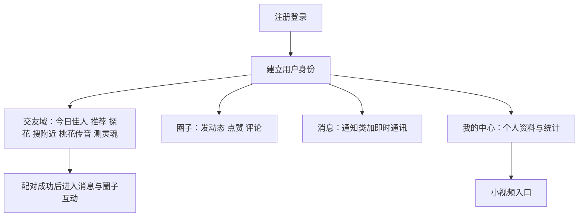
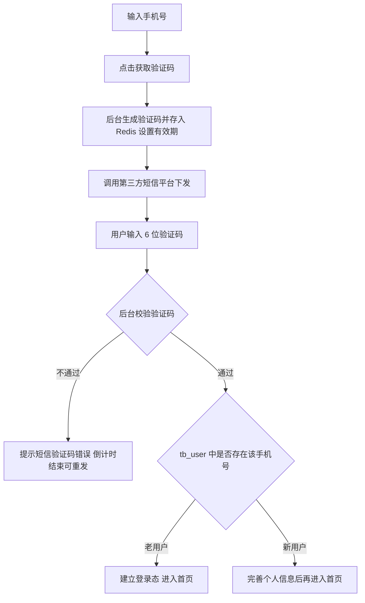

# 探花交友功能地图与验证码登录：从功能列表到 tb_user 的第一条链路

> 🔒 安全提示：文中示例的口令/密钥均为课程教学环境演示口径，生产环境的安全要求见《安全与合规须知》。

拿到一个陌生人社交项目的后台工程，最先要回答两个问题：产品到底有哪些功能，用户身份从哪里建立。功能列表决定后面十几天要建哪些模块，注册登录决定所有模块的共同前提「系统能识别这个用户是谁」。day01 的功能介绍部分正好用一张功能列表加一段注册登录的业务说明，把这两个问题交代清楚。

这条登录链路看着只有两三步，实际把第三方短信平台、Redis、人脸识别、MySQL 四类外部能力全部串了起来，后面的交友、圈子、消息全都建立在它之上。把注册登录吃透，等于把项目地基预演了一遍。

## 先给结论

- 功能全景六大块：注册登录、交友、圈子、消息、小视频、我的中心；交友域是核心功能，其余模块承接匹配之后的互动与沉淀。
- 注册登录是一件事而不是两件事：手机号即账号，验证码即凭证，没有独立注册页，首次登录成功后强制完善个人信息。
- 验证码链路五步走：输入手机号、后台生成验证码并调第三方短信平台下发、输入 6 位验证码、后台校验、按新老用户分流。
- 头像审核的产品口径是「必须是人像」，不要求「是本人」，卡口由人脸识别服务把守，非人像直接拒绝。
- 身份数据落在 MySQL 的 tb_user 表：mobile 字段建了普通索引支撑登录查询，password 存 32 位 MD5 摘要。

## 一、功能地图：六大功能域各管一段

功能列表把平台的业务切成六个域，每个域一句话说清职责：

| 功能域 | 一句话说明 |
|---|---|
| 注册登录 | 手机号验证码登录，首次登录完善个人信息，上传图片做人像校验 |
| 交友 | 今日佳人、推荐、探花、搜附近、桃花传音、测灵魂等核心玩法 |
| 圈子 | 类似朋友圈，发动态、查看好友动态 |
| 消息 | 通知类消息加即时通讯消息 |
| 小视频 | 类似抖音，拍视频、看视频、评论，列表由推荐算法计算后展现 |
| 我的中心 | 我的动态、关注数、粉丝数等个人数据 |

六个域之间的关系画出来是这样，所有功能都从登录这一步长出来：



图里能看出三个设计取向。**第一，交友域单独成域并且体量最大。** 今日佳人、探花、搜附近、桃花传音、测灵魂这些子功能全部服务「找到合适的人」这一个目标，是产品区别于普通社区 App 的核心竞争力，后面会用单独的篇幅展开。**第二，小视频没有独立入口，挂在「我的」中心下。** 它的列表不按时间排，而是推荐算法算出来的，与交友域共享推荐底座。**第三，消息是双轨的。** 一轨是平台产生的通知（点赞、评论、公告），另一轨是用户之间的私信，也就是即时通讯，两轨在同一个消息页呈现。

## 二、验证码登录：从手机号到登录态的完整链路

原型里的交互按顺序是这样的：手机号登录页提供 +86 前缀的手机号输入框和「获取验证码」按钮；点击后跳到 6 位验证码输入页，顶部提示已发送到哪个手机号；输错会给出「短信验证码错误」的提示，「重新获取」按钮带 50 秒倒计时，倒计时结束前不能重发。

交互背后是服务端的一段标准逻辑：用户填完手机号点击获取，后台生成验证码，调用第三方短信平台把验证码发到用户手机，同时把验证码暂存起来等待比对；用户提交验证码后，后台先校验验证码本身，再校验这个手机号在数据库中是否存在，存在就是老用户，直接进入主页，不存在就是新用户，先走完善个人信息的流程。



关键路径在 F 到 H 这两个判断：验证码校验解决「证明你是这个手机号的主人」，用户存在性判断解决「接下来给你什么页面」。day01 资料包没有 Java 源码，下面给一段按本课写法补全的简化示例，包名按规范使用 `com.study.tanhua`，依赖注入部分从略：

```java
package com.study.tanhua.sso.service;

// 验证码登录核心逻辑（示例，按本课写法补全，Redis 与短信平台为对接点）
public class LoginService {

    private static final String CODE_KEY = "tanhua:code:";

    // 发送验证码：生成 6 位随机码，Redis 暂存并设置有效期，再交给第三方短信平台下发
    public void sendCode(String mobile) {
        String code = String.valueOf((int) ((Math.random() * 9 + 1) * 100000));
        redisTemplate.opsForValue().set(CODE_KEY + mobile, code, 5, TimeUnit.MINUTES);
        smsClient.send(mobile, code);
    }

    // 校验验证码并区分新老用户：验证码一次性消费，新用户标记由服务端判定
    public LoginResult login(String mobile, String code) {
        String cached = redisTemplate.opsForValue().get(CODE_KEY + mobile);
        if (cached == null || !cached.equals(code)) {
            throw new BusinessException("短信验证码错误");
        }
        redisTemplate.delete(CODE_KEY + mobile);
        boolean newUser = userMapper.findByMobile(mobile) == null;
        return new LoginResult(newUser);
    }
}
```

两个实现细节值得展开。**验证码为什么放 Redis？** 它的生命周期只有几分钟，读写频繁且到期作废，关系库没有自动过期，用定时任务清理反而是负担，Redis 的 TTL 一次设置自动失效。**50 秒倒计时防的是什么？** 防的是用户（或脚本）反复触发短信下发，前端倒计时只是体验层的拦截，服务端还要对同一手机号做发送频率限制，两层一起才构成完整防刷。

## 三、首次登录：完善资料与人像卡口

新用户进入完善信息页后，界面要素是昵称设置、年龄生日、现居城市，外加一个「设置头像」按钮，页面标题是「提升我的魅力」。前几项是普通表单，头像这一项藏着本课最重要的产品约束：上传的图片要经过后台审核。

审核的实现是人脸识别服务。图片上传后，后台调用识别能力判断这张图里是不是人像：是，审核通过，流程继续；不是，前端弹出「审核失败」的提示，用户点「重新上传」换一张。产品口径要记准：要求是必须是人像，没有要求必须是本人的人像。宠物照、风景照、随手拍的物品照都不行，但只要是真实的人像就可以通过。

这个口径背后是产品对成本与信任的权衡。社交平台的信任基础是真实头像，所以「是人像」必须是硬门槛，由机器自动把守；而「是本人」需要人像比对甚至活体检测，能力和成本是另一个量级，对陌生人社交的前期增长并不划算。技术实现上，人脸识别在这里只回答一个二分类问题：图中是否存在人脸。

## 四、数据落点：tb_user 表与登录分流

新用户分流判断的依据就是 tb_user 表里有没有这个手机号。资料包里的 mytanhua.sql 给出了真实建表脚本：

```sql
CREATE TABLE `tb_user` (
  `id`       bigint(20)  NOT NULL AUTO_INCREMENT,
  `mobile`   varchar(11) DEFAULT NULL COMMENT '手机号',
  `password` varchar(32) DEFAULT NULL COMMENT '密码，需要加密',
  `created`  datetime    DEFAULT NULL,
  `updated`  datetime    DEFAULT NULL,
  PRIMARY KEY (`id`),
  KEY `mobile` (`mobile`) USING BTREE
) ENGINE=InnoDB DEFAULT CHARSET=utf8 COMMENT='用户表';
```

逐个字段看设计意图。mobile 是 varchar(11)，正好装下国内手机号，上面建了普通索引，登录时按手机号等值查询走 B+ 树，不扫全表；password 是 varchar(32)，对应 MD5 摘要的十六进制长度，资料包种子数据的密码值就是 123456 的 MD5 结果，验证码是主凭证，密码字段服务于已有账号的兼容场景；created 与 updated 做审计，方便排查账号异常。

新用户在登录流程里完成 tb_user 的首次插入，昵称、头像这些展示资料则写入 tb_user_info，两表按 user_id 一对一关联。认证层稳定少变、资料层频繁演化，登录这种高频接口只碰窄表 tb_user，不会拖累宽表，这套分离设计在阶段开篇已经画过蓝图，登录链路正是它的第一个使用者。

## 常见误区

- **把注册和登录做成两个接口。** 错例：先让用户填注册表单设置密码，再引导登录。正解：手机号验证码登录一步到位，服务端发现是新手机号就自动落库，「注册」只是登录的副产品。
- **验证码存数据库或 Session。** 错例：MySQL 存验证码再加定时任务清理。正解：Redis 写入时带 TTL，到期自动失效，校验通过立即删除，做到一次性消费。
- **人脸识别校验「是不是本人」。** 错例：拿证件照做人像比对。正解：本课口径只做人像二分类，非人像拒绝；本人核验是另一个量级的能力与成本，产品并未要求。
- **首次登录判断交给前端。** 错例：前端用本地存储记一个首登标记。正解：以服务端查 tb_user 是否存在该手机号为准，前端状态可被清空篡改，产品约束必须由服务端兜底。

## 面试可能被问到的问题

1. 面试官追问：「验证码登录的完整流程是怎样的？」
   答：用户输入手机号，服务端生成验证码写入 Redis 并设置有效期，同时调用第三方短信平台下发；用户提交 6 位验证码后，服务端取出比对，通过则删除验证码，再按手机号查用户表区分新老用户，新用户走完善信息流程，老用户直接建立登录态进入首页。
2. 面试官追问：「验证码为什么要放 Redis？防刷怎么做？」
   答：验证码生命周期短、读写频繁、需要自动过期，Redis 的 TTL 与这个场景完全匹配。防刷分两端：发送端对同一手机号限频，前端 50 秒倒计时只是体验层，服务端要做真正的频率限制和每日上限；校验端限制错误次数，连续失败要锁定一段时间。
3. 面试官追问：「新老用户怎么判断？为什么不能靠前端标记？」
   答：以服务端为准，验证码校验通过后按手机号查 tb_user，查到是老用户，查不到则插入新记录并返回需要完善资料的标记。前端本地状态可以被清空和篡改，首登强制完善资料这类业务规则必须由服务端判定才可靠。
4. 面试官追问：「头像人脸识别失败后系统怎么处理？」
   答：识别结果是非人像时返回审核失败，前端弹窗引导重新上传，资料不落库；识别为空或接口异常要按失败处理并允许重试。通过后图片上传对象存储，把返回的 URL 写进用户信息表的头像字段。
5. 面试官追问：「密码字段为什么定成 varchar 32？」
   答：password 用 MD5 摘要存储，MD5 输出 128 位二进制，转成十六进制正好 32 个字符。存摘要而不是明文，避免库被拖走后泄露原始密码；手机号验证码是主登录凭证，密码字段主要服务账号的兼容与扩展场景。

## 配套资料

- 原型：`materials/code/07/day01 探花交友-项目搭建以及登录完善个人信息/day01/资料/探花交友移动端原型V1.2/`，其中登录页.html 与首次登录信息完善.html 对应注册登录的完整交互。
- 数据库：`materials/code/07/day01 探花交友-项目搭建以及登录完善个人信息/day01/代码/mytanhua.sql`，tb_user 与 tb_user_info 的真实建表脚本和种子数据。
- 讲义：`materials/docs/07/` 不存在，本阶段无讲义文本，内容以画面线为准。
- 说明：day01 资料包无 Java 源码，登录示例为按本课写法补全；包名按规范改写为 `com.study.tanhua`；引用路径截至 day 目录层级。
