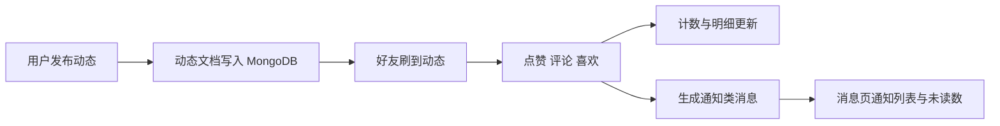
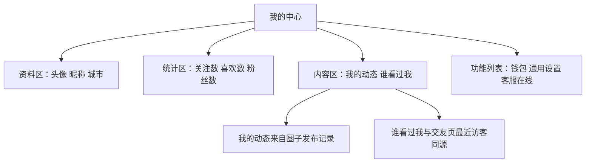

# 圈子、消息与我的中心：匹配成功之后，用户的互动、通知与个人数据放在哪

探花交友把人匹配上之后，用户留在哪里？答案是三个模块：圈子承接内容互动，消息承接通知与私信，我的中心承接个人数据。功能介绍的后半段把这三个模块的原型过了一遍，看点不在界面，而在每个界面背后「数据长什么样、谁来存、谁来推」这三个问题。

这三个模块还有一个共同的技术底色：它们的数据形态和账号资料不一样。动态有文字有图片还有位置，评论有嵌套有计数，IM 消息要长连接，这些都不是一张 MySQL 单表能优雅装下的，课程对应的存储选型在这篇里先立起来。

## 先给结论

- 圈子复刻朋友圈心智：发文字图片动态，动态卡片带昵称、婚姻状态、学历、年龄，下方是点赞、评论、喜欢三件套，点进详情能看到最新评论。
- 消息分两条线：通知类消息（点赞、评论、喜欢、公告）由平台自己产生并推送；即时通讯私信对接第三方 IM 云服务，本课技术架构选型是环信。
- 小视频类似抖音：拍、传、看、点赞，列表由推荐算法计算得出，入口挂在「我的」中心下。
- 我的中心四块内容：资料区（头像、昵称、城市），统计区（关注数、喜欢数、粉丝数），内容区（我的动态、谁看过我），功能列表（钱包、通用设置、客服在线）。
- 动态、评论这类半结构化数据走 MongoDB，账号资料仍留在 MySQL，存储分工在写第一行动态接口之前就要想清楚。

## 一、圈子：动态圈的发布与互动

圈子的心智模型就是朋友圈：用户发一段文字配若干图片，关注自己的人刷到这条动态。原型把动态卡片的信息要素列得很全：头像与昵称，婚姻状态、学历、年龄这些资料标签，正文与图片，发布时间与距离，浏览质量，以及点赞、评论、转发三个计数。点进一条动态的详情，下方是最新评论区，每条评论带头像、昵称、内容和时间。

互动产生数据，数据再回流成通知。别人给我的动态点赞或评论，消息页的通知列表就要出现对应条目，这就是通知类消息的主要来源。一条动态在后端的存储形态大致是一个 MongoDB 文档：

```json
{
  "id": "moment_10001",
  "userId": 3,
  "textContent": "今天天气不错",
  "medias": ["https://oss.example.com/img/a.jpg"],
  "location": "上海市",
  "longitude": 121.47,
  "latitude": 31.23,
  "likeCount": 12,
  "commentCount": 5,
  "loveCount": 3,
  "created": "2026-11-06T10:00:00Z"
}
```

这份结构是按本课写法补的示意，看它和 MySQL 表的差别：medias 是数组，位置是成对的坐标，计数字段会频繁自增，文档模型把这些异构字段装在一个文档里，读写都不用拼多表。点赞、评论、喜欢三个动作分别维护对应的计数与明细集合，通知则在动作发生的同时生成一条消息记录。



图里最容易被省略的是 F 这一步。互动不落通知，用户就不知道谁在关注自己，圈子的活跃度会迅速衰减；通知类消息本质上是把互动行为翻译成用户能感知的钩子。

## 二、消息：通知与 IM 的双轨设计

消息页原型给了四个功能按钮：点赞、评论、喜欢、公告，对应通知类消息的四个子类，加上下方的会话列表，整个模块分成两条线。

**通知线**由平台自己完成。它产生的时机很明确：圈子里的点赞评论喜欢、探花的配对结果、系统公告。实现上是一条「事件发生即写入」的路径，动作落库的同时生成通知记录，前端拉取时按类型分组展示，未读数靠统计未读记录得出。类型划分可以这样表达：

```java
package com.study.tanhua.message;

// 通知类消息的类型划分（示例，按本课写法补全）
public enum NoticeType {
    LIKE("点赞"), COMMENT("评论"), LOVE("喜欢"), ANNOUNCE("公告");

    private final String label;

    NoticeType(String label) {
        this.label = label;
    }

    public String getLabel() {
        return label;
    }
}
```

**IM 线**是用户之间的私信，体验对标 QQ 和微信。这条线课程不自研长连接，而是对接环信这样的第三方 IM 云服务：账号注册与登录托管、消息收发通道、离线消息、多端同步这些重活由云服务承担，自研要处理网关、心跳、消息可靠性、漫游历史一整套基础设施，成本远高于业务本身。服务端保留自己的职责边界：好友关系、好友添加、以及业务维度的消息扩展仍由探花后台管理，IM 通道只负责把消息可靠送达。day05 实现消息功能时会专门过环信的开发流程，这里先把选型理由立住。

两条线在消息页汇合，但数据的所有者不同：通知线的数据完全在自己的库里，IM 线的消息体在云服务侧，本地只留关系与必要的扩展信息。

## 三、小视频与我的中心

**小视频**的玩法对标抖音：拍一段视频上传，刷列表观看，可以点赞评论。它的特别之处在列表来源：不按时间排，而是通过推荐算法计算后展现，具体算法逻辑课程在后面讲到推荐实现时再展开。入口设计也值得注意，小视频挂在「我的」中心下，而不是底部导航的独立入口，原型里它更像个人内容的展示位。

**我的中心**是个人数据的一站式页面，原型里分四块：

- 资料区：头像、昵称、所在城市，点击可进入资料编辑；
- 统计区：相互关注数、喜欢数、粉丝数三个数字，是社交资产的一览；
- 内容区：我的动态、谁看过我，前者是我在圈子里的发布记录，后者与交友页的最近访客同源；
- 功能列表：钱包、通用设置、客服在线等产品功能入口。

统计区三个数字的实现思路值得提前想。关注与粉丝关系是典型的「我关注的人、关注我的人」两张倒排，数字若每次实时统计大表会越来越慢，主流做法是计数冗余：关系变化时在计数表或 Redis 里增减，展示时直接读计数。谁看过我则是访客流水，访客行为发生时写入一条记录，去重展示最近访客。



## 常见误区

- **把圈子动态当 MySQL 单表需求。** 错例：一张动态表塞文字、图片路径、位置、计数，字段越加越多。正解：动态与评论是典型的半结构化数据，用 MongoDB 文档承载，图片数组、坐标、计数天然一体。
- **把 IM 当自研长连接练习题。** 错例：自己起 Netty 网关维护所有私信。正解：课程选型接环信云服务，服务端只管好友关系与业务扩展；自研要解决心跳、断线重连、离线消息、多端同步，投入产出不划算。
- **通知只在前端展示不落库。** 错例：点赞后直接推一条弹窗了事。正解：通知是数据，要落库支撑类型分组、未读数与红点，用户离线期间发生的互动补拉时必须还在。
- **粉丝数每次实时 count。** 错例：页面每次对关系大表做统计。正解：计数冗余，关系变化时增减计数，展示读计数；大 V 用户的粉丝明细再用分页明细表支撑。

## 面试可能被问到的问题

1. 面试官追问：「动态为什么选 MongoDB 而不是 MySQL？」
   答：动态的字段异构且多变，文字、图片数组、位置坐标、各类计数混在一起，文档模型一次读全且天然支持数组与嵌套；动态量大、以读写为主、对多表事务要求低，MongoDB 的文档与分片能力更贴合。账号资料这类强关系数据仍留在 MySQL，两库分工。
2. 面试官追问：「通知类消息和 IM 消息在实现上有什么区别？」
   答：通知由平台业务事件触发，自己生成、自己存储、自己推送，按点赞评论喜欢公告分类展示，还要支撑未读数；IM 是用户对用户的私信，课程对接环信云服务，消息通道、离线与多端同步由云服务承担，本地只维护好友关系与业务扩展信息。
3. 面试官追问：「为什么 IM 用环信而不自研？」
   答：自研长连接要解决网关维护、心跳保活、断线重连、消息可靠投递、离线消息、多端同步与漫游历史，是一整套基础设施，研发和运维成本高；IM 云服务把这些标准化了，团队可以聚焦社交业务本身，服务端只需对接注册登录和好友关系。
4. 面试官追问：「关注数粉丝数怎么统计才不会越来越慢？」
   答：做计数冗余。关系发生增删时同步维护计数表或 Redis 里的计数，页面展示直接读计数，避免每次对关系大表做统计；粉丝列表走关系倒排的分页查询，冷热数据可以再按需缓存。
5. 面试官追问：「谁看过我这个功能怎么实现？」
   答：访客行为发生时写入一条访客记录，含访客与被访用户和时间，展示时按被访用户倒序分页取最近记录并按访客去重。写入口径要控制频率，同一访客短时间内的重复浏览合并计数，避免流水爆炸。

## 配套资料

- 原型：`materials/code/07/day01 探花交友-项目搭建以及登录完善个人信息/day01/资料/探花交友移动端原型V1.2/`，其中圈子.html、消息.html、小视频.html、我的.html 对应这篇的四个模块。
- 讲义：`materials/docs/07/` 不存在，本阶段无讲义文本，内容以画面线为准。
- 说明：day01 资料包无 Java 源码，动态文档结构、通知类型枚举与计数方案为按本课写法补全的示例；环信为课程技术架构的选型说明，实现细节在消息功能一课展开；站点用 example.com 占位。
