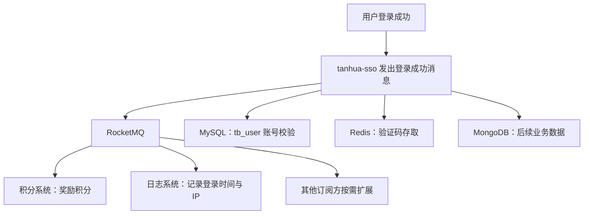

# 搭建探花交友的开发环境：Maven 父子工程骨架与四件套中间件

> 🔒 安全提示：文中示例的口令/密钥均为课程教学环境演示口径，生产环境的安全要求见《安全与合规须知》。

业务讲完，该动手了。day01 开发部分的第一个动作不是写接口，而是把工程骨架和中间件环境立起来：父工程管住版本，第一个子模块 tanhua-sso 承载登录服务，MySQL、MongoDB、Redis、RocketMQ 四件套就位并导入课程数据库。这套骨架决定后面十几天所有代码往哪里放、依赖怎么引，搭歪了后面天天返工。

这一篇按搭建顺序走：先看父工程怎么设计，再看 sso 模块引了什么、为什么引，然后落中间件与数据库，最后给一份开机即用的验证清单。课程画面里的 pom 配置是原始依据，包名与坐标按规范做了去品牌改写。

## 先给结论

- 工程是 Maven 父子结构：父工程继承 Spring Boot 2.1.0.RELEASE，用 properties 集中定义版本号，用 dependencyManagement 管理依赖清单，子模块按需引入且不写版本号。
- dependencies 与 dependencyManagement 是两回事：前者在父工程直接生效并传递给所有子模块（如测试与 junit），后者只锁版本不引入，子模块用到才生效。
- day01 只用到 tanhua-sso 一个模块：单点登录工程，对外提供 REST 接口；RocketMQ 依赖此刻就位，因为登录成功后积分、日志等其他系统要靠消息才知道这件事。
- 编译插件统一锁 JDK 1.8 和 UTF-8，多模块的编译行为不允许各自漂移。
- 中间件课程环境：MySQL 端口 3306 账号 root 密码 123456，MongoDB 27017，Redis 6379，RocketMQ NameServer 9876；数据库用资料包的 mytanhua.sql 导入。

## 一、父工程：版本集中管理的设计

整个项目用 Spring Boot 开发，父工程的第一件事是声明继承 `spring-boot-starter-parent`，这样所有子模块自动继承同一套 Spring Boot 依赖基线。把 packaging 定成 pom，它自己不打业务包，只做版本与插件的中枢：

```xml
<?xml version="1.0" encoding="UTF-8"?>
<project xmlns="http://maven.apache.org/POM/4.0.0"
     xmlns:xsi="http://www.w3.org/2001/XMLSchema-instance"
     xsi:schemaLocation="http://maven.apache.org/POM/4.0.0 http://maven.apache.org/xsd/maven-4.0.0.xsd">
    <modelVersion>4.0.0</modelVersion>
    <packaging>pom</packaging>
    <parent>
        <groupId>org.springframework.boot</groupId>
        <artifactId>spring-boot-starter-parent</artifactId>
        <version>2.1.0.RELEASE</version>
    </parent>
    <groupId>com.study.tanhua</groupId>
    <artifactId>my-tanhua</artifactId>
    <version>1.0-SNAPSHOT</version>

    <!-- 集中定义依赖版本 -->
    <properties>
        <mysql.version>5.1.47</mysql.version>
        <jackson.version>2.9.9</jackson.version>
        <druid.version>1.0.9</druid.version>
        <mybatis.mybatis-plus>3.1.1</mybatis.mybatis-plus>
        <mongodb-driver-sync.version>3.9.1</mongodb-driver-sync.version>
        <lombok.version>1.18.2</lombok.version>
        <commons-lang3.version>3.3.2</commons-lang3.version>
    </properties>
</project>
```

版本号全部进 properties 的好处是单一事实来源：哪天升级 MySQL 驱动，改一处，所有子模块跟着走。往下的依赖分两层写，这是整个设计里最容易混的地方：

```xml
<!-- 全局生效：所有子模块都拥有，不需要再声明 -->
<dependencies>
    <dependency>
        <groupId>org.springframework.boot</groupId>
        <artifactId>spring-boot-starter-test</artifactId>
    </dependency>
    <dependency>
        <groupId>junit</groupId>
        <artifactId>junit</artifactId>
        <version>4.12</version>
        <scope>test</scope>
    </dependency>
</dependencies>

<!-- 仅管理：只锁版本，子模块用到才真正引入，引入时不写版本号 -->
<dependencyManagement>
    <dependencies>
        <!-- mybatis-plus 插件依赖 -->
        <dependency>
            <groupId>com.baomidou</groupId>
            <artifactId>mybatis-plus</artifactId>
            <version>${mybatis.mybatis-plus}</version>
        </dependency>
        <!-- mysql 驱动 -->
        <dependency>
            <groupId>mysql</groupId>
            <artifactId>mysql-connector-java</artifactId>
            <version>${mysql.version}</version>
        </dependency>
        <!-- mongodb 驱动 -->
        <dependency>
            <groupId>org.mongodb</groupId>
            <artifactId>mongodb-driver-sync</artifactId>
            <version>${mongodb-driver-sync.version}</version>
        </dependency>
        <dependency>
            <groupId>org.projectlombok</groupId>
            <artifactId>lombok</artifactId>
            <version>${lombok.version}</version>
            <optional>true</optional>
        </dependency>
        <dependency>
            <groupId>org.apache.commons</groupId>
            <artifactId>commons-lang3</artifactId>
            <version>${commons-lang3.version}</version>
        </dependency>
        <!-- RocketMQ 相关 -->
        <dependency>
            <groupId>org.apache.rocketmq</groupId>
            <artifactId>rocketmq-spring-boot-starter</artifactId>
            <version>2.0.0</version>
        </dependency>
        <dependency>
            <groupId>org.apache.rocketmq</groupId>
            <artifactId>rocketmq-client</artifactId>
            <version>4.3.2</version>
        </dependency>
        <dependency>
            <groupId>com.fasterxml.jackson.core</groupId>
            <artifactId>jackson-databind</artifactId>
            <version>${jackson.version}</version>
        </dependency>
        <!-- commons-codec：Apache 加密解密工具，可用来生成 MD5 -->
        <dependency>
            <groupId>commons-codec</groupId>
            <artifactId>commons-codec</artifactId>
        </dependency>
    </dependencies>
</dependencyManagement>
```

被管理的清单对应项目的技术栈全景：MyBatis-Plus 与 MySQL 驱动管关系库，MongoDB 驱动管文档库，Lombok 简化实体代码，commons-lang3 是 Apache 工具包，RocketMQ 的 starter 与客户端管消息，jackson 管序列化，commons-codec 提供加密解密与 MD5 工具。子模块需要哪个就声明哪个坐标，版本一律省略。编译插件收尾：

```xml
<build>
    <plugins>
        <plugin>
            <groupId>org.apache.maven.plugins</groupId>
            <artifactId>maven-compiler-plugin</artifactId>
            <version>3.2</version>
            <configuration>
                <source>1.8</source>
                <target>1.8</target>
                <encoding>UTF-8</encoding>
            </configuration>
        </plugin>
    </plugins>
</build>
```

写完父 pom 记得让构建工具自动导入依赖变更，导入完成后在依赖列表里确认版本都解析到了，再继续建模块。

## 二、tanhua-sso 模块：登录服务的骨架

第一个子模块是 sso（单点登录系统），职责有两个：为整个系统提供用户登录能力，为前端提供接口服务。建 module 后它的 parent 自动指向刚建好的父工程：

```xml
<parent>
    <artifactId>my-tanhua</artifactId>
    <groupId>com.study.tanhua</groupId>
    <version>1.0-SNAPSHOT</version>
</parent>
<artifactId>my-tanhua-sso</artifactId>
```

sso 的依赖清单按用途过一遍：`spring-boot-starter-web` 提供对外的 REST 接口能力；test 父工程已经给过，不必重复声明；MyBatis-Plus 及其与 Spring Boot 的整合包、MySQL 驱动、Druid 连接池支撑关系库访问；Lombok 与 commons-lang3 是基础工具；jackson 处理 JSON；`spring-boot-starter-data-redis` 让验证码读写走 Redis；commons-codec 给密码摘要用；RocketMQ 的两个包用于消息。全部不写版本号，版本由父工程的 dependencyManagement 决定。

单点登录工程为什么需要 RocketMQ？这是本节最值得想通的问题。登录这件事本身用不到消息，但登录成功之后，系统里其他参与者有事要做：记录登录时间、记录登录 IP、给用户发奖励积分。这些事不该挤在登录接口里同步做，正确形态是登录成功后发一条消息出去，谁关心谁消费：



消息一出，登录接口的职责就干净了：验证码校验、用户判定、发消息，然后立刻返回。积分和日志的快慢、故障，都不阻塞用户进入首页，这是用消息换取解耦与削峰的标准场景。

## 三、中间件环境与数据库导入

工程之外，四个中间件按课程环境的默认端口装好并启动：

| 中间件 | 默认端口 | 在项目里的职责 |
|---|---|---|
| MySQL | 3306 | 账号与资料等结构化数据，导入 mytanhua.sql |
| MongoDB | 27017 | 动态、评论等半结构化数据 |
| Redis | 6379 | 验证码暂存与热数据 |
| RocketMQ | 9876（NameServer） | 登录成功等业务消息 |

RocketMQ 注意它是两个进程：NameServer 做路由注册中心，Broker 做真正的存储与收发，Broker 启动时要注册到 NameServer，应用侧配置的是 NameServer 地址。数据库导入用资料包的建库脚本，密码按课程环境如实使用 root 加 123456：

```bash
mysql -uroot -p123456 -e "CREATE DATABASE IF NOT EXISTS mytanhua DEFAULT CHARSET utf8;"
mysql -uroot -p123456 mytanhua < mytanhua.sql
mysql -uroot -p123456 -e "SHOW TABLES FROM mytanhua;"
redis-cli ping
```

脚本执行完应能看到 tb_user 与 tb_user_info 两张表。sso 模块的应用配置把这套环境串起来，下面是按课程环境补全的示例：

```yaml
server:
  port: 18080

spring:
  datasource:
    driver-class-name: com.mysql.jdbc.Driver
    url: jdbc:mysql://127.0.0.1:3306/mytanhua?useUnicode=true&characterEncoding=utf8
    username: root
    password: 123456
  redis:
    host: 127.0.0.1
    port: 6379
  data:
    mongodb:
      uri: mongodb://127.0.0.1:27017/tanhua

rocketmq:
  name-server: 127.0.0.1:9876
```

MySQL 驱动是 5.1.47，驱动类用 `com.mysql.jdbc.Driver`；URL 上显式带 utf8 编码，避免中文资料入库变问号。MongoDB 此刻还没有专用库名的约定，示例里用 tanhua 库，后面按课程实际使用调整。

## 四、环境验证清单

搭建完成不等于环境可用，按这份清单逐项过：

- `mvn` 对父工程执行构建成功，子模块依赖全部解析，无红色版本号；
- MySQL 里 `SHOW TABLES FROM mytanhua;` 能列出 tb_user、tb_user_info，抽查种子数据中文无乱码；
- Redis `ping` 返回 `PONG`；
- MongoDB 本地 shell 能连上 27017 并建库读写一条测试文档；
- RocketMQ 的 NameServer 与 Broker 都在运行，Producer 能正常建立连接；
- sso 模块带着 yml 启动一次，日志无数据源与 Redis 连接报错。

day01 只用到 sso 工程，把它启动通过，环境就算闭环。后面每天的模块都会以同样的方式挂到这个父工程下，骨架稳了，每天的增量就只剩业务本身。

## 常见误区

- **子模块自己写版本号。** 错例：每个 module 引依赖时各带一个版本。正解：版本只活在父工程的 properties 与 dependencyManagement 里，子模块只写坐标，升级改一处生效全局。
- **dependencies 与 dependencyManagement 用反。** 错例：把所有依赖都塞进 dependencies，子模块被动获得一堆用不到的包。正解：全局都要的进 dependencies，按需取用的进 dependencyManagement，后者不引入只锁版本。
- **RocketMQ 只装了 NameServer 或忘了配 name-server。** 错例：只起路由中心就发消息，或应用里漏配地址。正解：NameServer 与 Broker 两个进程都要在，Broker 注册成功，应用配置指向 NameServer。
- **导库不带字符集。** 错例：直接建库导入，中文昵称变问号。正解：建库时指定 utf8，连接串同样带编码，两边一致才不会乱码。

## 面试可能被问到的问题

1. 面试官追问：「Maven 的 dependencyManagement 和 dependencies 有什么区别？」
   答：dependencies 声明即引入，父工程里写的会传递给所有子模块；dependencyManagement 只是版本仲裁表，不引入任何依赖，子模块声明了对应坐标才真正生效，且不必再写版本号。项目里全局都要的放前者，按需取用的放后者，配合 properties 统一管理版本。
2. 面试官追问：「为什么父工程要继承 spring-boot-starter-parent？」
   答：继承后获得官方调好的依赖版本基线与插件配置，所有子模块统一跟着走，避免自己逐个管理 Spring 生态的版本兼容；项目专属的第三方版本再用 properties 覆盖，比如 MySQL 驱动与 MyBatis-Plus。
3. 面试官追问：「单点登录系统里为什么要引 RocketMQ？」
   答：登录成功后其他系统有后续动作，比如记录登录时间和 IP、发放奖励积分。把这些动作改成订阅登录成功消息，登录接口只负责校验和发消息，下游的消费快慢与故障都不阻塞登录响应，用消息换取解耦和可扩展性。
4. 面试官追问：「多模块项目如何保证编译环境一致？」
   答：在父工程的 maven-compiler-plugin 里统一配置 source 与 target，项目锁 JDK 1.8 并强制 UTF-8 编码，子模块继承这套配置。本地装多个 JDK 时还要检查构建工具实际指向的 JDK，避免声明 1.8 实际用高版本编译。
5. 面试官追问：「环境搭建完，你怎么验证它真的可用？」
   答：分层验证。构建层看依赖是否全部解析；数据层连上 MySQL 看表和种子数据、连 Redis 发 ping、连 MongoDB 读写测试文档；消息层确认 NameServer 与 Broker 运行且能建连；最后把 sso 模块带配置启动一次，日志里没有连接类异常才算闭环。

## 配套资料

- 数据库：`materials/code/07/day01 探花交友-项目搭建以及登录完善个人信息/day01/代码/mytanhua.sql`，tb_user 与 tb_user_info 的真实建表脚本和种子数据，导入即可复现课程环境。
- 学习目标：`materials/code/07/day01 探花交友-项目搭建以及登录完善个人信息/day01/学习目标.md`。
- 讲义：`materials/docs/07/` 不存在，本阶段无讲义文本。
- 说明：day01 资料包无工程源码，pom 按课程画面逐项整理并把坐标改写为 `com.study.tanhua`，中间件安装要点、yml 与验证命令为按课程环境补全的示例。
