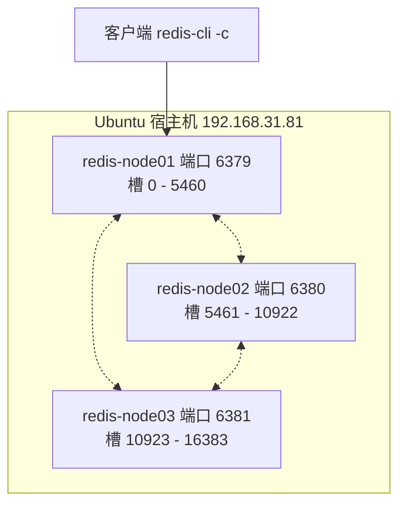
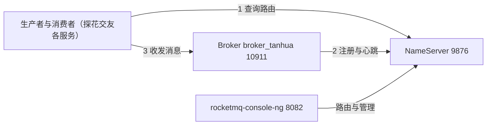
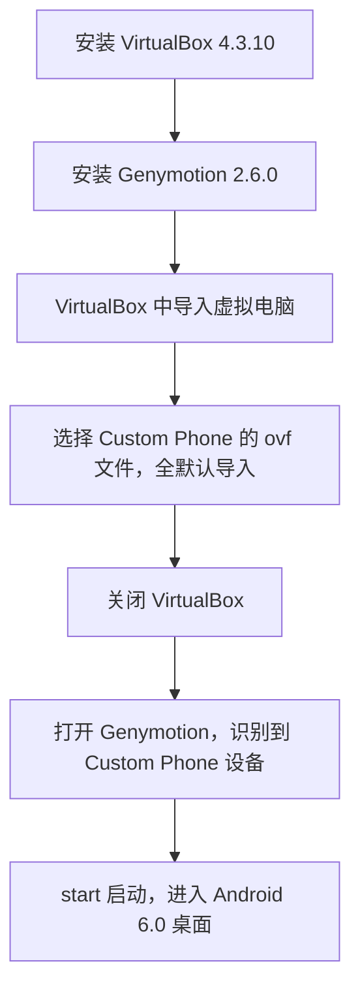
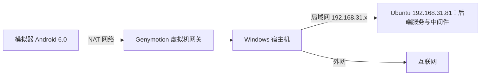

# 功能开发之部署基础服务(Redis 集群、RocketMQ 与 Android 模拟器)

## 先给结论

- 系列定位：探花交友功能开发前的环境三连，把 Redis 从单机升级成集群、补齐 RocketMQ，再配一台测试用的 Android 模拟器。
- Redis 集群：Docker 三节点 host 网络跑 `redis:5.0.2`，`redis-cli --cluster create` 加 `--cluster-replicas 0` 组建三主无从集群，`cluster nodes` 与 MOVED 重定向验证闭环。
- RocketMQ：NameServer 与 Broker 两个进程分工明确，broker.conf 的 `brokerIP1` 必须写宿主机真实 IP，控制台经 8082 映射端口访问。
- 模拟器：VirtualBox 做底座、Genymotion 管设备，导入课程 ovf 镜像即得 Android 6.0 定制机；装 APK 拖拽即装，联网连一次 WiredSSID 走 NAT。
- 一条贯穿三篇的地址纪律：集群广播地址、Broker 注册地址、App 的后端地址都必须是真实可达地址，容器内网 IP 与 127.0.0.1 都会在联调时爆雷。
- 三个服务的验证各有闭环：Redis 看 cluster_state 与跨节点读写，RocketMQ 看控制台集群页与收发测试，模拟器看 App 能否连上宿主机后端。
- 全系列 Docker 命令按课程画面逐条整理，资料包未含部署脚本，配置文件路径与镜像名按规范做了中性改写。
- 环境就位的标志：Redis 集群、RocketMQ 收发、模拟器联网三件事全部验证通过，功能开发才开工。

## 第1部分：把单机 Redis 升级成集群：Docker 三节点的搭建与验证

工程骨架立起来的时候，Redis 还是单机 6379 的形态，应付功能自测没有问题。但探花交友的验证码读写、后续各种热数据都会压到 Redis 上，开发正式开始前按课程规划把它升级成 3 节点的 Redis Cluster。部署全程用 Docker 完成，中间件统一放在一台 Ubuntu 主机上，地址 192.168.31.81。这一篇按部署顺序把每条命令拆开讲清，包括最后那个不认识的 MOVED 报错，它其实是集群在正常工作。

### 一、为什么是三节点，为什么用 host 网络
Redis Cluster 把数据空间切成 16384 个槽（slot），每个 key 经 CRC16 计算归属某个槽，槽再分配给各主节点。官方要求集群至少 3 个主节点，课程取最小规模搭 3 个；`--cluster-replicas 0` 表示副本数为 0，三个节点全是 master，没有从节点。生产环境一般三主三从，任何一个主节点挂掉都有从节点顶上，教学环境先掌握组建流程。

网络模式选 host 而不是默认 bridge，是阶段三用 Docker 搭 Redis 集群时已经验证过的结论：bridge 模式下每个容器拿一个内网 IP，节点向集群广播的也是这个内网地址，外部客户端拿不到、连不上；host 模式下容器没有独立网络命名空间，与宿主机共享 IP 和端口，等于把三个 Redis 直接装在 Ubuntu 主机上。代价是放弃了网络隔离，本机教学环境可以接受。

Docker 客户端版本课程环境是 18.09.2，保持一致或更高即可；Ubuntu 系统与 Docker 本身的安装前面阶段都练过，不再重复。

### 二、创建并启动三个节点
三个节点的创建命令只有名字、数据卷、配置文件、端口四处的差别，一条条过：

```bash
# 创建 Redis 集群，该集群有 3 个节点
docker create --name redis-node01 --net host -v redis-node01:/data redis:5.0.2 --cluster-enabled yes --cluster-config-file nodes-node-01.conf --port 6379
docker create --name redis-node02 --net host -v redis-node02:/data redis:5.0.2 --cluster-enabled yes --cluster-config-file nodes-node-02.conf --port 6380
docker create --name redis-node03 --net host -v redis-node03:/data redis:5.0.2 --cluster-enabled yes --cluster-config-file nodes-node-03.conf --port 6381

# 启动容器
docker start redis-node01 redis-node02 redis-node03
```

`-v redis-node01:/data` 给每个节点一份独立数据卷，节点数据与集群配置文件都落在里面，容器删除数据不丢。镜像名后面跟的一串是传给 redis-server 的启动参数：`--cluster-enabled yes` 开启集群模式，`--cluster-config-file` 指定该节点自己的集群配置文件，节点 ID、槽位分布、其他节点的地址都会写进这个文件，三个节点必须各用各的。`--port` 因为没有端口映射，直接指定节点监听宿主机的哪个端口。

启动完 `docker ps` 能看到三个节点在跑，此时它们只是三个「开启了集群模式的独立 Redis」，彼此还不认识，集群还没组建。

### 三、组建集群：meet 与槽位分配
进入任意一个节点容器，执行集群创建命令：

```bash
# 进入 redis-node01 容器
docker exec -it redis-node01 /bin/bash

# 创建集群：3 个节点，无副本
redis-cli --cluster create 192.168.31.81:6379 192.168.31.81:6380 192.168.31.81:6381 --cluster-replicas 0
```

命令先打印分配方案并要求确认，输入 yes 之后，redis-cli 会驱动三个节点互相 meet 握手，然后执行槽位分配：

```bash
>>> Performing hash slots allocation on 3 nodes...
Master[0] -> Slots 0 - 5460
Master[1] -> Slots 5461 - 10922
Master[2] -> Slots 10923 - 16383
>>> Sending CLUSTER MEET messages to join the cluster
[OK] All 16384 slots covered.
```

这张图把组建完成后的拓扑与槽位画了出来。



关键在最后一句 `[OK] All 16384 slots covered.`：任何一个 key 都能落到某个槽上，没有槽悬空，集群才算可用。meet 在先、分槽在后，节点间的互连（图中虚线）由 Gossip 协议维持，任何一个节点都知道全部槽位的归属。

### 四、验证：cluster nodes 与 MOVED 重定向
进入单节点客户端看集群视图：

```bash
127.0.0.1:6379> cluster nodes
# 每行一个节点：节点 ID + 地址 + 角色为 master + 自己负责的槽区间
# 三个节点全部在线，槽区间首尾相接覆盖 0 到 16383
```

更直观的是写一条数据。不带 `-c` 的普通客户端里执行：

```bash
127.0.0.1:6379> set abc 123
(error) MOVED 7638 192.168.31.81:6380
```

`abc` 经 CRC16 计算落在 7638 号槽，这个槽归 6380 节点管，6379 明确拒绝并告知去向。这不是故障，是集群的寻址语义。让客户端自动跟随重定向，加 `-c` 参数重新进入：

```bash
redis-cli -c
127.0.0.1:6379> set abc 123
-> Redirected to slot [7638] located at 192.168.31.81:6380
OK
127.0.0.1:6380> get abc
"123"
```

写请求被重定向到 6380 并成功落盘，接着 get 也能读到，集群读写链路闭环。探花交友后续所有 Redis 操作走的是支持集群协议的客户端（Lettuce 等），应用代码不需要自己处理 MOVED，但开发期用 redis-cli 手工查数据时，`-c` 必须带上。

## 第2部分：用 Docker 部署 RocketMQ：NameServer、Broker 与管理控制台

Redis 集群就位后，四件套还差最后一个 RocketMQ。工程骨架那篇已经把 rocketmq-spring-boot-starter 和 rocketmq-client 引进了依赖清单，登录成功事件就等着它广播出去。这一篇把服务端两个进程加一个管理控制台全部 Docker 化，部署在同一台 Ubuntu 主机 192.168.31.81 上。版本选 4.3.2，与父工程锁定的 rocketmq-client 版本严格一致，客户端和服务端版本错位是消息中间件最常见的隐性坑。

### 一、两个进程的角色分工
RocketMQ 由两类服务进程组成。NameServer 是无状态的路由注册中心，Broker 启动后向它注册并持续保活心跳；生产者发送消息前先从 NameServer 查路由表，搞清楚目标 topic 的队列在哪个 Broker 上，消费者同样从 NameServer 发现消费位置。阶段一的 RocketMQ 快速入门已经把这套角色关系讲过，当时是本地解压直接启动，这一次换成 Docker 落地，角色与流程完全不变。



这张图的要点在箭头方向：应用侧永远只配置 NameServer 地址，Broker 的真实地址是运行期从 NameServer 查出来的。所以 Broker 自己「广播哪个 IP」就成了部署时最关键的一个配置项，后面会看到它对应 `brokerIP1`。

### 二、创建 NameServer 容器
拉取镜像后先创建 NameServer，容器名 rmqserver：

```bash
# 拉取镜像
docker pull foxiswho/rocketmq:server-4.3.2
docker pull foxiswho/rocketmq:broker-4.3.2

# 创建 nameserver 容器
docker create -p 9876:9876 --name rmqserver \
  -e "JAVA_OPT_EXT=-server -Xms128m -Xmx128m -Xmn128m" \
  -e "JAVA_OPTS=-Duser.home=/opt" \
  -v rmqserver-logs:/opt/logs \
  -v rmqserver-store:/opt/store \
  foxiswho/rocketmq:server-4.3.2
```

两个环境变量值得看一眼：`JAVA_OPT_EXT` 把堆内存压到 128m，RocketMQ 默认启动参数按 8g 内存配，教学机直接起会报内存不足；`JAVA_OPTS=-Duser.home=/opt` 是镜像内约定的用户目录。两个数据卷分别挂日志与存储目录，容器重建时记录不丢。NameServer 本身无状态，配置最简单，难点全在 Broker。

### 三、Broker：先写 broker.conf，再建容器
Broker 与 NameServer 不同，需要一份自己的配置文件。在宿主机建 `/opt/rmq/rmqbroker/conf/broker.conf`，画面中的路径前缀按规范做了改写，放在哪个目录都可以，关键是与下一步的挂载参数严格对应：

```bash
brokerIP1=192.168.31.81
namesrvAddr=192.168.31.81:9876
brokerName=broker_tanhua
```

三项各管一件事。`brokerIP1` 是 Broker 对外广播的 IP，客户端从 NameServer 查到的就是这个地址，写成容器内网 IP 或 127.0.0.1 都会让客户端连上一个不存在的目的地；`namesrvAddr` 告诉 Broker 去哪里注册；`brokerName` 起一个在控制台里能一眼认出的名字。

```bash
# 创建 broker 容器
docker create -p 10911:10911 -p 10909:10909 --name rmqbroker \
  -e "JAVA_OPTS=-Duser.home=/opt" \
  -e "JAVA_OPT_EXT=-server -Xms128m -Xmx128m -Xmn128m" \
  -v /opt/rmq/rmqbroker/conf/broker.conf:/etc/rocketmq/broker.conf \
  -v rmqbroker-logs:/opt/logs \
  -v rmqbroker-store:/opt/store \
  foxiswho/rocketmq:broker-4.3.2

# 启动两个服务
docker start rmqserver rmqbroker
```

10911 是 Broker 的主监听端口，消息收发走它；10909 是 VIP 通道端口，客户端开启 VIP 通道时用主端口减 2 的这个端口，追求吞吐时走这条快车道。配置文件通过 `-v` 覆盖容器内的 `/etc/rocketmq/broker.conf`，Broker 启动时按它注册。日常运维的 stop 与 rm 命令照常可用，重建容器时记得 broker.conf 还在宿主机上。

### 四、启动控制台并验证
服务跑起来只是第一步，发没发成功、消费没消费掉，需要管理工具来观测。控制台是第三个容器：

```bash
# 拉取 RocketMQ 管理工具
docker pull styletang/rocketmq-console-ng:1.0.0

# 启动管理工具
docker run -e "JAVA_OPTS=-Drocketmq.namesrv.addr=192.168.31.81:9876 -Dcom.rocketmq.sendMessageWithIPChannel=false" \
  -p 8082:8080 -t styletang/rocketmq-console-ng:1.0.0
```

环境变量 `rocketmq.namesrv.addr` 指定控制台要连的 NameServer；宿主机侧用 8082 映射容器内的 8080，容器里服务固定跑 8080，对外访问走映射出来的端口。浏览器打开 `http://192.168.31.81:8082`，切换中文后进入集群页面，能看到 broker_tanhua 已注册、读写队列数正常，说明 NameServer 与 Broker 的链路通了。

再向前一步验证收发。把 sso 模块带着 `rocketmq.name-server` 配置启动一次，日志里不出现 `No route info of this topic` 或连接超时，说明客户端到 NameServer 的路由发现正常。想看得更直观，可以按本课写法补一个示例测试类，同步发一条消息：

```java
@RunWith(SpringRunner.class)
@SpringBootTest
public class RocketMqSendTest {

    @Autowired
    private RocketMQTemplate rocketMQTemplate;

    @Test
    public void testSend() {
        // 同步发送一条测试消息，控制台的消息页面按 topic 可查
        rocketMQTemplate.syncSend("tanhua-test-topic", "hello rocketmq");
    }
}
```

执行后回到控制台的消息页面按 topic 检索，能查到这条记录，部署就算真正闭环。登录成功事件的发送与消费，会在实现登录接口时接上来。

## 第3部分：给探花交友配一台测试手机：VirtualBox 与 Genymotion 模拟器从安装到联网

中间件侧已经齐了：MySQL、MongoDB、Redis 集群、RocketMQ 都在 Ubuntu 主机上跑着。服务端环境闭环之前还缺一个终端，探花交友是移动 App 项目，页面由前端团队交付 APK 安装包，后端要验证接口就得有一台能装 APK 的安卓设备。真机不是不行，但开发期要反复装包、清数据、看表现，模拟器快照随时回滚，效率高得多。课程选定 VirtualBox 加 Genymotion 的组合，并提供了一个配置好的设备镜像，这一篇把安装、导入、装 APK、联网、连后端地址一次讲全，末尾补上使用中两个高频小坑：悬浮控件怎么收、外网怎么连。

### 一、为什么后端开发需要一台「手机」
探花交友的前后端分工在项目介绍时就定了：移动端由前端团队开发，双方按 API 契约对接，前端最终交付的是 APK 安装包。后端拿不到（也不需要拿到）前端源码，但接口做出来总要有人从 App 视角验证一遍：请求格式对不对、响应字段够不够用、报错时 App 表现如何。把 APK 装起来对着调，是最接近真实交付形态的验证方式。

真机模式的问题在开发节奏上。每次改完接口都要重新打包给前端，或者把开发机上的服务暴露给手机；手机系统版本五花八门，数据线驱动、USB 调试开关、弹窗授权样样都是干扰项。模拟器把这些摩擦全部消掉：设备固定、随时重置、装包就是一次拖拽。课程在 day01 就把模拟器立起来，后面十几天的接口演示全部基于它。

课程资料里给了一套安装文件和一个现成设备镜像，目录结构如下：

```text
AndroidPhone/
├── Custom Phone - 6.0.0 - API 23 - 768x1280.ovf   # 配好的安卓设备镜像
├── VirtualBox-4.3.10-93012-Win.exe                # 虚拟机底座软件
├── genymotion-2.6.0.exe                           # 模拟器管理软件
├── 安装说明.txt
# 另附两个 APK：功能精简的探花 test 版，与含登录注册完整功能的正式版
```

两个 APK 的用法有先后之分。test 版功能简单，先拿它验证「装包、打开、页面渲染」这条链路通不通；正式版包含登录注册等完整功能，等对应接口开发完成后再换它做真正的联调。资料目录里还有测试图片、测试视频等素材，完善资料和发动态功能会用到，装环境阶段可以先不管。

模拟器对开发节奏的价值不止在省一根数据线。真机调试时设备状态不可控，昨天装的旧版 App、残留的本地缓存、别人动过的系统设置，都可能让两次联调结果不一致；模拟器的设备状态完全由你掌握，装包即新装，出问题直接重置到干净状态再复现，问题定位少了很多噪音。对探花交友这种要天天对着 App 调接口的项目，这些摩擦省下来的时间会累积成可观的开发效率。

### 二、VirtualBox 与 Genymotion 各管什么
Genymotion 不是传统意义上 SDK 自带的那种模拟器，它构建在 VirtualBox 之上：VirtualBox 负责把一台虚拟机完整跑起来，虚拟机里装的是针对 x86 优化过的 Android 系统；Genymotion 在这层之上做管理，提供设备列表、一键启动、桌面窗口化、传感器模拟这些上层能力。理解了这层关系就明白为什么两个软件都要装，也明白为什么启动模拟器时偶尔会看到 VirtualBox 的窗口在后台闪过。



这张图是安装到启动的完整流程。版本号照课程走：VirtualBox 4.3.10、Genymotion 2.6.0、设备镜像基于 Android 6.0（API 23）。版本不是随手挑的，ovf 镜像对 VirtualBox 版本敏感，用课程配套的版本组合可以避开导入报错这类无谓的坑。

### 三、安装与导入：四步走
安装说明文件里写了两行命令级的内容：先装 `VirtualBox-4.3.10-93012-Win.exe`，再装 `genymotion-2.6.0.exe`。两个都是常规安装包，一路下一步即可，VirtualBox 装完不需要打开它。

真正需要动手的是导入设备。打开 VirtualBox，在菜单里选 管理 → 导入虚拟电脑，把资料目录的路径粘贴到文件选择框里回车，列表会直接定位到目标文件夹，选中 `Custom Phone - 6.0.0 - API 23 - 768x1280.ovf`，下一步后所有参数保持默认，点导入。ovf 里已经写好了这台设备的硬件描述，磁盘、内存、显示配置随文件一起带入，导入对话框里看到的那些参数不需要逐项理解，保持默认即可。导入要花一点时间，完成后左侧列表出现这台虚拟电脑。

到这里 VirtualBox 的使命就结束了，把它关掉。打开 Genymotion，首次启动会加载插件，稍等片刻后设备列表里出现 `Custom Phone - 6.0.0 - API 23 - 768x1280`，证明 Genymotion 已经接手了 VirtualBox 里的这台设备。整个安装链条里最容易出错的就是导入这一步，报错几乎都指向版本不匹配，回到课程给的版本组合即可。

### 四、启动与基本操作
选中设备点 start，等待启动完成，出现的就是一块标准的 Android 6.0 屏幕，中间相当于手机主屏幕，操作逻辑和真机一致。

窗口右侧竖排一列工具按钮，对应手机上的物理按键：返回键、主页键、最近任务、电源键，还有屏幕旋转。调返回逻辑、息屏唤醒、横竖屏适配时这些按钮就是真机按键的替身，比如验证页面在横屏下的布局，点一下旋转按钮就能切过去，不需要真的把电脑倒过来。顶部工具栏是虚拟资源设置入口，可以配置 GPS 定位、摄像头、电量等传感器：GPS 可以手动指定经纬度，后面做搜附近这类 LBS 功能时，位置数据就是从这里注入的；摄像头可以把宿主机的摄像头映射给模拟器，人脸识别相关功能会用到；电量、网络信号也能模拟，用来观察 App 在极端状态下的表现。

使用补充第一点在这里：模拟器启动后，屏幕上有时悬浮着一块操作控件，恰好挡住应用界面，拖动也不方便。处理办法是在窗口空白处点一下，把它收起，右侧工具栏的返回、主页、任务键已经覆盖日常操作，这块悬浮件用不用随个人习惯。

### 五、装 APK：拖拽即装
Genymotion 装 APK 的方式简单到不像是在装软件：从资源管理器把 apk 文件拖进模拟器窗口，松手后模拟器底部出现文件传输提示，传输完成自动安装并打开应用，全程不需要任何命令。

课程提供了两个 APK，先用探花 test 版走一遍流程。拖入模拟器，等待安装完成，应用自动打开，出现探花交友的登录注册入口页。输入一个 11 位手机号，点「获取验证码」，此时拿不到验证码，属于预期现象：test 版只是 UI 测试壳，还没有可连的后端，验证码接口要在后面实现登录时才接通。这一步的目的只是确认「模拟器能装包、能打开应用、页面能正常渲染」，前端运行环境就算部署起来了。

拖拽之外的等价方式是 adb 命令，装包脚本化、批量回归时比拖拽稳定，按主流写法补一份示例：

```bash
adb devices                      # 确认模拟器在线，列表应显示设备
adb install -r tanhua-test.apk   # -r 表示存在同名应用时覆盖安装
```

Genymotion 的设备同样被 adb 识别，两个入口殊途同归：拖拽本质上调用的也是系统的包安装器，adb 只是把它命令化了。

### 六、联网：WiredSSID 与 NAT 原理
使用补充第二点，也是新导入设备必踩的坑：默认不能联外网。现象是打开模拟器自带的浏览器，输入任何网址都长时间无响应，而宿主机上网一切正常。

处理路径在系统设置里：返回桌面打开 设置，进入 WLAN，列表里有一条 WiredSSID，它的默认状态是未保存，点它连接一次，状态栏出现联网图标，外网就通了。验证方式很直接：浏览器输入百度，能打开首页，再随便点进一个新闻页面也能加载，说明不只是 DNS 解析通了，整条 HTTP 链路都是通的。

为什么会这样设计？Genymotion 的虚拟机网络是 NAT 模式：虚拟机不直接出现在局域网里，而是通过一个 NAT 网关借用 Windows 宿主机的网络栈。宿主机能上外网，虚拟机经网关转发就也能上外网；WiredSSID 那一步的本质，是让安卓系统的网络状态机确认这条链路可用并标记为已连接。



这张图把两条出向链路画在一起：往右经宿主机出外网，对应 WiredSSID 那一步；往左下到 192.168.31.81 的后端服务与中间件，这是后续联调真正要走的路。两条路共用「借宿主机网络」这一层原理，所以外网通通常意味着连后端也通，反之连不上后端时先查这一层。

### 七、连后端：模拟器与真机的地址差异
App 请求的后端地址是 APK 内携带的配置（可能是编译期常量，也可能是启动时拉取），这条地址怎么写，模拟器和真机的答案不一样，这是移动端联调里最经典的误区。

模拟器是独立虚拟机，它眼里的 127.0.0.1 指模拟器自己，不是开发机。APK 里配 127.0.0.1 或 localhost，请求会打到模拟器本机，必然连接失败。正确写法是宿主机的局域网 IP，课程环境即 192.168.31.81，配合 sso 模块监听的 18080 端口组成完整地址。按本课写法补一份示例：

```java
// App 侧服务地址常量（按本课写法补全的示例）
public final class ServerConfig {
    // 模拟器与真机统一写宿主机局域网 IP，不要写 localhost
    public static final String BASE_URL = "http://192.168.31.81:18080/";
}
```

真机场景下规则有两点变化。其一，手机必须与开发机处于同一局域网（连同一个 WiFi），地址仍写开发机的局域网 IP；其二，如果走 USB 数据线调试，可以用 adb 的反向代理，把真机上的某个端口转发回开发机：

```bash
adb reverse tcp:18080 tcp:18080
# 真机内访问 127.0.0.1:18080 会被转发回开发机的 18080
```

模拟器因为 NAT 网关的存在，直接访问宿主机 IP 就能到达后端服务，不需要 reverse。另外两个实操细节：Windows 防火墙可能拦截局域网入站，后端服务端口要在防火墙放行；Ubuntu 主机上的服务对局域网开放，宿主机与它之间同样要保证网络可达，课程环境里两者同在一个网段，默认即可互通。

模拟器、宿主机、Ubuntu 主机三方互通确认过之后，前端运行环境与后端服务环境才算真正接上了头，后续每一天的接口开发都是在这条链路上做增量。

### 八、把模拟器接进日常开发节奏
环境立起来只是起点，关键是把它嵌进每天的循环里。探花交友后续每天的开发节奏大致是：服务端改接口、重启 sso 模块、到模拟器里操作 App、回看结果。判断「请求有没有真的到达服务端」，最直接的证据是 sso 的启动控制台：App 每发起一次请求，控制台都会打印对应的访问日志，模拟器上的操作与日志行一一对得上，链路通没通一眼便知。

两个 APK 的切换时机也值得明确。test 版承担「环境验证」的角色：模拟器装好、服务起好，先用它点一下，确认 App 能发出请求、服务端能收到；正式版承担「功能联调」的角色，哪个 day 的接口开发完成，就换它走对应的真实流程，登录、完善信息都以后者为准。调试中如果怀疑 App 本身状态脏了，直接卸载重装或者清一次应用数据，比排查缓存成因快得多。

再往前一步，VirtualBox 本身支持快照：导入完成后先打一个快照，之后无论模拟器折腾成什么样，一条命令回到干净初始态。这属于按主流做法补全的技巧建议，课程未展开，但对长期项目价值很大，建议养成「改坏就回快照」的习惯，不要花时间修复一个已经面目全非的测试环境。

## 常见误区

- **三个容器跑起来就当集群好了。** 错例：`docker start` 之后直接 set，节点各存各的，key 可能对不上。正解：必须再执行 `redis-cli --cluster create` 完成 meet 与槽位分配，用 `cluster info` 确认 `cluster_state:ok` 才算可用。
- **三个节点配 `--cluster-replicas 1`。** 错例：想顺手加上从节点，命令却报节点数不够。正解：每个主节点配一个副本至少要 6 个节点，3 节点只能 `--cluster-replicas 0`。
- **把 MOVED 当故障处理。** 错例：看到 `(error) MOVED` 就以为环境坏了，回滚重建。正解：这是集群在告知 key 的真实归属，客户端加 `-c` 或使用支持集群协议的客户端即可自动跟随。
- **三个节点共用一个集群配置文件。** 错例：`--cluster-config-file` 都写 `nodes.conf`。正解：节点 ID、槽位信息会互相覆盖导致组建失败，每个节点必须独立文件名。
- **broker.conf 漏配 `brokerIP1`。** 错例：只配 namesrvAddr 就启动，Broker 按默认行为广播内网地址，控制台看得到集群，客户端却连不上。正解：广播地址必须写客户端可达的宿主机 IP。
- **只起了 rmqserver 没起 rmqbroker。** 错例：控制台集群页空空如也，发送报 `No route info of this topic`。正解：NameServer 只管路由，存储与收发都在 Broker，两个进程缺一不可。
- **挂载路径与文件实际路径对不上。** 错例：broker.conf 建在 A 目录，`-v` 挂的是 B 目录，Broker 读了镜像内置的默认配置，怎么改都不生效。正解：配置文件路径可以随意，但必须与挂载参数一致。
- **控制台访问 8080。** 错例：看到启动日志里的 8080 就去访问宿主机 8080。正解：8080 是容器内部端口，对外访问用映射端口，本课是 8082。
- **装完 Genymotion 就去点启动。** 错例：设备列表是空的，或者启动报错退出。正解：Genymotion 依赖 VirtualBox，设备来自 ovf 导入，两个软件装齐、镜像导完，设备才会出现。
- **ovf 导入报错后到处换镜像。** 错例：怀疑 ovf 文件损坏。正解：ovf 对 VirtualBox 版本敏感，先回到课程配套的 4.3.10 版本重试，再考虑其他原因。
- **App 里配 127.0.0.1 连后端。** 错例：模拟器上永远连不上服务，日志里全是连接拒绝。正解：127.0.0.1 指模拟器自身，后端地址必须写宿主机局域网 IP，真机则要求同一局域网或使用 adb reverse。
- **模拟器上不了网就怀疑镜像损坏。** 错例：反复重装 Genymotion。正解：十有八九是 WiredSSID 未连接，进 设置 → WLAN 连一次即可。

## 面试可能被问到的问题

1. 面试官追问：「Redis Cluster 的槽为什么设计成 16384 个？」
   答：CRC16 校验值有 65536 种，官方取 16384 一方面够用（集群建议规模不超过 1000 节点），另一方面心跳包里携带的槽位图按位压缩后小得多，降低节点间通信开销。key 定位时对 16384 取模，槽与节点的映射由集群自行维护。

2. 面试官追问：「MOVED 和 ASK 重定向有什么区别？」
   答：MOVED 表示槽已永久归属另一个节点，客户端应更新路由缓存后重试；ASK 表示槽正在迁移中，本次请求先按提示去目标节点试，但不更新缓存。前者是稳定态，后者是迁移过渡态。

3. 面试官追问：「`--cluster-replicas 0` 的集群能保证高可用吗？」
   答：不能。三个节点全是 master，任何一个宕机它负责的槽就不可用，整体可能退化为不可服务。生产环境至少三主三从，主节点故障时从节点自动接替，槽位由故障转移机制重新认领。

4. 面试官追问：「Docker 里部署 Redis Cluster 为什么推荐 host 网络模式？」
   答：集群节点会把自己的地址广播给其他节点和客户端，bridge 模式下广播的是容器内网 IP，宿主机之外不可达。host 模式让容器与宿主机共享网络栈，广播的地址就是真实可达地址，代价是失去网络隔离，需要靠防火墙与密码策略补偿。

5. 面试官追问：「给你一个 key，怎么判断它落在集群哪个节点上？」
   答：对 key 做 CRC16 后对 16384 取模得到槽号，再查槽位与节点的映射关系。实际操作用 `cluster keyslot <key>` 查槽号，用 `cluster nodes` 或 `cluster slots` 看槽归属；redis-cli 带 `-c` 时这些对开发者是透明的。

6. 面试官追问：「NameServer 和 Broker 各自负责什么？为什么设计成两个进程？」
   答：NameServer 是轻量无状态的路由中心，维护 Broker 与 topic 队列的路由信息，互相之间不通信；Broker 负责消息存储、收发与消费位置管理。拆开之后路由发现与数据面解耦，NameServer 可以部署得很轻，Broker 故障时路由随之摘除，整体结构简单可靠。

7. 面试官追问：「生产者发送一条消息的完整流程是什么？」
   答：启动时或发送前向 NameServer 拉取路由表，根据 topic 选出目标队列所在的 Broker，然后与该 Broker 建连发送，Broker 落盘成功后返回结果；同步发送等待响应，异步发送走回调，失败按策略重试其他队列。

8. 面试官追问：「broker.conf 里的 brokerIP1 是干什么用的？不配会怎样？」
   答：它是 Broker 向 NameServer 注册并对外广播的地址。不配或配错成容器内网 IP，客户端查到的路由就指向一个不可达地址，表现为控制台正常而收发超时，这是 Docker 部署 RocketMQ 最典型的故障点。

9. 面试官追问：「Broker 的 10911 和 10909 两个端口分别是什么？」
   答：10911 是 listenPort，消息收发与心跳的主端口；10909 是 VIP 通道端口，即主端口减 2，客户端开启 VIP 通道后读写走它，用于与服务间其他流量隔离提吞吐。

10. 面试官追问：「RocketMQ 的管理控制台连的是什么？能看到哪些信息？」
   答：控制台也只连 NameServer 地址，借此获取路由并旁路调用管理接口。集群页看 Broker 注册与队列情况，消息页按 topic 与时间检索消息内容与轨迹，消费者页看消费组进度与积压，是排查收发问题最常用的三个页面。

11. 面试官追问：「后端项目为什么要装 Android 模拟器？直接用 Postman 不行吗？」
   答：Postman 只能验证接口的请求响应契约，验证不了 App 的完整行为，比如请求头与拦截逻辑、响应字段缺失时页面的降级表现、多接口串起来的业务流。模拟器装上前端交付的 APK，后端能以最终交付形态验证接口，联调时也更贴近真实。

12. 面试官追问：「ovf 是什么格式的文件，和常见的虚拟机磁盘文件有什么区别？」
   答：ovf 是开放的虚拟机描述格式，把虚拟机的硬件配置与磁盘打包成可导入的标准化文件，VirtualBox、VMware 等都能识别。vdi、vmdk 这类只是磁盘镜像，不描述硬件；ovf 导入后虚拟机配置即用即得，适合分发配置好的环境，课程的安卓设备就是这么交付的。

13. 面试官追问：「模拟器里访问 127.0.0.1 和访问宿主机 IP 有什么区别？原理是什么？」
   答：127.0.0.1 是回环地址，永远指向当前系统自身，在模拟器里就是模拟器这台虚拟机；宿主机在局域网里有自己的 IP，模拟器经 NAT 网关把请求转发给宿主机网络栈后可达。开发期 App 配置后端地址要写后者，真机上还要求手机与开发机同处一个局域网。

14. 面试官追问：「adb install 与拖拽安装是什么关系？」
   答：拖拽安装最终也调用系统的包安装器完成安装，adb install 是同一能力的命令行入口，还额外提供 -r 覆盖安装、-t 允许测试包等参数。手工装包用拖拽更方便，脚本化、CI 环境里只能用 adb。

15. 面试官追问：「adb reverse 是干什么的，什么场景下会用到？」
   答：它把真机上的某个端口反向转发到开发机端口，比如 reverse tcp:18080 后，真机 App 访问 127.0.0.1:18080 实际到达开发机的 18080。适合手机与电脑不同网段、公司 WiFi 隔离客户端等场景，省去改后端地址重新打包的麻烦。

## 配套资料

- 学习目标：`materials/code/07/day01 探花交友-项目搭建以及登录完善个人信息/day01/学习目标.md`
- 说明：day01 资料包未含集群部署脚本，这一篇的 Docker 与 redis-cli 命令为按课程画面逐条整理；项目数据库脚本在同目录 `day01/代码/mytanhua.sql`，与集群部署无直接依赖。Redis 单机版与四件套中间件的安装口径见开发环境搭建一篇。
- 说明：day01 资料包未含部署脚本，这一篇的 Docker 命令为按课程画面逐条整理，配置文件路径与镜像名按规范做了中性改写，测试类为按本课写法补全的示例；工程依赖清单与 sso 模块配置的口径见开发环境搭建一篇，RocketMQ 基础概念与阶段一的快速入门篇衔接。
- 原型：`materials/code/07/day01 探花交友-项目搭建以及登录完善个人信息/day01/资料/探花交友移动端原型V1.2/`，打开 `index.html` 可浏览全部页面原型（登录页、首次登录信息完善、交友、圈子、消息、我的、小视频），与 APK 内页面一一对应。
- 说明：模拟器安装包、设备镜像与 APK 属课程资料包内文件，materials 目录未收录，按资料包 day01 目录获取；安装步骤按课程画面整理，adb 命令与 BASE_URL 常量为按主流写法补全的示例。
