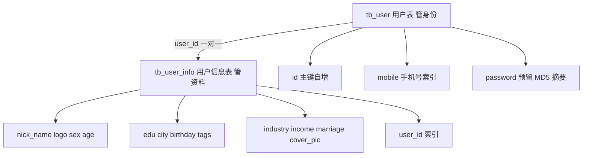
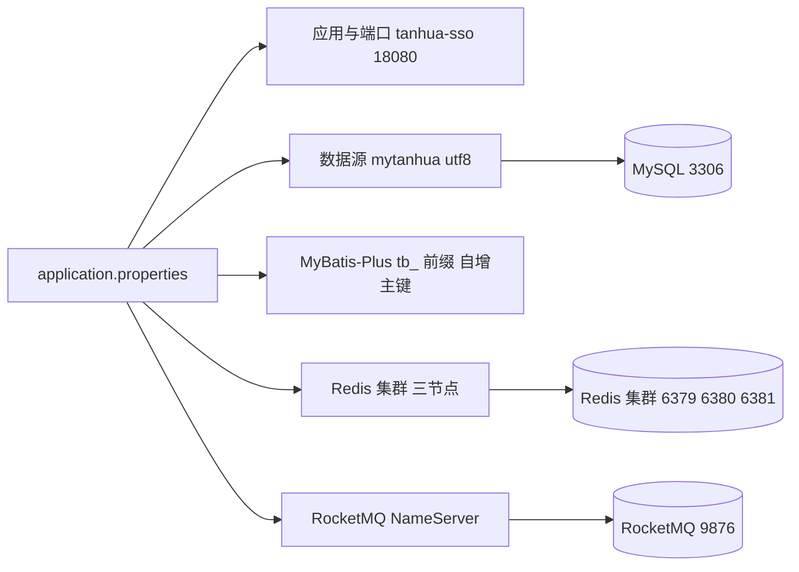

# 探花交友的数据库设计与配置文件：两张表立骨架，一份 properties 连通外围服务

> 🔒 安全提示：文中示例的口令/密钥均为课程教学环境演示口径，生产环境的安全要求见《安全与合规须知》。

工程骨架和中间件就位之后，动手写代码之前还剩两件事：把库表建出来，把配置文件写好。这两步看似机械，实际是把 sso 工程的地基图纸落到地面。表结构决定了实体类长什么样，配置文件决定了代码运行起来连到哪里。等真正跑起来再回头找配置问题，代价往往是一下午的启动报错，所以在这一步就把每一段配置的用途想清楚。

## 先给结论

- 库名 `mytanhua`，字符集 utf8；day01 只用 `tb_user` 与 `tb_user_info` 两张表，建表脚本直接用资料包的 `mytanhua.sql`。
- `tb_user` 是窄表管身份：`mobile` 建了 B+ 树索引支撑登录时的等值查询；`password` 是预留字段，验证码登录用不到，存储形态是 32 位 MD5 摘要。
- `tb_user_info` 是宽表管资料：昵称、头像、性别、年龄、学历、城市、生日等十几个展示字段，靠 `user_id` 索引与用户关联。
- `application.properties` 按用途分五段：应用与端口、数据源、MyBatis-Plus、Redis 集群、RocketMQ，表名前缀 `tb_` 与主键自增交由全局配置，实体类从此不必写表名。
- `jwt.secret` 由项目标识做一次 MD5 得到，必须换成自己的值并严格保密，泄露等于把伪造 token 的大门敞开。

## 一、建库建表：utf8 起步，两张表分工

数据库用 MySQL，在图形化客户端里新建库，名称取 `mytanhua`，字符集选 utf8。字符集这一步没有任何可妥协的余地：昵称、城市、签名全是中文，建库时没定 utf8，后面写入的中文会变成一串问号，改起来要动表动数据。

day01 涉及的表只有两张，脚本在资料包的 `mytanhua.sql` 里。用户表走读一遍：

```sql
CREATE TABLE `tb_user` (
  `id` bigint(20) NOT NULL AUTO_INCREMENT,
  `mobile` varchar(11) DEFAULT NULL COMMENT '手机号',
  `password` varchar(32) DEFAULT NULL COMMENT '密码，需要加密',
  `created` datetime DEFAULT NULL,
  `updated` datetime DEFAULT NULL,
  PRIMARY KEY (`id`),
  KEY `mobile` (`mobile`) USING BTREE
) ENGINE=InnoDB DEFAULT CHARSET=utf8 COMMENT='用户表';
```

字段不多，每个都有明确的理由。主键 id 自增；mobile 定长 varchar(11)，正好装下国内手机号，上面建普通索引，因为「根据手机号查询」是整个系统出现频率最高的查询之一，登录、发码、找用户都要走它，索引让等值查询落在 B+ 树上而不是全表扫描。password 这一段值得多说两句：课程选的是验证码登录，密码在这条链路里完全用不上，但项目要为后续业务扩展预留能力，比如账号密码登录、第三方账号绑定后的凭证兜底，所以字段留着；既然存密码，就必须存摘要而不是明文，varchar(32) 正好对应 MD5 输出转十六进制的长度。created 与 updated 是所有表通用的审计字段，出问题时靠它们还原数据的新旧。

用户信息表是另一个极端，字段一下子多起来：

```sql
CREATE TABLE `tb_user_info` (
  `id` bigint(20) NOT NULL AUTO_INCREMENT,
  `user_id` bigint(20) NOT NULL COMMENT '用户id',
  `nick_name` varchar(50) DEFAULT NULL COMMENT '昵称',
  `logo` varchar(100) DEFAULT NULL COMMENT '用户头像',
  `tags` varchar(50) DEFAULT NULL COMMENT '用户标签：多个用逗号分隔',
  `sex` tinyint(1) DEFAULT '3' COMMENT '性别，1-男，2-女，3-未知',
  `age` int(11) DEFAULT NULL COMMENT '用户年龄',
  `edu` varchar(20) DEFAULT NULL COMMENT '学历',
  `city` varchar(20) DEFAULT NULL COMMENT '居住城市',
  `birthday` varchar(20) DEFAULT NULL COMMENT '生日',
  `cover_pic` varchar(50) DEFAULT NULL COMMENT '封面图片',
  `industry` varchar(20) DEFAULT NULL COMMENT '行业',
  `income` varchar(20) DEFAULT NULL COMMENT '收入',
  `marriage` varchar(20) DEFAULT NULL COMMENT '婚姻状态',
  `created` datetime DEFAULT NULL,
  `updated` datetime DEFAULT NULL,
  PRIMARY KEY (`id`),
  KEY `user_id` (`user_id`)
) ENGINE=InnoDB DEFAULT CHARSET=utf8 COMMENT='用户信息表';
```

昵称、头像、性别、年龄、学历、城市、生日，再加上封面图、行业、收入、婚姻状态，全是展示与推荐要用的资料属性。两张表通过 user_id 一对一关联，索引就建在这列上。按功能拆成窄表与宽表，逻辑很直接：认证相关的数据稳定少变、访问频率极高，资料相关的数据演化频繁、字段随时可能增减，拆开后两边互不拖累。执行完建表语句，刷新一下能看到两张表已经就位，此刻还是空表，资料包脚本里的种子数据按需全量导入即可。



图里把两张表的职责和关键索引摆在一起：窄表三个业务字段加索引就撑起登录链路，宽表十几个字段全部围绕「展示一个人」。

## 二、配置文件：application.properties 的五段式

配置文件建在 sso 工程的 `src/main/resources` 下，文件名 `application.properties`，这是 Spring Boot 约定会自动加载的位置。应用名直接取业务名，服务端口 18080：

```properties
spring.application.name = tanhua-sso
server.port = 18080
```

往下是数据源。驱动类、连接串、账号密码三项，URL 后面挂了一串参数，每一个都有用：

```properties
spring.datasource.driver-class-name=com.mysql.jdbc.Driver
spring.datasource.url=jdbc:mysql://127.0.0.1:3306/mytanhua?useUnicode=true&characterEncoding=utf8&autoReconnect=true&multiQueries=true&useSSL=false
spring.datasource.username=root
spring.datasource.password=123456
```

`useUnicode` 与 `characterEncoding=utf8` 和建库时的 utf8 呼应，连接层与存储层字符集一致才不会乱码；`autoReconnect` 让断线后自动重连；`multiQueries` 允许一次提交多条语句；`useSSL=false` 关闭本地开发用不上的加密握手。账号密码按课程环境如实写，root 加 123456。

第三段是 MyBatis-Plus 的全局配置，也是这份配置里对后续代码影响最深的一段：

```properties
# 枚举扫描包
mybatis-plus.type-enums-package=com.study.tanhua.sso.enums
# 表名前缀
mybatis-plus.global-config.db-config.table-prefix=tb_
# id 策略为自增
mybatis-plus.global-config.db-config.id-type=auto
```

`table-prefix` 配成 `tb_` 之后，实体类只需要叫 `User`，框架拼表名时自动补前缀得到 `tb_user`，类上不再需要写表名注解。`id-type=auto` 对应建表时的自增主键，插入时主键交给数据库生成。`type-enums-package` 指向马上要建的枚举包，性别这类有限取值的字段用枚举类型承接，框架负责枚举与数据库数值之间的转换。

第四段 Redis。注意这里配的不是单机，而是集群：

```properties
# Redis 集群
spring.redis.jedis.pool.max-wait=5000ms
spring.redis.jedis.pool.maxIdle=100
spring.redis.jedis.pool.minIdle=10
spring.redis.timeout=10s
spring.redis.cluster.nodes=192.168.31.81:6379,192.168.31.81:6380,192.168.31.81:6381
spring.redis.cluster.max-redirects=5
```

三个节点就是前面部署 Redis 集群时起的那组端口。集群模式下数据按槽位分布，客户端访问的节点上没有目标 key 时会返回重定向，`max-redirects=5` 限定一次操作最多跳转五次，防止环状重定向把请求吊死。连接池的 maxIdle 与 minIdle 控制空闲连接的上下限，max-wait 是拿连接时的最长等待。

第五段 RocketMQ，只需两项：NameServer 地址指向消息中间件部署机的 9876 端口，生产者分组取业务名 tanhua。键名以课程画面为准写成 `spring.rocketmq.nameServer`，不同版本的 rocketmq-spring-boot-starter 键前缀略有差异，以所引依赖的自动配置为准：

```properties
spring.rocketmq.nameServer=192.168.31.81:9876
spring.rocketmq.producer.group=tanhua
```



这张图是配置文件与外围服务的一一映射：五段配置各管一条连线，任何一段写错，对应的服务在启动或运行时立刻暴露问题，这也正是排查配置故障时的定位思路。

## 三、jwt.secret 与第三方服务的占位

配置文件末尾还有一类特殊条目。生成 token 用的是 JWT，签发时要有一个密钥参与签名：

```properties
# 值已打码：32 位十六进制摘要，需自行生成
jwt.secret=76bd****3df1
```

这个 secret 的来历是把一个项目标识字符串做一次 MD5，得到 32 位十六进制串。课程用它演示生成思路，真正落到自己的项目里，这个值必须换掉并且不能提交到公共仓库。原因在 JWT 的机制本身：token 由头部、载荷、签名三段组成，签名就是用这个 secret 算出来的，谁能拿到 secret，谁就能给任意用户签发合法 token，等于把整个认证体系的根钥匙交了出去。课程里反复强调不许泄露，道理就在这。

再往后是人脸识别服务的配置占位，应用 ID、密钥等几个键先空着，讲到人脸识别那一节再去开放平台注册账号、创建应用后把值填回来。现在留占位的好处是配置结构一次定型，后面补值即可，不用再改配置的骨架。

## 四、多环境组织：一份配置的进化方向（补充）

课程演示环境单一，所有配置直接写在 `application.properties` 里，开发期这样最省事。工程化之后更常见的做法是按环境拆文件：主配置只留 `spring.profiles.active` 指定激活的环境，环境差异项分散到 `application-dev.properties` 与 `application-prod.properties`，数据库地址、Redis 节点、日志级别这类天然不同的项各自维护。习惯 yml 的话，等价写法如下，层级缩进代替了键前缀：

```yaml
spring:
  datasource:
    driver-class-name: com.mysql.jdbc.Driver
    url: jdbc:mysql://127.0.0.1:3306/mytanhua?useUnicode=true&characterEncoding=utf8
    username: root
    password: 123456
  redis:
    cluster:
      nodes: 192.168.31.81:6379,192.168.31.81:6380,192.168.31.81:6381
      max-redirects: 5
```

两种格式 Spring Boot 都认，团队统一一种即可。拆不拆环境不取决于项目大小，取决于这套配置会不会出现在第二种机器上，一旦要上线，拆分几乎是必然动作。

## 常见误区

- **建库忘了字符集。** 错例：默认字符集建库，导入数据后中文昵称全是问号。正解：建库时指定 utf8，连接串再带 `characterEncoding=utf8`，两端一致才安全。
- **表名前缀与实体类两头都管。** 错例：全局配了 `table-prefix=tb_`，实体上又写死表名，或者反过来漏配前缀导致启动时报表不存在。正解：前缀只在一处约定，配了全局前缀就让实体类名保持业务名。
- **Redis 集群按单机写法配。** 错例：只写 host 与 port，启动后操作报集群重定向异常。正解：集群模式必须用 `spring.redis.cluster.nodes` 列出全部节点，并给 `max-redirects` 一个合理上限。
- **secret 用别人的值还提交进仓库。** 错例：`jwt.secret` 沿用课件里的原值并推到公共仓库。正解：自己生成 32 位摘要，放进私有配置或不进版本库，泄露立即轮换。

## 面试可能被问到的问题

1. 面试官追问：「用户表和用户信息表为什么要拆成两张？」
   答：tb_user 只留认证必需的窄字段，访问频率极高且结构稳定；tb_user_info 承载昵称头像等十几个展示字段，演化频繁。拆开后高频的登录查询只碰窄表，资料变更不影响认证链路，两表靠 user_id 一对一关联。
2. 面试官追问：「mobile 字段为什么建索引？用唯一索引还是普通索引？」
   答：手机号是登录、发码、查用户等高频操作的查询条件，建索引避免全表扫描。业务上一个手机号只应注册一个账号，用唯一索引能同时约束数据正确性；课程脚本给的是普通索引，工程上应结合业务约束升级为唯一索引。
3. 面试官追问：「password 字段在验证码登录里用不到，为什么还要存 MD5？」
   答：为后续扩展预留，比如账号密码登录或绑定凭证。存摘要不存明文是底线，MD5 输出 128 位，转十六进制正好 32 字符，与 varchar(32) 对应。工程上还会加盐或改用 BCrypt 等慢哈希，抵御彩虹表与撞库。
4. 面试官追问：「Redis 集群配置里的 max-redirects 是干什么的？」
   答：集群按槽位分布数据，客户端请求落到错误节点时会收到重定向响应，max-redirects 限定单次操作允许的最大跳转次数。不设上限的极端情况是节点间互相重定向形成循环，请求一直得不到结果，设一个 5 这样的上限能让它快速失败。
5. 面试官追问：「jwt.secret 泄露会发生什么？怎么防范？」
   答：JWT 的签名由 secret 计算，拿到 secret 就能为任意用户签发合法 token，等于绕过整个登录体系。防范上，secret 不进公共仓库、按环境独立、定期轮换，泄露后立即更换使已签发 token 全部失效。
6. 面试官追问：「properties 和 yml 两种配置格式怎么选？」
   答：表达能力等价，yml 层级清晰、适合结构深的配置，properties 直白、适合项少且平的场景。同一工程二选一并全团队统一，避免两份文件同时存在造成覆盖关系难以追踪。

## 配套资料

- 数据库：`materials/code/07/day01 探花交友-项目搭建以及登录完善个人信息/day01/代码/mytanhua.sql`，tb_user 与 tb_user_info 的真实建表脚本，含种子数据，可全量导入复现课程环境。
- 学习目标：`materials/code/07/day01 探花交友-项目搭建以及登录完善个人信息/day01/学习目标.md`。
- 讲义：`materials/docs/07/` 不存在，本阶段无讲义文本，配置以课程画面为准。
- 说明：day01 资料包无工程源码，配置示例按课程画面逐项整理；包名按规范改写为 `com.study.tanhua`；`jwt.secret` 等敏感值已打码，多环境与 yml 部分为按课程写法补全的示例。
