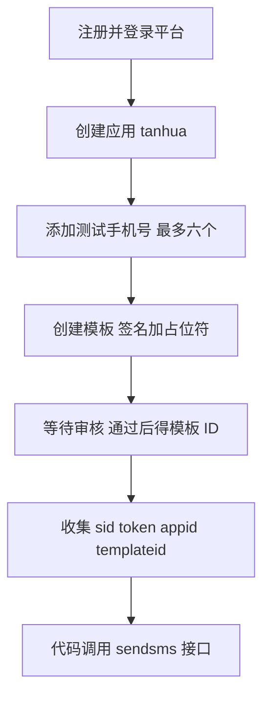

# 探花交友的短信验证码下发：对接云之讯平台与 RestTemplate 调用

验证码登录的第一环是把验证码真实地发到用户手机上。平台选型、模板审核、密钥管理这些前置步骤绕不开，代码本身反而只有几十行。常见的手忙脚乱是反向的：代码写完发现模板没过审、密钥填错、响应中文乱码，一个个回头补。按平台侧配置、接口契约、代码实现、真机验证的顺序走一遍，每一步的坑都提前亮出来。

## 先给结论

- 短信平台选用云之讯（ucpaas），发送走 REST 接口 `https://open.ucpaas.com/ol/sms/sendsms`，提交 sid、token、appid、templateid、mobile、param 六个参数，响应 code 为 `000000` 即下发成功。
- 未上线的应用只能给控制台绑定的测试手机号发短信，最多六个；正式对用户开放需要走上线流程。
- 模板由签名加内容构成，签名取「探花交友」，内容里的 `{1}` 是占位符，调用时由 param 参数替换成 6 位验证码；模板提交后要等审核，通过后才有模板 ID。
- RestTemplate 配置类把字符串转换器换成 UTF-8 并设置 5 秒超时；`SmsService` 负责拼参数、发请求、解析响应，把本次生成的验证码返回给上层。
- 下发与存码分离：`SmsService` 只管真实发送并交回验证码，验证码写 Redis 由接口服务层完成，两层职责不混；sid 与 token 是账户级凭证，一律打码处理，不进前端、不进公共仓库。

## 一、平台侧准备：应用、测试号码与模板

平台的控制台操作先于代码。注册账号登录后，进账户中心的应用管理创建一个应用，名字随意，课程里就叫 tanhua。创建完成别急着写代码，有一个限制要先弄清：应用处于未上线状态时，短信只能发给控制台里绑定的测试手机号，最多添加六个。开发期把测试用的手机号加进去即可，上线审核通过后才会对真实用户开放。

模板是短信的正文骨架，在短信的模板库里点创建模板：签名填「探花交友」，正文写「您的验证码是{1}，如非本人操作请忽略」。`{1}` 是占位符，代表变量，调用接口时用 param 参数替换它。提交后模板进入待审核状态，大约半小时内出结果，审核通过会有短信通知，同时拿到一个模板 ID，课程环境里是 487656。整个准备过程串起来是五步：



关键路径在 F 这一步：四个凭证分散在控制台的不同页面，应用管理里拿 appid，账户信息里拿 sid 与 token，token 需要验证手机后才会展示，模板库里拿 templateid。收集齐之后代码才有得写。

## 二、接口契约：一个 POST 请求与 000000

发送短信的 API 是一个 HTTP POST，请求体是 JSON，参数含义如下：

| 参数 | 含义 | 来源 |
|---|---|---|
| sid | 账户 ID | 控制台账户信息 |
| token | 账户令牌 | 控制台验证手机后查看 |
| appid | 应用 ID | 应用管理对应应用 |
| templateid | 模板 ID | 审核通过的模板 |
| mobile | 接收手机号 | 请求入参 |
| param | 替换占位符的内容 | 服务端生成的 6 位验证码 |

响应同样是 JSON，`code` 为 `000000` 代表下发成功，其余状态码按文档对照排查，平台文档里列有完整的状态码表。注意 param 的方向：它不叫验证码，叫参数，因为模板是通用的，`{1}` 处放什么都行，放验证码只是它在本项目的用途。生成用 commons-lang3 的 `RandomUtils.nextInt(100000, 999999)`，区间下限保证结果是六位数，不会出现前导零丢失的问题。

## 三、RestTemplate 配置：编码与超时两件事

发 HTTP 请求用 Spring Boot 自带的 `RestTemplate`。它默认就能用，但直接拿来发短信会在两个地方栽跟头：默认的字符串转换器编码是 ISO-8859-1，中文参数会乱；默认没有超时限制，平台一旦响应慢，调用线程会被一直占住。配置类把两件事一起解决：

```java
package com.study.tanhua.sso.config;

import org.springframework.context.annotation.Bean;
import org.springframework.context.annotation.Configuration;
import org.springframework.http.client.ClientHttpRequestFactory;
import org.springframework.http.client.SimpleClientHttpRequestFactory;
import org.springframework.http.converter.StringHttpMessageConverter;
import java.nio.charset.Charset;

@Configuration
public class RestTemplateConfig {

    @Bean
    public RestTemplate restTemplate(ClientHttpRequestFactory factory) {
        RestTemplate restTemplate = new RestTemplate(factory);
        // 把字符串转换器替换为 UTF-8，避免中文乱码
        restTemplate.getMessageConverters().set(1, new StringHttpMessageConverter(Charset.forName("UTF-8")));
        return restTemplate;
    }

    @Bean
    public ClientHttpRequestFactory simpleClientHttpRequestFactory() {
        SimpleClientHttpRequestFactory factory = new SimpleClientHttpRequestFactory();
        factory.setReadTimeout(5000);  // 读超时，单位 ms
        factory.setConnectTimeout(5000); // 连接超时，单位 ms
        return factory;
    }
}
```

转换器列表按下标替换看起来生硬，但这里是刻意的：下标 1 的位置原本是默认字符串转换器，用同位置的 UTF-8 版本换掉它，其他转换器的顺序不受影响。读写各给 5 秒超时，第三方接口的可用性不在自己的控制范围内，快速失败让上层有机会走降级逻辑，比如提示用户稍后再试，而不是让请求无限悬挂。

## 四、SmsService：拼参数、发请求、解析响应

服务层一个类、一个方法：

```java
package com.study.tanhua.sso.service;

import com.fasterxml.jackson.databind.JsonNode;
import com.fasterxml.jackson.databind.ObjectMapper;
import org.apache.commons.lang3.RandomUtils;
import org.apache.commons.lang3.StringUtils;
import org.springframework.beans.factory.annotation.Autowired;
import org.springframework.http.ResponseEntity;
import org.springframework.stereotype.Service;
import org.springframework.web.client.RestTemplate;
import java.util.HashMap;
import java.util.Map;

@Service
public class SmsService {

    private static final ObjectMapper MAPPER = new ObjectMapper();

    @Autowired
    private RestTemplate restTemplate;

    public String sendSms(String mobile) {
        String url = "https://open.ucpaas.com/ol/sms/sendsms";
        Map<String, Object> params = new HashMap<>();
        params.put("sid", "******");          // 账户 ID，已打码
        params.put("token", "******");        // 账户令牌，已打码
        params.put("appid", "******");        // 应用 ID，已打码
        params.put("templateid", "487656");   // 审核通过的模板 ID
        params.put("mobile", mobile);
        // 生成 6 位验证码
        params.put("param", RandomUtils.nextInt(100000, 999999));
        ResponseEntity<String> responseEntity = this.restTemplate.postForEntity(url, params, String.class);
        String body = responseEntity.getBody();
        try {
            JsonNode jsonNode = MAPPER.readTree(body);
            // 000000 表示发送成功
            if (StringUtils.equals(jsonNode.get("code").textValue(), "000000")) {
                return String.valueOf(jsonNode.get("param"));
            }
        } catch (Exception e) {
            e.printStackTrace();
        }
        return null;
    }
}
```

参数用 Map 承载，`RestTemplate` 的 `postForEntity` 会自动把 Map 序列化成 JSON 提交，省掉手工拼字符串。响应体是字符串，用 Jackson 的 `readTree` 解析成树，取 code 字段与 `000000` 比对。成功时返回的值值得停一下：返回的是本次下发的验证码，也就是响应里回传的 param。方法签名返回 String 而不是 boolean，为的是把验证码交给上层存 Redis，发送动作与存码动作因此分属两层，`SmsService` 保持纯粹的「对第三方发短信」职责，将来换平台只动这一个类。失败或异常统一返回 null，语义交给上层解释。

## 五、发送侧的防线：限频与凭证

真实业务里，发送验证码的接口是刷子最爱光顾的地方，费用按条计，被刷就是真金白银。防线分几层：前端 50 秒倒计时挡住正常用户的重复点击，这只是体验层；服务端对同一手机号要有真正的频率限制，本项目的做法是验证码未失效期间不重发，同一手机号同时只存在一个有效验证码，实现落在接口服务层；更严格的还要加每日上限与图形验证码前置。凭证安全同样属于发送侧：sid 与 token 是账户凭证，绝不能下发到前端代码或打包进客户端，服务端保管、配置打码是底线。

## 六、跑通第一条短信

写一个测试用例验证整条链路，测试类放在 test 目录，包名与被测服务一致：

```java
package com.study.tanhua.sso.service;

import org.junit.Test;
import org.junit.runner.RunWith;
import org.springframework.beans.factory.annotation.Autowired;
import org.springframework.boot.test.context.SpringBootTest;
import org.springframework.test.context.junit4.SpringRunner;

@RunWith(SpringRunner.class)
@SpringBootTest
public class TestSmsService {

    @Autowired
    private SmsService smsService;

    @Test
    public void testSend() {
        String code = this.smsService.sendSms("158****7941");
        System.out.println(code);
    }
}
```

`@SpringBootTest` 拉起完整上下文，`@RunWith(SpringRunner.class)` 让 JUnit 与 Spring 容器协作，于是 `SmsService` 能正常注入。手机号填控制台绑定过的测试号码，运行后控制台打印出本次验证码，同时手机收到短信，两串数字一致即整条链路打通。课程里这次运行打印的是一串六位数字，手机收到的短信内容正是模板里的文案加这串数字。收不到短信时按固定路径排查：先看响应 code 是不是 `000000`，再核手机号是否在测试名单里，最后确认模板状态是不是审核通过。

## 常见误区

- **未上线应用给任意手机号发码。** 错例：代码调通前拿自己的手机号直接测，响应非 `000000`。正解：未上线应用只能发给控制台绑定的测试手机号，先把号码加进名单。
- **模板没过审就调用接口。** 错例：模板刚提交就写代码联调，一直报发送失败。正解：模板有审核周期，通过后才能拿到可用的模板 ID，准备工作提前做。
- **沿用默认编码与无超时的 RestTemplate。** 错例：请求里的中文乱码，或平台抖动时调用线程长期阻塞。正解：替换 UTF-8 字符串转换器，显式设置连接与读超时。
- **在 sendSms 里顺手存 Redis。** 错例：发送与存储耦合在一个方法里，换平台或改存储策略时牵一发动全身。正解：发送层只返回验证码，存码与有效期由接口服务层负责。

## 面试可能被问到的问题

1. 面试官追问：「为什么用 RestTemplate 而不是直接用平台 SDK？」
   答：该平台对接的是一个简单的 HTTP POST 加 JSON 参数，RestTemplate 配合 Map 就能完成，不引入额外依赖；SDK 通常封装签名、重试，适合接口复杂或平台官方主推的场景。两者取舍看接口复杂度与维护成本。
2. 面试官追问：「RestTemplate 的默认字符串转换器有什么问题？」
   答：默认的 StringHttpMessageConverter 编码是 ISO-8859-1，请求或响应里出现中文会乱码。做法是在配置类里用同下标替换为指定 UTF-8 的转换器，同时保留其他转换器顺序，超时也一并在配置类里通过 request factory 设置。
3. 面试官追问：「验证码随机数怎么生成，有哪些安全考量？」
   答：课程用 commons-lang3 的 RandomUtils 在 100000 到 999999 之间取值，保证六位无前导零。安全上更严谨的做法是用 SecureRandom 提升随机强度，避免被猜测；同时配合有效期、错误次数限制与限频，缩短单码可尝试窗口。
4. 面试官追问：「短信发送的限频应该怎么设计？」
   答：分多层。前端倒计时只防误触；服务端对同一手机号设发送间隔，未失效的验证码存在期间不重发；再按手机号与 IP 设每日上限；必要时叠加图形验证码或行为验证。服务端限频状态放 Redis，天然带过期，跨实例共享。
5. 面试官追问：「sid、token 这类平台凭证怎么管理？」
   答：只保存在服务端，用配置中心或环境变量注入，不硬编码进源码与客户端包，仓库里打码或占位；按环境隔离，泄露后立即在平台侧重置。模板 ID、appid 属于标识类信息，敏感度低于 token，但同样不建议写死在多处。

## 配套资料

- 学习目标：`materials/code/07/day01 探花交友-项目搭建以及登录完善个人信息/day01/学习目标.md`，其中明确列出掌握发送短信验证码这一目标。
- 讲义：`materials/docs/07/` 不存在，本阶段无讲义文本，接口契约与代码以课程画面为准。
- 说明：day01 资料包无工程源码，`RestTemplateConfig` 与 `SmsService` 按课程画面逐行整理，画面未及的异常分支按上下文补全；包名改写为 `com.study.tanhua`；sid、token、appid 等凭证已打码；第三方平台为云之讯（ucpaas）真实接口，测试手机号已脱敏。
