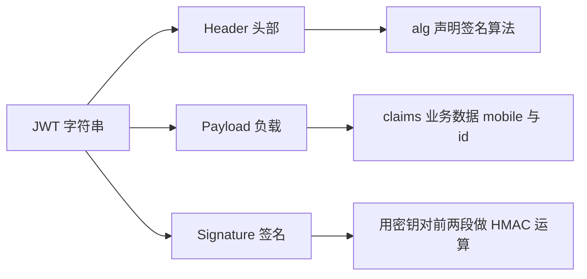
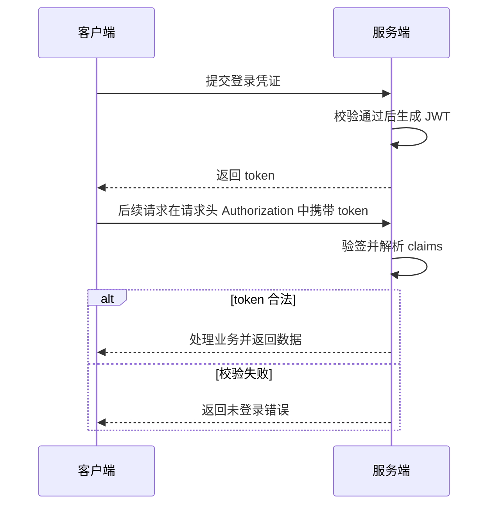

# JWT 快速入门：三段结构、签名防篡改与 jjwt 的生成解析

> 🔒 安全提示：文中示例的口令/密钥均为课程教学环境演示口径，生产环境的安全要求见《安全与合规须知》。

验证码能发到手机了，登录真正的难题在后面：服务端怎么「记住」这个用户？最朴素的方案是生成一个随机串存 Redis，之后每个请求都拿着串来查。但随机串本身不携带任何信息，谁拿到了都能用，服务端也必须查一次存储才知道来者是谁。JWT 就是给 token 定的一个行业标准，把身份信息直接编进 token 并附上防篡改签名，这一节用最小的代码把它跑起来。

## 先给结论

- JWT 全称 JSON Web Token，最终是一个字符串，三段式结构 `头部.负载.签名`，两处点号分隔。
- 头部声明签名算法（如 HS256），负载放业务数据也就是 claims（本项目放 mobile 与 id），签名用密钥对前两段做 HMAC 计算，改动任何字符都会校验失败。
- 前两段只是 Base64Url 编码而非加密，内容任何人可读，敏感信息绝不能放进去。
- jjwt 0.9.1 两个入口够入门：`Jwts.builder()` 生成，`Jwts.parser()` 验签解析；密钥不知道就解不出，密钥泄露等于任何人可伪造合法 token。
- 与 Redis token 相比 JWT 自包含、无状态，但无法主动失效；本项目两者结合，JWT 承载身份，Redis 负责有效期控制。

## 一、三段结构：每一段放什么

一个 JWT 长这样：`eyJhbGciOiJIUzI1NiJ9.eyJtb2JpbGUiOiIxMjM0NTY3ODkifQ.xZ3...`，三段各自的职责如下：



头部与负载都是 JSON 再做 Base64Url 编码，任何人在浏览器或抓包工具里都能解开看，所以它解决的是「防篡改」而不是「保密」：攻击者把负载里的 id 改成别人再发过来时，服务端用密钥重算出的签名与第三段对不上，请求被拒绝。签名这一段才是整个机制的安全支点，而它的前提只有一个，密钥不泄露。

防篡改的验证成本极低：服务端不查任何存储，本地一次 HMAC 运算就能确认「这个 token 是我签发的且内容没被改过」，这正是它与随机串方案的本质区别。

## 二、流程：token 放请求头，不放参数

JWT 的使用流程里有一个容易做错的位置问题：



token 不作为业务参数随表单提交，而是放进 HTTP 请求头（规范位置是 `Authorization`），服务端从请求头取出后验签解析。放在头里的好处是它与业务参数解耦，拦截器、网关都能在进入业务逻辑之前统一完成校验，业务代码不必到处写取参判断。

## 三、jjwt 生成与解析的最小示例

引入依赖，版本以课程画面为准：

```xml
<dependency>
    <groupId>io.jsonwebtoken</groupId>
    <artifactId>jjwt</artifactId>
    <version>0.9.1</version>
</dependency>
```

写一个测试用例，把生成与解析两个动作各走一遍，掌握了这两步，JWT 的日常使用就够用了：

```java
package com.study.tanhua.sso.service;

import io.jsonwebtoken.Jwts;
import io.jsonwebtoken.SignatureAlgorithm;
import java.util.HashMap;
import java.util.Map;

public class TestJWT {

    public static void main(String[] args) {
        String secret = "example-secret"; // 签名密钥，生产环境从配置读取并妥善保管
        Map<String, Object> claims = new HashMap<>();
        claims.put("mobile", "12345789");
        claims.put("id", "2");
        // 生成token
        String jwt = Jwts.builder()
                .setClaims(claims) // 设置响应数据体
                .signWith(SignatureAlgorithm.HS256, secret) // 设置加密方法和加密盐
                .compact();
        System.out.println(jwt);

        // 解析token
        Map<String, Object> body = Jwts.parser()
                .setSigningKey(secret)
                .parseClaimsJws(jwt)
                .getBody();
        System.out.println(body);
    }
}
```

运行 `main` 方法，控制台先打印生成的 token，肉眼就能数出三个点号分隔的段落；随后打印解析结果 `{mobile=12345789, id=2}`，与存进去的 claims 完全一致。解析时 `setSigningKey` 传入的密钥必须与签发时一致，否则抛出签名校验异常，这也现场验证了那句话：不知道密钥，解析不出来。

密钥不该写在代码里，放进配置文件统一管理：

```yaml
jwt:
  secret: example-secret
```

## 四、与 Redis token 的对比，以及一个真实的坑

**第一，有状态与无状态的取舍。** 随机串方案里，token 只是一把钥匙，用户身份在服务端存储里，想踢掉一个用户就删掉那把钥匙，天然支持注销、改密、封号；JWT 把身份写在票面上，服务端不用查库就能验票，分布式网关下扩容友好，代价是票一旦签出就在有效期内一直有效，主动作废需要额外机制。两者的长短正好互补。

**第二，本项目的组合用法。** 探花交友的登录会把 JWT 与 Redis 一起用：JWT 承载 mobile 与 id 供下游解析，Redis 再存一份 token 与用户信息用于控制有效期和主动失效，登录逻辑的编写在下一节展开。记住一个判断：只求无状态轻量就用纯 JWT，需要踢人能力就必须有服务端存储参与。

**第三，版本坑。** jjwt 0.9.1 依赖 `javax.xml.bind`，JDK 8 上直接可用，JDK 9 及以上会抛 `NoClassDefFoundError: javax/xml/bind/DatatypeConverter`，需要补 jaxb 相关依赖或升级 jjwt 到 0.11 之后的新 API。课程环境按 JDK 8 演示，迁移老项目时这里经常踩。

## 常见误区

- **把 JWT 当加密手段。** 错例：以为负载里的手机号别人看不见。正解：前两段只是编码，解开即读，JWT 提供的是完整性保护，保密要靠 HTTPS 与内容设计。
- **密钥硬编码或用弱密钥。** 错例：密钥写成 `"secret"` 提交进代码仓库。正解：密钥进配置并区分环境，长度足够、定期轮换，泄露即全体 token 可伪造。
- **负载里塞敏感信息。** 错例：把密码、身份证号放进 claims。正例：只放路由身份所需的最小字段，如 mobile 与 id，更多信息按需查库。
- **以为 JWT 天然支持注销。** 错例：用户退出登录就认为 token 失效了。正解：token 本身仍然合法，必须配合服务端黑名单或删除 Redis 副本才能做到主动失效。

## 面试可能被问到的问题

1. 面试官追问：「JWT 的三段分别是什么，哪几段能被人直接读出来？」
   答：头部声明签名算法，负载放 claims 业务数据，签名由密钥对前两段做 HMAC 得到。前两段是 Base64Url 编码，任何人可解码阅读；签名段没有密钥算不出来。所以 JWT 防篡改不防窃听，敏感字段不能进负载。
2. 面试官追问：「JWT 为什么能防篡改，攻击者改了负载会发生什么？」
   答：签名是服务端用密钥对头部与负载的原文计算的。攻击者修改负载后无法重新计算签名，因为他没有密钥；服务端验签时重算结果与第三段不一致，直接拒绝。强度取决于密钥的保密性与算法选择，HS256 对称签名够用，对外开放体系可考虑 RS256 非对称。
3. 面试官追问：「JWT 和 Session 加 Redis 的方案怎么选？」
   答：需要主动踢人、在线状态管理、会话强制下线，用 Session 加 Redis 这类有状态方案；无状态横向扩展、多端共用、跨服务认证，JWT 更合适。实践中常见组合是 JWT 管身份与验签，Redis 管有效期与失效控制，本项目就是这么做的。
4. 面试官追问：「用户改密码或注销后，已签发的 JWT 还有效怎么办？」
   答：纯 JWT 无法主动失效，必须引入服务端状态。常用做法是把 token 或用户级版本号存 Redis，校验时多查一步；改密后更新版本号使旧 token 失配，或者维护黑名单。安全要求高的系统一定有这一层。
5. 面试官追问：「jjwt 0.9.1 在 JDK 11 上运行报找不到 DatatypeConverter，为什么？」
   答：jjwt 0.9.1 内部依赖 javax.xml.bind，JDK 9 起 JAXB 从标准库移除，运行期就抛 NoClassDefFoundError。解决办法是显式补充 jaxb-api 相关依赖，或升级到 jjwt 0.11 之后按新 API 使用。
6. 面试官追问：「token 为什么放在请求头里传，而不是作为接口参数？」
   答：请求头与业务参数解耦，拦截器与网关能在业务代码之前统一验签，业务方法不用重复取参判断；同时避免 token 被写进 URL 带来的日志与代理缓存泄露风险。规范位置是 Authorization 头。

## 配套资料

- 学习目标：`materials/code/07/day01 探花交友-项目搭建以及登录完善个人信息/day01/学习目标.md`，独立完成登录功能是 day01 的目标项，JWT 是登录逻辑的前置知识。
- 说明：day01 资料包无工程源码，`TestJWT` 示例与依赖版本按课程画面逐行整理，包名统一改写为 `com.study.tanhua`，签名密钥与配置值已打码为 `example-secret`。
